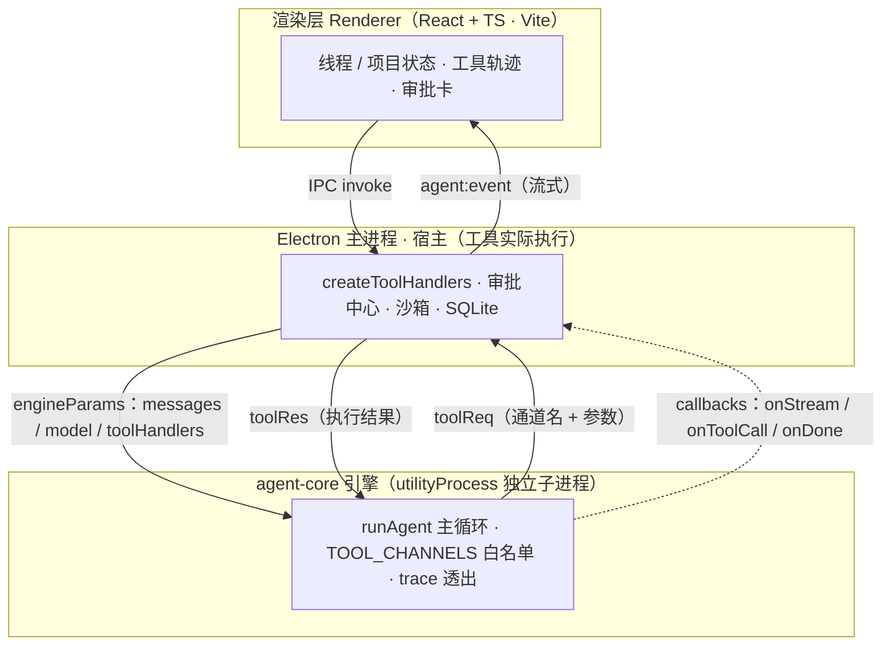
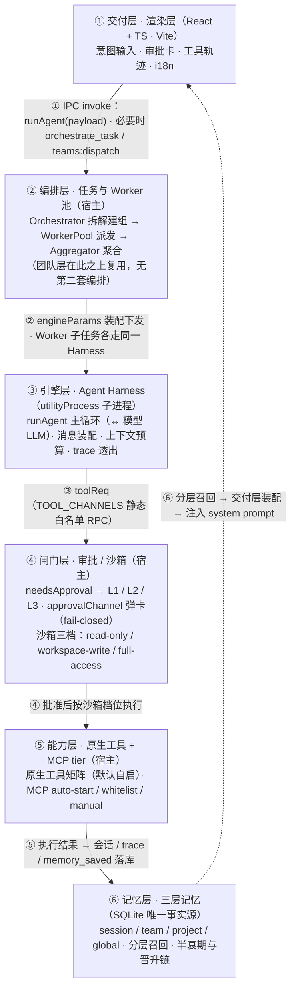
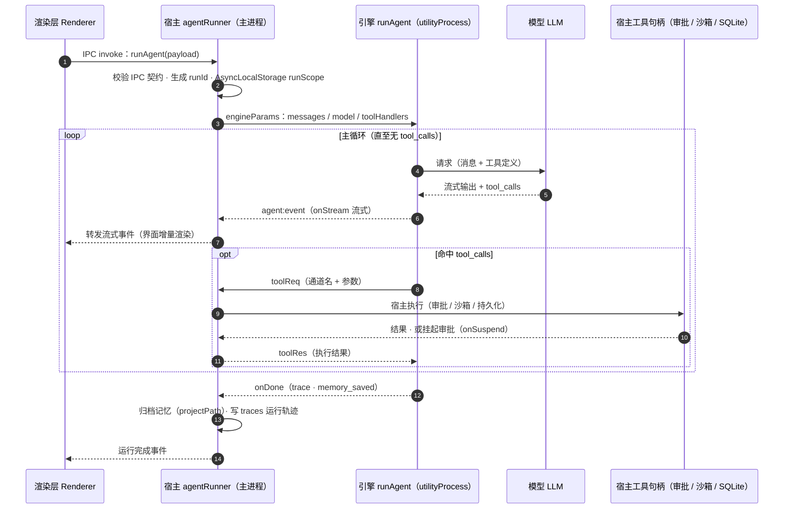
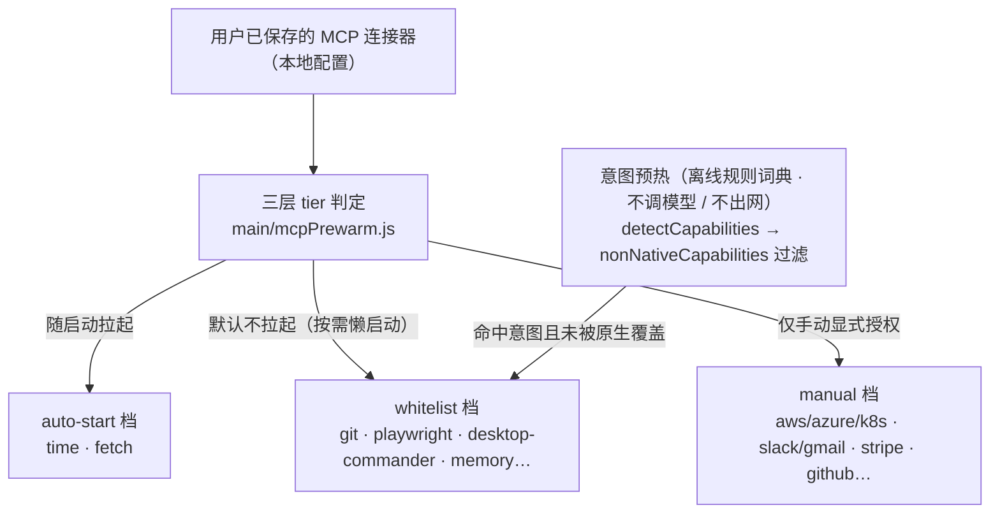
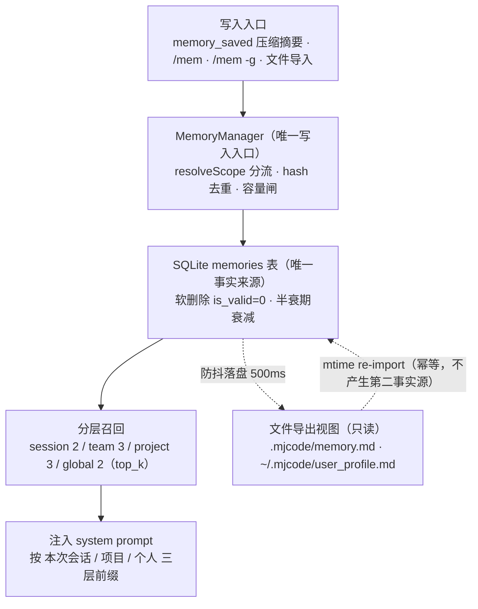
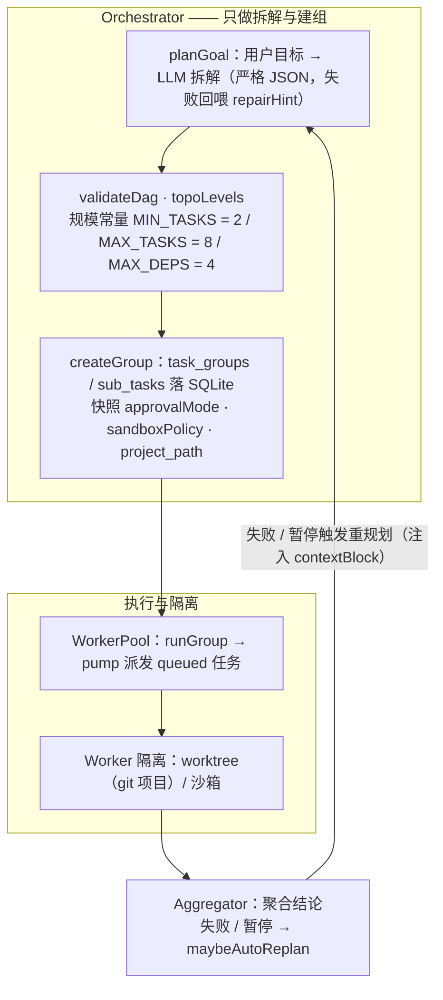
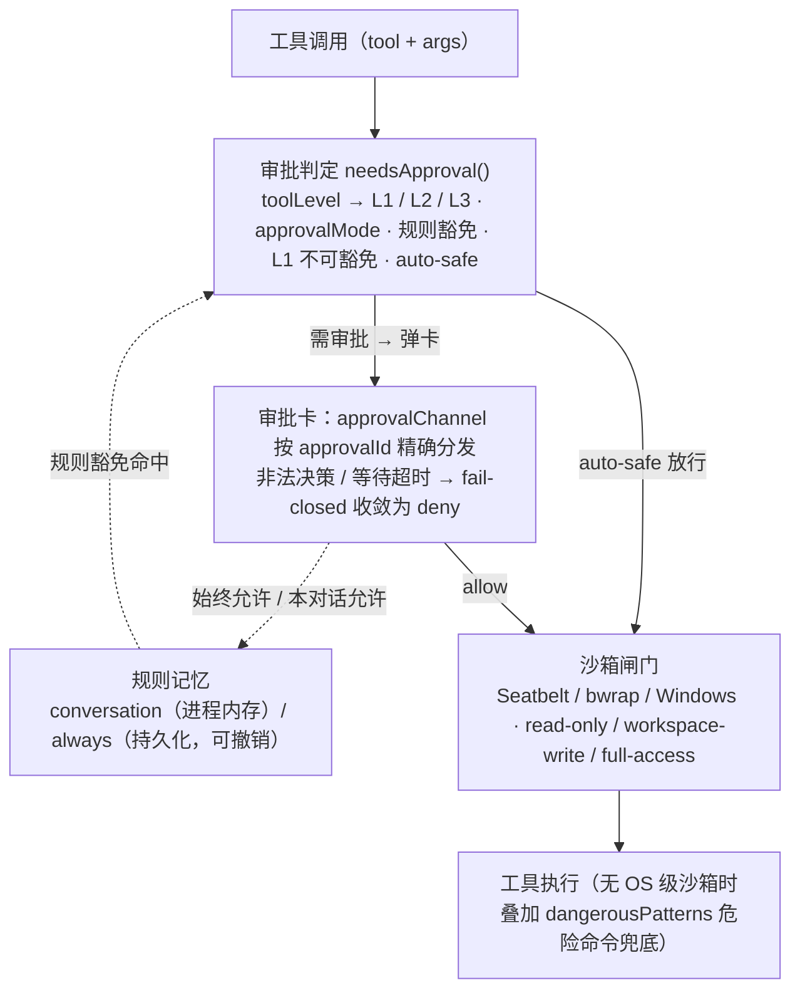

# MJ Coder 技术流程功能文档

> 本文档描述 MJ Coder（本地桌面 Agent 产品）的**完整实现思路、技术流程与功能矩阵**。
> 所有内容均取自当前仓库源码（`desktop/`），用「文件 + 函数名 / 常量名」定位，供开发、审查与验收使用。
> 文档按「完整视角」撰写，不做版本间对比。
>
> **本版为 2026-10-29 收口轮增量修订版**：在 2026-10-21「第八轮全量审查之后的增量修订版」之上，
> **只同步已落地的事实**——本轮 P0 ~ P3 全部处置完毕（代码链：`9bcfc21` P0 → `fd8b1c0` 门禁回压 →
> `f7f1ccd` P1-2 → `dedbf16` P1-1 → `04d6a04` P1-4 → `733eded` P2-2 → `4a97b57` P3-1），
> 另有五项**复核撤销**（经复核确认不需要改代码，**不是没做**，见 13.10）。
> 原有 13 章骨架、「先说人话再讲技术」的写法、两条阅读纪律**保持不变**（技术标识符一律保留英文原文）；
> 历史章节中标注为「第八轮发现 / 已知缺口」的内容按原文保留，只在必要时补一行「处置」。
>
> **两条阅读纪律**：
> 1. **数字纪律**：全篇数字都是**某一时点的快照**，不是常量。每处数字都必须能指出**取法命令**
>    （本轮的取数命令集见 12.1 与 12.4；工具面口径见 4.2；测试基线口径见 12.1）。
>    口径一律为**工作区**：现基线为 HEAD `4a97b57` + 工作区干净（`git status --short` 无输出）；
>    凡 HEAD 与工作区不一致处**两个数字都给**。
>    **同一口径在文中出现两次时，两处必须同值**——本轮更正了 §1.5 与 §4.2 的工具数、§12.1 与 §13.5 的测试数两处漂移。
> 2. **定位纪律**：一律用「文件 + 函数名 / 常量名」定位，**不使用行号**（行号随编辑即刻位移）。

### 数据来源与本轮修订说明

| 项 | 位置 / 值 |
|---|---|
| 第八轮审查报告（下称「报告」） | `docs/MJCode-AgentHarness第八轮全量审查报告与调整实现方案-2026-10-21.md` |
| 角度 A · 执行引擎与能力层 | `docs/harness-r8/02-design/审查-角度A-执行与能力层.md`（发现 `A-01` ~ `A-10`） |
| 角度 B · 编排与认知层 | `docs/harness-r8/02-design/审查-角度B-编排与认知层.md`（发现 `B-01` ~ `B-20`） |
| 角度 C · 安全、持久化与交付层 | `docs/harness-r8/02-design/审查-角度C-安全与交付层.md`（发现 `C-01` ~ `C-07`） |
| 主流技术判据 | `docs/harness-r8/01-research/主流技术基线简报.md` |
| 审查基线 HEAD | `24acc1531f55d70d8f591f0435d48eb114fbf3d0`（工作区另有 99 项未提交改动） |
| 收口轮代码基线 HEAD | `4a97b57`（`P3-1: MCP 工具进度全链路…`），工作区干净（`git status --short` 无输出） |
| 本轮落地与撤销清单 | §13.10「2026-10-29 收口轮：P0 ~ P3 落地与复核撤销」 |

> **读法约定**：文中的 `A-x` / `B-x` / `C-x` 是第八轮的**发现编号**（字母代表来源角度），`报告 D-8xx` 是**决策编号**。
> 它们指向可复核的结论，不是待办清单；发现编号的严重度见报告 §3，本文不重复搬运。
>
> **编号体系消歧（2026-10-29 起）**：`A-x` / `B-x` / `C-x` 是**发现编号**（第八轮，指向「问题是什么」）；
> `P0-x` ~ `P3-x` 是**修复项编号**（收口轮，指向「这次改了什么」），两者**不是同一体系**，不可互相引用为证据。
> 修复项有两种处置：**落地**（改了代码）与**撤销**（经复核确认不需要改代码，理由随项写明）——见 13.10。

---

## 章节导航

- [一、产品定位与整体架构](#一产品定位与整体架构)
- [二、引擎进程隔离（engineProcess）](#二引擎进程隔离engineprocess)
- [三、Agent Harness 执行流](#三agent-harness-执行流)
- [四、原生工具矩阵与接线规范](#四原生工具矩阵与接线规范)
- [五、MCP 三层治理与意图预热](#五mcp-三层治理与意图预热)
- [六、技能、生态中心与数字员工](#六技能生态中心与数字员工)
- [七、三层记忆体系（M0 ~ M4）](#七三层记忆体系m0--m4)
- [八、任务编排与 Worker 池](#八任务编排与-worker-池)
- [九、审批、沙箱与安全约束](#九审批沙箱与安全约束)
- [十、验证层](#十验证层)
- [十一、i18n 与界面结构](#十一i18n-与界面结构)
- [十二、门禁、CI 与评估](#十二门禁ci-与评估)
- [十三、里程碑现状](#十三里程碑现状)
- [附：关键设计原则速查](#附关键设计原则速查)

### 架构图索引

| 图 | 名称 | 位置 | 表达的核心机制 |
|---|---|---|---|
| 总览图 | 系统总览 · 六大子系统全景 | [1.4 节](#14-系统总览六大子系统全景) | 交付 → 编排（含团队层）→ 引擎（↔ 模型）→ 闸门 → 能力 → 记忆的贯穿路径，以及「分层召回回注 prompt」闭环 |
| 图 1 | 三进程 + 工具 RPC | [1.3 节](#13-三进程--三层运行架构) | 渲染层 / 主进程 / 引擎三进程与 `toolReq`·`toolRes` 反向 RPC |
| 图 2 | Agent Harness 执行流时序 | [3.1 节](#31-工具调用主循环) | 主循环、流式透出、工具回调、trace 与记忆归档的时序 |
| 图 3 | MCP 三层 tier 治理 | [5.1 节](#51-三层权限模型tier) | auto-start / whitelist / manual 三档判定与意图预热接入 |
| 图 4 | 三层记忆读写路径 | [第七章](#七三层记忆体系m0--m4) | 写入分流、SQLite 唯一事实源、分层召回、文件只读视图 |
| 图 5 | 任务编排与 Worker 池流程 | [第八章](#八任务编排与-worker-池) | 拆解建组 → DAG 校验分层 → SQLite 持久化快照 → Worker 池派发与隔离 → 聚合 / 重规划回环 |
| 图 6 | 审批 / 沙箱安全闸门 | [第九章](#九审批沙箱与安全约束) | 审批判定（L1/L2/L3 · L1 不可豁免）→ 弹卡分发（fail-closed）→ 沙箱三档策略 → 危险命令兜底 |

---

## 一、产品定位与整体架构

> **大白话**：MJ Coder 是一个装在你电脑上的 AI 编程助手。模型本身不在本地跑（要联网调模型 API），
> 但**所有干活的部件都在你这台机器上**：读文件、跑命令、连外部工具，全在本机闭环。
> 之所以要拆成三个进程，是因为「模型循环」是链路里最容易失控的一段——把它单独关进一个子进程，
> 它崩了就只崩它自己，不会把窗口、界面、数据库一起带走。
> 之所以坚持「本地存储是唯一事实来源」，是为了让记忆、任务、连接器这些资产**永远属于用户，不属于任何云端**。

### 1.1 产品定位

MJ Coder 是一款**本地优先（offline-first）的桌面 Agent 应用**：Electron 桌面壳 + 内嵌 headless Agent 引擎 +
React 渲染界面，对标 codex app 等主流桌面 Agent，**排除云与在线模式**相关能力，核心能力全部在本机闭环运行。

硬约束（架构红线，贯穿全项目，每条都是「不这么做会出什么事」的具体防线）：

- **原生优先**：同一能力只要有原生实现，就永不同时拉起对应的 MCP 连接器，保证同一次运行中两套实现永不「同框」
  （否则模型会一半用原生写、一半用 MCP 写，写入台账口径分裂）。
- **默认最小权限自启**：默认自启只包含「原生工具 + 少量无密钥 MCP」；带外部密钥 / 宿主命令行 / 浏览器自动化的 MCP 一律只进白名单懒加载或手动授权。
- **Shell/Terminal 类高权限能力绝不默认自启**，必须由用户手动开启并额外配置权限控制。
- **本地存储为唯一事实来源**：记忆、任务、连接器等均以本机 SQLite / 文件为准。
- 移除登录系统，启动后直接进入主页面；无账户体系，但**设置页保留完整配置能力**——按两组共 10 个页签组织（`settings.navGroupSettings`：通用 / 外观 / 模型；`settings.navGroupFeatures`：生态 / 网络 / 浏览器 / Git / Hooks / 记忆 / 团队空间），版本更新区块（`UpdateSection`）归入「通用」页内，不单独成页。

### 1.2 目录结构

```
/Users/jianma/Desktop/MJCode
├── desktop/                 # 桌面端主代码（应用主体）
│   ├── main/                # Electron 主进程（CommonJS）
│   ├── agent-core/          # headless Agent 引擎（ESM，零 Electron 依赖）
│   ├── renderer/            # React + TypeScript 渲染层（Vite 打包）
│   ├── shared/              # 主进程/引擎/渲染层共享的纯函数模块（ESM）
│   ├── shared-ipc/          # IPC 契约（zod 校验）
│   ├── test/                # 发现式全量测试（*.test.{js,mjs} + 2 个 smoke；2026-10-29 实测 309 + 2 = 311 suite，另 5 个 GATES → 合计 316 个检查项；取法命令见 12.1）
│   └── eval/                # 离线评估任务集与自检脚本
├── ecosystem/               # 生态目录（数字员工、MCP 连接器、技能）
├── miniprogram/             # 微信小程序（功能开关默认冻结）
├── chrome-extension/        # Chrome 扩展（浏览器接管能力）
└── server/                  # 本地服务端（Node.js + Express，可选）
```

> 目录树中的 `server/` 技术栈以 `server/package.json` 为准：包名 `mj-code-server@0.6.1-beta`，
> `express@^4.21.0` + `pg@^8.13.0` + `yjs@^13.6.33` + `y-protocols@^1.0.7` + `jsonwebtoken@^9.0.2` +
> `bcryptjs@^2.4.3` + `cors@^2.8.5` + `croner@^10.0.1` + `dotenv@^16.4.5`，入口 `src/index.js`（`node src/index.js` 启动）。
> **不是 Java 技术栈**：该目录下无 `pom.xml` / `build.gradle` / `*.java`（`find server -name "*.java"` 零命中）。

### 1.3 三进程 / 三层运行架构

> **大白话**：三个进程的分工很像「前台 / 后台总管 / 做题的人」。
> 渲染层是前台，只管画界面、收用户的话；主进程是总管，真正动手干活——碰磁盘、跑命令、问用户要不要批准、
> 往数据库写东西；引擎是那个只负责「想」的角色，它对着模型一轮一轮地想，想到「要调用某个工具」时，
> 就反过来请求总管替它做。**引擎一根手指都不碰用户的机器**，这是整套设计里最关键的一条隔离。

| 层 | 技术栈 | 职责 |
|---|---|---|
| **宿主（Electron 主进程）** | Node.js (CommonJS) | 窗口与生命周期、IPC 通道、审批中心、沙箱、工具实际执行、凭证保管、SQLite 持久化、任务编排 |
| **引擎（agent-core）** | ESM，headless | LLM 工具调用主循环、消息装配、上下文预算、trace 事件透出；零 `window` / 零 Electron 依赖 |
| **渲染层（renderer）** | React + TypeScript + Vite | 界面与交互、线程/项目状态、工具轨迹可视化、审批卡、i18n |

引擎与宿主之间**通过工具句柄（toolHandlers）解耦**：引擎不认识任何具体工具，只按名称向注入的句柄发起调用；
生产环境进一步把引擎放进 **Electron `utilityProcess` 独立子进程**，使引擎崩溃的半径不覆盖整个应用。



> 关键点：引擎侧**不认识任何具体工具**，只按 `TOOL_HANDLER_NAMES` 映射出的**通道名**向宿主发起 `toolReq`；
> 宿主侧 `TOOL_CHANNELS` 静态白名单是唯一的准入闸——**漏登记会让引擎报「未知工具」甚至重启也无法修复**。
> 第八轮实测：`TOOL_CHANNELS` **61 条**（第七轮 HEAD 为 52 条，之后新增四条团队层通道，B-04 又补 `teamReadMessages`，DS Bots T6-6 再补四个 `artifact*` 通道），
> 回调桥为 **8 notify + 1 request = 9** 个。详见第四章。

### 1.4 系统总览（六大子系统全景）

> **大白话**：把六个子系统想象成一条流水线。用户在前台说一句话，编排层把它拆成一堆小任务，
> 引擎带着这些小任务去问模型，模型说「我要执行某某工具」，闸门层先问「这事要不要用户点头、要不要关进沙箱里跑」，
> 能力层才真的动手（原生工具或外部 MCP），最后记忆层把值得留的东西存进本地库。
> 存下来的东西不会被忘掉——下一次对话开始时，**分层召回**会把它们重新装配进 prompt，闭环就此合上。

前面各章分别展开单个子系统，本节把**六大子系统**按「**一次任务的贯穿路径**」串成一张全景图：交付层下发意图 → 编排层拆解建组 → 引擎层 Harness 主循环（↔ 模型）→ 闸门层审批 / 沙箱 → 能力层执行（原生工具 / MCP）→ 记忆层落库，最后由**分层召回**回到交付层装配并注入 prompt，形成闭环。

**总览图 · 六大子系统全景**



> 关键点：竖轴是「一次任务的贯穿路径」，横轴是**三进程边界**——①交付层在渲染层，③引擎层在 `utilityProcess` 子进程，②编排层 / ④闸门层 / ⑤能力层 / ⑥记忆层均在 **Electron 主进程**；引擎与宿主之间的每一次调用都走 `TOOL_CHANNELS` **静态白名单 RPC**（图 1）。六个子系统各自的细节见后续章节：引擎执行流（图 2）、编排与 Worker 池（图 5）、审批 / 沙箱闸门（图 6）、原生工具与 MCP tier（图 3）、三层记忆（图 4）；**Worker 子任务会再次进入同一 Harness**，故编排与执行是嵌套关系而非串行关系。
>
> **团队层（MJ 军团）在图里的位置**：团队层**不是第七个泳道**，它是加在 ②编排层之上的一层「数据 + 调度语义」——
> 复用同一套 `planGoal` 编排与 `workerPool` 执行，团队语义全部落在 `dag_json` 数据层，**没有第二份调度代码**。
> 详见第八章 8.5 节。

### 1.5 子系统 ↔ 源文件 ↔ 关键常量 对照表

> **大白话**：这张表是整个文档的「坐标系统」。改动任何一块代码之前，先来这里查三件事：
> 这块改动谁负责（源文件）、哪些数字容易漂（关键常量）、以及改完之后**最少要跑哪些测试**才敢说没弄坏。
> 表里的内容不是手写的——它由 `desktop/test/docs-consistency.test.mjs` 自动校验，源码改了常量而这张表没同步，门禁就会红。

下表是总览图的**口径基准**：每个子系统只列**核心源文件**（不含同目录辅助模块）、**跨会话最易漂移的常量 / 契约**、**该子系统改动后必跑的守护测试**与**回归触发条件**，路径均相对 `desktop/`。任一分图细节调整时，先回看本表是否需要同步；一旦改动命中某行的「回归触发条件」，即按该行「守护测试」列跑最小回归集。

> 本表的常量数值与测试路径由 `desktop/test/docs-consistency.test.mjs` 自动校验（`npm test` 内执行）：源码改了常量而未同步本表、或本表引用了不存在的测试文件，门禁即红。

| 子系统（总览图泳道） | 核心源文件 | 关键常量 / 契约 | 守护测试（`desktop/test/`） | 回归触发条件 | 对应图 |
|---|---|---|---|---|---|
| ① 交付层 · 渲染层（React + TS · Vite） | `renderer/src/components/ChatArea.jsx`（分层召回装配）、`ApprovalCard.jsx`、`MessageStream.tsx`、`renderer/src/hooks/useAgentRun.ts`、`renderer/src/i18n/locales/{zh-CN,en-US}/` | 分层召回前缀 `[本次会话] / [项目] / [个人]`；i18n **仅 zh-CN + en-US**；记忆归档空间键 = `projectPath`（≠ `cwd`） | `ui-conventions.test.js`（界面一致性基线）、`i18n.test.mjs`（双语包 key 完整性）、`smoke-load.mjs` / `render-smoke.mjs`（冒烟） | 改动 `renderer/src/**`（组件 / hooks / i18n 语言包），或新增 / 变更任一 UI 文案 key 时 | 总览图 ① · 图 4 |
| ② 编排层 · 任务与 Worker 池（宿主） | `main/orchestrator/index.js`、`main/orchestrator/dag.js`、`main/workerPool.js`、`main/workerIsolation.js`、`main/worktree.js`、`main/aggregator/merge.js`、`main/taskStore.js` | `MIN_TASKS = 2` / `MAX_TASKS = 8`（提示词与 DAG 校验**共用同一常量**）；迁移 v7 `task_groups.project_path`；召回键 `group.project_path \|\| group.cwd`；建组即快照 `approvalMode` / `sandboxPolicy` | `orchestrator.test.js`（拆解 / DAG / 规模常量）、`workerPool.test.js`（派发 / 组收尾）、`tasks-ipc-wiring.test.mjs`（`tasks:*` deps 契约 + 治理快照接线） | 改动 `main/orchestrator/**`、`workerPool.js`、`taskStore.js`，或 `tasks:*` IPC 通道契约时 | 总览图 ② · 图 5 |
| ③ 引擎层 · Agent Harness（utilityProcess 子进程） | `agent-core/index.js`、`main/agentRunner.js`、`main/engineProcess/{host.js,childEntry.js,registry.js,transport.js}`、`main/modelShape.js`、`main/runTrace.js`、`main/streamGuard.js`、`main/bigPayload.js` | `BASE_TOOLS` 52 / `TOOL_HANDLER_NAMES` 60 / **两者并集 62** / `TOOL_CHANNELS` **61**（2026-10-29 实测，口径与 4.2 节同源，取法命令见 4.2）；`TOOL_TIMEOUT_OVERRIDES`（引擎侧超时）；`runAgent(...)`；`NOTIFY_CBS` 8 条 / `REQUEST_CBS` 1 条（`onSuspend`）；`registry.MEMBER_TASK_ONLY_CHANNELS` 5 条（成员任务专属通道，交互式形态下不展开）；`runId` + `AsyncLocalStorage runScope` | `engine-process.test.mjs`（子进程 RPC / 通道白名单）、`tool-registration-matrix.test.mjs`（**8 环节双向差集断言**，实跑 150/150；第三环节按调用形态求值，条件注册也在判据内，见 A-03） | 改动 `agent-core/**` 或 `main/engineProcess/**`，尤其**新增 / 改名任一原生工具**时（须同步 8 环节接线 + 白名单登记） | 总览图 ③ · 图 1 · 图 2 |
| ④ 闸门层 · 审批 / 沙箱（宿主） | `main/approval.js`、`main/approvalChannel.js`、`main/approvalPolicy.js`、`main/approvalSettings.js`、`main/sandbox.js`、`main/sandboxLinux.js`、`main/sandboxWindows.js`、`main/dangerousPatterns.js`、`main/computerUse.js`、`main/cuaProcess/` | `LEVELS = { L1: danger-command, L2: file-write, L3: mcp-tool }`；`APPROVAL_MODES = { never, auto-safe, on-request（默认）, always }`；**L1 不可豁免** + 非法决策 / 超时 **fail-closed → deny**；`TOOL_LEVEL` 42 / `READONLY_TOOLS` 14 / `SPECIAL_CASED_TOOLS` 11（三对交集全空，死条目 0 条 —— 2026-10-29 移除幻影条目 `mcp__` 后此句才成立）；沙箱三档 `read-only / workspace-write / full-access`；规则库 `userData/approval-rules.json`（可撤销） | `approval.test.js`（分级 / `needsApproval` / 可补偿性）、`approvalChannel.test.js` / `approval-queue.test.js`（按 `approvalId` 分发 / fail-closed）、`exec-governance.test.mjs`（载荷只能收紧不能放宽）、`computer-use-wiring.test.mjs`（CUA 强门控） | 改动审批档位 / 分级 / `needsApproval` / 沙箱策略，或新增「可被审批」的工具时 | 总览图 ④ · 图 6 |
| ⑤ 能力层 · 原生工具 + MCP tier（宿主） | `main/nativeTools.js`、`main/codeTools.js`、`main/codeProcess/`、`main/nativeSandbox/`、`main/webTools.js`、`main/docTools.js`、`main/latexTools.js`、`main/mcpPrewarm.js`、`main/intentMcpPrewarm.js`、`main/mcpClient.js`、`main/mcpHttpTransport.js`、`main/mcpProtocol.js`、`main/mcpAutoReconnect.js`、`main/mcpToolCache.js`、`main/tools/timeouts.js`、`main/mcpProgress.js`（请求级进度桥：令牌生成 / 事件整形 / 收尾） | `TIER = { auto-start, whitelist, manual }`；`PREWARM_NAMES = { time, fetch }`；`DEVELOPER_AUTO_START_NAMES = { git, git-mcp }`；`MANUAL_NAMES`；灰度开关 `MJCODE_MCP_LAZY`；`PROTOCOL_VERSION = '2025-11-25'`；`SUPPORTED_PROTOCOL_VERSIONS = ['2025-11-25','2025-06-18','2025-03-26','2024-11-05']`（**不含 `2026-07-28`**）；`SHELL_DEFAULT_TIMEOUT_MS = 480000` / `SHELL_WATCHDOG_TIMEOUT_MS = 600000` | `mcp-lazy-prewarm.test.mjs`（tier 判定 / 懒启动）、`mcp-governance.test.mjs`（三层治理）、`timeouts-contract.test.mjs`（超时常量契约）、`native-tools-p3.test.mjs` / `native-doc-tools.test.mjs` / `native-latex-tools.test.mjs`（原生工具接线）、`code-mode.test.mjs`（Code Mode） | 改动原生工具实现、超时常量、MCP tier 判定 / 懒启动灰度开关 / 协议版本与时 | 总览图 ⑤ · 图 3 |
| ⑥ 记忆层 · 四作用域记忆（SQLite 唯一事实源） | `main/memory/index.js`、`main/memory/scorer.js`、`main/memory/recall.js`、`main/memory/team.js`、`main/memory/memoryFile.js`、`main/memory/bgScheduler.js`、`main/db/index.js` | `SCOPES = ['session','team','project','global']`；`SOURCE_DEFAULT_SCOPE`（来源 → 默认作用域，`resolveScope` 为唯一事实来源，`team` 需归属键 `teamId`）；`LAYER_QUOTA = { session: 2, team: 3, project: 3, global: 2 }`（合计 10）；半衰期 session 7 / team 30 / project 30 / global 90 天（未知回落 14）；`SALVAGE_MIN_HITS = 3` / `PROMOTE_L1_MIN_HITS = 3` / `PROMOTE_L2_MIN_HITS = 5` / `PROMOTE_TEAM_MIN_HITS = 3`（团队提名制阈值）；`MAX_MEMORIES_PER_SPACE = 500` / `MAX_GLOBAL_MEMORIES = 300` / `MAX_TEAM_MEMORIES = 200` / `RECALL_TOP_K_MAX = 50` | `memory.test.js`（写入 / 去重 / 容量闸）、`memory-scope.test.mjs`（`resolveScope` 分流）、`memory-salvage.test.mjs`（salvage + 晋升阈值）、`memory-m4-hardening.test.mjs`（半衰期 / 全局硬闸）、`memory-file-channel.test.mjs`（文件只读双通道）、`memory-mem-command.test.mjs`（`/mem` 分流）、`memory-team.test.mjs`（团队记忆共享/私有/提名制门禁） | 改动记忆写入 / 召回装配 / 晋升阈值 / 半衰期 / 容量闸，或 `/mem` 分流规则时 | 总览图 ⑥ · 图 4 |
| ⑦ 团队层 · MJ 军团（编排层之上的增量，非独立泳道） | `main/teamStore.js`、`main/ipc/teams.js`、`main/teamWaves.js`、`main/waveEngine.js`、`main/teamInterrupt.js`、`main/teamTools.js`、`main/workerSession.js`、`main/memory/team.js`、`main/memory/recall.js`、`main/ipc/teamControl.js`（成员会话重置 → 写 `offline`）、`desktop/shared/mcpAllow.mjs`（成员级 MCP 授权判定） | `TEAM_MODES = { lead, select }`；`MAX_MEMBERS_PER_TEAM = 20` / `MAX_ACTIVE_MEMBERS = 10` / `MAX_PER_TYPE_IN_RUN = 2` / `MAX_WAVES = 3`；探活 `WAVE_PROBE_INTERVAL_MS = 5000` × `WAVE_PROBE_MAX_MISSES = 3`；`MESSAGE_KINDS` 6 / `MODEL_MESSAGE_KINDS` 5；`MESSAGE_SUMMARY_MAX = 600` 字符 / `MESSAGE_TOTAL_MAX = 4000` 字节；`BUDGET_DEFAULTS = { max_rounds: 8, max_tokens: 200000, max_wall_ms: 1800000 }`（**运行期零强制点，见 B-02**）；`MAX_TOOLS`（成员工具子集，当前未被 Worker 消费，见 B-01） | `team-waves.test.js`、`team-store.test.js`、`team-tools.test.mjs`、`team-interrupt.test.js`、`team-message-bus.test.js`、`team-lead-dispatch.test.js`、`team-dag-wait.test.js`、`team-stream.test.mjs`、`member-model.test.js`、`worker-session.test.js`、`memory-team.test.mjs` | 改动 `main/team*.js`、`main/waveEngine.js`、`main/workerSession.js`、`ipc/teams.js`，或成员模型 / 工具集 / 消息总线契约时 | 总览图 ② · 图 5 |

> **⑦ 这一行为什么是「第八条」而不是「第七个子系统」**：团队层**没有第二份编排实现**。
> `ipc/teams.js` 的派活（`teams:dispatch`）直接调用 `orchestrator.planGoal`，通过 `planWaves` 钩子把
> 波次、指派、编制快照作为**返回值**交回编排器，最终原样落进 `dag_json` 数据层；
> 编排器自身**不认识「团队」这个概念**。这是第八轮判定「做得最正确的一处架构决策」（报告 §0 正面结论 2）。

**门禁运行方式**（均在 `desktop/` 下执行，上表「守护测试」列即对应子系统改动后**必跑的最小回归集**）：

| 命令 | 作用 | 通过标准 |
|---|---|---|
| `npm test` | 发现式全量测试（`test/run-all.mjs` 自动扫描 `test/**/*.test.*`），已把 5 个外部前置门禁并入 | 全量检查项全绿（2026-10-29 实测 **总计 316 · 通过 313 · 失败 0 · 跳过 3 / EXIT=0**，见 §12.1） |
| `npm run typecheck` | 全量 TS/JSX 类型检查 | **零错误** |
| `npm run lint` | 静态规则检查（棘轮） | **0 error / ≤157 warnings**，警告数不得反弹 |
| `npm run eval:check` | 离线评估自检（`eval/run-eval.mjs --check`） | 自检通过（亦为 `npm test` 前置门禁之一） |

> 口径：表内「守护测试」列只列**该子系统的定点回归**，并非全集；跨子系统改动（如新增原生工具的 8 环节接线）须以 `tool-registration-matrix.test.mjs` 的双向差集断言为准，跑全量 `npm test` 兜底。

---

## 二、引擎进程隔离（engineProcess）

> **大白话**：如果让 AI 的「思考循环」直接跑在应用主进程里，它会带来三个麻烦：一旦它失控或崩溃，整个应用跟着完蛋；
> 它占满 CPU 时界面会卡；想中途叫停它还难回收资源。
> 解法是把这个循环整个搬进一个独立子进程，让它和主进程只靠「发消息」来往。
> 于是它崩了只崩它自己，主进程还能体面地告诉用户「刚才那次跑挂了，要不要接着来」。

### 2.1 设计动机

原生引擎若直接运行在 Electron 主进程，会带来三类问题：崩溃半径覆盖整个应用、主进程卡顿连锁、失控任务难回收。
解决方案是把 `agent-core` 迁入 Electron `utilityProcess` 独立子进程，通过 RPC 回调主进程工具实现——
无需重写引擎即可获得绝大部分进程隔离收益。

### 2.2 关键模块

- `main/engineProcess/host.js`：生产环境经 `utilityProcess.fork` 启动引擎子进程并设置 V8 堆上限；主进程作为**工具执行端**处理 `toolReq`，在本进程内执行审批 / 流式推送 / 凭证解析，再把结果经 `toolRes` 回传子进程。
  > 口径澄清：`--max-old-space-size=2048` 约束的是 **V8 堆**，不等价于「进程 RSS ≤ 2GB」（`A-09`）。崩溃半径隔离本身是有效的：子进程 OOM 只杀自己，`tr.onExit` 收敛为 `engineExited`。
- `main/engineProcess/childEntry.js`：子进程侧为 `TOOL_CHANNELS` 中每个通道生成 RPC 工具代理，等待 `toolRes`——这实现了「引擎调用主进程能力」的反向依赖。
- `main/engineProcess/registry.js`：**工具通道静态白名单** `TOOL_CHANNELS`。子进程只能回调登记在其中的句柄；**漏登记会导致 `resolveChannel` 返回 `null`、引擎报「未知工具」**（重启应用也无法修复）。新增原生工具必须同步更新此白名单。2026-10-22 实测 61 条（详见第四章）。
- `main/engineProcess/transport.js`：传输适配层，兼容 Electron `utilityProcess`（`parentPort`）与 Node `child_process.fork`（`process.send`），统一 `send/onMessage/onExit/kill`。

### 2.3 回调分类

`registry.js` 把回调分为两类（合计 9 个，第七轮起保持不变）：

- `NOTIFY_CBS`（通知型，fire-and-forget，8 条）：`onStream` / `onToolCall` / `onMessage` / `onTodos` / `onSubagentEvent` / `onBudget` / `onTrace` / `onDone`。
- `REQUEST_CBS`（请求-响应型，需要返回值语义，1 条）：`onSuspend`（返回断点是否保存成功）。

> **已知契约失真（P3，`A-05`）**：跨进程路径下 `onSuspend` 返回 Promise，引擎侧 `suspendNoticed = !!onSuspend?.(...)` 对 Promise 取布尔恒为真，
> 「断点是否真的落盘」这一事实无法回传引擎。当前行为正确（两个分支都按预期收敛），但引擎内部判据是假的，
> 主进程侧经 `emit('suspended', { saved, ... })` 如实上报给 UI 的链路不受影响。

---

## 三、Agent Harness 执行流

> **大白话**：这一章讲 AI 的「一轮轮思考」是怎么跑的。
> 流程其实很朴素：把用户的话和工具清单交给模型，模型说「我要调某某工具」，我们去真的执行，
> 把结果塞回给它，它接着想，直到它说「我做完了」。
> 复杂的地方在于——这段循环里嵌了六道闸门（防止无限循环 / 超预算 / 一直失败还不停），
> 而且每一次「工具执行」都必须反向回到主进程去做，引擎自己不碰任何资源。

### 3.1 工具调用主循环

引擎入口 `agent-core/index.js` 定义了标准循环：

```
用户消息 → LLM → tool_calls → 执行工具 → 结果回传 → LLM → …… → 完成
```

- 主循环导出入口为 `runAgent(...)`（`agent-core/index.js`），参数包含 `messages / model / onToolCall / onDone / onMessage` 等，是 LLM 循环、工具调用与完成事件透出的核心函数。
- 每轮把 `tool_calls` 逐条解析为 `camelCase` 通道名（经 `TOOL_HANDLER_NAMES` 映射），再查句柄。
- 六道闸门：轮次双闸（`maxRounds = 40`，可续期 2 次，硬顶 `AGENT_HARD_ROUND_CAP = 120`）、token 预算、整任务墙钟、重复失败熔断、空收尾守卫、模型超时兜底（`DEFAULT_MODEL_TIMEOUT_MS = 960000`）。

**图 2 · Agent Harness 执行流时序**



> 关键点：**引擎只跑循环、不碰宿主能力**——所有工具执行经 `toolReq` 反向回调给主进程；流式输出经 `agent:event` 逐级转发到渲染层；`memory_saved` 只通过 trace 通道透出，由主进程统一归档（引擎不直接操作存储）。

### 3.2 工具句柄注入（零 Electron 依赖）

- 引擎不写静态工具实现，所有工具与模型调用经 **`toolHandlers` 注入**；未提供时回落兼容路径 `globalThis.window.mjcode`。
- 解析入口 `resolveChannel`（`agent-core/index.js`）：优先从注入的 `toolHandlers` 按通道名取句柄，否则回落旧兼容路径。
- 工具名 → 通道名的唯一映射表为 `TOOL_HANDLER_NAMES`（`agent-core/index.js`，第八轮实测 55 条），例如 `read_file → readFile`、`web_search → webSearch`、`sandbox_code_run → sandboxCodeRun`、`team_list_members → teamListMembers`。

> **已知契约失真（P2，`A-02`）**：引擎 default 分支调用 `channel(toolArgs, { signal })` 并注释「signal 可用于长阻塞工具响应中止」，
> 但 `resolveChannel` 返回的是 `(args) => toolHandlers[camelName](args)`——**只转发第一个参数**，第二参被无条件丢弃。
> 工具实际拿到的取消能力全部来自主进程 `createToolHandlers` 的**闭包**（`signal: controller.signal`），不是引擎契约。
> 今天有闭包兜底、无实际故障；风险在于契约是假的，新的宿主实现会静默失去工具级取消。

### 3.3 宿主侧运行生命周期（agentRunner）

`main/agentRunner.js` 是主进程侧 Agent 运行的编排者：

- **启动**：校验 IPC 契约 → 生成 `runId` → 创建 `AbortController` 与事件发射器。
- **装配**：组装 `engineParams`、创建宿主 `toolHandlers`，并包装 `deps.toolHooks`（决定哪些参数 / 工具 / 审批策略进入引擎及 hooks 执行顺序）。
- **运行上下文**：`main.js` 用 `AsyncLocalStorage`（`runScope`）承载 `{ runId }`，使工具句柄在运行上下文中执行——
  - `requestApproval` 据此把挂起审批挂到 `runId`（运行取消 → `cancelApprovalsForRun` 统一撤下）；
  - `exec.js` 据此把 shell 子进程注册到 `runId`（运行取消 → `killChildrenForRun` 终止子进程）。
- **事件透出**：`makeEmitter` 在发送前做契约校验，非法载荷不静默丢弃，而是降级为同 `runId` 的 error 事件，便于定位字段漂移。

### 3.4 消息装配与模型转换

- 模型形状转换由 `main/modelShape.js` 统一：`toAgentModel`（嵌套形 → 扁平形）与 `toChatRequest`（扁平形 → 请求体），是全项目唯一事实来源，避免两处各写一份导致静默拿到 `undefined`。其中 `MODEL_REF_*` 一组材质串编解码（`encodeModelRef` / `decodeModelRef` / `canonicalizeModelRef` / `resolveModelRef`）由本轮在工作区新增。
- 图片输入进入模型主对话通道时，持久化与界面展示保持文本 `@path` 引用，不修改数据库结构；**仅在运行时装配为 OpenAI 兼容的 `image_url` 数据部件**传入模型。排除 SVG 格式并设 12MB 上限，超限返回结构化错误。

### 3.5 上下文预算与记忆透出

> **大白话**：模型能「记住」的内容是有上限的，超出就装不下了。
> 所以系统要随时估算还剩多少预算，快满的时候就压缩历史、实在不行就换一个干净窗口接着跑。
> 「觉得有用值得留下来」的东西不直接进模型上下文，而是走一条单独的通道（trace）交给主进程写进本地记忆库。

- 引擎内部做粗略 token 估算（中日韩字符约 1 token/字，其余约 1 token/4 字符）用于上下文预算。
- 会话落盘：当存在 `sessionDir` 时，把消息写入 `${sessionDir}/session.jsonl`，持久化 `tool_calls`、`tool_call_id`、token 用量等字段。
- 上下文压缩三级降级：`compactHistory`（压缩）→ `trimHistoryForRun` / `splitFixedHead`（硬截断）→ `new-window`（换窗口续跑）；`rewriteLedger` 记重写次数，用于度量前缀缓存税（`MAX_REWRITES_PER_RUN` 有上限）。
- **记忆持久化采用分层架构**：`agent-core` 仅在压缩完成后通过 **trace 通道**发出 `memory_saved` 事件，**不直接操作存储**；由主进程 `agentRunner` 统一收纳归档。归档采用 `projectPath` 作为空间键，避免临时工作目录使记忆散入一次性空间；归档失败采用 **fail-open**，不阻塞主任务。

### 3.6 trace 与诊断

- `main/runTrace.js`：`appendTraceEvent` 把引擎 trace 事件按运行写入 `userData/traces/<runId>.jsonl`，用于本地诊断与断点恢复分析；`evictOldTraces()` 提供 LRU 淘汰，保证存储增长有上界。
- `main/streamGuard.js`：对模型流式输出做守卫（防异常/半截输出污染）。
- `main/bigPayload.js`：大载荷外置（如 `offloadToolCall`），避免超大工具结果撑爆 IPC 与上下文；配合 `bigPayload:fetch` 可分页取回，保证「卸载了但还拿得回来」。

### 3.7 已知缺口（第八轮）

| 缺口 | 事实 | 来源 |
|---|---|---|
| 取消无法穿透到在途模型请求 | 交互式通道的 `chat` handler 是 `chatStreamOnce(chatPayload, sender, signal, runId)`，signal 经闭包进 `fetch`，中止即刻生效；而 Worker 与定时任务两条无人值守通道走 `scheduledAgentChat(payload)`——单形参、内部自建 controller，**不接受外部 signal**。Worker 工具工厂 `createToolHandlers: ({ signal, cwd, teamContext }) => ({...})` 解构了 `signal` 却从未使用。后果：abort 后在途请求要等内部流式守卫（最长档 15min）才停，`quota` 的 `fg` 并发槽位在此期间不释放 | `A-01`（P1） |
| 对外表述口径 | 这条应表述为「**长时运行的可中断性缺口**」，**不要说成性能问题** | 报告 §4 D-805 |
| `resolveChannel` 丢弃第二参 | 见 3.2 节的契约失真说明 | `A-02`（P2） |
| 工具输出落盘位置 | offload 目录为 `${TMPDIR}/mjcode-tool-outputs/`，会话内可被系统回收、且无清理策略，构成「会话内可失效 + 磁盘泄漏」两面 | `B-13`（P2） |

> 一项**校准结论**（防止以讹传讹）：历史上曾流传「**89% 后端命令未被前端调用**」。
> 第八轮实测该结论在当前代码上**已不成立**：preload 桥接 **208** 个 `ipcRenderer.invoke`，
> 渲染层源码中完全找不到引用的只有 **22 个，占 10.6%**（门禁上限 40%），
> 死代码集中在 `collab*` 6 个与 `teams*` 4 个。**本文档与后续评审一律使用 10.6%，不得再引用 89%。**（报告 §1.2 B-10）

---

## 四、原生工具矩阵与接线规范

> **大白话**：「工具」就是 AI 能动手的那一双手——读文件、写文件、跑命令、搜网页。
> 加一个新工具远比看起来麻烦：模型要能看到它叫什么、有什么参数（声明），
> 子进程要允许这个通道（白名单），主进程要有真的实现（handler），
> 审批要知道它危险到什么程度（分级），超时、回滚、界面标签也都要登记。
> 一共八个环节，少接一个就会出现「模型看得见、一调用就报错」这种诡异故障。
> 所以项目专门写了一个「登记矩阵」测试，把八个环节交叉比对一遍。

### 4.1 完整原生工具清单

原生工具在 `agent-core/index.js` 的 `BASE_TOOLS` 中声明（模型可见 schema），主进程 / 渲染层提供同名句柄。当前清单：

| 类目 | 工具（模型名） |
|---|---|
| 插件 | `search_plugins`、`install_plugin` |
| 文件系统 | `read_file`、`write_file`、`edit_file`、`apply_patch`、`list_dir`、`grep`、`glob` |
| Git | `git_status`、`git_diff`、`git_log`、`git_commit`、`git_add`、`git_branch` |
| Shell | `shell`（含 `argv` 数组直调，绕开 shell 更安全） |
| 定时任务 | `scheduled_create` |
| PR 审查 | `pr_list`、`pr_view`、`pr_diff`、`pr_review`、`pr_comment` |
| 编排 | `spawn_subagent`、`orchestrate_task` |
| 网络 | `web_search`、`web_fetch`、`deep_research` |
| 浏览器自动化（MCP 型） | `browser_navigate/click/fill/select/screenshot/extract` |
| Chrome 接管 | `chrome_status/tabs/navigate/click/fill/screenshot/extract` |
| 代码执行 | `code_exec`（Code Mode） |
| 待办 | `todo_write` |
| 原生系统能力 | `clipboard`、`notify`、`http_request`、`sqlite` |
| 沙盒代码 | `sandbox_code_run`（独立沙盒） |
| 文档生成 | `doc_create`、`xlsx_create`、`pptx_create`、`pdf_generate` |
| LaTeX | `latex_compile` |
| 技能 | `load_skill` |
| 桌面自动化 | `computer_use`（opt-in，强门控） |
| **团队协同（本轮新增）** | `team_list_members`、`team_send_message`、`team_board`、`team_wait` |

> **内置 vs MCP 的边界**：本地系统原生能力（剪贴板、桌面通知、HTTP 客户端、SQLite、沙盒代码执行、文档生成）一律做**内置原生工具**；仅「外部依赖 / 第三方服务 / 可插拔扩展」才走 MCP 连接器。仅付费全网搜索（Brave/Tavily/Exa）保留 MCP 实现。

### 4.2 工具数量的三个口径（第八轮实测，勿混用）

> **大白话**：「有多少个工具」这个问题有三个合理答案，因为它们量的不是同一件事。
> 混用这三个数字，是本类文档最容易出错的地方。

| 项 | 值 | 口径 | 说明 |
|---|---:|---|---|
| `BASE_TOOLS` | **52** | `BASE_TOOLS.length` | 静态声明的**模型可见 schema** 条数。注意元素形状为 `{type, function:{name,...}}`，取名须走 `t.function.name` |
| `TOOL_HANDLER_NAMES` | **60** | `Object.keys(...).length` | 工具名 → 通道名的**映射表**条数（第七轮 51 → 团队四工具 55 → B-04 读消息 56 → T6-6 工件四工具 60） |
| **模型可调用工具并集** | **62** | `new Set([...BASE_NAMES, ...TH_KEYS]).size` | 上面两张表的并集，也是登记矩阵认定的「模型可见工具全集」（第七轮 53 → 团队层 57 → B-04 58 → T6-6 62） |
| `TOOL_CHANNELS` | **61** | `require('main/engineProcess/registry.js').TOOL_CHANNELS.length` | 子进程 ↔ 宿主的**通道白名单**条数（第七轮 52 → B-04 团队读消息 57 → T6-6 工件四通道 61） |

> **为什么三个数不相等**：`todo_write → todoWrite` 登记了映射但**不经 RPC**（引擎内置 case，`A-08`）；
> 而 `team_*` 四条登记了通道与映射，却被**条件注册**（见 4.4 节）。这两处例外都由注释而非机器可读标记表达。
>
> **另一个结构性事实（`A-07`）**：`BASE_TOOLS` 的条数被 `test/web-todo-tools.test.js` 的「工具总数断言」钉死，
> 因此新增工具**一律不能进静态清单**，只能在运行时条件追加，目前有三处：
> `LOAD_SKILL_TOOL`（summary 模式）、`COMPUTER_USE_TOOL`（macOS + 用户 opt-in）、`TEAM_TOOLS`（`teamContext` 非空）。
> 副作用是「工具全集」只在**运行时**才确定，静态清单不再是单一事实来源。

### 4.3 「8 环节接线」规范

新增一个原生工具，必须在**以下 8 个环节全部接线**，缺一即出现功能异常（典型症状：模型「有声明无通道」或子进程报「未知工具」）：

| 环节 | 说明 | 对应位置 |
|---|---|---|
| 1. 引擎 schema | 在 `BASE_TOOLS` 声明工具与参数 | `agent-core/index.js` |
| 2. 通道映射 | 在 `TOOL_HANDLER_NAMES` 登记模型名 → 通道名 | `agent-core/index.js` |
| 3. 子进程白名单 | 在 `TOOL_CHANNELS` 登记（否则 utilityProcess 报未知工具） | `main/engineProcess/registry.js` |
| 4. 主进程接线 | 在 `createToolHandlers` 实现句柄 | `main/main.js` |
| 5. 审批分级 | 在审批矩阵给出级别（L1/L2/L3） | `main/approval.js` |
| 6. 超时配置 | 登记超时（避免默认超时误杀长任务） | `main/tools/timeouts.js` |
| 7. 可补偿性 | 声明失败是否可补偿（校验/回滚语义） | 审批与验证策略 |
| 8. UI 工具轨迹标签 | 在工具轨迹映射中文标签 | `renderer/src/components/tools/ToolTrace.tsx` |

上述 8 环节的一致性由**工具登记矩阵**统一守护：

- 单一事实来源：`BASE_TOOLS ∪ TOOL_HANDLER_NAMES` 派生出「模型可见工具清单」（第八轮为 **57**）。
- 双向差集断言：对 8 环节逐一做覆盖差集检查，配合显式白名单承载合理豁免，避免聚合断言恒绿。
- 测试文件：`desktop/test/tool-registration-matrix.test.mjs`；第八轮三次收尾实测 **150/150 通过**（58 工具 × 8 环节 + 4 条按调用形态的聚合断言）。

### 4.4 `team_*` 四工具的条件展开注册（登记矩阵的已知盲区）

> **大白话**：第八轮新加了四个「给团队成员用」的工具。它们登记是齐全的，
> 但登记方式是**条件性的**——只有当这次任务是某个团队成员的任务时才注入。
> 麻烦在于：登记矩阵测试扫的是源码里写死的键名，它看得见「这四个工具登记了」，
> 却看不见「它们只在特定条件下才真的存在」。所以矩阵判了全绿，而实际运行时主会话里一个都没有。

- **这四条是**：`team_list_members` / `team_send_message` / `team_board` / `team_wait`（由 `TOOL_HANDLER_NAMES` 分别映射到 `teamListMembers` / `teamSendMessage` / `teamBoard` / `teamWait`）。
- **条件展开的位置**：`main/scheduledTools.js` 的 `scheduledToolHandlers` 中以 `...(teamTools ? {...} : {})` 形式展开；源码注释明确要求「四个字面量键必须落在本文件，否则门禁看不见『有通道无 handler』」。
- **实际注入点**：只有 Worker 侧（成员任务，`createToolHandlers({ ..., teamContext })`）会注入 `teamTools`；交互式主会话调用的是不带参数的 `scheduledToolHandlers()`，`teamTools` 为 `null`，四键不展开。
- **为什么当前不炸**：引擎只在 `teamContext` 非空且非 `customTools` 时才把 `TEAM_TOOLS` 并入通告；交互式从不传 `teamContext`，模型根本看不到这四个 schema，因此不会调用。
- **为什么仍是定时炸弹**：一旦把 `teamContext` 接到交互式（或任何非 Worker 通道），模型会立刻开始调用四个不存在的 handler，而矩阵与单测**都查不出来**。

> 这是「已登记 ≠ 运行时可得」的第二代形态（第一代是第七轮 F-002 的「漏登记不产生孤儿所以恒绿」）。
> 建议方向：把 `TOOL_CHANNELS` 从字符串数组升级为**结构化登记**（含 `scope: 'always' / 'member-task' / 'engine-builtin'`），
> 并让矩阵**按调用形态求值**——分别断言「交互式集合 = 全集 − team_*」与「Worker/成员任务集合 = 全集」两个方向（`A-03`、`DA-03`）。

### 4.5 原生工具统一管控

所有原生工具统一接入同一套管控体系：

- `main/nativeTools.js`：原生能力实现与**统一审批闸** `gateApproval(toolKey, args)`。
- 统一的调用审计、高危操作弹窗、能力降级开关（文件只读/读写、沙盒网络开闭）。
- 沙盒代码工具 `sandbox_code_run`：**Node VM + 独立子进程 + 网络开关 + 超时 + 资源限制**，与宿主 shell 彻底解耦；宿主 shell 永久脱离自动启动列表。
- web 抓取工具的**重定向跟随**改为手动逐跳校验目标地址后再执行请求，杜绝公网 302 跳转绕过校验访问内网的 SSRF 旁路（判据强度见 9.5 节，第八轮 D-802 已补齐字面量与解析层双闸）。
- **工具裁剪链**（`agent-core` 三段顺序写死、全部 fail-closed）：① capability 门 ② 角色子集（`toolNames`）③ `planMode` 只读白名单。三者合成最终工具集，派生深度因此**结构性恒为 1**（`spawn_subagent` 的子工具集不含 `spawn_subagent`）。

---

## 五、MCP 三层治理与意图预热

> **大白话**：MCP 是一种外接能力的标准协议——别人写好的服务，通过这个协议插进来，AI 就能用。
> 但外部服务鱼龙混杂，有的免费无害，有的要你的密钥，有的直接操作你的云端服务器。
> 所以项目把 MCP 服务分成三档：安全的随启动连上（自动挡）、中风险的用到再连（白名单）、
> 危险的必须你手动授权才可能连（手动挡）。此外还有一套「看你这句话的意图，提前把可能要用的连上」的预热机制，
> 而且它是**纯离线规则**——不调模型、不出网，所以零延迟、零成本、行为可解释。

### 5.1 三层权限模型（tier）

`main/mcpPrewarm.js` 把 MCP 服务分三级：

| 档位 | 判定口径 | 行为 |
|---|---|---|
| **auto-start** | 开箱即用刚需、低风险、无外部强鉴权、稳定通用 | 随启动拉起 |
| **whitelist** | 中风险 / 无需外部密钥但非刚需 | 默认**不**拉起，按需懒启动 |
| **manual** | 高危 / 付费 / 第三方 / 带外部密钥 | 绝不默认自启，仅用户手动显式授权添加 |

**默认自启集合**（`PREWARM_NAMES`）：`time`（时区与日期计算）、`fetch`（已知 URL 只读抓取）；
（`filesystem` 已于 A-04 收口时移出：原生文件工具已完整覆盖其能力，继续常驻只会在同一 run 内造成两套同名能力同框；
移出后它按 `whitelist` 档懒启动，用户仍可手动启用。）
另有包名兜底 `PREWARM_PKGS`，防止用户重命名后白名单失效。

`whitelist` 例：`git`、`playwright`（浏览器自动化）、`desktop-commander`（宿主 shell）、`memory`、`context7`、`deepwiki`。
其中「开发者档（profile=developer）」可额外把 git 类纳入自动启动（`DEVELOPER_AUTO_START_*`）。

`manual` 例：云与基础设施（aws/azure/kubernetes…）、消息与邮件（slack/gmail/discord…）、支付（stripe/paypal…）、第三方 SaaS（github/notion/atlassian…）等（`MANUAL_NAMES` / `MANUAL_PKGS`）。

**生效纪律**：三层分级**默认生效**——启动只拉起 auto-start 档，whitelist/manual 一律按需懒连接。
仅当显式设置 `MJCODE_MCP_LAZY=0/false/off` 时才回落到旧行为（启动全量重连），该开关只用于排障/兼容，不作为常规运行路径。

**图 3 · MCP 三层 tier 治理**



> 关键点：**默认只有 auto-start 档随启动拉起**；whitelist 档由「意图预热」命中且未被原生能力覆盖时才懒连接；manual 档（高危 / 付费 / 第三方 / 带密钥）**绝不默认自启**。连接侧统一遵守「只连用户已保存的连接器 + 有界并发 + 单服务 6s 超时 + fail-open」，任一失败只告警、不影响本轮运行。

### 5.2 意图驱动的 MCP 懒启动

`main/intentMcpPrewarm.js` + `main/mcpPrewarm.js` 实现「按输入文本意图自动判定加载哪些 MCP」：

- **离线规则词典**：不调模型、不出网，保证零延迟、可解释、无额外成本（`detectCapabilities` 做关键词匹配）。
- **原生优先过滤**：`nonNativeCapabilities` 排除已被原生工具覆盖的能力（doc/xlsx/pptx/pdf/web/browser/code）——命中意图若已有原生实现则直接跳过 MCP。
- **只连用户已保存的连接器**：本模块不新建任何 MCP 服务实例；已在本轮 `mcpTools` 中的服务不重复连。
- **有界并发 + 单服务超时（`PREWARM_CONNECT_TIMEOUT_MS`）+ fail-open**：任一连接失败/超时都只告警，绝不影响本轮运行。
- **观测（governanceStats）**：区分「没命中意图（noIntent）」「命中了但全被原生覆盖（nativeCovered）」「已全部在场（satisfied）」「真连上（connected）」等状态。

运行时常量：工具定义构造统一取自 `shared/mcpToolDefs.mjs`（与渲染层同一实现），并按「服务名 → 工具名」稳定排序后展开，保证相同配置下披露序列字节稳定（前缀缓存友好）。

### 5.3 「MCP 不得默认注入每条对话」的实现

`main/ipc/mcp.js` 的 `mcp:listTools` **只返回已连接服务**（`connected:true`）的工具清单。
此前存在的「已保存但未连接服务的缓存清单兜底」循环**已移除**——该兜底会把全部已保存 MCP 工具注入每一条对话，违反「MCP 默认全关、仅自选或意图判定加载」的架构约束。
未连接服务的工具改由**意图预热**在命中意图时按需连接后纳入本轮。

> **A-04 已收口（2026-10-21）**：`filesystem` 已移出 `PREWARM_NAMES`，auto-start 只剩 `time` / `fetch`。
> 原生文件工具（`read_file / write_file / edit_file / apply_patch / list_dir / grep / glob`）已完整覆盖其能力，
> 因此默认不再常驻 `filesystem` MCP；它回落 `whitelist` 档，意图命中时懒启动、也可由用户手动启用。
> 原先「一半原生写、一半 MCP 写，台账口径不同源」的风险随之消失（默认 run 内只剩一套文件能力）。

### 5.4 MCP 连接与运维

- `main/mcpClient.js`：工具名清洗与注册（服务端原始工具名规范化为模型可用名，并维护 `exposedName → originalName` 映射）。
- `main/mcpProtocol.js`：协议版本与客户端能力声明（详见 5.7 节）。
- `main/mcpHttpTransport.js`：HTTP 传输，`send()` 中按协商结果在每个 POST 上附加 `MCP-Protocol-Version` 头。
- `main/mcpAutoReconnect.js`：重连采用**有界并发**，避免串行启动拉长工具可用时间；完成后输出汇总统计。
- `main/mcpStdioTransport.js`：stdio 服务密钥通过环境变量配置表单输入。
- 启动参数占位符必须在连接前完成替换；未填充参数会导致服务静默不可用，连接前做合法性校验，参数缺失时明确拒绝连接而非返回假健康状态。
- `stderr` 与 `notifications/message` 默认仅透传 warn/error，可用 `MJCODE_MCP_VERBOSE` 开启全量。
- 授权双轨分流：oauth 类型远程服务走浏览器授权引擎；paste_key 类型保留粘贴令牌入口；stdio 类走环境变量；手动类型仅提供文档指引。**OAuth 令牌全程在 Electron 主进程闭环处理**，不经渲染进程 IPC 传递。
- **请求级进度（P3-1，2026-10-29 落地）**：服务端的进度要能走到界面，必须先补上「**发令牌**」这一环——
  `tools/call` 的 `params._meta.progressToken` 不带令牌时，规范规定服务端**不会**产生任何进度通知
  （此前客户端只有一条「记 `lastProgress`、不路由」的分支，等于死代码）。
  现由 `main/ipc/mcp.js` 的 `callMcpTool` 在**确实有人要收进度**时（`ctx.onProgress` 存在）生成令牌并登记监听器，
  `main/mcpClient.js` 以 `server.progressListeners`（Map）按令牌把 `notifications/progress` 路由回本次调用；
  渲染层经 `preload.onMcpProgress` 收到 `mcp:progress` 事件，由 `renderer/src/components/McpProgressStrip.tsx` 显示浮动进度条。
  两条纪律：① **只推发起方窗口**（进度是本次调用的副作用，别的窗口既无对应等待卡片，也无权知道另一会话在跑什么）；
  ② **发送一律吞异常**（窗口中途关闭不得把一次工具调用变成失败——工具结果的价值高于一条进度条）。
  进度事件的 `end` 相由**客户端**在调用落定时补发（`settleProgress`），不假装是协议给的。

### 5.5 成员级 MCP 授权粒度（按服务 / 工具）

> **大白话**：以前一个成员只有「能用 MCP / 不能用 MCP」一个开关。现在是**逐条授权**：
> 这个成员能用哪个服务的哪个工具，一条一条列清楚；没列的，模型连看都看不到。

- **授权数据**：`team_members.mcp_allow_json`（db 迁移 v17 `team-mcp-allow`），由 `main/teamStore.js` 持久化，
  经 `main/teamRoster.js` 进入运行期编制快照，由 `main/rolePresetApply.js`（成员运行期配置的唯一事实来源）落到成员。
- **判定实现**：`desktop/shared/mcpAllow.mjs` 的 `normalizeMcpAllow`（归一）/ `mcpAllowMatches`（单条命中）/ `narrowToolsByMcpAllow`（收窄工具集）。
- **一条容易写错的细节**：**服务端名必须先经 `decodeToolName` 反解**再比较——
  模型看到的是百分号编码后的名字（`shared/mcpNameCodec.mjs`），直接拿明文服务端名去比会**永远匹配不上**。
- **收窄发生在 ②b 段**：`agent-core/index.js` 的 `toolCandidatePool` 在「角色子集」之后收窄，
  因此**模型看到的工具表与最终工具集同源**；收窄后的集合同时收紧 `advertisedToolNames` 运行时白名单（见 10 节）。

### 5.6 本实现为 MCP tools profile（能力边界显式声明）

**一句话结论：连接器生态可用，但不应被表述为完整 MCP host。**

本节为**显式缺口声明**，不是「待办清单」——列出未实现项的目的，是让读者（以及后续维护者）不必靠读源码才能判断「这个能力到底有没有」。

**协议版本 vs 能力范围是两件独立的事。** 客户端在 `initialize` 里提议 `2025-11-25`，并接受服务端回落到 `2025-06-18` / `2025-03-26` / `2024-11-05`（支持集见 `main/mcpProtocol.js`，四条都共享同一套握手流程）。「支持四代协议版本」指的是**能完成握手并互通**，**不**意味着这四代版本里的每一项能力都已实现。把前者读成后者，是本节要消除的误读。

**已实现（本 profile 的完整能力面）**

| 能力 | 实现位置 / 说明 |
|---|---|
| `initialize` | 提议版本 + 声明客户端能力，服务端版本按规范采纳（非法版本由调用方决定断连，不自行降级重试） |
| `notifications/initialized` 等通知 | 含 `notifications/message` 日志通知（默认仅透传 warn/error） |
| `tools/list` | 带分页游标与页数上限（服务端返回恒真游标时不至于死循环） |
| `tools/call` | 结果**二分**：JSON-RPC `error` 走异常，`result.isError:true` 原样回喂模型自纠 |
| 传输 | stdio 与 HTTP 双传输 |
| 会话恢复 | HTTP 会话 404 → 重新 `initialize` 后重试一次 |
| 工具缓存 | 服务最近一次握手清单落盘，懒启动下渲染层据此重建工具集 |
| 工具定义预算 | `description` 超限截断（构造侧与缓存落盘侧同一套阈值），`inputSchema` 超限/超深**标记不可用而非截断** |
| OAuth | 远程服务浏览器授权引擎，令牌主进程闭环 |
| 工具名拼装 | `mcp__<server>__<tool>` 百分号编码（`_`→`%5F`、`%`→`%25`）可逆，见 `shared/mcpNameCodec.mjs` |
| 客户端能力声明 | `roots` / `completion` / `logging`——**每一项都有对应应答实现**（声明而不实现会让服务端一直等，表现为「连上了但一调用就挂死」）。能力本身的弃用状态见 5.7 节 |
| 请求级进度 | `tools/call` 带 `params._meta.progressToken` → 按令牌路由回**发起方窗口**；`end` 相由客户端补发（协议无「结束」概念） |

**未实现（显式缺口，均为刻意取舍而非疏漏）**

- `resources/list` / `resources/read`：未接入。资源枚举需要渲染层资源浏览 UI 与「选中资源注入上下文」的完整链路。
- `prompts/list` / `prompts/get`：未接入。提示词模板需要参数填报表单与模板渲染通道。
- `tasks/*`：未接入。任务化长时操作的轮询/取消语义未实现，长操作按同步调用 + 超时处理。
- `outputSchema` / `structuredContent` 校验：未做。当前按「透传结果内容」处理，不校验结构化输出是否符合服务端自述 schema——即结构化输出**不被当作可信契约**。
- `sampling` / `elicitation`：**显式拒绝**。服务端发来这两类请求时，客户端立即回 JSON-RPC `-32601`（未实现该方法），而不是静默——静默会让服务端一直等，表现为挂死。这是刻意的安全选择：两者都需要「向用户逐次征询同意」的完整信任链路（`sampling` 是服务端借客户端跑模型推理，`elicitation` 是服务端向用户索取输入），而当前**没有面向 MCP 的 HITL 交互界面**，开了就等于在无同意界面的情况下开放模型通道与用户输入回传。

**读法约定**：本产品在 MCP 生态里的定位是 **client + tools profile**——能把用户已保存的连接器连起来、把它们的工具安全地交给模型并按审批策略调用。凡涉及「资源浏览 / 提示词模板 / 任务编排 / 反向采样」的表述，都应视为**未支持**，不得在文档、UI 文案与市场材料里被暗示为已实现。

### 5.7 协议代际：落后一代，且是「已知且有意的推迟」

> **大白话**：MCP 协议本身在升级。最新一代做了个「拆掉握手」的大改：不再需要先打招呼建立会话，
> 每个请求自带身份和版本。我们目前的做法还是老一代：必须先握手、必须带着会话 ID。
> 这不是没发现——代码注释里就写着「这次改不动，下次再说」。
> 真正要追的不是「为什么还没改」，而是「这个推迟有没有写清楚什么时候到期」。

**定性优先**：这是**已知且有意的推迟，不是疏漏**。`main/mcpProtocol.js` 文件头注释明写「2026-07-28 取消了 initialize 握手，属架构级改造，不在本批范围」；`main/mcpHttpTransport.js` 也标注了「本处是 2026 双栈的唯一改造点」。

**代际事实清单**（均可用 `grep -n "<常量名>" desktop/main/mcpProtocol.js` 等命令复核）：

| 项 | 实测值 | 判定 |
|---|---|---|
| `PROTOCOL_VERSION` | `2025-11-25` | 默认提议版本 |
| `SUPPORTED_PROTOCOL_VERSIONS` | `['2026-07-28','2025-11-25','2025-06-18','2025-03-26','2024-11-05']` | **已含现行规范 `2026-07-28`**（D-804 S2–S5 后）；另有 `HANDSHAKE_PROTOCOL_VERSIONS` 单独记录握手栈四代 |
| 降级方向 | 先试**无状态**（`server/discover`）→ 失败回落握手 → 握手内仍只向更旧退（`MIN = 2024-11-05`） | 两条栈都在；无状态失败是**预期路径**，不打 error 日志 |
| `MCP-Protocol-Version` 请求头 | **有**——`mcpHttpTransport.js` 的 `send()` 中 `...(protocolVersion ? { 'MCP-Protocol-Version': protocolVersion } : {})`，initialize 之后每个 POST 都带协商值 | 这一项是对齐的（报告 §0.1 R-1 已裁定） |
| 对 `initialize` + `Mcp-Session-Id` 的依赖 | **不再是硬依赖**：`setStateless()` 打开后两者都不用 | 无状态栈：首请求即带版本头 + `Mcp-Method` 路由头，不发也不收 `Mcp-Session-Id`；握手栈保持原行为（`mcpAuth.js` 的 401 探针仍发 `initialize`，属握手栈） |
| `CLIENT_CAPABILITIES` | 握手栈 `{ roots, completion, logging }` / 无状态栈 `{ completion }` | S4 已按版本分叉：`roots` 与 `logging` 只在握手栈声明 |
| 支持的最低版本 | `2024-11-05` 对应 legacy HTTP+SSE 传输 | 同样**在弃用清单内** |

**为什么选择「双栈协商 + 明确到期日」而不是硬切**（报告 §4 `D-804`）：MJCode 是**桌面客户端**，
对接的大量现实 MCP server 仍停留在 `2025-11-25`；规范本身给了 12 个月弃用窗口，
主流做法是**版本协商 + 显式降级路径**，而不是一刀切。

#### 排期已经不再靠注释，而是靠状态（第八轮 D-804 落地）

`main/mcpProtocol.js` 新增 `MCP_PROTOCOL_ROADMAP` 常量，把「推迟」变成**机器可查的状态**：

| 字段 | 值 | 含义 |
|---|---|---|
| `current` | `2025-11-25` | 当前默认提议版本 |
| `next` | `2026-07-28` | 下一代（断裂式升级） |
| `nextStatus` | **`implemented`** | 无状态路径已实现并通过互通测试（真起两个本地服务端跑通两代），S5 已收口 |
| `dueBy` | **`2027-07-28`** | 口径 = 规范自带的 12 个月弃用窗口（`2026-07-28` + 12 月），不是拍脑袋定的 |
| `strategy` | `dual-stack-negotiation` | 双栈协商，不硬切 |
| `deprecatedInNext` | `['roots', 'logging']` | 到下一代必须停止声明的能力 |

**门禁做双向断言**（`test/mcp-protocol-roadmap.test.mjs`，**15 条**）：

- `nextStatus === 'not-implemented'` ⇒ 支持集**不得**包含 `2026-07-28`（防「声明了却连不上」）；
- `nextStatus === 'implemented'` ⇒ 支持集**必须**包含它（防「改了状态忘了接线」）；
- `PROTOCOL_VERSION` 必须是**握手栈**里最新的一版（无状态栈不提议 initialize，故不参与此判据）；
- 弃用清单必须非空、⊆ 握手栈声明、**且已从无状态栈移除**（防「纸面弃用、实际仍宣告」）；
- **支持集 = 握手栈 ∪ {next}**（防两份清单各自漂移）；到期日必须在未来。

> **这套设计的价值在「会红」**：实测把它变异成「把 `2026-07-28` 塞进支持集但仍标 not-implemented」，
> 立刻红 2 条。纯注释做不到这一点。

**分阶段排期**（`not-implemented` → `implemented` 的路径）：

| 阶段 | 内容 | 验收判据 |
|---|---|---|
| S1（已做） | 代际事实与状态入代码 + 双向门禁 | 门禁通过；变异后必红 |
| **S2（已做）** | `mcpHttpTransport.js` 的 `setStateless()`：不发/不收 `Mcp-Session-Id`、首请求即带版本头、按新规范带 `Mcp-Method`/`Mcp-Name` | 无状态模式下 `server/discover` + `tools/list` 跑通，且**一次 initialize 都没发**（真连本地服务端断言） |
| **S3（已做）** | `tryStatelessDiscovery()`：先发 `server/discover`，成功即无状态；失败**复位后**走原握手 | 两条路径各有真实互通用例（两个本地服务端分别覆盖两代） |
| **S4（已做）** | `clientCapabilitiesFor(version)`：无状态栈不声明 `roots` / `logging`，握手栈三项全留 | 集合等式断言：`无状态能力 = 握手能力 − deprecatedInNext`；legacy SSE 的退出口径仍记在 `MIN` 一侧 |
| **S5（已做）** | `nextStatus` 改 `implemented`，支持集加入 `2026-07-28` | 门禁 ② 已翻转（支持集**必须**含 next）并通过 |

> **到期硬线**：`2027-07-28`。门禁 ⑤ 在到期后变红，强制重新排期而不是静默拖延。
> **明确非目标**：MRTR 多轮往返、可缓存 list、正式扩展框架**未实现**——它们是新版的附加能力，
> 基础请求/响应（discover / tools/list / tools/call）已经跑通，故不影响「支持 2026-07-28」这个声明。

> **诚实标注**：生态目录里的连接器有多少能在当前代际下真正连通，**第八轮未核**（建议单独立项抽样）。

---

## 六、技能、生态中心与数字员工

> **大白话**：三样东西名字像，其实是三回事。
> **技能**是一份「说明书」——告诉 AI 某类活该怎么干，不引入任何进程。
> **MCP 连接器**是真的外部程序或远程服务，接进来就多了一双手。
> **数字员工**是一组预设——把「用哪些工具、审批多严、跑在哪档沙箱、用哪个模型」打包成一个角色，一键套用。

### 6.1 技能体系

- 内置技能在渲染层注册（`renderer/src/lib/builtinSkills.ts`），技能通过 `load_skill` 工具在运行时载入。
- `main/skillCompat.js`：**SKILL.md 兼容层**，兼容外部 SKILL.md 技能格式。
- `main/pluginDiscovery.js` / `pluginMarket.js`：插件发现与市场（本地已装 + 本地市场索引 + 公网源合并去重）。
- 技能与 MCP 的区别：技能是**提示词与工作流知识**（不引入新进程/连接），MCP 是**外部能力连接器**（独立进程/远程服务）。
- **渐进披露**（三级）：渲染层显式下发 `skillDisclosure: 'summary'` → 引擎只注入 name + description 索引 → 正文由 `load_skill` 按需加载并经 `guardUntrusted` 过审。避免「预载全量技能目录」吃掉上下文预算。
- **触发器两级（2026-10-29 落地）**：技能被「想起」有两条路径，语义**不同**，别混为一谈。
  ① **slash 强制**：`desktop/shared/skillTrigger.mjs` 的 `parseSlashSkill` 解析 `/技能名`；
     `agent-core` 据 `forcedSkillName` 置 `slashForced`，该技能**跳过摘要裁剪**，正文**强制注入**本轮上下文。
  ② **关键词标注**：`matchSkillsByQuery` 做关键词匹配（默认最多 5 条），
     命中**只加一句提示语**（「本次消息提到，建议优先加载」），**不改变披露级别**、不强制加载。
  一句话记法：**slash 是命令，关键词是建议。**

### 6.2 生态中心

- 生态目录位于 `ecosystem/`（随包分发至 `extraResources/ecosystem`）。
- 来源合并：`mcp-connectors.json`（精选目录，有「条目数 ≤ 90」的防膨胀不变式）+ `mcp-connectors-workbuddy.json`（从 WorkBuddy 目录导入，id 前缀 `wb-`）。去重规则为**精选优先**（先按安装地址，其次按 name）。
- 数字员工卡片**无需下载按钮**：所有内容均为本地存储，仅保留「详情」与「招募」两个操作按钮。

**生态资产计数（2026-10-29 收口轮末次复核，取法命令 `node desktop/scripts/gen-ecosystem-counts.mjs`）**：数字员工 **51**；MCP 连接器 **292**（精选目录 **78** + workbuddy **214**，两套命名空间 id 零重叠、**运行时不合并去重**）；随包发布技能目录 **136**（`ecosystem/skills/` 一级子目录）；技能目录条目 `skills.json` **255**；本机工作区已安装 `SKILL.md` **178**（参考口径，与本机环境绑定，**不参与任何合计**）。

> **口径警示（诚实标注）**：这四组数字与既有文档中的表述**全部对不上**（第七轮 `F-021` 的延续），第八轮**未裁定谁对**（报告 §7.2 L-2），只给取法命令。处置见报告 §4 `D-812`：建立单一的事实源条目，各文档改为引用它。在裁定之前，本文档的这四组数字**不得作为对外承诺**。
>
> **2026-10-29 收口轮末次复核**：五组数字由单一事实源 `desktop/scripts/gen-ecosystem-counts.mjs` 现算确认
> （员工 51 / 连接器 292 = 精选 78 + 原样清单 214 / 随包技能目录 136 / 目录条目 255 / 本机已安装 178）。
> 当日两批变动：① 连接器精选 77 → **78**（总数 291 → 292）；② 技能库扩容 **+36 个目录**（`SKILL.md` 100 → 136、
> 目录条目 219 → 255，合计 229 → 265）——因此 219 / 154 这两个旧值作废，`154` 本身还是**两套口径混算**的产物
> （既不是随包 136，也不是本机 178），已按脚本字段拆成两列。
> **数字纪律**：本行只在「跑过取法命令」后改；不允许凭记忆或按加减法推算。

### 6.3 数字员工（Digital Employees）

`main/ecosystem.js` 的 `loadDigitalEmployees` 加载 `digital-employees.json`，并对每项做**归一化与 fail-closed 保护**：

- 非法策略值降级为最保守默认，避免生态数据绕过审批矩阵。
- 员工角色映射为运行时 **`rolePreset`**：工具子集（`tools`）、审批档（`approval_policy`）、沙箱档（`sandbox_policy`）、
  **技能集合（`skillNames` = `core_skill_ids` ∪ `starter_skills`）**、模型档（`default_model_tier`）。
  三个命名空间**不得混用**：`core_skill_ids` / `starter_skills` 是技能 id（kebab-case，用于按名装载 SKILL.md）；
  `core_skills` 是中文**能力词表**，只用于目录展示与选人匹配，**永不进加载键**——中文不可能是技能目录名，
  实测 51 名员工的 246 个唯一 `core_skills` 值在「已安装目录 + `ecosystem/skills.json`」里可解析数曾为 **0**（并进去＝每次多 246 次无效查找）。
  2026-10-29 P1-2 初版曾把 `core_skills` 并入 `skillNames`，属语义错误，已由「新增 `core_skill_ids` 字段」回正
  （见 `main/ecosystem.js` 的 `skillNames` 装配处与 `docs/harness-r9/02-design/core_skill_ids-映射口径-2026-10-29.md`）。
- 由 `buildEmployeeRuntimePreset` 产出运行时预设，审批与沙箱取「**更严格者**」；模型字段经 `canonicalizeModelRef` 归一。

---

## 七、三层记忆体系（M0 ~ M4）

> **大白话**：模型每次对话都是「失忆」的，所以系统要替它记住事。
> 记忆分成三层：本轮会话时的临时草稿（`session`）、这个项目跨会话都该记住的（`project`）、
> 以及跨项目都成立的个人偏好（`global`）；团队层（`team`）是后来加的第四个作用域，给军团成员共享结论用。
> 规矩很朴素：**本地数据库是唯一真身**，导出的 `.md` 文件只是给人看的只读副本。
> 另外不是什么都值得存——会过期的内容有半衰期，经常被命中的会自动往上升一级。

记忆以 **SQLite 为唯一事实来源**，文件仅作只读导出视图。核心模块：`main/memory/index.js`（唯一写入入口）、`scorer.js`、`recall.js`、`team.js`、`memoryFile.js`、`bgScheduler.js`。



> 关键点：写入必须先经 `MemoryManager` 的 `resolveScope` 分流（来源 → 默认作用域的**唯一事实来源**），再落 SQLite；文件 `memory.md` / `user_profile.md` **只读导出**，经防抖落盘与基线 `mtime` 幂等 re-import 与库双向同步，**绝不作为第二事实源**；召回按会话/团队/项目/个人分层装配注入 prompt。

### 7.1 作用域（scope）与语义域（domain）

- **scope（记忆层级，可见范围与生存周期）**：`session` / `team` / `project` / `global`（`SCOPES` 的顺序即晋升优先级，只允许自左向右晋升）。
  - `session`：本轮会话工作记忆，绑定 `conversation_id`，仅同会话可见（最强时效、最快衰减）。
  - `team`：团队记忆，需归属键 `teamId`（可再按 `agentId` 区分为成员私有），团队内可见。
  - `project`：项目记忆，按 `space_id` 分区，项目内跨会话可见。
  - `global`：全局记忆，跨项目可见，仅「用户显式确认」的可信资产允许写入。
- **domain（语义分类）**：`private` / `session` / `global_knowledge` / `entity` / `reflection`。
- **tier（层级）**：Tier0 瞬时（仅内存） / Tier1 原文 / Tier2 压缩摘要 / Tier3 长期固化。

**来源可信度**（随 `source` 列持久化，读取时确定性推导）：`user_input 1.0 > model_conclusion 0.6 > external_content 0.2`（`compressor` 与 `legacy-import` 同为 0.6，`TRUST_THRESHOLD = 0.6`）。

### 7.2 写入分流（唯一事实来源 `resolveScope`）

来源 → 默认作用域：`user_input → project`、`model_conclusion → session`、`compressor → project`、`external_content → session`、`legacy-import → project`。

两条硬约束：

1. `external_content` 不可信 → **强制收敛到会话层**（禁止跨会话/跨项目传播不可信内容）；
2. 全局层是「用户显式确认的跨项目资产」→ 非 `user_input` 一律降级项目层（防自动沉淀污染全局）。

低可信来源（`external_content`）默认不进 system prompt 注入，仅当 query 显式命中（词法相关性 > 0）时按低权重返回。

### 7.3 写入路径

| 路径 | 目标 | 说明 |
|---|---|---|
| `memory_saved`（压缩摘要） | **L2 项目级** | 压缩完成后由引擎 trace 透出、主进程归档；默认写项目级，禁止写 L1 以避免跨会话晋升死结 |
| `/mem <内容>` | **L2 项目级** | `scope:'project'` + `domain:'global_knowledge'` |
| `/mem -g <内容>` | **L3 全局级** | `scope:'global'` + `domain:'private'` |
| 外部文件导入 | 视来源 | 全局文件以 `source:'user_input'` 导入，与 `resolveScope` 全局硬约束对齐 |
| 团队记忆（`rememberTeamMemory`） | `scope:'team'` | **受 `memory.autoCapture` 总闸控制，默认关闭**（见 7.7 节） |

记忆写入入口对 `domain`/`scope` 做白名单校验，非法值自动回落默认值。

### 7.4 去重与幂等

内容归一化（trim / 连续空白压缩 / 大小写折叠）后取 sha1 前 16 位 hash；同 `space+domain+hash` 已存在则**刷新元数据**（`updated_at` / `usage_count` / `source`）而非重复 INSERT。

### 7.5 分层召回

- 分层模式由 `recallContents({ scopes, conversationId, ... })` 触发，输出 `scope`，渲染层据此加**层级前缀**注入（按「本次会话 / 项目 / 个人」三层前缀注入），`agent-core` 无需改动，仅在 `ChatArea.jsx` 层完成装配。
- 受控注入预算：`LAYER_QUOTA = { session: 2, team: 3, project: 3, global: 2 }`，**合计 10 条上限**。
- 容量总闸：`RECALL_SCAN_LIMIT=200`（单次扫描打分行数）、`RECALL_TOP_K_MAX=50`、`MAX_MEMORIES_PER_SPACE=500`；`MAX_GLOBAL_MEMORIES=300`（L3 全局层独立容量闸，跨空间按 scope 计数 + LRU 硬淘汰）；`MAX_TEAM_MEMORIES=200`（团队层容量闸）。容量闸抽象为 `_enforceCap` 统一实现。
- 打分权重：`relevance .40 / recency .20 / importance .20 / frequency .10 / tierBoost .10`；`TIER_BOOST` 为 `1→0.3 / 2→0.6 / 3→1.0`。

### 7.6 半衰期与晋升链（M2 / M4）

- **半衰期按 scope 差异化**（`scorer.HALF_LIFE_DAYS_BY_SCOPE`）：半衰期 session 7 / project 30 / global 90 天（未知回落 14）。其中 `team` 层与 `project` 同档（30 天），`domain` 表作兼容回落，未知键兜底 14 天。
- **失效与清理**：`invalidate` 为**软删除**（`is_valid=0` 保留行），`INVALID_GRACE_MS = 7 天` 后由 cleanupJob 物理删除。
- **晋升链（阈值单一事实来源）**：
  - 会话删除 salvage：`SALVAGE_MIN_HITS=3`（或 `tier≥3`）的 L1 → 沉淀为 L2，其余 L1 物理删除。
  - 后台 `promote-scope`：L1 命中 `≥3` → L2；L2 命中 `≥5` 且来源 `user_input` → L3。
  - 团队提名制：`PROMOTE_TEAM_MIN_HITS = 3`（`memory/team.js` 的 `listTeamPromotionCandidates` 只列不写，晋升由 `promoteTeamMemoryToProject` 显式执行）。
  - 晋升 `Tier3` 后永不被衰减/清理。salvage 采用 fail-open，异常不阻断会话删除。

### 7.7 文件双通道（M3）

- SQLite 为唯一事实来源；文件（项目级 `.mjcode/memory.md`、全局级 `~/.mjcode/user_profile.md`）仅作**只读导出视图**；`session` 层不落盘。
- 采用 500ms 防抖落盘 + 基线 mtime re-import 幂等实现双向同步，不产生第二事实源。
- 变更通知 `onChange` 驱动导出视图；`importItems` 支持 `onlyNew`（幂等跳过已存在内容，避免覆盖来源/语义域）。
- 项目级记忆文件默认加入 `.gitignore`，提供团队共享开关。

### 7.8 已知空转点（第八轮）

> **大白话**：这两处的问题不是「写错了」，而是「管线接好了但阀门没开」，所以整条链在默认配置下什么都不干。
> 必须如实写出来，否则读文档的人会以为它们是生效的。

| # | 事实 | 影响 | 来源 |
|---|---|---|---|
| ① | **分层召回在 Worker 路径未启用**。主对话管理面（`main/ipc/localData.js` 的 `recallContents`）传了 `scopes: [...SCOPES]` 走分层；Worker 通道（`main.js` 的 `buildTaskPrompt`）**没传 `scopes`、也没传 `conversationId`**，走的是旧的「`space_id = ?` 全 scope 混排」路径；团队记忆另走 `recallTeamMemories` 单独召回 | `LAYER_QUOTA` 这条「注入 10 条上限」的纪律**在真正烧 token 的那条链路上不生效**；团队记忆与项目记忆之间**不做跨层去重**，同一条结论可能同时以 project 层和 team 层进入同一个 Worker 上下文 | `B-11`（P2） |
| ② | **团队记忆链受 `memory.autoCapture` 总闸控制，且该开关默认关闭**。 `main.js` 中 `if (!localStore?.getPreference('memory.autoCapture')) return;` 是 `rememberTeamMemory` 的第一道闸 | `MAX_TEAM_MEMORIES=200` 容量闸、`PROMOTE_TEAM_MIN_HITS=3` 提名门槛、`recallTeamMemories` 召回、`promoteTeamMemoryToProject` 晋升——**整条团队记忆链在默认配置下什么都不写**，读侧全是空转 | `B-12`（P2） |

> 处置建议见报告 §4 `D-806`：Worker 路径改用一次分层召回（同时覆盖项目层与团队层）；
> 团队记忆链从 `memory.autoCapture` 总闸下解耦，或明确声明「默认关闭 = 该能力默认不生效」。
>
> **处置（2026-10-29 复核：两条均已收口）**：
> ① **已收口**（第八轮 B-11，见 13.6 CL-3）——Worker 路径改用一次分层召回：`main.js` 的 `buildTaskPrompt`
>    按 `group.thread_id` 传 `scopes`（有会话 `session/project/global`，无会话 `project/global`）与 `conversationId`，
>    不再走「`space_id = ?` 全 scope 混排」的旧路径；`LAYER_QUOTA` 的「注入 10 条上限」在 Worker 链路上**现已生效**。
> ② **已收口**（第八轮 D-806，见 13.1 M5）——写入侧的闸已从 `memory.autoCapture` **解耦**为独立开关
>    `memory.teamAutoCapture`（**默认开**，只有显式 false 才关），判据落在 `main/teamMemoryGate.js` 的纯函数
>    `teamCaptureEnabled`；团队记忆链**不再默认什么都不写**。
> 上表**保留为发现原文**（编号与严重度不改），以便后人知道「它曾经是什么样、后来靠什么收口」。

---

## 八、任务编排与 Worker 池

> **大白话**：遇到一个大到一次做不完的任务怎么办？
> 让模型先把它拆成 2~8 个互相不冲突的小任务（有依赖关系就用 DAG 排好先后），
> 然后把这些小任务丢进一个「工人池」并行跑，每个工人在隔离的目录里干活互不干扰，
> 最后把各自的结论汇总起来。中间的排期、失败重排、暂停，全由**确定性代码**决定，
> 模型说了不算——这是这一层最重要的设计选择。

编排层遵循「**只做拆解与建组**」的职责边界：执行交给 WorkerPool，聚合交给 Aggregator，Orchestrator 自身不做执行。

**图 5 · 任务编排与 Worker 池流程**



> 关键点：**建组时刻即快照宿主治理档位**（`approvalMode` / `sandboxPolicy` / `project_path`）并随组持久化；Worker 执行期从组快照读 `project_path` 作为记忆召回的**统一空间键**（worktree 隔离下 `cwd` 是临时目录，故不可用 `cwd`）；召回键为 `group.project_path || group.cwd`，历史组无该列时回落 `cwd`。

### 8.1 编排（Orchestrator）

`main/orchestrator/` 是「最小版 Orchestrator」，职责边界：**只做拆解与建组**；执行交给 WorkerPool，聚合交给 Aggregator。

- `planGoal({ goal, cwd, projectPath, ... })`：用户目标 → LLM 拆解 → `validateDag` 校验 → `topoLevels` 拓扑分层 → `store.createGroup` 持久化任务组。
- 拆解提示与 DAG 校验**共用同一规模常量**（`MIN_TASKS = 2` / `MAX_TASKS = 8` / `MAX_DEPS = 4`，定义于 `main/orchestrator/dag.js` 的规模常量定义处），消除「提示说 2~6、校验允 8」的双重口径漂移。
- 拆解输出严格 JSON；非法 JSON 时**自动回喂修复**（`repairHint`），最多重试 1 次。
- `autoOrchestrate`：一键流（目标 → 自动拆解 → 自动执行），即 WorkBuddy 式主理人模式。
- `maybeAutoReplan`：失败/暂停组自动重规划，注入「上次执行情况」（已完成结论 / 失败原因）作为 `contextBlock`；`replan_depth >= 1` 时不再重规划，派生深度由此**结构性封顶**。
- 建组时刻快照宿主治理（`approvalMode` / `sandboxPolicy`），随组持久化；`threadId` 使组绑定会话，渲染层据此归属显示。

### 8.2 DAG 与持久化

- `main/orchestrator/dag.js`：`validateDag` / `topoLevels` / 规模常量。校验项：结构 / 数量 / 字段 / 重复 id / prompt ≤ 8000 字符 / 自依赖 / 依赖存在性 / Kahn 环检测；`maxRetry` 上限 3。
- `task_groups` / `sub_tasks` 落 SQLite；**迁移 v7 新增 `task_groups.project_path`**——为任务组持久化项目路径，作为 Worker 记忆召回的**统一空间键**。
  - Worker 执行期从组快照读 `project_path`，避免「调用方漏传即静默回落」的漂移；历史组无该列时回落 `cwd`（向后兼容）。
  - 召回键：`group.project_path || group.cwd`。
  - **该 v7 迁移已在 HEAD 内**（`MIGRATIONS` HEAD 最大版本 = 7），无需再追（报告 §1.6 E-07、角度 C §4.2）。

### 8.3 Worker 池与隔离

- `main/workerPool.js`：`runGroup()` 启动组，`pump()` 从 running 组中派发 queued 任务，处理组收尾与关键失败暂停。Worker 侧 `runOpts`：`maxRounds = 20`、`tokenBudget = 200000`、另叠 per-task `timeoutMs`（`ORCHESTRATE_TASK_MIN/DEFAULT/MAX_MS`）。
- `main/workerIsolation.js`：Worker 隔离手段。
- `main/worktree.js`：git 项目可用 worktree 隔离并行任务（注意此时 `cwd` 是临时隔离目录，故召回空间键必须用 `project_path`）。
- 工具集：Worker 使用 `scheduledToolHandlers`，**不含 `spawn_subagent` 与 `orchestrate_task`** ⇒ Worker 不可再派生，与子代理一致，派生深度恒为 1。

### 8.4 定时任务（无人值守）

- `main/scheduledStore.js`：定时任务持久化（本地、离线可用）。
- `main/scheduler.js`：到点自动执行提示词。
- `main/scheduledChannels.js`：无人值守执行通道，透传 `projectPath`（`orchestrateTask` 补 `projectPath: rc.dir`）。
- 创建定时任务的动作 = 持久化 + 未来无人值守自动执行，故**恒走 L3 审批**（`main/scheduledTools.js`）。
- 无人值守路径的审批/沙箱档来源为**用户设置**（`approvalSettings`），与交互 run 的 payload 档严格分开。
- 已知缺口：`scheduledAgentChat(payload)` 单形参、内部自建 controller ⇒ 取消不穿透（见 3.7 节 `A-01`）。

### 8.5 团队层（MJ 军团）：与编排层的复用关系

> **大白话**：军团功能听起来很大，但它在架构上做的事很小——
> 它没有另写一套调度器，而是把「谁是一波、谁干哪个任务、谁的主力 Ster是谁」这些信息
> 塞进已有任务组的 `dag_json` 数据里。编排器依旧不认识「团队」这个概念，只是多了一个回调钩子
> 让它把团队语义带回数据层。**这是第八轮判定「做得最正确的一处架构决策」。**

**形态判定：orchestrator-worker**（确定性编排权威 + 一次性隔离子任务 + 只回传压缩摘要），
**不是** swarm 共享黑板，**不是** supervisor 三级，**不是** 部门间传文档的流水线。
这一形态与 2026 年主流收敛结论一致（判据 6.1 / 6.4 / 6.5 / 6.6 对齐）。

**「复用，不重叠，无第二实现」的四条证据**：

1. `ipc/teams.js` 的派活直接调用 `deps.orchestrator.planGoal`，源码注释明示「不新起第二条编排实现」。
2. `orchestrator/index.js` 的 `planWaves` 钩子注释明示「编排器**不认识『团队』概念**（零侵入约束）」，团队语义只以回调返回值形式出现，最终原样落进 `dag_json`。
3. 普通编排（不传 `planWaves`）行为完全不变；`waveEngine.attach` 仅在 `normalizeWaves(group)` 非空时触发，普通组「不装配任何东西」。
4. DAG 校验 / 分层 / 重规划 / 失败暂停 / 聚合全部仍是既有 `orchestrator` + `taskStore` + `workerPool`，团队层未复制任何一份。

**唯一的张力（需写清以免后人误读）**：`waveEngine.allowOf` 引入了一条与拓扑分层**并行**的入队门控（`allowedTaskIds`）。
它不改变状态机（仍是 `taskStore.enqueueReady` 的 `allowIds` 参数），失败时 `normalizeWaves` 返回 `null` 即退化为「不限制」——**fail-open 方向正确**。
**wave 是「调度提示」而非「依赖语义」**，不得把它当依赖关系使用。

**团队层第一批关键常量**（`main/teamWaves.js` / `main/teamStore.js`，均为工作区源码声明值）：

| 常量 | 值 | 含义 |
|---|---:|---|
| `MAX_MEMBERS_PER_TEAM` | 20 | 编制在册上限 |
| `MAX_ACTIVE_MEMBERS` | 10 | 单轮参与上限（人数硬闸） |
| `MAX_PER_TYPE_IN_RUN` | 2 | 同类型软闸（超出者进 `deferredMembers`） |
| `MAX_WAVES` | 3 | 波次上限 |
| `MAX_REASSIGN_PER_TASK` | 1 | 单任务改派上限 |
| `WAVE_PROBE_INTERVAL_MS` | 5000 | 探活间隔 |
| `WAVE_PROBE_MAX_MISSES` | 3 | 连续失联多少次撤员 |
| `WAVE_PROBE_IDLE_MS` | 120000 | 静默判定阈值（真机事故后新增） |
| `MESSAGE_KINDS` / `MODEL_MESSAGE_KINDS` | 6 / 5 | 总线消息类型（模型侧去掉 `system`） |
| `MESSAGE_SUMMARY_MAX` / `MESSAGE_TOTAL_MAX` | 600 字符 / 4000 字节 | G4 体积闸，超限回落 refs-only（fail-closed） |
| `SYSTEM_PROMPT_MAX` | 12000 | 成员人格串长度闸 |
| `BUDGET_DEFAULTS` | `{ max_rounds: 8, max_tokens: 200000, max_wall_ms: 1800000 }` | 三键预算（**运行期零强制点**） |

**成员状态 FSM（2026-10-29 落地）**：成员在编制里有一个显式状态，值域 `busy` / `waiting` / `idle` / `offline`。
写入口唯一：`main/teamStore.js` 的 `setMemberState`。
驱动点全在 `main/workerPool.js`：**任务开始 → `busy`**、**进入等待 → `waiting`**（槽位已释放，成员不再 busy）、
**到达终态 → `idle`**；`waiting` 分支与「探活撤员后重派」分支都提前 `return`，
故**不会**把正在等待或被重派的成员误标为 `idle`。**无归属成员的任务（`ownerMemberId` 为空）不驱动成员状态。**
`main/ipc/teamControl.js` 的 `resetMemberSession` 把成员置 `offline`（会话已被重置、私有记忆已降权）；
`main/ipc/teams.js` 的 `teams:dispatch` **过滤 `offline` 成员**（其会话已重置，不宜再派活）；
过滤后为空时由 `planWaves` 兜底，与「名册为空」极端情况同口径（**fail-open 方向不变**）。
界面侧 `renderer/src/components/TeamsPage.tsx` 显示成员状态徽标。

**统筹不变式（2026-10-29 落地）**：「成为统筹」的唯一写入口是 `main/teamStore.js` 的 `_setLeadInternal`，
它拒绝把**已下架成员（`enabled` 为假）**设为统筹。此前该判据缺失时出现过**状态自洽但事实错误**的假绿——
「已下架成员仍当统筹，而 `leadMissing` 报 false」。这类假绿比报错更危险：它让界面显示的团队结构与真实编制不一致。

**三条缺口（如实记录，均为已确认事实）**：

| # | 缺口 | 事实 | 严重度 |
|---|---|---|---|
| ① | **成员运行时配置在 Worker 路径不生效** | `ipc/teams.js` 的 `snapshotRoster` 把 `model` / `toolNames` / `systemPrompt` / `approvalMode` / `sandboxPolicy` / `skillNames` 写进 `dag.roster`，但 `dag.roster` 的全部消费点（`main.js` 的 `resolveTeamRoster` / `resolveTeamContext`、`teamInterrupt` 的 `resolveRoster`、`shared/teamStream.mjs`）**只用到 `.id` / `.name` / `.roleKind`**。Worker 的 `runOpts.model` 恒为 `toAgentModel(deps.resolveModel())`、`systemPrompt` 是硬编码 Worker 人格串、`approval`/`sandbox` 取组快照。后果：给成员声明 `toolNames=['read','grep']`，实际拿到全量工具（无人值守下 `write` 还被注入 `requireApproval:false`）——**「声明了限制却不执行」比没有白名单更危险**；所谓「多角色」运行时实际是**同一个 Worker × N 份标签** | **P0**（`B-01`） |
| ② | **G2 三键预算运行期零强制点** | `budget` 的三个消费者全是「非强制」：`buildTeamContext` 拼进 LLM 拆解提示词文本、派活消息的 `payload.budget`、`audit('team_dispatch', ...)` 字符串。`taskStore` / `workerPool` 全库无 `budget` 消费、无组级墙钟。当前实际只有 per-task `timeoutMs` 一闸 + 引擎固定 `maxRounds=20` / `tokenBudget=200000`（后两者是固定值，不是团队预算；与 `max_tokens` 名义 200000 属**数值巧合而非贯通**） | **P0**（`B-02`） |
| ③ | **团队层零端到端 eval** | 相对 HEAD 新增 **11 个**测试（`member-model` / `memory-team` / `team-dag-wait` / `team-interrupt` / `team-lead-dispatch` / `team-message-bus` / `team-store` / `team-stream` / `team-tools` / `team-waves` / `worker-session`），**100% 是单模块确定性单测**；触及 `runGroup` / `finalizeGroup` 的 0 个。三条**顺序敏感**不变量无覆盖：探活撤员 vs 失败分支（源码注释自己写明「必须早于失败分支，否则撤员被当成超时失败，备用成员永远等不到重派」）、`team_wait` defer vs 失败分支、组收尾 | **P1**（`B-03`） |

> **缺口 ① 的处置**：该条已于第八轮 D-808 收口——成员运行期配置经 `main/rolePresetApply.js` 在 `runOpts` 装配末尾生效
> （人格走 `guardUntrusted`，工具集走交集裁剪、空交集 fail-closed，治理档只取更严），守护测试见 13.2 TL-6。
> 本行**保留为发现原文**（编号与严重度不改），以便后人知道「它曾经是什么样、后来靠什么收口」。
>
> **缺口 ③ 的处置**：该条已于第八轮 D-807① 收口——新增 `team-e2e-invariants.test.js`（14 条）走真实 `runGroup` → `finalizeGroup`，
> 覆盖三条顺序敏感不变量（详见 12.5 与 13.2 TL-8）。本行**同样保留为发现原文**。

**另一条需在文档层面明确的事实**：成员之间的**实质信息流**不是「互发消息」，而是
「同组已完成任务结论摘要（`buildTaskPrompt` 的 `doneSiblings`，每条 `slice(0, 300)`）+ 团队记忆（`topK:3`，每条 `slice(0,200)`）」。
`team_send_message` 是模型侧的写通道，但**当前无人读取**——`TEAM_TOOLS` 只有 list / board / send / wait 四个，没有读消息工具；
消息只流向 `teams:listMessages`（IPC → 渲染层）与 `shared/teamStream.mjs`（UI 投影），**不进任何 `runOpts.messages` / `systemPrompt` / `buildTaskPrompt`**。
因此 `MESSAGE_KINDS` 里的 `question` / `handoff` 两种 kind 是**死语义**（占 6 分之 2）（`B-04`）。

> **行数预警（2026-10-29 实测）**：`main/ipc/teams.js` 为 **800 行（raw，`split('\n').length`）**，**不在** `BASELINE_800` 白名单（该白名单只有 `main/computerUse.js`、`main/main.js`、`agent-core/index.js` 三条）内，门禁判据是 `split('\n').length > 800` ⇒ **余量 0 行**，任何新增行都会触发 800 行软档门禁（`max-lines` 棘轮守护）。
> 同档的还有 `main/teamStore.js` / `main/workerPool.js` / `main/approval.js`（同为 **800 行**，均不在白名单内）；取法命令见 12.4。
> 处置方向是**拆模块**而不是加白名单（报告 §4 `D-811`；白名单纪律是「只减不增」）。

---

## 九、审批、沙箱与安全约束

> **大白话**：AI 要动手做一件有副作用的事之前，要过两道门。
> 第一道问「要不要用户点头」——按危险程度分级，最危险的必须每次都问，且不允许「以后都别问了」。
> 第二道问「就算批准了，要不要把它关进笼子里执行」——也就是沙箱。
> 这两道门各自独立，取「更严的那个」生效，谁也不能替另一个做主。

工具调用在执行前后各过一道闸门：**审批闸门**（是否弹卡、谁批准）与**沙箱闸门**（以何种隔离级别被执行）。

**图 6 · 审批 / 沙箱安全闸门**



> 关键点：审批判定有两条**不可逆红线**——**L1 不可豁免**（逐次审批）、非法决策与超时一律 **fail-closed 收敛为 deny**；「始终允许」规则必须可见可撤销（`approval:listRules` / `approval:deleteRule`）。沙箱侧按 `read-only / workspace-write / full-access` 三档生成 OS 级隔离；仅当 OS 级沙箱不可用时，才叠加危险命令规则兜底，避免重复拦截项目内合理命令。

### 9.1 审批中心

- `main/approval.js`：审批档位定义（四档互斥枚举）与工具 → 级别映射（L1/L2/L3）。
  - `shell` / `git` / `mcp` / `browser` / `chrome` / `code_exec` / `computer_use` 等工具的级别在此明确。
  - `toolLevel(tool, args)` 决定级别；`needsApproval(...)` 依据 approvalMode、规则豁免、**L1 不可豁免**、auto-safe 放行等逻辑决定是否弹卡。
- **规则记忆**：`conversation`（本对话同类，进程内存）与 `always`（「始终允许」，持久化到 `userData/approval-rules.json`，走 `writeFileDurable` 防写坏）。
- **不可记忆工具集（2026-10-29 P0-1 落地）**：`main/approval.js` 的 `NON_REMEMBERABLE` 列出
  **恒为 L3 且决策不落规则库**的工具——`unconfined_exec` / `scheduled_create` / `computer_use` / `cua_action` /
  `install_plugin` / `pr_review` / `pr_comment`；`isRememberable(tool)` 是唯一判据。
  `main/main.js` 的 `applyApprovalDecision` 在写规则库前并入 `&& !approval.NON_REMEMBERABLE.has(tool)`：
  命中时**「始终允许 / 本对话允许」两个分支都不执行**（等价于「收到了也直接忽略」）。
  本轮新增 `install_plugin` / `pr_review` / `pr_comment` 三项：此前三者可被「始终允许」沉淀成规则，
  之后又被 `needsApproval` 的规则豁免分支**静默放行**——与「L3 不可被同类规则静默放行」的纪律直接矛盾。
  入集后审批卡不再渲染「记住」按钮 ⇒ 规则无从沉淀 ⇒ 每次仍逐次弹卡。
- **可撤销**：「始终允许」规则必须可见可撤销——提供 `approval:listRules` / `approval:deleteRule` IPC。
- `main/approvalChannel.js`：并发审批**按 `approvalId` 精确分发**，防串扰与张冠李戴；非法决策 fail-closed 收敛为 `deny`；等待带超时 deny。
- 无可用窗口时 fail-closed 按 deny 收尾（不对 `mainWindow.webContents` 裸解引用）。
- 审批结束广播（`tool:approval-end`），让渲染层撤下卡片，避免主进程 pending 超时消失而 UI 卡片仍挂着。
- `main/approvalPolicy.js` / `approvalSettings.js`：策略与设置来源；`stricterApproval` / `stricterSandbox` 是两把**独立**的取严钳。

### 9.2 审批三表：零死条目（正面结论）

> **大白话**：这张表要回答的问题是「有没有配置写了却根本不起作用」。
> 答案是没有——第八轮把 43 个登记项逐个拿出来，真的去调用一遍判定函数，比对「表上写的」和「实际生效的」，
> 零条不一致。这条是被门禁**真正守住**的，读的时候请把它当已验证事实，不要当成问题重报。

| 项 | 值 | 口径 / 复核方式 |
|---|---:|---|
| `TOOL_LEVEL` 条目数 | **43** | 工作区实测 |
| `READONLY_TOOLS` 条目数 | **10** | 工作区实测 |
| `SPECIAL_CASED_TOOLS` 条目数 | **10** | 工作区实测 |
| 三对交集（`TOOL_LEVEL ∩ SPECIAL` / `∩ READONLY` / `READONLY ∩ SPECIAL`） | **全空** | 工作区实测 |
| 「表登记 ≠ `toolLevel()` 实际生效」 | **0 条** | 逐工具调用 `toolLevel()` 与表值比对（非读数表） |
| 「无三表登记却落兜底」 | **0 条**（且兜底本身已是 L3） | 同上；兜底方向由 `tool-registration-matrix.test.mjs` ⑤-d 反向断言 |

> 附带说明：第七轮担心的 `chrome_status` / `todo_write` 死条目**已清零**——两个条目已从 `TOOL_LEVEL` 摘除，
> 改由 `SPECIAL_CASED_TOOLS` 承担，源码注释说明「特判提前 return 后该条目永不被末行读到」。

### 9.3 `toolLevel()` 的兜底方向：已改为 fail-closed（第八轮 D-801 收口）

- 现状：`approval.js` 的 `toolLevel()` 末行为 `return TOOL_LEVEL[tool] || 'L3'`。实测 `toolLevel('__unregistered_tool_probe__', {})` → **`L3`**。
- 为什么曾经是问题：`needsApproval` 在 **`auto-safe` 档对 L2 直接放行**。因此任何**不在 57 个模型工具枚举集内**的工具
  （未来的新通道、非模型工具、拼写漂移的通道名）会默认落到 L2，在无人值守 / auto-safe 档下**自动批准**。
- 为什么当时必须点破：**命中数为 0**，靠的是「门禁枚举集覆盖了全部模型工具」，**不是 fail-closed 本身**——防线是**外挂的**（矩阵门禁），不是内建的。
- 处置（已完成）：兜底改为 `'L3'`。**零行为变化**——已枚举集内实测 0 条依赖兜底，只改变「未知工具」的处置方向。
  为什么选 L3 而不是 L1：L3 = **需审批、且可被「始终允许 / 本对话同类」规则豁免**，与 `code_exec` 的普通代码、`mcp__` 工具同档；
  L1 是「逐次审批、规则不可豁免」，用在未知工具上过严（会把合法新工具直接卡死），而且 L1 的语义是「危险命令级」，不该被兜底滥用。
- 守护：`tool-registration-matrix.test.mjs` 的 **⑤-d** 是一条**反向断言** —— `toolLevel(未登记名)` 必须等于 `'L3'`；改回 `'L2'` 立刻红。
- **两级硬地板（2026-10-29 澄清，避免误读上一条）**：
  ① **L1 不可豁免**：逐次审批，规则库也容不下；
  ② **不可记忆**（`NON_REMEMBERABLE` 名单内工具）：L3 仍可走「规则豁免」判据，
     但决策**不落规则库**，因而实际仍是**逐次弹卡**——见 9.1 的「不可记忆工具集」。
  本轮**未**在 `needsApproval` 里另加「L3 一律短路」的第二判据：两套判据并行会互相覆盖，
  以 `NON_REMEMBERABLE` 为**唯一判据**即可——路径最短、可测、且不与 `toolLevel()` 的兜底方向冲突。

### 9.4 沙箱体系

- `main/sandbox.js`：macOS **Seatbelt** profile 生成，按 `read-only / workspace-write / full-access` 策略生成规则（写路径白名单、保护目录 deny、网络限制）。
- `main/sandboxLinux.js` / `sandboxWindows.js` / `main/nativeSandbox/`：Linux（bwrap）与 Windows 沙箱实现。
- 命令级安全兜底：当 OS 级沙箱不可用时，按**危险命令规则**（`main/dangerousPatterns.js`）拦截；有 OS 级沙箱时放行，避免重复拦截项目内合理命令。
- 三平台可用性判定：根据 policy / cwd / 后端能力决定是否启用 OS 级隔离。
- `main/writeGuard.js` / `main/ipc/sandbox.js`：写路径白名单守卫与沙箱 IPC。
- **Linux fail-closed 已确认落在 HEAD（正面结论）**：提交 `2f9ece4` 把「只看平台 + bwrap 存在」改为「真探测 + TTL 缓存（默认 60s，`MJCODE_SANDBOX_PROBE_TTL_MS` 可覆盖）」，已合入 HEAD（`git merge-base --is-ancestor 2f9ece4 HEAD` → YES）。
- 沙箱档位名的单一出处为 `shared/rolePolicyData.json`。

### 9.5 网络与 SSRF

> **大白话**：SSRF 就是「骗服务器去访问它本来不该访问的地址」——比如让 AI 去抓一个网址，
> 而这个网址实际指向你自己电脑上的服务。防线有两道：**先看主机名是不是内网**（字面量层），
> **再看到底连到哪个 IP**（解析层）。只做第一道，就挡不住「域名先解析成公网、连接时变成 127.0.0.1」这种把戏。

- `main/webTools.js`：Web 检索/抓取（含 SSRF 防护、HTML 转文本、超时与体积上限）。
- **重定向跟随改为手动逐跳校验目标地址后再执行请求**：防止公网 302 跳转绕过目标地址校验访问内网服务。
- 网页 Fetch（只读 GET）与 Web Search 拆分为独立能力，适用不同权限规则。
- **判据单一实现**：`main/ssrfGuard.js` 的 `isPrivateHost(hostname)` 是全项目唯一的 SSRF 判据
  （`webTools.js` 与 `nativeTools.js` 的 `http_request` 都经它；`webTools` 只做 re-export）。
- **两道闸**：① `isPrivateHost` 判**字面量主机名**（URL 解析后的 hostname 或原始主机名都判）；
  ② `guardedLookup` 作为 `http.request` / `https.request` 的 `lookup` 钩子，判**即将被连接的地址**
  （任一解析结果为内网即拒）——后者补的是 DNS rebinding 缝隙。

**实测拦截矩阵**（第八轮 D-802 修复后，逐用例跑出，非读代码推断）：

| 写法 | 修复前 | 现在 | 说明 |
|---|---|---|---|
| `http://[::1]/`（回环，`hostname` 带方括号） | **绕过** | **拦住** | 原实现判 `h === '::1'`，而 URL 给的是 `'[::1]'` ⇒ 永不命中 |
| `http://[0:0:0:0:0:0:0:1]/`（回环全写式） | **绕过** | **拦住** | 同上 |
| `http://[fd00::1]/`、`http://[fe80::1]/`（ULA / 链路本地） | **绕过** | **拦住** | 同上（`^f[cd]` / `fe80` 也不命中带括号的形式） |
| `http://[::ffff:127.0.0.1]/`（IPv4-mapped，`hostname` 为 `[::ffff:7f00:1]`） | **绕过** | **拦住** | 展开后按内嵌 IPv4 判 |
| `169.254.169.254` / `fd00:ec2::254`（云元数据） | 拦住 | **拦住** | 基本盘本来就是对的 |
| `127.x` / `10.x` / `192.168.x` / `172.16-31.x` / `0.x` / `localhost` | 拦住 | **拦住** | 基本盘 |
| `metadata.google.internal`、`my-internal.local` | 绕过 | **多数仍绕过** | 字面量层判不了域名；**解析层能拦「解析结果是内网」的情形**，但「伪装成公网的反代」仍不可判 |

> **一处必须记住的实测更正**：审查报告最初把 `2130706433` / `0x7f.1` / `0177.0.0.1` 列为绕过写法，
> **这在当前调用链上不成立** —— WHATWG `new URL()` 已把三者归一成 `127.0.0.1`，随后被 `^127\.` 拦住。
> 它们只在「调用方直接传原始主机名」时才漏。本判定仍兼容这三种写法，理由是**判据不该依赖调用方是否先做了归一**。
> 真正漏掉的是**整个带括号的 IPv6 地址族** —— 那一族原本一条都没防。

**为什么这是真实风险而非理论风险**：`web_fetch` 为 **L2**，在 `auto-safe` 档与**无人值守通道自动放行**；
而本机 `scheduledEventServer` 与 `chromeRelay` **都只绑 127.0.0.1**，正是上述写法可以触达的目标。
修复前一个定时任务写 `http://[::1]:<port>/` 即可打穿。

**两阶段处置**（报告 §4 `D-802`）：① 先补词法归一（`net.isIP()` 判 IPv4/IPv6，IPv6 展开后判 `::1` / `::ffff:0:0/96` / `fe80::/10` / `fc00::/7`）——纯函数改造、可单测、当天可完成；② 排期做 **resolve-then-validate**（`dns.lookup(hostname, { all: true })` 后对全部返回地址逐一过判据再直连），否则 DNS rebinding 不可拦。严重度 P2（`C-06` / `C-07`）。

### 9.6 桌面自动化（computer_use）

采用 **opt-in 强门控**：

- **默认关闭**，仅在 macOS 环境且用户手动在设置页开启后才**动态追加**到工具列表，不进入静态清单，避免默认暴露高风险能力。
- 所有调用统一走**全局标准审批中心通道**，采用**L1 逐次审批 + 应用白名单 + `maxSteps` 上限 + `cuaProcess` 子进程隔离**的多层防护，禁止使用独立审批通道。三重边界（用户开关 + 平台 + `allowedApps` 白名单）齐备。
- 工具名 `computer_use` 必须在 `engineProcess/registry.js` 的 `TOOL_CHANNELS` 登记（否则子进程报「未知工具」）。

---

## 十、验证层

> **大白话**：AI 说自己做完了，不一定真的做完了。
> 验证层就是那个「不信它说的话」的角色：用一套零成本的规则去核对它的产出（便宜的那一层），
> 必要时再请一个独立的评审模型来查（贵的那一层，只在有风险时才请）。
> 最关键的一条纪律是——**如果承诺要验证却没验证出来，就按「没通过」处理**，不能默认放行。

- `main/verifyPolicy.js`：
  - 定义风险面——区分 `external/mutating` 工具与危险 shell，用于 L3 验证触发与无人值守交付裁决。
  - L3 触发策略：仅 `l3` 档位运行，按 `risk/onBlock/sample` 条件决定是否调用独立评审。主通道默认档 `l3`，Worker 默认 `l1`。
  - **无人值守交付门禁 fail-closed**：L3 未产出、`FLAG`、`BLOCK` 都会降级交付，防止未验证运行被宣告成功。
- `main/verifyRun.js`：验证运行编排。
- `agent-core/verifier.js`（V-L1）与 `agent-core/verifierL3.js`（V-L3）：引擎侧验证器。V-L1 为全量零成本对账（不额外调模型）。
- 门禁侧覆盖：`verifier-l3` / `verifier-rules` / `verify-l3-integration` 三套件在第八轮全量跑测中全绿。

> **未验证声明**：「原生写」与「MCP 写」是否在 `verify_ledger` 的写入台账里同源計数，**第八轮未验证**（与 `A-04` 相关）。
> 详见角度 A §5 遗留项。

- **运行时白名单与工具面同源（正面结论）**：`agent-core/index.js` 的 `advertisedToolNames` 由**最终工具集**派生，
  模型请求的工具名不在其中即被拒——因此任何工具面收窄（例如 2026-10-29 成员级 MCP 授权在 ②b 段收窄 `toolCandidatePool`）
  会**同时**收紧运行时白名单，不存在「界面收窄了、运行时仍能调」的缝。
  这也是「收窄发生在 ②b 段而不是末端」的意义：收窄点选在派生之前，白名单自动跟随。

---

## 十一、i18n 与界面结构

> **大白话**：界面文案全部走双语包（中文 / 英文），代码里不允许出现写死的中文句子。
> 这一层本身很简单，但有一个坑：**检查工具存在，却没有任何东西会自动去跑它**——
> 于是「写了硬编码文案」不会让任何门禁变红。这是第八轮点名的「存在即假绿」问题（**该形态已于第八轮 D-807② 收口**，见 11.1）。

### 11.1 国际化

- `renderer/src/i18n/index.ts`：**仅支持 zh-CN / en-US**，语言包按模块拆分，默认 zh-CN。
- 缺失 key 处理：en-US 缺失回落 zh-CN，再缺返回 key 并 warn；`LanguageProvider` 支持热切换。
- **动态引用 key 必须在所有语言包存在**，否则 UI 渲染原始 key；由 i18n 单元测试的「动态引用 key 存在性断言」作为回归门禁。
- 工具轨迹文案映射（`ToolTrace.tsx` 的 `toolNameCN`）通过 `toolTrace.*` key 并调用 `tGlobal()`，保证语言切换生效。
- **i18n 扫描进入门禁（已收口，第八轮 D-807②）**：`scripts/i18n-scan.mjs`（扫 `renderer/src` 的裸中文）与
  `scripts/i18n-modcheck.mjs`（查语言包中英键集与 `{var}` 插值一致性）**均已并入 `test/run-all.mjs` 的 `GATES`**
  （`GATES` 现为 **5** 项：另有 `eval:check` / `doc-fact-check` / `harness-r7:check`），
  且两条都做过变异式反向验证（无参退出码 2、有残留或缺键退出码 1）。此前「脚本存在却无人触发」的形态已消除，见 13.5 GL-2 / GL-3。

### 11.2 界面结构

- 入口 `App.jsx`：维护线程/项目状态，`showDashboard` / `showScheduled` / `showEcosystem` 视图切换，快捷键（`Cmd+K` 命令面板、`Cmd+N` 新会话、`Cmd+O` 项目选择、`Cmd+,` 设置）。
- 主要组件：`ChatArea`（主对话，接收 `approvalSettings` / `agentsMd` / `mcpTools` / `enabledSkills` 等安全与能力配置）、`MessageStream`（消息流）、`ToolTrace`（工具轨迹，含中文标签映射）、`SubtaskTree`（子任务树）、`Dashboard`（仪表盘）、`MermaidDiagram`（对话内 Mermaid 可视化）、`settings/*`、`ui/*`（Button / Input / Switch / Modal 等原语）。团队层对应 `TeamBoard` / `TeamDispatchPanel` / `TeamRunStream` / `TeamsPage`（编制管理，含成员状态徽标：`busy` / `waiting` / `idle` / `offline`，主进程侧对应 `ipc/teams.js` 与 `ipc/teamControl.js`）；
  MCP 侧对应 `McpProgressStrip`（请求级浮动进度条，主进程侧对应 `main/mcpProgress.js`）。
- **界面规范**：默认主题图标为白底黑字（除 logo 与名称）、无蓝色图标、色彩风格性冷淡；不使用 emoji；固定头部行须 `shrink-0` 防止 flex 压缩导致遮挡。

### 11.3 前后端接线完整性（唯一口径）

> **大白话**：主进程对外提供了一批能力，界面层未必都用得上。用不上的那些就是「看起来有、实际没有入口」的声明，
> 会误导后续维护者，所以要定期清点。**历史上流传的「89% 没被调用」是早期结论，第八轮实测已不成立。**

| 项 | 值 | 口径 |
|---|---:|---|
| 主进程 `ipcMain.handle` 注册通道 | **209** = 静态 **206** + 模板族 `tool:${toolName}` 展开 **3**（`writeFile` / `editFile` / `applyPatch`） | 工作区 |
| preload 桥接的 `ipcRenderer.invoke` 方法 | **208** | 工作区 |
| 注册了但 preload **未桥接**（前端永远调不到） | **2** → `diag:preview`、`scheduled:ingestEvent` | 工作区 |
| **桥接了但渲染层源码中完全找不到引用** | **22 / 208 = 10.6%**（门禁上限 40%） | 工作区 |

- **整族死代码**：`collab*` 6 个（`collabOpen` / `collabDocId` / `collabPersist` / `collabEncodePush` / `collabApplyUpdate` / `collabListLocal` / `collabCloseAll`）、`teams*` 4 个（`teamsUpdate` / `teamsArchive` / `teamsSetMemberEnabled` / `teamsCreateLead`）。两族性质不同：`collab*` 是彻底的死子系统（CRDT 协作，不在任何功能叙事里），`teams*` 是军团功能做了一半。
- 方法学的已知局限（避免过读）：渲染层可能通过动态属性访问（`api[name]()`）调用，脚本扫不到；已对 `agentRun` / `teamsList` / `ecosystemSummary` / `marketSearch` 等做人工抽检确认，主要误报已排除。
- 处置见报告 §4 角度 C `DC-02`：分类处置（删 `collab*` 整族、`teams*` 随军团功能补齐 UI），不一刀切。

---

## 十二、门禁、CI 与评估

> **大白话**：这一章回答「凭什么相信这套东西没坏」。
> 测试是**发现式**的——往测试目录里丢一个新文件就自动被跑到，**不需要注册**，
> 这样可以杜绝「写了测试却从没被执行过」的假安全感。
> 另外还有三个外部命令级门禁（检查文档自洽性、评估集完整性等），它们会和测试项一起汇总进最后那行数字。

### 12.1 命令级门禁（`desktop/` 下）

| 命令 | 说明 | 基线 |
|---|---|---|
| `npm run typecheck` | 渲染层 TypeScript 类型检查 | 零错误 |
| `npm run lint` | ESLint（含棘轮阈值守护） | 0 error / 157 warnings（棘轮，不得反弹） |
| `npm test` | **发现式全量测试**（`test/run-all.mjs`） | 见下方「三个数字」；2026-10-29 实测 **EXIT=0 · 总计 316 · 通过 313 · 失败 0 · 跳过 3** |
| `npm run eval:check` | 离线评估自检（任务集/schema 完整性） | 作为 `npm test` 前置门禁之一 |

> **口径（三个数字不可互换，混用是本类文档的典型错误）**，均为 2026-10-29 工作区实测：
> **309** = 测试**文件数**（`ls test/*.test.js test/*.test.mjs | wc -l`）；
> **311** = 309 + **2 个 smoke**（`smoke-load.mjs` / `render-smoke.mjs`）= `run-all.mjs` 的 **suite 数**；
> **316** = 311 + `run-all.mjs` 的 `GATES` 里 **5 项**（`eval:check` / `doc-fact-check` / `harness-r7:check` /
> `i18n-scan` / `i18n-modcheck`）= 汇总行「总计 N」的**检查项数**。
>
> **这组数字是快照不是常量**——每增删一个测试文件它都会变。需要当期值时在 `desktop/` 下现算：
> `ls test/*.test.js test/*.test.mjs | wc -l`（文件数）、`ls test/smoke-load.mjs test/render-smoke.mjs | wc -l`（smoke 数，2）、
> `grep -n "const GATES" -A 7 test/run-all.mjs`（GATES 项数，5）；三者相加即「总计 N」。或直接 `npm test` 读汇总行。
>
> **2026-10-29 实测结果（工作区口径）**：`node test/run-all.mjs` → **EXIT=0 · 总计 316 · 通过 313 · 失败 0 · 跳过 3**。
> （口径对齐：§1.2 目录树的「合计 316 个检查项」、§13.5 GL-1 的「316 检查项」与本节同源，取法命令同上。）
>
> **绿里有保留项（必须点名）**：汇总公式为 `通过 = 总数 − 失败`，**没有减掉 skipped**。
> darwin 本机 `sandbox-crossplatform` / `sandbox-linux-status` / `sandbox` **三个套件未真正执行**却被计入「通过」：
> 前两者需在 Linux + bwrap 环境才真跑，第三者的真实沙箱探测在本机因 `/usr/bin/sandbox-exec` 命令失败而跳过。
> CI 跑在 `ubuntu-latest`，前两个在 CI 会真正执行，因此**沙箱真机验证的实际指望落在 CI 上**——发布前须确认 CI 最近一次确实绿。
> 另外 runner 自己会在末尾单列「未执行/跳过（3）」，不算欺骗；但任何只看「失败 0」的消费方会高估覆盖范围（`C-04`，P3）。
> 附带缺陷：skip 的识别依赖套件**自愿打印** `⚠…跳过/未执行` 字样，措辞一改 skip 就会静默变成 pass，且这个失效**没有守护**。

### 12.2 发现式全量测试

`test/run-all.mjs` 的设计要点：

- **发现式**：自动发现 `test/*.test.{js,mjs}` + 明确登记的 smoke 套件，新增套件**无需注册**即被跑到（修复此前「漏注册套件从未被跑而 CI 假绿」的事故）。
- **全量跑完**：单套件崩溃只记录、不阻断后续；最后按失败清单以非零退出码报错。
- **末尾汇总**：FAIL / CRASH / SKIP 列表集中在末尾，不再被截断。
- **前置门禁**：把外部命令级门禁纳入基线，非零退出同套件一样计失败——避免「存在却无人触发」的假绿。
- **已纳入的部分（2026-10-29 复核）**：i18n 扫描脚本（`i18n-scan.mjs` / `i18n-modcheck.mjs`）**已在 `GATES` 里**（`GATES` 现为 **5** 项），`test/` 下仍无独立 i18n 套件，但已有自动触发方——见 11.1 与 13.5 GL-2 / GL-3。

### 12.3 CI 语法门禁

- 采用**全量扫描**而非白名单文件列表：通过 `find` 遍历所有 JS/TS 文件执行 `node --check`，杜绝新增文件假绿。
- lint 警告棘轮阈值收紧至 157 并配套棘轮守护单元测试，确保警告数不反弹。（取法命令：`grep -n '"lint"' desktop/package.json` → `--max-warnings=157`；棘轮守护测试常量 `LINT_WARNINGS_BASELINE` 同为 `157`，二者同值。）
- CI 平台为 `ubuntu-latest`，跑 lint / `npm test` / typecheck / build / 全量语法门禁，与本地 `npm test` **同一门禁**。

### 12.4 行数软档（两把尺子，勿混用）

> **大白话**：项目用两把不同的尺子量代码长度，它们量的不是同一件事，所以「这个文件在 A 名单里却不在 B 名单里」
> **不是登记不一致**，而是两把尺子的结果本就不同。写的时候必须点明，否则后人会当成 bug 去重一遍。

| 文件 | raw 行 | code 行 | 在 `BASELINE_800`？ | 在 ESLint `max-lines` 豁免？ |
|---|---:|---:|---|---|
| `main/main.js` | 2258 | 1500 | 是 | 否（code ≤ 1500，本就不需要） |
| `main/computerUse.js` | 1336 | 994 | 是 | 否（同上） |
| `agent-core/index.js` | 4186 | 2958 | 是 | 是（唯一一条，因 code > 1500） |
| **`main/ipc/teams.js`** | **800** | 570 | **否** | 否 |
| `main/teamStore.js` | 800 | 558 | 否 | 否 |
| `main/workerPool.js` | 800 | 549 | 否 | 否 |
| `main/approval.js` | 800 | 496 | 否 | 否 |

> **两把尺子的口径**（项目既有纪律，非本轮新创）：800 行软档按 **raw**（`split('\n').length`，判据 `> 800`）；
> ESLint `max-lines: 1500` 按 **code**（`skipBlankLines` + `skipComments`，见 `desktop/eslint.config.mjs`）。
> 因此「`main.js` 在软档白名单却不在 ESLint 豁免清单」不是登记不一致——两把尺子量的是不同事实，完全自洽（报告 §7.1 第 2 条）。
>
> **取法命令（2026-10-29 实测）**：raw 列 =
> `node -e "const fs=require('fs');for(const f of ['main/main.js','main/ipc/teams.js','main/teamStore.js','main/workerPool.js','main/approval.js','agent-core/index.js','main/computerUse.js'])console.log(f,fs.readFileSync(f,'utf8').split('\n').length)"`；
> code 列 = ESLint `max-lines` 同口径（`skipBlankLines` + `skipComments`）现算。
>
> **余量警示（2026-10-29 实测）**：`main/ipc/teams.js` / `main/teamStore.js` / `main/workerPool.js` / `main/approval.js`
> 四个文件的 raw 行数（`split('\n').length`）**已顶到 800 整**，而 `BASELINE_800` 白名单**仍是 3 条**（不含它们）
> ⇒ 这四个文件**余量为 0**，任何新增行都会触发 800 行软档门禁（`max-lines` 棘轮守护）。
> 本轮 `9bcfc21`（P0）曾把 `main/approval.js` / `main/ipc/teams.js` / `main/workerPool.js` 推过 800 软档，
> 随后由 `fd8b1c0` 做**行为无关的回压**（压缩 P0 注释、合并相邻注释、单语句 `if` 收为一行）压回 800 整。
> 处置方向仍是**拆模块**，不是加白名单（白名单纪律是「只减不增」）。
>
> **口径提醒**：本表 raw 行按 `split('\n').length` 计（与门禁判据一致）；`wc -l` 口径比它**少 1**
> （末行换行）。设计文档记的 `main.js` raw 2257 是 `wc -l` 口径，两处不是漂移，是口径不同——引用时必须带口径。

### 12.5 离线评估

- `eval/run-eval.mjs`：任务集（`tasks.json` / `tasks-hard.json`）离线评估，`--check` 做完整性自检；已作为 `npm test` 前置门禁之一并真跑进 CI。
- `eval/run-compare.mjs`：对照脚本（profiles 配置）。
- **团队层端到端 eval**：**已完成**（第八轮 D-807① 收口）——`team-e2e-invariants.test.js`（14 条）走真实 `runGroup` → `finalizeGroup`，
  覆盖三条顺序敏感不变量：`team_wait` 的 defer 分支先于失败分支、等待超时清扫先于派发、全部终态才收尾。
  在此之前 `runGroup` / `finalizeGroup` 在全部团队测试中命中 0 次。历史缺口见 8.5 节缺口③（`B-03`）。

---

## 十三、里程碑现状

> **大白话**：这一章回答「这套系统到底做到哪一步了」。
> 早期版本只记录了记忆体系的 M0~M4，团队层、MCP、安全收口这些后来成为主体的部分没有覆盖，
> 本轮把它扩成覆盖全项目主要里程碑的现状表。
> 每条都标了**状态**与**判定依据**（文件 + 函数名 / 常量名，或第八轮的发现编号），可以按图索骥去复核。
>
> **状态口径**：**已完成** = 有实现、有门禁、运行时确实生效；**部分** = 有实现但有已确认的缺口；
> **待办 / 未开始** = 尚未闭环；**进行中** = 已开工但未落地到运行期。

### 13.1 记忆体系（M0 ~ M4 及团队层扩展）

| 里程碑 | 主题 | 状态 | 判定依据 |
|---|---|---|---|
| **M0** | 三层记忆体系（scope / 写入分流 / 分层召回基础） | 已完成（含一处已知空转） | `memory/index.js` 的 `SCOPES` / `SOURCE_DEFAULT_SCOPE` / `resolveScope`；守护测试 `memory.test.js` / `memory-scope.test.mjs`。注：分层召回在 Worker 路径未启用（`B-11`） |
| **M1** | `/mem` 命令分流（项目级 / 全局级）、domain/scope 白名单校验 | 已完成 | `memory-mem-command.test.mjs`；非法值回落默认已由写入入口校验覆盖 |
| **M2** | 三层记忆晋升链（会话删除 salvage + 后台 promote-scope） | 已完成 | `SALVAGE_MIN_HITS=3` / `PROMOTE_L1_MIN_HITS=3` / `PROMOTE_L2_MIN_HITS=5`；`memory-salvage.test.mjs` |
| **M3** | 管理 UI + 文件双通道 + 分层召回注入 | 已完成 | `memory-file-channel.test.mjs`；`memory/memoryFile.js` 的 `onChange` 防抖导出 + `importItems` 幂等回灌 |
| **M4** | 半衰期按 scope 差异化 + L3 全局层独立容量闸 | 已完成 | `memory/scorer.js` 的 `HALF_LIFE_DAYS_BY_SCOPE`（session 7 / team 30 / project 30 / global 90）；`MAX_GLOBAL_MEMORIES=300`；`memory-m4-hardening.test.mjs` |
| **M5（扩展）** | 团队记忆族（`scope:'team'`） | **已完成**（第八轮 B-12 收口） | 容量闸 `MAX_TEAM_MEMORIES=200`、`recallTeamMemories`、`listTeamPromotionCandidates`、`promoteTeamMemoryToProject` 均在 `memory/team.js`；写入侧的闸已从 `memory.autoCapture` **解耦**为独立开关 `memory.teamAutoCapture`（**默认开**，只有显式 false 才关），判据落在 `main/teamMemoryGate.js` 的纯函数 `teamCaptureEnabled`，设置页有独立开关 |

### 13.2 团队层（MJ 军团）

| 项 | 主题 | 状态 | 判定依据 |
|---|---|---|---|
| TL-1 | 编排形态（orchestrator-worker，非 swarm / 非部门流水线） | **已完成**（本轮判定「做得最正确的一处架构决策」） | `ipc/teams.js` 的 `teams:dispatch` → `orchestrator.planGoal` → `workerPool.runGroup`；团队语义全部落 `dag_json`，`planWaves` 钩子零侵入。报告 §0 正面结论 2 |
| TL-2 | 编制持久化（`teams` / `team_members`）+ 消息总线（`team_messages`） | **已完成（已入库）** | `teamStore.js` 实现完整（枚举 fail-closed 归一 + G4 体积闸）；v8–v12 五个迁移已随提交 `9de20ca` 入库，`MIGRATIONS` 长度 = **12** ⇒ 冷检出即可建表（原 `C-01` 闭合） |
| TL-3 | 消息总线的双向性 | **已完成**（D-810 写 + B-04 读，第八轮收口） | `MESSAGE_KINDS` 6 / `MODEL_MESSAGE_KINDS` 5，G4 体积闸 fail-closed。**写半边（D-810）**：`payload` 必须是可序列化普通对象且 ≤4 层、`refs` ≤20 条且每条 ≤512 字符，形状不对直接拒、零总线写入。**读半边（B-04）**：新增 `team_read_messages` —— 作用域恒为本团队本次 run（模型传 runId/teamId 无效）、归档团队可读（只读语义）、默认取最近 N 条 + `afterSeq` 增量读、payload 正文不回传只给 `hasPayload` 与键名。两端取舍刻意不同：读取端 `normalizeTeamMessage` 对历史脏数据保持容忍（新数据不放过、老数据不丢）。守护测试 `team-tools.test.mjs` 已增至 85 条：D-810 写入段 11 条（含「更严≠全拒」正样本）+ B-04 读取段 21 条（越界 / 尾部语义 / 增量 / kind 过滤 / payload 不回传 / 归档可读 / 四处登记） |
| TL-4 | 波次调度与探活撤员 | **已完成（含端到端覆盖）** | `teamWaves.js` / `waveEngine.js`；`MAX_ACTIVE_MEMBERS=10` / `MAX_PER_TYPE_IN_RUN=2` / `MAX_WAVES=3` / `WAVE_PROBE_INTERVAL_MS=5000` × `WAVE_PROBE_MAX_MISSES=3` / `WAVE_PROBE_IDLE_MS=120000`。撤员链（采样→判停滞→挑备用→记意图→收尾消费）有**端到端**覆盖：引擎支持注入时钟与 `autoTimer:false`，测试手动 `probeOnce()` 推进，不必真等 2 分钟；并断言 `consumeStall` 在 `runWorkerTask` 内早于失败分支 |
| TL-5 | 三主体中断矩阵 | **部分** | `teamInterrupt.checkInterruptPermit` 逻辑完整；但生产唯一入口 `main.js` 硬编码 `actorKind:'user'` ⇒ lead / member 两分支不可达，`reason` / `confirmed` 成为惰性参数（`B-07`） |
| TL-6 | 成员运行时配置（`model` / `toolNames` / `systemPrompt` / `approvalMode` / `sandboxPolicy` / `skillNames`） | **已完成**（第八轮 D-808 收口） | `snapshotRoster` 存六项 → `workerPool` 的 `runOpts` 装配末尾调 `applyMemberRuntimeConfig` → `rolePresetApply.js`（唯一事实来源，主会话与 Worker 共用）。人格走引擎 `guardUntrusted`，工具集走交集裁剪 + 空交集 fail-closed，治理档**只取更严**。守护测试 `member-runtime-config.test.js`（12 条，直接断言引擎收到的 runOpts） |
| TL-7 | G2 三键预算（`max_rounds` / `max_tokens` / `max_wall_ms`）落到运行期 | **已完成**（第八轮 D-809 收口） | 预算随 `planWaves` 的 `runMeta.budget` 落进 `dag_json`（编排器不解释、只透传），`workerPool` 由 `main/groupBudget.js` 强制：`max_rounds` → 引擎 `maxRounds`（替换硬编码 20）、`max_wall_ms` → 每个在途任务的超时**夹到剩余额度**、`max_tokens` → 起新任务前结算、越界即把未开始任务**确定性置 skipped** 并写明原因。守护测试 `group-budget.test.js`（14 条） |
| TL-8 | 团队层端到端 eval | **已完成**（第八轮 D-807① 收口） | 新增 `team-e2e-invariants.test.js`（14 条），走真实 `runGroup` → 真实 `finalizeGroup`，覆盖三条**顺序敏感**不变量：① team_wait 的 defer 分支必须先于失败分支（挂起不判 failed）；② 等待超时清扫先于派发（到点判 failed 并级联唤醒）；③ 全部终态才收尾（等待中不得收尾；关键失败 → 下游 skipped + 组 failed）。此前 `runGroup`/`finalizeGroup` 在全部团队测试中命中 0 次 |
| TL-9 | 持久化层进入版本 | **已完成（第八轮 D-803 收口）** | `MIGRATIONS` 长度 = **12**（v8–v12 已入库，提交 `9de20ca`）。落地形态与计划有偏差：原计划拆「团队层 / 平台治理」两条提交，实测三种切法都被门禁否掉（审批表、工具注册、文档数字三者互锁），最终以**一条集成提交**落库；偏差与证据见报告 §8.3 |
| TL-10 | `ipc/teams.js` 行数余量 | **已缓解（D-811）** | 抽出 `teamRoster.js` 后 **783 行**（`split('\n')` 口径；`wc -l` 782），距 800 软档余量 **17 行**；`BASELINE_800` 仍为 **3** 条，未加白名单 |
| TL-11 | 成员状态 FSM 与 `offline` 过滤 | **已完成**（2026-10-29 P0-2 收口） | 唯一写入口 `main/teamStore.js` 的 `setMemberState`；`main/workerPool.js` 三处驱动（`busy` / `waiting` / `idle`，`ownerMemberId` 为空的任务不驱动）；`main/ipc/teamControl.js` 的 `resetMemberSession` 写 `offline`；`main/ipc/teams.js` 的 `teams:dispatch` 过滤 `offline`（过滤后为空由 `planWaves` 兜底）；`renderer/src/components/TeamsPage.tsx` 状态徽标 |
| TL-12 | 成员级 MCP 授权粒度（按服务 / 工具） | **已完成**（2026-10-29 P1-4 收口） | `desktop/shared/mcpAllow.mjs` 的 `normalizeMcpAllow` / `mcpAllowMatches` / `narrowToolsByMcpAllow`（服务端名须 `decodeToolName` 反解后比较）；db 迁移 v17 `team-mcp-allow`（`team_members.mcp_allow_json`）；`main/teamStore.js` / `main/teamRoster.js` / `main/rolePresetApply.js` 搬字段；`agent-core/index.js` ②b 段 `toolCandidatePool` 收窄；UI 三档 |
| TL-13 | 统筹不变式钉在唯一写入口 | **已完成**（2026-10-29 P2-2 收口） | `main/teamStore.js` 的 `_setLeadInternal` 判 `!m.enabled`；修掉「已下架成员可当统筹、而 `leadMissing` 报 false」的**假绿**（状态自洽但事实错误） |
| TL-14 | 技能触发器与常驻技能装载 | **已完成**（2026-10-29 P1-1 / P1-2 收口） | `desktop/shared/skillTrigger.mjs` 的 `parseSlashSkill` / `matchSkillsByQuery`；`agent-core/index.js` 的 `forcedSkillName` / `slashForced`（**slash 强制注入正文，关键词仅标注**）；`main/ecosystem.js` 的 `skillNames` = `core_skill_ids` ∪ `starter_skills`（只吃技能 id；`core_skills` 是中文能力词表，永不进加载键） |

> **TL-10 的后续行数（2026-10-29 实测）**：上表的 **783 行**是 D-811 拆模块后的**当时中间态**，本行保留原文不改。
> 后续 `9bcfc21`（P0）曾把 `ipc/teams.js` / `workerPool.js` / `approval.js` 推过 800 软档，由 `fd8b1c0` 做行为无关回压，
> 现已**回到 800 整（余量 0）**；`BASELINE_800` 仍是 **3** 条，未加白名单。取法命令见 12.4。

> 关于 TL-6 的一句话提醒（报告 §4 `D-808`）：现状是**最危险的一种形态**——用户在界面上配了限制，系统也把限制存了下来，
> 但执行的时候根本不看它。这比「不做」更糟，因为它**制造了一个虚假的安全保证**。

### 13.3 MCP 治理

| 项 | 主题 | 状态 | 判定依据 |
|---|---|---|---|
| ML-1 | 三层 tier 治理 + 意图预热 | **已完成** | `mcpPrewarm.js` / `intentMcpPrewarm.js`；`mcp-lazy-prewarm.test.mjs` / `mcp-governance.test.mjs` 在 316 项全绿内 |
| ML-2 | `MCP-Protocol-Version` 请求头 | **已完成** | `mcpHttpTransport.js` 的 `send()` 中 initialize 后每个 POST 带协商值（报告 §0.1 R-1 已更正为对齐） |
| ML-3 | tools profile 能力面与显式缺口声明 | **已完成** | 见 5.6 节（`sampling` / `elicitation` 显式拒绝并回 `-32601`） |
| ML-4 | 协议代际对齐到 `2026-07-28` | **已完成**（第八轮 D-804 S2–S5 收口，双栈） | 支持集已含 `2026-07-28`；`nextStatus` 改 `implemented`。**无状态栈**：`mcpHttpTransport.setStateless()` 不发/不收 `Mcp-Session-Id`、首请求即带版本头、按新规范带 `Mcp-Method`；**协商**：`tryStatelessDiscovery()` 先发 `server/discover`，失败复位后走原握手（`discover` 在老服务端必失败，是可靠判别器）。守护：真起两个本地服务端跑通两条栈，断言新栈「一次 initialize 都没发」、老栈「会话头与 2025-11-25 版本头正确」 |
| ML-5 | 能力声明去弃用项（`roots` / `logging`） | **已完成**（第八轮 S4 收口） | 能力声明按版本分叉：`clientCapabilitiesFor(version)` —— 无状态栈只声明 `completion`，握手栈三项全留（老服务端要靠 `roots` 协商文件系统）。门禁用**集合等式**守：`无状态能力 = 握手能力 − deprecatedInNext` |
| ML-6 | `filesystem` MCP 与原生工具同框 | **已完成**（A-04 收口） | `filesystem` 已移出 `PREWARM_NAMES`，回落 `whitelist` 懒启动；默认 run 内不再与原生文件工具同框。守护：`mcp-governance.test.mjs` / `mcp-lazy-prewarm.test.mjs` 断言 auto-start = `time/fetch` |
| ML-7 | MCP 请求级进度全链路 | **已完成**（2026-10-29 P3-1 收口） | `main/mcpProgress.js` 的 `newProgressToken` / `makeProgressBridge` / `settleProgress`；`main/ipc/mcp.js` 的 `callMcpTool` 写 `params._meta.progressToken` 并登记监听器；`main/mcpClient.js` 以 `server.progressListeners`（Map）按令牌路由 `notifications/progress`；`main/preload.js` 的 `onMcpProgress`；`renderer/src/components/McpProgressStrip.tsx`；`end` 相由客户端补发（协议无「结束」概念） |

### 13.4 审批、沙箱与安全收口

| 项 | 主题 | 状态 | 判定依据 |
|---|---|---|---|
| SL-1 | 审批三表零死条目 | **已完成**（正面结论，勿当问题重报） | `TOOL_LEVEL` 43 / `READONLY_TOOLS` 10 / `SPECIAL_CASED_TOOLS` 10；三对交集全空；逐工具比对「登记 ≠ 生效」= **0 条**（报告 §1.5 D-01 ~ D-05） |
| SL-2 | 工具登记矩阵（8 环节逐项全覆盖 + 条件注册可判） | **已完成**（第八轮 A-03 收口） | `tool-registration-matrix.test.mjs` 实跑 **150/150**（58 工具 × 8 环节）。第三环节不再 grep 源码文本，而是**实跑两种调用形态**比对键集合：`scheduledToolHandlers({})`（交互式）vs 注入 `teamTools`（成员任务）。条件展开集合必须**精确等于** `registry.MEMBER_TASK_ONLY_CHANNELS`（不多不少），交互式形态下一个都不许出现——已做变异自证（删掉一个条件键 ⇒ 4 条红） |
| SL-3 | Linux 沙箱 fail-closed | **已完成（已落在 HEAD）** | 提交 `2f9ece4` 的真探测 + TTL 60s 缓存已合入 HEAD（`git merge-base --is-ancestor 2f9ece4 HEAD` → YES） |
| SL-4 | `toolLevel()` 兜底方向 | **已完成**（第八轮 D-801 收口） | 兜底为 `\|\| 'L3'`：未知工具**需审批、可被规则豁免**（与 `code_exec` 普通代码、`mcp__` 同档），不再是「回落 L2 → auto-safe 档静默放行」。反向断言见 `tool-registration-matrix.test.mjs` ⑤-d |
| SL-5 | SSRF 判定强度 | **已完成**（第八轮 D-802 收口） | `main/ssrfGuard.js` 是唯一判据：字面量层做 IPv4 宽松归一（十/十六/八进制、1~3 段）+ IPv6 去括号展开（回环/ULA/链路本地/IPv4-mapped），解析层由 `guardedLookup` 做 resolve-then-validate。**实测更正**：十进制/十六进制/八进制三种写法在当前调用链上本就被 URL 归一拦住；真正漏掉的是**整个带括号的 IPv6 地址族**，已闭合。守护测试 `ssrf-guard.test.js`（41 条） |
| SL-6 | 取消信号穿透到 Worker 与定时任务 | **已完成**（第八轮 D-805 收口） | 交互式 `chatStreamOnce(payload, sender, signal, runId)` 一直是对的；本轮把非流式通道补齐：`scheduledAgentChat(payload, { signal })` 用 `AbortSignal.any` 合并「外部取消」与「内部超时」，`main.js` 的 Worker 工具工厂改为 `chat: (payload) => scheduledAgentChat(payload, { signal })`，引擎侧 `resolveChannel` 恢复透传第二参 ctx、`chatWithRetry` 传 `{ signal }`。**取消返回 `{aborted:true}` 而不抛错**——与交互式同款，任务终态是「已取消」而非「失败」。守护测试 20 条（含「排队期间取消则一次请求都不发」与「超时不得被误判成取消」） |
| SL-7 | 不可记忆工具集（审批决策不落规则库） | **已完成**（2026-10-29 P0-1 收口） | `main/approval.js` 的 `NON_REMEMBERABLE`（新增 `install_plugin` / `pr_review` / `pr_comment`）与 `isRememberable`；`main/main.js` 的 `applyApprovalDecision` 并入 `&& !approval.NON_REMEMBERABLE.has(tool)`；`needsApproval` 的「L3 短路」**未采用**（以 `NON_REMEMBERABLE` 为唯一判据，避免两套判据互相覆盖） |

### 13.5 门禁、CI 与评估

| 项 | 主题 | 状态 | 判定依据 |
|---|---|---|---|
| GL-1 | 发现式全量测试 | **已完成（实测通过）** | 309 个测试文件 + 2 smoke = 311 suite + 5 GATES = **316** 检查项；实测 **EXIT=0 · 通过 313 · 失败 0 · 跳过 3**（跳过项见 GL-4，不再计入通过）。取法命令见 12.1 |
| GL-2 | 前置外部门禁 `GATES` | **已完成** | **5 项**：`eval:check` / `doc-fact-check` / `harness-r7:check` / `i18n-scan` / `i18n-modcheck` |
| GL-3 | i18n 扫描进入门禁 | **已完成**（第八轮 D-807② 收口） | 两条同时接入：`i18n-scan` 扫 `renderer/src`（注释剥离后的裸中文，当前 0 残留）、`i18n-modcheck` 查 42 个语言包模块的中英键集与 `{var}` 插值一致性。两条都**自证会红**（无参 exit 2、有残留或缺键 exit 1），并有变异验证：裸中文必红、**只出现在注释里的中文必绿**、不存在的模块必红 |
| GL-4 | 汇总口径把「跳过」计入「通过」 | **已完成**（第八轮 C-04 收口） | 汇总改为三数齐全：`通过 = 总计 − 失败 − 仅跳过`，口径落在 `test/helpers/summary.mjs` 纯函数。跳过**不影响退出码**（平台限制不是缺陷），但已从「通过」里扣出；一项目既失败又跳过只计失败（否则等式会破）。守护 18 条，含「旧公式已删除」反向断言 |
| GL-5 | lint 警告棘轮 | **已完成** | 阈值 157，配套棘轮守护单元测试，不得反弹（取法命令见 12.3） |
| GL-6 | 行数软档白名单「只减不增」 | **已完成（张力已缓解）** | `BASELINE_800` 保持 3 条不变；`ipc/teams.js` 由 799 → **790 行**（余量 10），靠拆模块而非加白名单解决（D-811 抽 `teamRoster.js`，第八轮三次收尾抽 `teamDispatchPlan.js`） |
| GL-7 | 冷检出可复现性（新） | **本机已完成 / CI 无证据** | 已修「`CHANGELOG.md` 被 `*.md` 排除导致冷检出必红」（提交 `bf423fa`），并用干净 worktree 复核（两个 `node_modules` 软链 + `NODE_OPTIONS=--preserve-symlinks`，报告 §8.4）。**CI 运行历史已查：0 次运行**（`gh run list` 空 / 工作流 state=active / 运行记录 total_count=0）⇒ 「以 CI 为准」这句话当前**没有证据**，只能是待办检查项（`L-1`） |
| GL-8 | 技术文档一致性门禁（`docs-consistency`） | **已完成（实测 23/23）** | `node desktop/test/docs-consistency.test.mjs`：① 10 项数值常量 + 7 项结构常量与源码同源；② `TOOL_CHANNELS` / `NOTIFY_CBS` / `REQUEST_CBS` 条数与源码一致；③ 半衰期与迁移 v7 一致；④ 文档引用的测试文件**精确等于基线 51 个**且**逐个真实存在**（严格相等棘轮，禁止用 `>=` 放宽） |

### 13.6 上下文工程

| 项 | 主题 | 状态 | 判定依据 |
|---|---|---|---|
| CL-1 | 三级降级压缩 + offload 可取回 | **已完成** | `compactHistory` → `trimHistoryForRun` / `splitFixedHead` → `new-window`；`bigPayload.offloadToolCall` + `bigPayload:fetch` 分页取回；顺序正确（先 offload 再 summarize） |
| CL-2 | offload 落盘的可恢复性 | **已完成**（第八轮 B-13 收口） | 目录由宿主注入（`userData/tool-outputs/`，环境变量 `MJCODE_TOOL_OUTPUT_DIR`，子进程天然继承 ⇒ in-process 与子进程两条路径同值），按 mtime 保留 24h 自动清（`MJCODE_TOOL_OUTPUT_TTL_H` 可调，上限 30 天）；落盘后**回读确认存在**，落不了盘时文案明示「不会被保存」。守护测试 `tool-outputs.test.mjs`（25 条） |
| CL-3 | 分层召回覆盖全部模型入口 | **已完成**（第八轮 B-11 收口） | `buildTaskPrompt` 现按 `group.thread_id` 传 `scopes`（有会话 `session/project/global`，无会话 `project/global`）与 `conversationId`。此前不传 `scopes` ⇒ 走单空间全量旧路径：**没有 scope 过滤**，别的会话的 session 记忆会漏进无人值守 Worker（已用行为对照断言钉死：旧路径 5 条含他人会话、分层路径 4 条不含） |
| CL-4 | 派生深度硬上限 | **已完成（结构性）** | `SUBAGENT_TOOL_NAMES` 7 个只读工具不含 `spawn_subagent`；`scheduledToolHandlers` 亦不含 `orchestrate_task` ⇒ 深度**恒为 1**，由工具集而非计数保证 |
| CL-5 | 子代理结论回传的截断与取回 | **已完成**（第八轮 D-806 收口） | 回传**有** 15000 字符硬截（`TOOL_RESULT_MAX_CHARS`，`truncateToolResult` 在工具分派 switch 之后无条件执行），并非「未截断」；此前 `summarizeToolOutput` 的字段白名单只认 `stdout` / `content`，子代理回传键 `result` 因此**不走头尾保留、不落盘**，尾部永久丢失。**修法是把 `result` 纳入摘要化（阈值取 `TOOL_RESULT_MAX_CHARS`，8k~15k 段保持无损）**，超阈值即头尾保留 + 原文落盘并给出可读路径，模型用 `read_file` 取回尾部。守护测试 `subagent-result-offload.test.mjs`（11 条，含「落盘内容 = 原文全文」的实证） |

### 13.7 本轮明确不做或未覆盖（防止被误读为待办）

- `sampling` / `elicitation`：**显式拒绝**（回 JSON-RPC `-32601` 而非静默），理由是缺少面向 MCP 的 HITL 交互界面——见 5.6 节。
- `resources/*` / `prompts/*` / `tasks/*` / `outputSchema` 校验：**未接入**，理由见 5.6 节。
- `attestation`：暂不实现；云与在线模式相关能力整体排除。
- 生态四组数字：**已裁定**（第八轮 D-812）。所谓「对不上」是假冲突——四个数字量的是四件事，**不可互相校验**：
  | 数字 | 口径 | 出处 |
  |---|---|---|
  | 员工 **51** | 数字员工模板 | `ecosystem/digital-employees.json` 顶层数组 |
  | 连接器 **292** | 精选 **78** + WorkBuddy 导入 **214**（实测 id 零重叠、运行时不合并去重） | 两个 `mcp-connectors*.json` 的 `.connectors` |
  | 技能目录条目 **219** | 可安装条目（含索引/分类等非目录项） | `ecosystem/skills.json` |
  | 内置技能实体 **100** | **随包发布**的 `SKILL.md` | `ecosystem/skills/**/SKILL.md` |
  | 工作区已安装 **154** | **本机装了多少**（2026-10-29 复核） | `~/.mjcode/skills/**/SKILL.md` |
  单一事实源 = `desktop/scripts/gen-ecosystem-counts.mjs`（**没有第二份脚本**），守护套件会拿它的输出与技术设计文档「生态资产」行逐值对账，并做变异自证（喂错数字必须红）。
- 幂等键：**已核，明确不做**（全仓确认不存在；理由见 13.9 表末三行）。
- 工具定义钉定 / 审计不可改写：**已核并加固**——清单指纹 + 定义漂移审计；审计哈希链 + `verifyAuditChain()`（见 13.9）。
- CI 历史绿红：**已查，结论是「从未运行过」**（`gh run list` 空、运行记录 0、工作流 state=active）。
  因此「Linux 隔离以 CI 为准」这句话目前**没有证据支撑**，只能表述为「无验证证据」。

### 13.8 第八轮落地后仍未完成的事（2026-10-21 三次收尾：已清零）

> **大白话**：上一节说的是「本来就不打算做」，这一节说的是「打算做、但**还没做完**」。
> 两件事必须分开记，否则下次复用这套材料时会误以为已经齐了。
> 逐条的判定依据与复现命令在报告 `docs/MJCode-AgentHarness第八轮全量审查报告与调整实现方案-2026-10-21.md` 的 **§8.2 / §8.7 / §8.9 / §8.10**。
>
> **销账轨迹**：11 行 → 8 行（D-805 / D-807② / D-812）→ 5 行（D-804 / D-806 / B-04）→
> 3 行（C-04 汇总口径 + 探活撤员端到端）→ **0 行待处置**（本轮：七条 P2/P3 小账全闭；三项未核已核清，两项落地加固、一项明确不做）。
>
> **2026-10-29 收口轮**：P0 ~ P3 全部处置完毕——**落地 7 项**（见 13.2 TL-11 ~ TL-14、13.3 ML-7、13.4 SL-7），
> **撤销 5 项**（经复核确认不需要改代码，理由随项写明，见 13.10）。本次修订**不新增欠账**。
>
> ⚠ **仍有一条卡在外部条件**：本地提交 `4bdf52b` 的推送因网络故障失败（HTTP2 framing / CONNECT 502 /
> 直连 443 不通）。代码已在本地仓库，**网络恢复后一条 `git push` 即可**；在此之前打包仍按旧 HEAD。
> 复跑命令与原始报错见报告 §8.1。

**现在剩下的不是「欠账」，而是三类性质不同的东西**（写在这里防误读）：

| 类别 | 具体 | 为什么不算欠账 |
|---|---|---|
| 未逐条展开的 P3（14 条） | `B-10` / `B-14` ~ `B-19`、`A-05` ~ `A-09`、`C-05` | 它们从未进过处置清单，属「下一轮要不要看」的取舍。要动哪条，先在报告 §3 里认领再改 |
| 判据随主流移动 | MCP 协议代际（`2025-11-25` → `2026-07-28`） | 规范一年一代，**不可能修到归零**。已建「状态字段 + 到期日 + 双向门禁」，把「追不上」变成「有账可查」 |
| 环境不可验证 | Linux 沙箱真实隔离 | 需要 CI 的 ubuntu runner，而 **CI 至今 0 次运行**（见 `13.5` GL-7）。诚实的表述只能是「无验证证据」 |

### 13.9 三次收尾：七条小账 + 三项未核（大白话版）

这批活儿的共同点是**「说的和做的不一致」**——没有一条会让功能不能用，但每一条都让系统对自己的描述不够诚实。

| 编号 | 大白话：原来哪里不对 | 现在怎么改的 | 守护 |
|---|---|---|---|
| `B-09` | 团队↔run 的反查用 `run_id` 单列过滤，可索引最左列是 `team_id`，等于**每次都在翻整张表**；每个任务翻 4 次，探活还每 5 秒翻一遍 | 加一条 `(run_id, seq)` 索引（迁移 v13）。**没有动原索引**——原索引服务的是「按团队看消息」这条主查询，挪了列序会让那条反过来变慢 | `team-waves` / `team-store` 既有套件 |
| `B-07` | 中断权限矩阵写了「用户 / 主管 / 成员」三套规则，可入口把身份**写死成用户**，于是主管和成员两条分支、连同「必须填理由」「必须逐次确认」两条判据，**从来没被执行过** | 入口改成读调用方声明的身份（`resolveActor`）：没声明或写了非法值都按「用户」处理（用户本来就是权限最宽的主体，这个回落方向不会放大权限）；显式声明时才走那两条更窄的分支 | `team-interrupt-actor.test.js`（23 条，含端到端拦截验证） |
| `B-08` | 「协作模式」两个选项只改了一句提示词，代码里**一个分支都没有**——用户以为能改行为，其实改不了 | `select` 模式不再预先生成「谁干哪个任务」的指派表，改成成员按能力自己认领；`lead` 模式保留预置指派。模式从一个说法变成了**可断言的事实**（有没有指派表） | `team-dispatch-plan.test.js`（18 条） |
| `B-05` | 同类型成员上限挡下的那些人，名单算出来**转身就丢了**；更糟的是快照存的是**全员**，所以被挡下的人照样会被派活 | 快照只存真正参与的人（统筹恒留——因为中断判定、审计署名、成员会话键三处都要在快照里找到它）；被挡下的人和原因进 `runMeta.dispatch` 并随派活消息回传 | 同上（含「统筹被挡仍在册」「收窄为空要回退全员」两条边界） |
| `B-13` | 超长工具输出的原文写到系统临时目录：macOS 会定期清、重启就空 → 摘要里那句「完整原文已落盘」**可能变成一句空话**；而且永不删除 | 改写到用户数据目录（宿主管），保留 24 小时自动清（`MJCODE_TOOL_OUTPUT_TTL_H` 可调，上限 30 天）。落盘后**回读确认文件真存在**；落不了盘时文案改成「**不会被保存**」，不再含糊 | `tool-outputs.test.mjs`（25 条，含原文逐字节一致） |
| `A-04` | 「原生优先」只拦「新拉起的 MCP」，而 `filesystem` 是默认常驻的 → 它的读写工具每轮都跟原生文件工具**同框**（白占上下文，还让模型二选一） | 把「原生已覆盖就下架」扩到**已连接**的服务：新增一张显式对照表，组装工具表时把重复的那份摘掉。三条保险：表外一律保留、只列「有同名原生工具」的（`move_file` 不列）、`MJCODE_MCP_NATIVE_OVERLAP=0` 可一键关掉 | `mcp-native-overlap.test.mjs`（19 条，含端到端比对模型真的收到了什么） |
| `A-03` | 登记矩阵查「实现里有没有这个名字」，而团队工具是**条件注册**的 → 四个工具「登记表全有、交互式运行时一个都没有」，矩阵却判全绿 | 不改匹配串（下次条件注册还会再骗一次），改成**把作用域写成机器可读的声明**，矩阵**实跑两种调用形态**比对键集合：条件注册的集合必须等于声明表（不多不少）、交互式形态下一个都不许出现 | `tool-registration-matrix.test.mjs`（143 → **150** 条） |
| `L-3` ①审计 | 审计文件「写入侧只能追加」，但**谁都能用编辑器改一行**，改完看不出来——而审计的全部价值就是「事后能证明它没被动过」 | 每行加 `seq` / `prev` / `hash` 组成哈希链，`verifyAuditChain()` 可判定「改过 / 删过 / 插过」。老文件照样能读（记为 legacy，不误报） | `audit-chain-and-defs-pin.test.mjs`（22 条，用**真实篡改**验证） |
| `L-3` ②定义钉定 | MCP 服务端改了工具定义（加个必填参数、删个工具）时，缓存被直接覆盖，**没有事件可查**，而模型看到的工具表字节变了（前缀缓存被打掉） | 清单记指纹；指纹变了就记一条「定义已变化」审计（含前后指纹 + 新增/移除的工具名）；只在变化时记，不刷噪声 | 同上 |
| `L-3` ③幂等键 | 全仓确实**没有**幂等键 | **明确不做**：幂等该落在工具级/任务级/请求级是产品决策；本产品实际的重复风险路径是模型重试循环，那条已被「同签名连续失败 4 次强制收尾」+ 写工具审批覆盖。留一条「确认不存在」的断言，防止将来有人**以为**它有 | 同上 |
| `L-1` CI | 文档说「Linux 隔离以 CI 的 ubuntu 为准」，可 CI **从来没跑过**（`gh run list` 返回空、运行记录 0） | 不伪造结论：改成「无任何验证证据，待 CI 首次运行」，并把复算命令写进文档。**下一轮把它当发布前检查项** | 无法用测试钉（环境事实） |

### 13.10 2026-10-29 收口轮：P0 ~ P3 落地与复核撤销

> **大白话**：这一节回答「这一轮到底改了什么、哪些没改」。
> **撤销不等于没做**——它是「看完代码后确认：现状已经是对的，改了反而更错」。把撤销也写下来，
> 是为了下一个人不用重新怀疑一遍。

| 编号 | 事项 | 处置 | 落点（文件 + 函数名 / 常量名） |
|---|---|---|---|
| P0-1 | 审批不可记忆 | **落地** | commit `9bcfc21`：`main/approval.js` 的 `NON_REMEMBERABLE` 加入 `install_plugin` / `pr_review` / `pr_comment`，配 `isRememberable`；`main/main.js` 的 `applyApprovalDecision` 并入 `&& !approval.NON_REMEMBERABLE.has(tool)`；`needsApproval` 的「L3 短路」**未采用**（唯一判据） |
| P0-2 | 成员状态 FSM | **落地** | commit `9bcfc21`：`main/teamStore.js` 的 `setMemberState`；`main/workerPool.js` 三处驱动（`busy` / `waiting` / `idle`）；`main/ipc/teamControl.js` 的 `resetMemberSession` 写 `offline`；`main/ipc/teams.js` 的 `teams:dispatch` 过滤 `offline`；`renderer/src/components/TeamsPage.tsx` 状态徽标 |
| P1-1 | 技能触发器 | **落地** | commit `dedbf16`：`desktop/shared/skillTrigger.mjs` 的 `parseSlashSkill` / `matchSkillsByQuery`；`agent-core/index.js` 的 `forcedSkillName` / `slashForced`（slash 强制注入正文，关键词仅标注） |
| P1-2 | 常驻技能装载 | **落地** | commit `f7f1ccd`：`main/ecosystem.js` 的 `skillNames` = `core_skill_ids` ∪ `starter_skills`（P1-2 初版误把中文 `core_skills` 并进去，2026-10-29 已回正；同批清掉 61 个不可解析 starter id） |
| P1-3 | 成员 MCP 默认值 | **撤销** | `allowMcp` 默认「反向」是**刻意留的接缝**（默认值本身有争议，接缝让改动可控），保持现状即正确，代码零改动 |
| P1-4 | 成员级 MCP 授权粒度 | **落地** | commit `04d6a04`：`desktop/shared/mcpAllow.mjs` 的 `normalizeMcpAllow` / `mcpAllowMatches` / `narrowToolsByMcpAllow`（服务端名须 `decodeToolName` 反解后比较）；db 迁移 v17 `team-mcp-allow`（`team_members.mcp_allow_json`）；`main/teamStore.js` / `main/teamRoster.js` / `main/rolePresetApply.js` 搬字段；`agent-core/index.js` ②b 段 `toolCandidatePool` 收窄；UI 三档 |
| P1-5 | 安全删除闸门 | **撤销** | 「>50 条硬闸」在本仓**本就不存在**（该结论来自对别处的误读）；现方案（L3 + 键入数量确认 + 5s 撤销快照）**更严**，代码零改动 |
| P2-2 | 统筹不变式 | **落地** | commit `733eded`：`main/teamStore.js` 的唯一写入口 `_setLeadInternal` 判 `!m.enabled`，修掉「已下架成员可当统筹、而 `leadMissing` 报 false」的假绿 |
| P3-1 | MCP 请求级进度 | **落地** | commit `4a97b57`：`main/mcpProgress.js` 的 `newProgressToken` / `makeProgressBridge` / `settleProgress`；`main/mcpClient.js` 以 `server.progressListeners`（Map）按令牌路由；`main/ipc/mcp.js` 的 `callMcpTool` 写 `params._meta.progressToken`；`main/preload.js` 的 `onMcpProgress`；`renderer/src/components/McpProgressStrip.tsx`；`end` 相由客户端补发 |
| P3-2 | 工具面运行时白名单 | **撤销** | `agent-core/index.js` 已有 `advertisedToolNames` 守卫（由最终工具集派生），无需改动 |
| P3-3 | 偏好键消费点 | **撤销** | 6 个偏好键**均有主进程消费点**，问题不成立，代码零改动 |
| P3-4 | 目录技能安装接线 | **撤销** | `main/ipc/ecosystem.js` 已调用 `installCatalogSkill`，接线本就完整，代码零改动 |

> **编号说明**：`P0-x` ~ `P3-x` 是**修复项编号**（收口轮），与第八轮的**发现编号** `A-x` / `B-x` / `C-x` **不是同一体系**，不可互相引用为证据（见头部「读法约定」）。
> 「落地 7 项」= P0-1 / P0-2 / P1-1 / P1-2 / P1-4 / P2-2 / P3-1；「撤销 5 项」= P1-3 / P1-5 / P3-2 / P3-3 / P3-4。


## 附：关键设计原则速查

1. **单一事实来源**：工具映射、模型形状、审批规则、容量闸、晋升阈值、记忆作用域、工具 assistant 发布路径，均收敛到唯一实现，禁止多分支重复判断。
2. **fail-closed vs fail-open**：安全类（审批无窗口、非法决策、无人值守交付、工具定义超限时标记不可用）fail-closed；体验类（记忆归档、MCP 预热、salvage）fail-open，不阻塞主任务。**曾经的反例已消除**：`toolLevel()` 的兜底方向原为 fail-open（`|| 'L2'`），第八轮 D-801 已改为 `|| 'L3'` 并由矩阵 ⑤-d 反向断言钉住（见 9.3 节）。
3. **原生优先**：同能力有原生实现则不拉起 MCP，保证同一次运行两套实现永不同框。**已覆盖两条路径**：意图预热（新连接不拉）+ 组装期下架（已连接服务里与原生重复的工具摘掉，`MJCODE_MCP_NATIVE_OVERLAP=0` 可关；见 13.9 的 `A-04`）。
4. **默认最小权限**：默认自启只含低风险能力；高权能力一律 opt-in。
5. **进程隔离**：引擎、CUA、沙盒代码各自独立进程，控制崩溃半径。
6. **门禁即契约**：新增能力必须在引擎 / 通道 / 主进程 / 审批 / 超时 / UI 等环节全量接线，并由登记矩阵测试守护。**条件注册不再是盲区**：作用域登记表 + 按调用形态求值（第八轮 `A-03`）。
7. **登记 ≠ 生效**：任何登记表、配置表、承诺性的注释，都要有一处机器可读的检查去验证「运行时真的是这样」。没有检查的地方，就是下一次事故的入口。
8. **宁可承认空转，不要假装生效**：`B-01`（成员配置不生效）、`B-12`（团队记忆链默认空转）、`C-03`（i18n 扫描从未触发）都是同一族问题——它们不报错、不失败，只是悄悄什么都不做。写文档时把这种状态显式标出来。
   （这三个例子分别已在 D-808 / D-806 / D-807② 收口；此处保留它们作为**这一族问题的定义**，不是当前未修项。）
9. **快照 vs 事实源**：一切「当前是 N」的表述在活跃开发轮次里都会失真。写进文档的数字必须能指出它的取法命令；拿不出命令的数字不许写。
   **同一口径在文中出现两次时，两处必须同值**——本轮更正了三处同口径不同值（工具数：§1.5 vs §4.2；测试数：§12.1 vs §13.5；检查项数：§1.2 vs §12.1）。
