# MJ Coder 技术设计文档

> 本地优先的桌面 Agent 工作台 —— 架构、模块、Agent 运行时、数据、前端、部署与验收的全景说明

| 项 | 值 |
|---|---|
| 文档版本 | **v2.3**（2026-10-24，双入口信息架构 + 自动编排判定点落地：新增第 2 章 §12，同步第 4 章 §2.2/§3.1、第 6 章 §4.1、第 9 章 X26–X29、第 10 章 D5；v2.1 Esc 误中止修复 + 注入检测精度；v1.4 代码审查 8 条修复，v1.3 穷举核验与脚本落地，v1.2 状态回填，v1.1 数字口径，v1.0 初版） |
| 技术基线 | 2026-10-24 实测（快照；复算命令 `cd desktop && node scripts/doc-fact-check.mjs`）；`desktop/test` **293 套件全绿**（291 个 `*.test.{js,mjs}` + 2 个 smoke；`npm test` → `总计 298 · 通过 295 · 失败 0 · 跳过 3`，其中 298 = 293 套件 + 5 个前置门禁（`eval:check` / `doc-fact-check` / `harness-r7:check`，后两者于 2026-10-20 接入；`i18n-scan` / `i18n-modcheck` 于 2026-10-21 第八轮 D-807② 接入），3 条平台跳过记账）；`tsc --noEmit` 0 error |
| 适用读者 | 新加入工程师（上手）、架构评审 / 技术尽调（判断）、产品（理解约束） |
| 编制方式 | 8 位专业角色分章撰写 + 主理人交叉校验与裁决（见第 10 章） |
| 证据约定 | 结论一律附 `文件:行`；`【推断】`= 由代码结构推出但未实测；`【待确认】`= 需要决策或度量 |
| 本轮修订 | v2.3（2026-10-24）：同步双入口与判定点实现，逐条见下方「修订记录 v2.3」 |

> **修订记录 v2.3（2026-10-24）**　本轮不改既有架构判断，只把「已落地的实现」写进文档并校正随实现变化的数字。基线：HEAD `53eb83b`；复跑 `cd desktop && node scripts/doc-fact-check.mjs` 与 `npm test`。
>
> | # | 影响位置 | 原说法 | 实测（口径） | 处理 |
> |---|---|---|---|---|
> | R33 | 第 2 章（新增 §12） | 全文无「双入口」「判定点」章节，入口仍是 4 个一级项 | 代码已有 `main/entryRouter.js`（629 行）+ `main/entryRuntime.js`（198 行）+ `main/entryPolicy.json`；`main/main.js` 的 `agent:run` 已接 `entryRuntime.judgeAndStart`；渲染层 `EntryRouteNotice.tsx` 已消费 4 个桥 | 新增 §12（判定依据 / 三档确认点 / 三条纪律 / 与模型自决的关系） |
> | R34 | 速查表、第 4 章 §2.2/§3.1、第 6 章 §4.1、一页纸 | 192 通道 / 202 顶层键 / 55 组件 / `App.jsx` 789 行 | 通道 **233**（229 字面量=226 invoke+3 on，另 3 模板 + 1 条件自注册）；preload 顶层键 **246**；`components/` 顶层 **68** 个 `.jsx/.tsx`；`App.jsx` **798** 行 | 四处数字改写，统一到 `doc-fact-check` 现算口径 |
> | R35 | 第 9 章 §1 | 25 条风险（X1–X25） | 本轮实测新增 4 条仍在的风险：SSRF 30x 残留、临时编制不可派活、工具面预热未实现、单 Agent 基线无数据 | 补 X26–X29，编号扩到 29，等级按「会不会出安全问题 / 让功能静默失效」排 |
> | R36 | 第 10 章（新增 D5） | 无「入口数 / 命名 / 编制语义」的裁决记录 | 本轮 5 项决策已定或待裁决（4→2 入口、候选编制、判定器不建组、临时编制限制、助理命名） | 补 D5 决策表，含 2 项标【待拍板】 |
> | R37 | 速查表「测试」行 | 272 套件 / 281 文件 / 269 用例 | 套件 **291**（289 个 `*.test.{js,mjs}` + 2 smoke）；`npm test` 共 **296 项**：通过 293、失败 0、跳过 3（单位=检查项） | 改写并有口径说明（跳过 3 条为沙箱真机，不计入已验证） |
>
> **本轮未做的事（诚实边界）**：① 未重算全文所有历史数字（`agent-core/index.js` 行数、生态资产条数等仍是旧快照，见附录 A）；② 未新增时序图；③ 3 条平台跳过项仍未在真机验证。
>
> **修订记录 v1.1（2026-10-17）**　本轮只做「让结论与证据对齐」，不改架构判断。核对基线：HEAD 由 `1d54721` 前进至 `00a9d9f`（会话期间 3 个提交），工作树在每次核对前保持干净；复跑命令与结果见各条「实测」列。
>
> | # | 影响位置 | v1.0 说法 | 实测（口径） | 处理 |
> |---|---|---|---|---|
> | R1 | 速查表、第 2 章 §1/§2、第 4 章 §2.2–§2.4/§3/§7、第 9 章 X14、第 10 章 J5 | 168 通道 / 178 桥方法；且 §2.2 写「164+3+1」、§5.2 写「161+3+1+3」 | **170** = 166 字面量 `ipcMain.handle` / `ipcMain.on`（含 3 条 `on`）+ 3 模板展开 + 1 条件自注册；preload **183** 顶层键、182 调用点（168 invoke + 3 send + 11 on）。旧式把 3 条 `on` 计了两次 | 全文统一，并给出可复跑口径 |
> | R2 | 第 2 章 D2/§2.5、第 4 章 R2、第 9 章 X9、第 10 章岔路口 B | 契约未就绪窗口内「跳过校验」= 未修 P1 | **已修**（`4010a4d`）：`agent:run` 走 `startAgentRunWhenReady`（`agentRunner.js:74-79`）→ `await contractReady`；`if (!contract)` 由放行改为硬拒（`:94-96`），唯一入口 `main.js:931` | 四处状态回填为已修，残余风险改为「打包漏白名单」 |
> | R3 | 第 9 章 X8 | 条目下挂着 `startAgentRunWhenReady` 的修复说明 | 该说明属 **X9**；X8（成本无上界）**未修**，实测仍成立（`agent-core:1274` tokenBudget=0；`:1063` 与 `invoke.js:8` 同为 30min；`:1728-1729` 超时后不 abort 组） | 修复归属改回 X9，X8 标未修 |
> | R4 | 第 8 章全章、第 7 章 §10、第 10 章、速查表 | 116 套件 / 116 通过 / 域分组合计 116 | **126** 套件（124 `*.test.{js,mjs}` + 2 smoke）；`总计 126 · 通过 126 · 失败 0`，2 条平台跳过记账，整轮约 55s | 数字与域分组重算，附录 A 补 10 个漏列套件 |
> | R5 | 速查表、第 2 章 D1、第 4 章 §1.0/R4、附录 B | `main.js` 1490 行（X20 处又写 1425） | raw **1442** / code **1028**（eslint `max-lines` 压到 1 实测） | 全部改写 |
> | R6 | 速查表、第 4 章 §1.0 | 98 个 `.js` 模块 | **102** 个（16 个子目录不变） | 改写 |
> | R7 | 第 2 章 D1、第 4 章 R4 | 证据 `main.js:241` 注释「逼近 max-lines 门禁」 | 该注释已被 `60d989e` 清理，241 行现为 ResourceQuotaCenter 段头 | 证据换为 `main.js:1137-1139` 的同口径说明 |
> | R8 | 第 3 章 R1、第 9 章 X8 | 「看门狗先到点」 | 与 `agent-core:1063` 注释「组级超时先于看门狗生效」**互相矛盾**，无实测 | 降级为【未验证】，给出判定实验 |
> | R9 | 第 10 章 §4、附录 D | 全文「约 40 处」待确认；附录 14 项决策 | 实测 **32 处**（第 1–7 章 7/7/2/4/4/2/2，第 10 章 2）；附录 D 实为 20 项（8+4+5+3） | 改写 |
> | R10 | 第 9 章开头 | 合并为 23 条 | 表内实为 **25 条**（X1–X25 齐备、无缺号） | 改写并整理行序 |
> | R11 | 第 1 章 §6.1 | `npm run eval` 15 条 / 15 | `npm run eval` 只跑 `tasks.json`（10 条）；15 条需 `eval` + `eval:hard` | 改写命令口径 |
> | R12 | 第 7 章 R2（+ 全章 8 处「第 11 章」） | 「`ecosystem/skills/` 下 103 个 SKILL.md **全部未被 git 跟踪**」 | 实为「100 个 SKILL.md + 3 个顶层 .md = 103 个 .md」；且 **100 个 SKILL.md 已全部入库**（`!/ecosystem/skills/**/*.md` 白名单，X1 于 `7b63c9f` 已修） | 状态改已修 + 数字与标签双更正 |
> | R13 | 第 7 章 R3、第 5 章 R4 | sql.js 损坏即重建空库、无 `.corrupt`、无提示 | **已修**（`34659a9`）：`.corrupt-<ts>` 隔离 + `pre-v*.bak` 回退 + `schema_version` 探测 + `dbStatus.warning` 上状态条 | 状态改已修，并写清残余（快照只建于迁移前） |
> | R14 | 第 7 章 R6 | 「全仓无 `allowPrerelease`/`allowDowngrade`，CI 固定 `latest`」 | **均已实现**：`main/updater/index.js:104-110`；CI 由 tag 解析 channel/releaseType（`resolve-update-channel.mjs`） | 状态改「已修但未验证」，并列出待真跑项 |
> | R15 | 第 7 章 R8 | release job 缺 `GH_TOKEN` / `permissions` | **已修**（`7b63c9f`，`ci.yml:126-134`）；并发创建 Release 的竞态仍在 | 状态改已修，残留单列 |
> | R16 | 第 7 章「缺件提醒」 | 「`desktop/build/` 目录当前不存在」 | 目录与 `entitlements.mac.plist`（1,302 B）已于 18:35 建立 | 改为「已解除」，保留「先建 plist 再开 secrets」纪律 |
> | R17 | 第 6 章 R1 | 流式全量重算（无状态标记） | **已修**（`9433085`，`streamCoalescer` + `useMemo`），但**未用 `React.memo`**——故「全仓 React.memo 0 处」仍成立，不是反证 | 补已修标记 + 消歧 |
> | R18 | 第 7 章 R4、第 7 章 §10（制品清单）、第 6 章 R10 | verify「8 条门禁」；用例 114+2；桥面「约 180」 | verify 现 **11 步**；用例 **124+2=126**；桥面 **183** | 三处数字改写 |
> | R22 | 第 3 章 R1、第 9 章 X8 | 「谁先到点【未验证】」，两处源码注释互相矛盾 | **已实测**（新增 `desktop/scripts/probe-timeout-order.mjs`，ms 级可复跑）：A 同值 300/300 → 看门狗 300ms 先 reject、组等待 307ms 才收尾；B 200/300 → 同样看门狗先；C 150/300（0.8 倍形态）→ 组级 152ms 先 settle、看门狗从未触发。**且三场景下内层都未被 abort**（`{timedOut:true,aborted:false}`）⇒ 0.8 倍只改「谁先到点」，必须另加 `abortGroup` | 结论回填到 R1/X8，并指出 `agent-core:1063` 注释错误 |
> | R23 | 附录 A6/A7、`.gitignore`、`docs/` | 「docs 全部未入库」；`docs/` 7 份文档 | **已修**：`.gitignore` 增 `!/docs/**/*.md`；`git ls-files docs` = 8。**新增发现**：`HEAD` 里**根本没有 `.gitignore`** —— clone 后零忽略规则，任何 `git add .` 都可能提交 `node_modules`/`.env`/凭证 | 两条状态改已修，并新增 A7 |
> | R32 | 第 6 章交互、第 3 章注入检测 | 用户实测：任务没跑完就断开（3 个 run 全被渲染层中止）；6 个技能全部拒绝注入 | ① **Esc 无差别中止**：全局 keydown 不看「谁消费了按键、焦点在哪」，关设置/关模型选择器/取消重命名/输入框内取消补全都会顺带杀任务。改为「各弹层 preventDefault 声明消费 + 全局只处理无人消费且焦点不在输入控件」。② **注入规则误杀**：`secret-exfiltration` 只看「动词+名词」共现，把「不要在日志中打印密钥」「输出 token（计费）」判成攻击 → 技能全废 → 回答更慢 → 用户按 Esc → 任务被中止（两缺陷互相放大）。规则收窄（去掉 token/api key/裸密钥/输出）+ 否定语境排除 + 外泄动词补「发给/发到」。套件 137→**138** | `test/injection-precision.test.mjs`（18 项，双样本：8 条攻击必中 + 9 条防御表述不中）；`test/queued-message.test.mjs`（11 项，含 Esc 语义） |
> | R31 | 第 3 章并发与交互 | 运行中再发消息会**掐断当前任务**并立刻开始下一条 | 排队机制其实已存在（`queueNext` + `QueuedTasks` 三按钮 + 轮末接力），但 Composer 的 Enter 分支走的是 `onSteer`，而 `steer()` 第一行就是 `stop()`。改为 Enter → 入队（`onQueue`），入队不动当前轮；三个动作接线保持：立即执行（摘队→stop→待发）/ 编辑（回填输入框，不覆盖已写内容）/ 删除（仅摘队）。用户主动停止时不接力（排队项保留） | `test/queued-message.test.mjs`（9 项，含反向验证：把优先级改回 steer 立刻红） |
> | R30 | 第 4 章 IPC 边界、生态目录 | **P0：全部消息都落不了库**（`local:messages/add` 报「threadId 必须是字符串（收到 number）」）；另需移除 ima 与 Ardot | ① 根因：`localStore.nextId()` 返回**数字**、`addMessage` 内部也按 `Number(threadId)` 处理，而边界层把这批 id 交给 `assertTokens`（token 语义 = 必须 string）⇒ **每一次**消息写入都被自己拦下，会话改名/删除/归档同理。8 处 `assertTokens({id/threadId})` 全部改正为 `assertIds`（接受数字与纯数字字符串），并给 `assertIds` 补「拒绝空串」——`Number('')` 是 0，会被当成合法 id 0。② 移除 `mcp-ima` / `mcp-ardot-remote` / `mcp-ardot-local` 三条（精选 80→77），测试改为**反向断言**「不得回流」。套件 135→**136** | `test/localdata-id-guard.test.mjs`（11 项，直调真实 handler 传数字 id） |
> | R29 | 第 6 章 + 菜单、第 4 章连接器 | 「+」菜单的鉴权输入框写死 `Authorization`（模板变量其实是 API_KEY 等）；`preAuth:cli` 只有备注没有可执行入口；`npx @latest` 无版本锁定 | ① `+` 菜单改为按 `plan.missing` 逐项渲染（label/docs_url 来自 token-schema），与配置弹窗一致；② 4 条 CLI 授权服务的 `auth_command` 进 `install`，UI 展示可全选命令，依赖独立 CLI 的额外提示需先安装；③ 导入期把 `@latest` 解析成具体版本（11 个 npm 包全部锁定），同一份目录任何时间连的是同一份代码。套件 134→**135** | `test/connector-form-fields.test.mjs`（7 项，含「目录里不得出现 @latest」的反向断言） |
> | R28 | 第 4 章 MCP、生态资产 | 11 条 `type: sse` 的服务没有入口（导入时整体跳过） | **已实现 SSE 传输**（`createSseTransport`：GET 建流 → 解析 `event: endpoint`（支持相对路径）→ POST 投递 → 响应从长连接回来；401 转 needsAuth；流断开标记不可用）。`consumeSse` 增加命名事件支持。顺带修正导入器把 sse 归到 stdio 分支、漏收 url 占位符的问题。导入 203→**214** 条，套件 133→**134** | `test/mcp-sse-transport.test.mjs`（7 项，本地 fake 服务端，覆盖相对/绝对 endpoint、CRLF、401、端口不通、缺 url） |
> | R27 | 第 6 章对话渲染、MCP 连接器 | 用户实测：点 `+` 菜单里需要授权/跳转的 MCP，回来变成**新建会话**；MCP「填了 key 仍 401」 | **两个独立缺陷**：① `MessageStream` 的 markdown 链接原样输出 `<a href>`，且主窗口**没有 `will-navigate`** ⇒ 点击在窗口内整页导航、SPA 卸载、`activeThread` 归零（表现为新建会话）。已双层修复：渲染层走 `openExternal`，主进程加导航兜底；② 一批服务的 key 放在 **URL query**（`?token=${X}`），而 `remotePayload` 只替换 header ⇒ 发出字面量 `${X}`。已支持 URL 替换 + 缺变量不发请求（返回 null）；导入器改为按 `url + headers` 判定 `auth_mode`，并合并 `token-schema`（中文 label / docUrl / placeholder）。套件 132→**133** | 详见 `docs/MJCode-MCP远程连接接入说明-2026-10-17.md` §1.4 与 `test/navigation-guard.test.mjs` |
> | R26 | 第 4 章 MCP、生态资产数字 | 远程 MCP「大量连不上」被归因为授权问题 | **两个真 bug**：① SSE 只按 `\n\n` 切分，**CRLF 服务端事件永远切不开**（DeepWiki 实测），initialize 卡 30s；② `notifications/initialized` 只对 stdio 发，严格服务端拒绝 tools/list。另修：`remotePayload` 只认 `Authorization`，`X-Api-Key` / `Bearer ${API_KEY}` 等模板注入不进去（填了 key 仍 401，静默失败）。并从本机 WorkBuddy 目录导入 **203 条**真实服务（独立文件 + 合并加载，主目录 80 条收敛门禁不破）。套件 130→**132** | 详见 `docs/MJCode-MCP远程连接接入说明-2026-10-17.md` |
> | R25 | 全文（8 条代码审查问题） | 代码审查发现 P1×3 / P2×3 / P3×2 | **✅ 全部已修 2026-10-17**：① 审批档来源改为「无人值守读持久化设置 + 编排组快照按 runId」（`main/approvalSettings.js` 新增，`agentRunner` 增 `runApprovalModes`）；② 服务端 SSRF 防护 + 本地模型白名单（`server/src/lib/urlGuard.js`）；③ Linux 沙箱 45 项 argv 断言（`test/sandbox-linux.test.mjs`）；④ 上游错误脱敏；⑤ 4 个零测试模块补齐（`test/coverage-gaps.test.mjs`）；⑥ 6 处 `@ts-nocheck` 全部剥离（strict 下 0 error）；⑦ `file:preview` 威胁模型登记；⑧ 三份 process host 策略断言（`test/process-host-policy.test.mjs`）。套件 126→**130**，全绿 | 详见 `docs/MJCode-代码审查与修改方案-2026-10-17.md` 的「修复结果」章 |
> | R24 | 第 8 章测试基线、`test/connector-launch.test.mjs` | 「126 套件全绿」 | 会话期间 HEAD 前进到 `00a9d9f`（ima 改远程端点），而 `connector-launch` 的两条断言仍要求 `manual` → **126 套件里 1 个红（125/126）**。这正是本文反复讨论的「改了数据没改断言」 | **✅ 已修**：断言改到新语义（`needs-auth`），并保留原守卫意图（不得误判为 `needs-config`）；单跑 19/19、全量恢复 126/126 |
> | R21 | 第 8 章 §1.5、§6.2、附录 B | 「43 / **114** 套件用临时目录」；「`git ls-files` = **107**，磁盘 **114**，差额 7 个未入库」 | 套件 **124**（43/124 用 mkdtemp）；`git ls-files desktop/test` = **124** = 磁盘数，**差额 0**（X7 已于 `7b63c9f` 补齐） | 三处改写——其中附录 B 那条把「已修」写成了「缺口证据」，属状态失真 |
> | R19 | 第 7 章 R9 vs 第 3 章 R1 | 同一问题两套相反建议（「看门狗抬到组超时+2min」vs「组超时=看门狗×0.8」） | v1.0 未裁决 | 统一为后者，另一套标废弃 |
> | R20 | 第 2 章 D7、第 9 章 X10、第 10 章岔路口 A | 「`api.js` 8 处 localMode 分支」 | 实为 **8 个三元 + 4 处提前返回 = 12 个分叉点** | 三处口径统一 |

> **本轮（v1.2）核验方法与边界**——为终止「改完又冒一批」的循环，本轮改为**穷举核验**而非抽查，口径如下（可复跑）：
>
> | 检查项 | 规模 | 结果 |
> |---|---|---|
> | `文件:行` 引用解析 | 815 条（去重 679） | 全部可解析、**行号 0 越界**；4 条指向空行、5 条指向纯闭合符号（已列为弱证据，未改结论） |
> | 表格结构 | 148 个表格块 | 列数全一致（v1.1 已修 6 处撑裂） |
> | 交叉引用 | 章号 + X/R/D/Q/J/P/E/T/V/A 十类编号 | **8 处「第 11 章」为悬空**（应为第 7 章 §11），已修；其余编号无缺号、无未定义引用 |
> | 状态一致性矩阵 | 25 条 X × 对应章级 R | 发现 **6 条章级 R 与 X 矛盾**（R2/R3/R6/R8、第 5 章 R4、第 6 章 R1），已回填 |
> | 关键数字复算 | 套件/IPC/行数/表数/生态资产/体积 | 套件 126、通道 170、桥 181、`main.js` 1440·1001、服务端 **17 表**（6+2+3+6，含 `migrate.js` 的 6 张）、生态 100/219/51、dmg 120,417,964 B、wasm 659,806 B —— 均与源码一致 |
> | 「已修」物证 | 13 条 | 13 条对应提交物均存在（`startAgentRunWhenReady`／`addColumn` 幂等／`corrupt-` 隔离／`payloadGuard`／`lint-gate`／`untracked-deps`／`resolve-update-channel`／`entitlements`／`allowPrerelease` 等） |
>
> **仍未机械校验、必须靠人读的部分（下轮请从这里查，别再重扫数字）**：① 散文断言与代码语义的对应关系（如「Zod 覆盖 tasks 写通道」这类需要读实现的判断）；② 带「高/中/低」的等级划分与 RICE 估算；③ 性能类断言（全文已标【待确认】，无基线可核）；④ 时序图（mermaid）与代码调用顺序的一致性。

---

## 阅读路径

| 你是谁 | 建议顺序 | 预计 |
|---|---|---|
| 新加入工程师 | 第 2 章（架构）→ 第 3 章（Agent 运行时）→ 第 6 章（前端）→ 附录 B（文件索引） | 90 分钟 |
| 架构评审 / 尽调 | 第 10 章（决策与裁决）→ 第 9 章（风险总表）→ 第 2 章 → 第 3 章 | 60 分钟 |
| 产品 / 需求 | 第 1 章（设想与范围）→ 第 10 章 §2（三个岔路口）→ 附录 A（文档漂移） | 30 分钟 |
| 运维 / 发布 | 第 7 章（构建部署）→ 第 8 章（测试与准入）→ 第 9 章风险表 | 40 分钟 |

---

## 关键数字速查

| 指标 | 数值 | 出处 |
|---|---|---|
| 渲染层组件文件 | **69** 个 `.jsx/.tsx`（`components/` 顶层，含 `ui/` 下 7 个基础件；不含入口 `main.jsx`）；`App.jsx` **798** 行 | 第 6 章 |
| 主进程模块 | **188** 个 JS 模块 / 17 个子目录（`main.js` raw **2239** 行 / code **1500** 行；写工具实现本体 2026-10-20 抽至 `main/tools/execWrite.js`，`exec.js` 799 → 622 raw；活动流文本工具 2026-10-20 抽至 `main/workerText.js`；2026-10-21 新增 `main/rolePresetApply.js`——rolePreset 宿主侧应用的单一事实来源，主会话与 Worker 共用；2026-10-21 新增 `main/groupBudget.js`——组级三键预算的运行期强制点；为给它腾出 800 行软档余量，同日从 `workerPool.js` 抽出 `main/workerVerify.js`（Worker 通道 V 层装配）、从 `ipc/teams.js` 抽出 `main/teamRoster.js`（run 级编制快照，纯函数）；为给 D-801 的说明注释腾余量，同日从 `approval.js` 抽出 `main/sqlReadonly.js`（SQL 只读判定，纯函数）；2026-10-21 新增 `main/ssrfGuard.js`——SSRF 判定的单一事实来源，含 `guardedLookup` 的 resolve-then-validate；2026-10-21 三次收尾新增 `main/teamDispatchPlan.js`（派活计划装配：类型闸 deferred 落地 + select 模式确定性分支，同时把 `ipc/teams.js` 798 → 790 行）与 `main/toolOutputs.js`（工具长输出落盘目录 + TTL 清扫，替代 `$TMPDIR`）；2026-10-21 八轮遗留项收口再新增四个小模块：`main/toolBaseline.js`（工具面下限唯一数字来源，A-07）、`main/groupConcurrency.js`（组级并发档，B-15）、`main/workerCritical.js`（关键失败暂停策略，B-15 腾行数）、`main/ipc/teamControl.js`（成员会话重置 / 中断控制面，B-06）；2026-10-21 团队调试日志批新增 `main/teamDebugLog.js`（JSONL 落盘 / 脱敏 / 轮转 / 导出）、`main/ipc/teamDebug.js`（`teams:debug*` 通道），并为守住 800 行软档抽出 `main/teamIpcTrace.js`（IPC 追踪包装）与 `main/teamWorkerTrace.js`（Worker 事实装配）；2026-10-22 DS Bots T6-6 新增 `main/artifactTools.js`（工件四原语的 handler 工厂，交互式与成员任务共用）；T6-7 新增 `main/quotaGate.js`（配额闸调度侧接线：pump 前置拦截 / 开跑预留 / 60s 老化恢复，唯一判定仍在 `quotaLedger.beforeDispatch`，`workerPool.js` 仅保留 4 处调用点以守住 800 行软档）；T6-8 新增 `main/memberBreaker.js`（单 Bot 熔断：10 分钟窗口聚合 + half-open 单探针，不新增持久表，判定粒度 projectId×memberId，只锁单一成员）；T6-9 新增 `main/projectSpaceInit.js`（项目空间七步初始化：默认章节 / 配额档位 / 团队模板归一 + 跨 SQLite 与 localStore 的补偿栈回滚，含 `projects:createSpace` 通道）；T6-10 新增 `main/ipc/artifacts.js`（侧面板只读 IPC：forProject/index/section/versions，含越权读取校验，正文只按章节分页下发）；T6-11 新增 `main/projectContext.js`（项目上下文装配四项 objective/summary/todo/index + 预算截断，工件正文永不进装配；摘要由宿主落 `project_runs.summary_json`）；2026-10-22 R-15/X-2 新增 `main/workerIdentity.js`（Worker 成员身份段：从 `workerPool.js` 拆出以守 800 行软档，有名册归属时才追加「你是「成员名」」，非军团路径字节不变）；2026-10-22 P0 修复批新增 `main/approvalOrigin.js`（审批归属解析：runId → 发起它的会话，供审批卡标注来源、并把 awaiting_approval 写对会话；抽出后 main.js code 1513→1498，回到 1500 硬档内）；2026-10-24 双入口批新增 `main/entryRouter.js`（路由判定纯逻辑：5 类离散路由 + L0 规则层 + 三档确认点）、`main/entryRuntime.js`（判定点宿主接线：事件广播 + `entry:choice` / `entry:policy`）、`main/employeeCatalog.js`（数字员工目录检索）、`main/teamCapabilities.js`（需求 → 能力标签推导）、`main/scheduledTeam.js`（定时任务军团装配：roster 快照 / teamTools / 记忆注入 / 会话继承）、`main/ipc/teamsDraft.js`（`teams:draftTeam` 草案生成，只出草稿不落库）、`main/browserProcess/urlGuard.js`（浏览器通道 SSRF 判据，复用 `ssrfGuard.isPrivateHost` 单一事实来源）） | 第 4 章 |
| Agent 内核 | `agent-core/index.js` 2022 行（循环、预算、压缩、分解、工具表全在此） | 第 3 章 |
| IPC 规模 | **233 条主进程通道**（226 invoke + 3 on）/ **246 个 preload 桥方法**（口径见第 4 章 §2.2、第 2 章 §5.2） | 第 2、4 章 |
| 本地数据库 | SQLite（sql.js/WASM）**5 张表**，迁移 v1–v6 | 第 5 章 |
| 本地旁路存储 | `local-data.json` 5 个集合 + 5 类旁路文件（checkpoint/audit/trace…） | 第 5 章 |
| 服务端表 | PostgreSQL **17 张**（当前未接入桌面） | 第 5 章 |
| 测试 | 本地 **291 套件**全绿（3 条平台跳过）；`npm test` 共 **296 项：通过 293、失败 0、跳过 3**（单位=检查项，口径 `test/helpers/summary.mjs`；跳过≠通过）；eval 常规 10/10、hard 5/5 | 第 8 章 |
| 安装包 | dmg ≈115 MiB、zip ≈110 MiB（Electron 运行时占大头） | 第 7 章 |
| 生态资产 | 数字员工 51、技能目录条目 219（实体 SKILL.md 100 个）、MCP 连接器 **291 条**（精选 77 + WorkBuddy 导入 214；ima 与 Ardot 已按用户要求移除） | 第 1、5 章 |

---

## 目录

| 章 | 标题 | 撰写角色 |
|---|---|---|
| 1 | 项目设想与需求范围 | 许可研（场景产品策略师） |
| 2 | 总体架构与技术选型 | 梁承宇（系统架构师） |
| 3 | Agent 运行时与编排实现 | 安智体（智能体应用工程师） |
| 4 | 主进程服务层与 IPC 契约 | 程不宕（后端服务工程师） |
| 5 | 数据模型与持久化 | 储海量（数据建模工程师） |
| 6 | 渲染层架构与交互实现 | 颜可心（前端体验工程师） |
| 7 | 构建、部署与运维 | 陆上线（部署运维工程师） |
| 8 | 测试体系与验收标准 | 凌无缺（测试验收工程师） |
| 9 | 风险总表（跨章汇总） | 高屋建（主理人汇编） |
| 10 | 决策、裁决与权衡 | 高屋建（主理人） |
| 附录 A | 文档与实现的偏差校正 | 主理人 |
| 附录 B | 关键文件索引 | 主理人 |
| 附录 C | 术语表 | 主理人 |
| 附录 D | 待确认事项汇总 | 主理人 |

---

## 一页纸架构摘要

MJ Coder 是一个**本地优先的桌面 Agent 工作台**：一个 Electron 应用里同时包含「聊天界面」「编码 Agent 运行时」「多 Agent 编排」「工具执行与审批沙箱」「生态装配（数字员工 / 技能 / 连接器）」五块能力，数据与凭证全部留在本机。

```
┌──────────────────────────── 渲染层（React 18，无 Node）────────────────────────────┐
│  App 壳（三栏：会话列表 / 对话流 / 工具面板）  ← 68 个组件，零全局 store            │
│  只经 preload 暴露的 246 个桥方法访问能力（contextIsolation + CSP 最严）             │
└───────────────────────────────────┬─────────────────────────────────────────────────┘
                     IPC（233 条通道，前缀即权限域；agent:*/tasks:* 有 zod 契约）
┌───────────────────────────────────┴─────────────────────────────────────────────────┐
│ 主进程（Node，持有凭证与全部副作用能力）                                            │
│  · AgentRunner：run 生命周期、事件回流、角色权限钳制                                │
│  · Orchestrator：目标 → DAG → 分层并发 → 失败重规划                                 │
│  · 工具执行：exec / 文件 / 浏览器 / CUA，四层守卫（OS 沙箱→写白名单→受保护路径→审批）│
│  · 数据：local-data.json（会话）+ SQLite/WASM（任务、记忆、副作用账本）              │
│  · 生态：数字员工 / 技能 / MCP 连接器 → 运行时预设                                  │
└───────────────────────────────────┬─────────────────────────────────────────────────┘
              agent-core（ESM 引擎：循环 / 预算 / 压缩 / 分解 / 工具表）
                         子进程：exec · worker(utilityProcess) · browser(playwright)
```

**三条设计主线**：① 副作用能力全部收在主进程，渲染层只做呈现；② 所有"能改用户机器"的动作都要过审批，且审批档与沙箱档正交、角色只能收紧；③ 长期任务必须在窗口外存活（关窗/切会话不杀 run）。

**入口只有两个（2026-10-24 起）**：新建任务 / 助理。「要不要组队」不再由入口分支决定——判定器按**任务结构**判、由**确认点**问（见第 2 章 §12）。这条是把「能力」与「入口」解耦：入口不再 gate 能力。

**已知的边界**：云端 `server/` 与小程序当前**不可达**（CSP + 恒本地模式）；性能无实测基线；原生模块在打包态被彻底排除（用 WASM 换确定性）。

---

## 第 1 章　项目设想与需求范围

# 第 1 章 项目设想与需求范围

> 文档对象：MJ Coder 桌面端（`desktop/`，版本 `0.5.0-beta`（2026-10-18 起；正文审查基于 0.1.0 代码基线，两版之间代码连续），Electron `^33.0.0` / React `^18.3.1` / Vite）
> 撰写角色：场景产品策略师（许可研）｜编写日期：2026-10-17
> 证据口径：**以仓库源码为唯一事实来源**。文中每条能力声明后附 `文件:行` 证据；无源码依据的一律标【待确认】，不采信根目录审查报告的结论。
> 标注约定：`✅ 已实现（源码可证）`｜`⚠️ 半实现 / 有条件`｜`⛔ 明确非目标`｜`【待确认】` 需决策方拍板

---

### 1. 问题定义

#### 1.1 一句话定义

**MJ Coder 是一款"本地优先"的桌面 AI 编码工作台：把 Agent 的执行引擎（读写项目、跑命令、调 Git/MCP）装进用户自己的电脑，用分级审批 + OS 级沙箱 + 本地审计三道闸把"让 AI 动手"的风险压到可接受，推理则连接用户自备的模型端点。**

对照表述（是什么 / 不是什么）：

| MJ Coder **是** | MJ Coder **不是** |
|---|---|
| 一个**本机执行**的 Agent 运行时：工具在用户机器上跑，文件在用户磁盘上 | ⛔ 不是云端 IDE / 云端执行沙箱（`README.zh-CN.md:7,96-105`） |
| 一个**模型无关**的客户端：任意 OpenAI 兼容端点，含本机 Ollama | ⛔ 不是模型提供方，不做推理转售或 Token 补贴 |
| 一个**带治理面的工具**：审批档 × 沙箱档 × 本地审计留痕 | ⛔ 不是"全自动无人监督代码工厂"（危险命令与 MCP 工具永不静默放行，`approval.js:6,16-60`） |
| 一个**多 Agent 编排器**：目标 → DAG 拆解 → 并发执行 → 失败重规划 | ⛔ 不是代码托管平台，PR 走用户本机 `gh` 登录态（`github.js:1-5`） |
| 一个**离线可用**的单机应用：无数据库、无账号、无服务端即可启动 | ⛔ 不是团队协同 SaaS；`server/`、`miniprogram/` 是可选扩展，不在核心链路（`README.zh-CN.md:96-105`） |

#### 1.2 核心场景（一句话版）

1. 一个只有半天的独立开发者，想让 AI 把某个仓库里"跨 4 个文件的重命名"改完并跑通测试，但他**不愿意**把源码上传到任何云端。
2. 一个技术负责人，要在不牺牲安全底线的前提下，允许 AI 在他本机执行 `npm test`、`git commit`，但 `rm -rf` 与 MCP 工具必须每次问他。
3. 一个产品经理，不具备读 diff 的能力，但他能看懂"这个操作会删除文件/会发消息/会花钱"的审批卡文案，并据此点允许或拒绝。

#### 1.3 现有替代方案与痛点

| 现有方案 | 真实痛点 | MJ Coder 的针对性 |
|---|---|---|
| 云端 AI IDE（浏览器内 Agent） | 源码必须上传；企业/涉密项目直接出局 | 本机执行 + 本机存储，推理端点可指向 `127.0.0.1`（`docs/打包与安装指南.md:256-258`；`README.zh-CN.md:7`） |
| 终端 CLI Agent | 无 GUI 审批面板；diff 靠肉眼；上下文与任务进度不可见 | `ApprovalCard.jsx` + `DiffReviewPanel.jsx` + `TodoPanel` + `AgentDock`（`WelcomePage.tsx:85-95`） |
| 编辑器插件（Copilot 类） | 单轮补全，不能跨文件执行并验证 | 工具调用循环 + 轮次预算 + 子代理（`agent-core/index.js:215,1062`） |
| 自己写脚本 + LLM API | 每次都要重建审批/沙箱/审计 | 三道闸 + 生态（技能/连接器/数字员工）现成（`README.zh-CN.md:22-32,96-105`） |

#### 1.4 成功标准（可度量版）

- **安全性（不可妥协项）**：L1 危险命令与 L3 MCP 工具在任何审批档位下 `need=true`；「始终允许」规则永不覆盖 L1。（源码可证：`approval.js:105-126`，`matchPattern` 对 L1 不参与豁免匹配）
- **可完成性**：内置 eval 任务通过率（当前基线 15/15，见 §6）。
- **可解释性**：100% 工具调用有语义化轨迹卡（非裸 JSON 截断），100% 审批决策可回溯到本地审计日志。
- **零门槛**：无账号、无 Key 也能安装、启动并进入引导（模型步骤允许"稍后配置"跳过，`Onboarding.jsx:321-323`）。

---

### 2. 目标用户与画像

#### 画像 A：独立开发者 / 小团队全栈（主场用户）

| 项 | 内容 |
|---|---|
| 典型任务 | 修一个跨文件的 bug、批量重构、补测试、发一个版本 |
| 现有方案痛点 | 云端 Agent 要上传源码；CLI Agent 的审批不可见、diff 不好看 |
| 关键路径 | 引导配自备 Key（`Onboarding.jsx:255-330`）→ 建项目 → 首任务 → 审批卡 → diff 审查 → `git commit` |
| 成功定义 | 一次会话内把任务推完且没改坏别的东西 |
| 证据 | `README.zh-CN.md:125`（无需数据库/服务端/账号即可开工） |

#### 画像 B：技术负责人 / 安全评审者（把关者）

| 项 | 内容 |
|---|---|
| 典型任务 | 决定团队能否用 AI 改生产代码；给"AI 能做什么"划线 |
| 现有方案痛点 | 工具只说"很安全"，不给出**分平台能力水位**与**不可豁免项** |
| 关键路径 | 设置页选审批档 × 沙箱档（`constants/approval.js:6-31`）→ 看风险态胶囊（`isRiskyApproval:27-31`）→ 抽查审计日志（`main/audit/auditLog.js:1-8`） |
| 成功定义 | 能向老板解释清楚"哪些操作 AI 一定问人、哪些平台没隔离" |
| 证据 | `README.zh-CN.md:34-59` 三平台分档表；Windows OS 隔离**如实标注未接线** |

#### 画像 C：产品经理 / 非工程岗（受控使用者）

| 项 | 内容 |
|---|---|
| 典型任务 | 让 AI 改文案/生成文档/跑一段分析脚本，自己不会读 diff |
| 现有方案痛点 | 审批弹窗只给一段命令，看不懂 | 
| 关键路径 | 用数字员工角色开会话（`ecosystem.js:1-16`）→ 给目标 → 看审批卡的中文标题与"会发生什么"（`approval.js:178-334`）→ 用 TodoPanel 看进度 |
| 成功定义 | 不读代码也能判断"能不能点允许" |
| 证据 | 审批卡文案刻意写"会**永久丢失，无法撤销**""会**无人值守自动执行**"（`approval.js:196-216`） |

#### 画像 D：值班 / 移动端旁观者（次要）

| 项 | 内容 |
|---|---|
| 典型任务 | 不在电脑前时看一眼任务状态、批一次审批 |
| 关键路径 | 微信小程序 `pages/{login,tasks,detail}`（只查看与审批，不执行代码） |
| 限制 | ⚠️ 依赖可选 `server/`，单机用户用不到（`README.zh-CN.md:102`） |

> **不服务的用户**（刻意）：要在手机/平板里跑 Agent 的人；要把 MJ Coder 当团队共享 CI 的人；期待"一键全自动、不要问我"的人（`never` 档存在但被 UI 标为风险态，`constants/approval.js:30`）。

---

### 3. 核心使用场景（每条均可在源码定位）

#### S1 首次启动：9 步引导把"能力地图"讲完 ✅
- **触发**：首次启动（或清空配置后），启动页播 2400ms（reduced-motion 降为 600ms）→ `SplashScreen.tsx:5,19,42`
- **用户动作**：按步骤选模型 → 选安全档 → 选数字员工 → 选技能 → 选连接器 → 建/选项目 → 选首任务
- **系统行为**：① 模型步骤落地"自备 Key"或"共享模型"二选一，Key 经主进程 `localAddProvider` 存本机；② 安全档进入即**写入**推荐默认值，用户直接点"下一步"也带着安全起点离开（`Onboarding.jsx:102-110`）；③ 完成时**真正物化**选择：技能调 `installEcosystemSkill` 生成 SKILL.md、连接器只写"启用态"、数字员工回传角色模板 id（`Onboarding.jsx:192-224`）
- **产出**：一个带安全档、角色、技能、项目的可开工会话
- **证据**：`Onboarding.jsx:15`（9 步常量）、`:18-37`（三档安全预置）、`:279-281`（共享模型离线时明示而非隐藏）、`:487-489`（不建项目也能走完）

#### S2 单会话结对编程：说目标 → Agent 自己动手 ✅
- **触发**：用户在首屏点快捷动作或直接输入（`WelcomePage.tsx:15-20,46-74`）
- **用户动作**：输入目标，必要时批准审批卡
- **系统行为**：工具调用循环（模型 → tool_calls → 本机执行 → 结果回传 → 模型）；只读工具（`read_file/list_dir/grep/glob/git_status/git_diff/git_log/git_branch`）任何档位都不问（`approval.js:63-66`）；写操作走 L2 审批；工具轨迹按类型渲染为语义化卡片（内联 diff / 折叠 stdout / 路径 chip，`ToolTrace.tsx:1-16`）
- **产出**：改动落在用户磁盘 + 右侧 Review Pane 可看 diff / 文件 / 子任务 / 终端（`RightPane.jsx:17-25`）
- **证据**：`agent-core/index.js:1-4`（引擎契约）、`approval.js:105-126`（分级判定）、`main/approvalChannel.js:1-15`（按 approvalId 精确分发，防"允许"发给另一条命令）

#### S3 危险操作拦截：三道闸在关键时刻开口 ✅
- **触发**：模型要执行命中危险模式（`rm -rf` / `curl | sh` 类）的命令
- **用户动作**：读审批卡 → 点 `once / conversation / always / deny`（`approvalChannel.js:9-12`）
- **系统行为**：① 判定 L1 → 弹卡，且**不接受任何规则豁免**（`approval.js:111-121`）；② 沙箱档 `read-only/workspace-write` 下套 OS 级隔离，可写区内 `.git` 与 `.mjcode` 追加 deny（`sandbox.js:83-130`）；③ 若 OS 沙箱不可用 → 受限档**默认阻断**，只给两条显式逃生口，且该次执行**不会被记为「已隔离」**（`sandbox.js:63-76`；`approval.js:303-311`；`README.zh-CN.md:75-81`）；④ 决策与理由落审计日志
- **产出**：要么被拦下并告诉模型"为什么被拒"，要么单次放行且不沉淀为规则
- **证据**：`approval.js:8-13`（不可记住的工具：`unconfined_exec` / `scheduled_create`）、`:159-167`（前缀白名单语义，`&&` 夹带不命中）

#### S4 大目标自动编排：一句话拆成 DAG 并并行跑 ✅
- **触发**：用户给出一个"一句话说不完"的目标（如"把这个模块从 JS 迁到 TS 并跑通测试"）
- **用户动作**：确认自动编排
- **系统行为**：LLM 拆解为 2~8 个子任务 DAG（提示与校验同源引用 `dag.js` 常量，消除口径漂移）→ Worker 池并发执行（默认并发 4，每任务独立 AbortController + 墙钟超时）→ 组级失败策略：非关键失败降级继续，关键失败阻塞下游则组 `paused` → 终态失败自动重规划 1 次（深度 ≥1 不再重规划，交人工）→ Aggregator 聚合结论
- **产出**：一个可折叠的任务组 + 每子任务结论摘要 + 失败原因
- **证据**：`orchestrator/index.js:9-22,57-100,120-156`、`workerPool.js:1-12`、`orchestrator/dag.js:8-9,107`（MAX_TASKS=8 / MIN_TASKS=2）

#### S5 无人值守定时任务：到点自己跑 ⚠️（有明确代价）
- **触发**：用户或模型创建定时任务（模型侧创建恒为 L3，文案写明"你不在场时它也会跑"，`approval.js:208-216`）
- **用户动作**：确认频率与内容
- **系统行为**：本地 20s 轮询 cron（分/时/日/月/周），分钟粒度幂等；执行通道为**完整 Agent 通道**（含审批、沙箱、10 分钟墙钟超时）；`valid_until` 过期自动跳过；启动时扫描 `[last_fired, now]`，宽限窗口内补跑一次，否则标记 `missed` 且**绝不静默**
- **产出**：任务卡片直读 `status/last_run_at/last_result` + 执行历史
- **证据**：`scheduler.js:1-14`、`main/scheduledTools.js`（不落规则库）
- **限制**：⚠️ 依赖应用在运行；应用关闭期间的多次错过只补一次（回放窗口上限 7 天）

#### S6 Git 隔离工作区 → diff 审查 → 一键 PR ✅
- **触发**：用户不想让 Agent 直接改主工作区
- **用户动作**：切到 worktree 模式 → 审 diff → 决定合并回主目录/提升为分支/清理 → 创建 PR
- **系统行为**：在独立 worktree 副本上执行（分支前缀 `mjcode/`，并发上限 8）；破坏性 `git_checkout` 判 L3 并写明"不可撤销"，可逆的 `git_restore_staged` 判 L2（刻意不判 L3，避免把用户逼去用更危险的操作）
- **产出**：主目录零污染 + 一条可评审的分支 + PR 链接
- **证据**：`worktree.js:1-8`、`WorktreeBar.jsx`（收口条：`WelcomePage.tsx:84-89`）、`approval.js:47-55,194-207`、`github.js:1-5`

#### S7 生态装配：数字员工 × 技能 × 连接器 ✅（数量口径见 §8）
- **触发**：用户想"让 AI 以某个角色、用某些技能、连某些服务"来干活
- **用户动作**：生态中心选员工卡片"用此角色开会话"、装技能、配连接器凭证
- **系统行为**：角色模板 = 系统提示 + 工具子集 + 审批档 + 沙箱档，逐轮随 `rolePreset` 进引擎；**角色只能收紧权限**（`stricterApproval/stricterSandbox` 取更严格者，`agentRunner.js:156-170`）；未知工具名丢弃、交集为空回落全量；技能以 `~/.mjcode/skills/<name>/SKILL.md` 物化；连接器启用态决定"+"菜单可见性，**启用 ≠ 已连接**
- **产出**：一个带角色边界与工具边界的会话
- **证据**：`ecosystem.js:1-16,132`、`skills.js:1-3`、`agentRunner.js:163-170`

---

### 4. 能力边界（诚实清单）

#### 4.1 已实现（附证据）

| 能力 | 证据 | 可验证方式 |
|---|---|---|
| Agent 工具循环 + 轮次预算 + 子代理 | `agent-core/index.js:1-4,215,1062` | `npm test`（`agent-core.test.mjs`/`agent-engine.test.mjs`） |
| 三级审批（L1/L2/L3）+ 四档模式 | `approval.js:6,16-60,105-126` | `test/approval.test.js`、`approval-queue.test.js` |
| 审批按 id 精确分发、未知决策 fail-closed | `approvalChannel.js:1-15` | `test/approvalChannel.test.js` |
| macOS Seatbelt 沙箱（三档 + `.git` carve-out + 真实可用性探测） | `sandbox.js:83-130,142-176` | `test/sandbox-crossplatform.test.js` |
| Linux bubblewrap 沙箱 | `sandboxLinux.js`、`sandbox.js:203-230` | 同上（非 Linux 环境打印"本节未执行"） |
| 无 OS 沙箱时的命令守卫兜底 + 单次逃生口 | `sandbox.js:63-76`、`approval.js:303-311` | `test/exec-governance.test.mjs` |
| 本地审计日志（jsonl，10MB 滚动） | `main/audit/auditLog.js:1-8` | 检查 `userData/audit-log.jsonl` |
| 多 Agent 编排 + 失败自动重规划 1 次 | `orchestrator/index.js:57-156` | `test/dag.test.js`、`test/aggregator.test.js` |
| 定时任务（补跑/missed/超时） | `scheduler.js:1-14` | `test/` 调度相关套件 |
| 生态：数字员工接入运行时 / 技能物化 / MCP 连接器 | `ecosystem.js:1-16,132`、`agentRunner.js:163-170` | `test/ecosystem.test.js`、`connector-catalog.test.mjs` |
| Git worktree 隔离 + `gh` PR 闭环 | `worktree.js:1-8`、`github.js:1-5` | `test/github.test.js`、`github-pr-review.test.js` |
| Browser Use / Chrome 接管 / macOS CUA | `browserTools.js`、`chromeTools.js`、`computerUse.js:1-20` | `test/browser-process.test.mjs`、`test/computerUse.test.js` |
| 断点续跑（预算熔断 = 暂停） | `checkpointStore.js:1-9` | `test/checkpointStore.test.js` |
| 记忆（5 域 × 3 层 + 来源可信度） | `memory/index.js:1-14` | `test/memory.test.js` |
| 应用内自动更新（仅 macOS，签名校验 fail-closed） | `README.zh-CN.md:131-133` | 发版后真机验证 |

#### 4.2 半实现 / 有条件（必须如实告知用户）

| 项 | 限制条件 | 证据 | 用户影响 |
|---|---|---|---|
| **Windows OS 级隔离** | 后端代码存在但**未接入执行链路**，无管理员设置入口 | `README.zh-CN.md:47-59`、`sandboxWindows.js` | Windows 实际保护 = 命令守卫 + 分级审批，**不得宣称 OS 级隔离** |
| **Linux seccomp** | 已移除 `--seccomp 9`（fd 传递失败），仅命名空间 + 全盘只读 | `README.zh-CN.md:58` | 无系统调用过滤 |
| **嵌套沙箱环境** | 在别的 Agent 平台沙箱内运行时 Seatbelt 无法 apply | `sandbox.js:142-176` | 明确报"不应在此环境运行"，走单次逃生口 |
| **数据看板** | 本地模式只算 threads/messages/tokens；`model_distribution` 等为空数组 | `renderer/src/lib/api.js:217-235` | 图表部分空白，需前端解释口径（已标 `data_scope:'local'`） |
| **归档管理** | 仅本地模式可用（服务端归档 API 未实现），在线模式隐藏入口 | `Sidebar.jsx:66-69` | 在线用户无归档功能 |
| **协同（CRDT）** | 只协同会话线程/任务看板/审批流，**不含代码**（代码归 git） | `collab.js:1-10` | 不能当多人实时编码用 |
| **小程序** | 只查看 + 远程审批，不执行代码；依赖可选 `server/` | `miniprogram/pages/{login,tasks,detail}`、`README.zh-CN.md:102` | 单机用户不可用 |
| **Windows/Linux 自动更新** | 不提供应用内更新，只能手动下载新版本 | `README.zh-CN.md:132` | 更新体验弱于 macOS |
| **数字员工运行时** | 源码**已接入**（`ecosystem.js:132`、`agentRunner.js:163-170`），但 `README.zh-CN.md:103` 仍写"当前未接入 Agent 运行时" | 文档与代码冲突 | **以源码为准**：已接入；README 表述过期，需修正 |

#### 4.3 明确不做 / 非目标

| 非目标 | 为什么不做 |
|---|---|
| ⛔ 云端 IDE / 云端执行环境 | 与"数据与执行留在本机"的核心承诺互斥（`README.zh-CN.md:7`） |
| ⛔ 代码托管 / 自建 Git 服务 | PR 走用户本机 `gh` 登录态，不新增凭证面（`github.js:1-5`） |
| ⛔ 模型推理转售 | 只做客户端，Key 存本机（safeStorage 加密），不进渲染层 |
| ⛔ 跨平台能力对等承诺 | 三平台水位确实不同，如实分档而非承诺一致（`README.zh-CN.md:36-38`） |
| ⛔ 云端 OAuth 作为唯一登录 | 本地优先产品不强制账号 |
| ⛔ 面向团队的计费/租户体系 | `server/` 存在但非核心链路，商业化不在本期范围 |
| ⛔ "全自动不问我"模式 | `never` 档存在但在 UI 上被判为风险态（`constants/approval.js:30`），不做一键关闭所有闸的产品引导 |

---

### 5. MVP 范围 vs 后续迭代

#### 5.1 用户故事地图（含 MoSCoW 与 RICE，RICE 为估算量级）

> RICE = (Reach × Impact × Confidence) / Effort；Reach 以"每月会用到的目标用户占比"估（1–5），Impact 1–3，Confidence 0.5–1.0，Effort 1–5。

| Epic | User Story | MoSCoW | RICE | 依赖 | 验收条件（Given/When/Then） |
|---|---|---|---|---|---|
| 上手 | 无账号也能装完并开工 | Must | 5×3×1.0/2 = **7.5** | — | Given 全新机器且无 Key，When 启动并跳过模型步骤，Then 进入主界面且能创建项目 |
| 会话 | 一句话让 Agent 改代码并看到 diff | Must | 5×3×1.0/3 = **5.0** | 模型配置 | Given 已选项目，When 提需求，Then 每处写操作有审批卡且右侧可看 diff |
| 安全 | 危险命令必须问我，且我的"始终允许"不能覆盖它 | Must | 4×3×1.0/2 = **6.0** | 审批中心 | Given `always` 规则含 `rm -rf /`，When 模型再发该命令，Then 仍然弹卡（L1 不可豁免） |
| 安全 | 沙箱不可用时默认阻断而非裸跑 | Must | 3×3×0.9/2 = **4.1** | 沙箱探测 | Given 未装 bwrap，When 选 `workspace-write` 执行命令，Then 阻断并给安装提示或单次审批 |
| 编排 | 大目标自动拆解并并行执行 | Should | 3×3×0.8/4 = **1.8** | 引擎 | Given 跨文件目标，When 自动编排，Then 生成 2–8 个 DAG 任务且并发 ≤ 4 |
| 编排 | 组失败后自动重规划一次 | Should | 2×2×0.8/3 = **1.1** | 编排 | Given 组终态 failed 且 replan_depth=0，When 触发，Then 新建组继承原治理快照且深度 +1 |
| 定时 | 到点自动跑且错过不静默 | Should | 2×3×0.9/3 = **1.8** | 调度器 | Given 应用在触发时刻关闭，When 下次启动，Then 宽限内补跑一次，否则标 `missed` |
| Git | 在隔离副本上改，主目录零污染 | Should | 3×3×0.9/3 = **2.7** | worktree | Given 切 worktree 模式，When 任务完成，Then 主目录 `git status` 无新增改动 |
| 生态 | 用角色模板开会话且只收紧权限 | Could | 3×2×0.8/3 = **1.6** | 生态资产 | Given 员工审批档严于用户设置，When 开会话，Then 生效档位 = 更严格者 |
| 协同 | 会话/看板/审批多端同步 | Won't（本期） | — | `server/` | 本期只保证单机本机可用 |
| 移动 | 手机上看进度与批审批 | Could | 2×2×0.7/4 = **0.7** | `server/` | 本期不做（依赖可选服务端） |

#### 5.2 能力 / 状态 / 切分理由

| 能力 | 当前状态 | 为什么这样切 |
|---|---|---|
| Agent 工具循环 + 审批 + 沙箱 + 审计 | ✅ 已完成 | 这是"能用且敢用"的地板，缺一条产品不成立 |
| 生态装配（员工/技能/连接器） | ✅ 已完成（数量口径见 §8） | 决定"首次体验是否有内容可看"，属留存杠杆 |
| 多 Agent 编排 + 自动重规划 | ✅ 已完成（重规划限 1 次） | 不设限会放大成本与不可控性，1 次是"够用且可控"的折中 |
| 定时任务 | ✅ 已完成（受制于"应用需运行"） | 无人值守是差异化卖点，但真无人值守需常驻进程，成本过高 |
| Browser / Chrome / CUA | ✅ 已完成（全部纳 L3，click/fill 恒逐次） | 风险高于文件写入，宁可多问 |
| 记忆 / 断点 / 大上下文经济性 | ✅ 已完成 | 长任务可用性的前置条件 |
| 协同（CRDT） | ⚠️ 可用但非核心 | 单机用户不需要；过早投入会拖慢主路径 |
| 小程序控制面 | ⚠️ 存在但依赖 `server/` | 移动端是锦上添花，不影响桌面端闭环 |
| 团队计费 / 租户 | ⛔ 本期不做 | 无明确付费验证前不投入 |

---

### 6. 可度量的成功标准

#### 6.1 产品指标

| 指标 | 定义与口径 | 目标值 | 数据来源 | 可验证性 |
|---|---|---|---|---|
| 引导完成率 | 走完 9 步并进入主界面的新用户 / 启动过引导的新用户 | ≥ 70% | 需新增埋点（当前无） | 【待确认】须先埋点 |
| 首任务成功率 | 首次会话内完成 1 次"有文件改动且用户未回退"的会话占比 | ≥ 60% | 本地 DB（threads/messages/tool 轨迹） + 回退事件 | 【待确认】口径需定义"回退" |
| 任务完成率（可复跑） | `npm run eval`（`tasks.json` 10 条）+ `npm run eval:hard`（`tasks-hard.json` 5 条）合计通过数 / 15 | 不低于基线 **10/10 + 5/5**（本地 Ollama 档） | `desktop/eval/results/*.md`、`npm run eval:check`、`npm run eval:hard` | ✅ **可验证**（`MJCode-Eval基线-本地离线模型-2026-10-17.md`）；注：单跑 `npm run eval` 只覆盖 10 条（v1.0 写成 15 条 / 15 与 §6.2 口径不一致） |
| 审批打扰密度 | 每 10 个工具调用的弹卡次数 | 中位数 ≤ 8（过高说明分级太粗） | 审计日志 `userData/audit-log.jsonl` | ✅ 可算出（数据已落盘） |
| 审批拒绝率 | deny / 总审批 | 5%–20%（过低=用户盲点允许，过高=分级误判） | 审计日志 | ✅ 可算出 |
| 沙箱未隔离事件数 | 记录为 `unconfined_exec` 的单次放行次数 | 0（除非用户显式选择） | 审计日志 | ✅ 可算出 |
| Token 成本/任务 | 单任务 tokens_input+output | 常规档 ≤ 12k in/任务（基线：87,903 in ÷ 10 ≈ 8.8k） | 本地看板 `tokens_input/tokens_output`（`api.js:217-235`） | ✅ 可算出（本地统计只覆盖本机会话） |
| 时间到首个产物 | 发起任务 → 首次文件改动 | ≤ 90s（本地模型档） | 【待确认】需埋点 | 【待确认】 |

#### 6.2 工程指标

| 指标 | 现状（实测） | 目标 | 数据来源 | 可验证性 |
|---|---|---|---|---|
| 测试套件规模 | `desktop/test/` 共 **268** 个 `*.test.{js,mjs}` 用例 + 2 个 smoke（`npm test` 发现 **270** 套件；汇总行的 275 = 270 套件 + 5 个前置门禁：`eval:check` / `doc-fact-check` / `harness-r7:check` / `i18n-scan` / `i18n-modcheck`。**跳过 3 条已从「通过」中扣出**，汇总为 `通过 272 · 失败 0 · 跳过 3`） | 全绿且新增功能必须带测试 | `npm test`（`node test/run-all.mjs`） | ✅ **可验证** |
| Eval 基线 | 常规档 **10/10**、hard 档 **5/5**（本地 Ollama `qwen3.8:27b-mlx`） | 不回归 | `npm run eval:check`、`npm run eval:hard` | ✅ **可验证** |
| 安装包体积 | macOS arm64 `.dmg` **120,417,964 B ≈ 115 MiB**；`.zip` **114,853,454 B ≈ 110 MiB**（`desktop/release/`，2026-10-17 产物） | ≤ 130 MiB（不显著增长） | `desktop/release/` | ✅ **可验证** |
| 前端产物体积 | `desktop/renderer/dist` **4.0 MB** | ≤ 6 MB | `npm run build --prefix renderer` | ✅ **可验证** |
| 冷启动到可交互 | 启动页固定 **2400 ms**（可点击跳过；reduced-motion 600 ms） | 真实首帧可交互 ≤ 2.5s | `SplashScreen.tsx:5,19,42` | ⚠️ 启动页时长可证；**真实首帧耗时无埋点**，【待确认】 |
| 构建配置门禁 | `test/build-config.test.js` 校验三平台 schema | 保持 | `npm test` | ✅ **可验证** |
| 跨平台沙箱真机验证 | 仅 macOS 可真机验证；Linux/Windows 套件会打印"本节未执行" | CI 三平台矩阵跑真机 | `README.zh-CN.md:92-94` | ⚠️ 现状不可在单一环境验证 |

---

### 7. 关键产品决策与取舍

| # | 决策 | 否决了什么 | 为什么 |
|---|---|---|---|
| D1 | **本地优先**：数据、执行、凭证都在本机，推理连用户自备端点 | 否决"云端优先 + 免费额度"增长模型 | 涉密/企业项目是最大增量用户，云端上传直接出局；代价是获客靠口碑而非免费额度，且必须做 Windows/Linux 沙箱补课 |
| D2 | **默认 `on-request` + `workspace-write`，引导另给"推荐安全档"预置并直接落地** | 否决"默认 `never` 爽快感"与"默认 `full-access` 高通过率" | 首日体验决定留存，但首日事故决定产品死掉；引导里显式写出"允许什么/阻止什么"而非只给档位名字（`Onboarding.jsx:18-37,102-110`） |
| D3 | **规则单一事实来源 + L1/L3 不可豁免 + 前缀白名单匹配** | 否决"正则子串匹配"与 `pattern='*'` 全放行 | 曾有审批层（10 条）比沙箱层（12 条）宽松，`curl xxx \| sh` 两层同时绕过（`approval.js:68-78`）；`pnpm test` 规则曾命中 `pnpm test && rm -rf /`（`approval.js:154-167`） |
| D4 | **角色模板只能收紧权限**，`stricterApproval/stricterSandbox` 取更严格者 | 否决"角色自带权限直接覆盖用户设置" | 生态资产是第三方可编辑的结构化定义，若可放宽权限则等于给用户装了后门（`agentRunner.js:38,156-170`） |
| D5 | **GitHub 走用户本机 `gh` 登录态** | 否决云端 OAuth App（自建 client_secret 面） | 本地优先产品不引入第二套凭证体系；代价是要求用户自己装 `gh` 并登录，缺 `gh` 时只能给引导（`github.js:1-5`） |
| D6 | **平台能力分档如实标注，不对等承诺** | 否决"三平台一律宣称 OS 级沙箱" | Windows 后端未接线就直说未接线，宁可承认水位低也不让用户误判风险（`README.zh-CN.md:34-59`） |
| D7 | **审批决策要能讲清后果，不只给命令** | 否决"直接展示 JSON / 原始命令"的极简审批卡 | 非工程岗看不懂 `git checkout -- .`；文案写"永久丢失，无法撤销"才可点（`approval.js:194-216`） |

---

### 8. 待确认事项

| # | 事项 | 冲突 / 缺口 | 建议决策方 |
|---|---|---|---|
| Q1 | **数字员工是否已接入运行时** | `README.zh-CN.md:103` 写"当前未接入"，但 `ecosystem.js:1-16,132` + `agentRunner.js:163-170` 已接入并钳制权限。**以源码为准已接入**，README 需修正 | 产品 + 文档 |
| Q2 | **技能数量口径** | `README.zh-CN.md:16,158` 称"100 个官方技能"；实测 `ecosystem/skills.json` 有 **219** 条记录，`ecosystem/skills/` 有 **100** 个 SKILL.md 目录。哪个是"可安装"口径？ | 产品 |
| Q3 | **数字员工数量** | 文档称 50，实测 `ecosystem/digital-employees.json` 为 **51** 条 | 产品 |
| Q4 | **React 版本** | 任务书写 React 19，`desktop/renderer/package.json` 实为 `^18.3.1`；README 亦写 18。**以源码为准 18** | 架构师（技术选型）+ 任务书修正 |
| Q5 | **冷启动真实耗时** | 只有启动页 2400ms 常量可证，无"首帧可交互"埋点；`docs/打包与安装指南.md:296` 只做人工自检清单 | 工程 |
| Q6 | **引导完成率 / 首任务成功率的埋点** | 当前产品无遥测（本地优先，且刻意不做云端上报）。若要度量，须定义"本地统计 + 用户可选导出"方案，且不能破坏"不上传"承诺 | 产品 + 架构师 |
| Q7 | **`never` 审批档的产品态度** | 档位存在且可选择，但 UI 判为风险态（`constants/approval.js:30`）。是否在引导中彻底不暴露、或要求二次确认？ | 产品 |
| Q8 | **定时任务的"无人值守"边界** | 应用关闭则任务不跑，补跑仅一次且回放窗口 7 天。是否承诺"开机自启 + 常驻"？（`autoLaunch.js` 存在，需确认是否覆盖此场景） | 产品 + 工程 |
| Q9 | **协同与小程序的真实使用方** | 两者都依赖可选 `server/`；若本期无真实用户，是否降级为"实验性"并在 UI 标注？ | 产品 |
| Q10 | **Windows OS 级隔离的接线时点** | `sandboxWindows.js` 后端在但未接线（`README.zh-CN.md:47-59`）。这是"能力缺口"还是"永不落地"？影响对外安全承诺措辞 | 架构师 + 产品 |
| Q11 | **包体积 115 MiB 的可接受度** | 其中绝大部分是 Electron 运行时；若面向分发，是否需要"绿色版/便携版"（`docs/打包与安装指南.md:121` 提到 portable target 未启用） | 产品 |

> 本章不含技术架构细节（进程模型、IPC 契约、DB 选型等），相关内容见第 2 章及后续章节。

---

## 第 2 章　总体架构与技术选型

# 第 2 章 总体架构与技术选型

> 本章只回答三件事：**系统被切成哪几块**、**块与块之间的边界是什么**、**为什么这样选**。
> Agent 内部循环（轮次/压缩/预算/工具协议）留第 3 章，页面与组件清单留第 4 章。
>
> 证据约定：所有结论给出仓库相对路径（`desktop/` 为根，行号以当前工作树为准）。凡属推断
> 而非源码直证，标【推断】；凡属需要实测/产品确认才能定的，标【待确认】。

---

### 1. 架构总览

#### 1.1 进程与分层

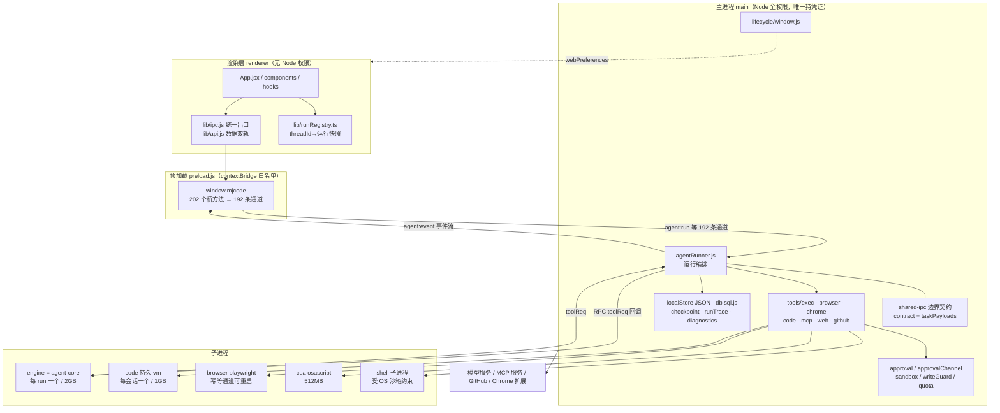

关键事实：

- 只有一个 Electron `BrowserWindow`（`main/lifecycle/window.js:36-53`），多会话并行靠渲染层注册表
  + 主进程 runId 分流，不靠多窗口。
- 主进程是 CommonJS（`desktop/package.json` 无 `type` 字段，`main: main/main.js`），
  `agent-core/` 与 `shared/`、`shared-ipc/` 是 ESM，跨模块一律**动态 import + ready 门**
  （`main/main.js:671-686`、`main/main.js:13-22`、`main/agentRunner.js:25-31`）。
- 所有"会出网、会落盘、会碰用户界面"的工具实现都在主进程；引擎子进程只有循环与协议
  （`main/engineProcess/childEntry.js:1-12`）。

#### 1.2 数据流与控制流

**数据流（一次对话）**：渲染层只提交"意图"（`agent:run` 载荷），主进程负责取凭证、发请求、
解析流、写库；流式 token 走独立下行通道 `model:delta` / `model:reasoning`
（`main/main.js:592-597`），结构化事件走 `agent:event`（`main/agentRunner.js:56-68`）。
三条通道分离的原因：流式 delta 是高频纯文本（每 token 一条），不能和需要契约校验的事件
混在一条通道里，否则热路径要为每次 token 付 zod 校验与序列化成本。

**控制流（取消）**：`agent:abort` → `run controller.abort()` → 同时做三件事：
转发引擎子进程 abort、撤下该 run 的挂起审批、杀掉该 run 注册的子进程
（`main/agentRunner.js:325-336`）。三件事都能按 runId 精确命中，靠的是
`AsyncLocalStorage` 把 `runId` 注入到每个工具 handler 的执行上下文
（`main/main.js:30`、`main/agentRunner.js:191-196`）——这是"统一取消"的结构基础，
否则只能全局杀，多会话并行时必然误伤。

**控制流（治理值）**：审批档与沙箱档不是模型说了算，而是"用户设置 / 宿主快照"与"角色声明"
取**更严格者**（`main/approvalPolicy.js`，被 `main/agentRunner.js:42,163-165`、
`main/workerPool.js:210` 共用）。工具处理器内一律读宿主下发的值，不读模型参数
（`main/main.js:876-887`）。这条纪律叫"权限单调不增"。

---

### 2. 进程与信任边界

#### 2.1 角色、职责与权限差异

| 角色 | 实现位置 | 权限 | 职责 | 明确不做 |
|------|---------|------|------|---------|
| 主进程 | `main/main.js` + `main/**` | Node 全权限：fs、child_process、net、Electron API；**唯一持有模型凭证** | 应用装配、IPC 注册、审批裁决、工具副作用、持久化、审计 | 不渲染 UI；不把凭证写进任何下行载荷 |
| 预加载 | `main/preload.js` | Node + `contextBridge`；只能调**已声明白名单**内的通道 | 把 202 个桥方法（187 invoke / 3 send / 11 on = 201 个 `ipcRenderer` 调用点，另 1 个 `getPathForFile` 直调 `webUtils`）暴露为 `window.mjcode`，背后是 192 条主进程通道（口径见 §5.2） | 不持有业务状态；不转发任意通道名；不做字段透传（`main/preload.js:88-97`） |
| 渲染层 | `renderer/src/**` | 无 `nodeIntegration`、`contextIsolation: true`（`main/lifecycle/window.js:52`）；仅 `window.mjcode` + `localStorage` + CSP 允许的同源资源（`renderer/index.html:23-36`） | 交互、渲染、按 threadId 归档流式状态（`renderer/src/lib/runRegistry.ts:9-10`） | 不起进程、不发模型请求、不持 Key；**但可经 `file:preview` 读取任意本机文件**（见下方登记） |

> **威胁模型登记（2026-10-17，代码审查 P3-1）**：`file:preview`（`main/tools/previewTool.js:30-55`）只做 `resolveToolPath(p, cwd)`，**没有根目录白名单**——小文件直接回 `dataUrl`，大文件走 `grantPreviewToken` 的流式协议。
> 这是「让 Agent 看你的项目」的必要能力，**不是缺陷**；但必须承认其边界：一旦渲染层被 XSS（Markdown / 代码块 / 连接器返回值都是不可信输入），等价于**任意本机文件读取**（含 `~/.ssh`、`~/.mjcode` 凭证目录）。
> 现有的两道缓解是：`contextIsolation` + 无 `nodeIntegration`（XSS 拿不到 Node），以及 CSP 限制外发。若要进一步收紧，可给 `previewFile` 加「必须属于已打开项目或用户显式选择」的可选白名单。
| engine 子进程 | `main/engineProcess/childEntry.js` + `agent-core/` | utilityProcess，独立堆 2GB（`main/engineProcess/host.js:16,30-33`）；**无凭证、无 fs 直连** | 跑 Agent 循环；每次工具调用 RPC 回主进程 | 不 spawn 工具进程、不碰窗口、不读 api_key |
| code 子进程 | `main/codeProcess/host.js` | utilityProcess，1GB；每会话一个持久 vm | 执行 Code Mode 代码 | 不做透明重启（状态丢失要如实上报，`host.js:1-7`） |
| browser 子进程 | `main/browserProcess/host.js` | utilityProcess + `playwright-core` | 受控浏览器操作 | 有副作用通道（click/fill/select）崩溃后**不自动重试** |
| cua 子进程 | `main/cuaProcess/host.js` | utilityProcess，512MB；osascript/screencapture | macOS 界面自动化 | 不承载模型调用（chat 留主进程，`main/main.js:1386-1388`） |
| shell 子进程 | `main/tools/exec.js` | `child_process`，受 Seatbelt/bwrap/Windows 受限用户包裹（`main/sandbox.js`） | 用户命令执行 | 不经 shell 时走 argv 直连（`main/tools/exec.js:67-78`） |
| MCP stdio 子进程 | `main/mcpClient.js:76-86` | `spawn` + 行 JSON-RPC | 第三方工具服务 | 不继承主进程凭证环境（按配置注入 env） |
| chrome 中继 | `main/chromeRelay/server.js` | 进程内 WebSocket，只听 `127.0.0.1` | 转发扩展 CDP 消息 | 不跨机监听；每次连接逐次审批 |

#### 2.2 为什么渲染层不碰 Node

五条理由，每条有代码或事故痕迹可循：

1. **攻击面收敛**。渲染层要渲染 Markdown、工具输出、插件 UI、网络内容——这是全系统最不可信
   的渲染面。Electron 安全检查的第一条就是关 `nodeIntegration`。一旦渲染层有 Node，
   任何一次 XSS 等于任意代码执行；当前即使 XSS，攻击者也只能调 preload 暴露的 202 个桥方法，
   且这 201 个方法背后只有 192 条通道（前缀即权限域，可审计），
   且主进程侧还有第二道校验（`main/preload.js:88-97` 的 `marketInstallGit` 字段白名单 +
   主进程再剥离一次）。
2. **凭证不出主进程**。`secrets` Map 是模块私有（`main/main.js:36,46`），`resolveSecret`
   只在主进程调用（`main/main.js:184-189`），`model:getSecrets` 只把服务端 Key 拉进主进程
   内存（`main/main.js:306-346`）。渲染层任何时刻拿不到 `api_key`。
3. **任务必须在窗口外存活**。这条是事故驱动：Agent 循环原先跑在渲染进程，刷新/关窗直接杀死
   进行中任务与全部副作用（`main/agentRunner.js:1-8` 记录了迁移理由）。后台运行、多会话并行、
   崩溃恢复都要求循环与 UI 生命周期解耦。
4. **持久化单一事实源**。最终总结的落库点已收到主进程（`main/agentRunner.js:103-118`），
   并且在 `done` 事件里用 `mainPersisted` / `persistState` 如实回执刷盘结果
   （`main/agentRunner.js:120-132,254-255`）。渲染层刷新不会丢消息。
5. **可测性**。纯逻辑（注入检测、沙箱 profile、审批分级、resume 决策）放在 `shared/*.mjs`
   与 `main/*.js` 里，能被纯 Node 测试直接 import（`shared/untrustedContent.mjs:1-26`、
   `desktop/test/run-all.mjs`）。

---

### 3. 分层职责表

| 层 | 目录 | 职责 | 允许的依赖方向 | 禁止事项 |
|----|------|------|---------------|---------|
| 表现层 | `renderer/src/**` | 渲染、交互、流式状态归档、本地 UI 偏好（localStorage） | → `lib/ipc.js`、→ `shared/*.mjs`（只读纯函数） | 禁止 `require('electron')`/`fs`；禁止直连模型或数据库；禁止自行决定审批档 |
| 接入层 | `main/preload.js`、`renderer/src/lib/ipc.js`、`lib/api.js` | 通道白名单、统一 `{ok,data,error}`、统一超时、能力矩阵 | → 主进程 IPC | 禁止透传整个 payload；禁止在 preload 写业务逻辑 |
| 边界契约层 | `shared-ipc/*.mjs`、`shared/*.mjs` | zod schema、跨宿主纯逻辑（沙箱文案、不可信内容、resume 决策） | 被三宿主 import；自身零依赖（仅 zod） | 禁止依赖 Electron/Node API；禁止放业务状态 |
| 应用编排层 | `main/agentRunner.js`、`orchestrator/`、`workerPool.js`、`scheduler.js`、`taskStore.js` | 运行生命周期、DAG 拆解、Worker 并发、定时触发、断点 | → 引擎（动态 import / 子进程）、→ 工具层、→ 数据层 | 禁止直接实现工具副作用；禁止绕过审批中心 |
| 引擎层 | `agent-core/**` | 轮次循环、工具协议、上下文压缩、预算 | ← 宿主注入 `toolHandlers` / 回调 | 禁止 `require` 主进程模块；禁止持有凭证 |
| 工具与能力层 | `main/tools/`、`browserTools.js`、`chromeTools.js`、`codeTools.js`、`webTools.js`、`github.js`、`computerUse.js` | 文件/命令/Git/网络/浏览器/界面/代码执行 | → 治理层、→ 子进程宿主 | 禁止无审计地产生副作用（每次写/执行都要 `audit()`，如 `main/tools/exec.js:177`） |
| 治理层 | `approval.js`、`approvalChannel.js`、`approvalPolicy.js`、`sandbox*.js`、`writeGuard.js`、`dangerousPatterns.js`、`resourceQuotaCenter.js`、`audit/` | 分级、审批分发、OS 沙箱、写白名单、IPC 配额、审计 | 被工具层调用；纯函数优先 | 禁止手抄规则副本（一律从 `dangerousPatterns.js` 取，`main/sandbox.js:37`、`main/approval.js:68-78`） |
| 数据层 | `localStore.js`、`db/`、`checkpointStore.js`、`runTrace.js`、`memory/`、`diagnostics.js`、`data/durableWrite.js` | 会话/消息/凭证/偏好（JSON）、任务与记忆（SQLite）、断点、trace、崩溃聚合 | 被编排层调用 | 禁止 UI 直接写；禁止无 fsync 的裸写（统一 `writeFileDurable`，`main/main.js:69-76`） |
| 平台层 | `lifecycle/window.js`、`updater/`、`autoLaunch.js`、`diagExport.js`、`featureFlags.js`、`previewScheme.js` | 窗口、更新、自启、诊断包、功能开关、自定义协议 | 被 `main.js` 装配 | 禁止承载产品业务逻辑 |

依赖方向铁律：**renderer → preload → main**单向；**main → agent-core**单向（引擎不得反向
`require` 主进程，只经注入的 handler 回调）。`main/main.js` 用 `getter` 注入而非互相 require，
正是为了打断 `main.js ↔ 各域模块` 的循环依赖（`main/main.js:226-235,340-342,439-453`）。

---

### 4. 技术选型

#### 4.1 选型总表

| 领域 | 主选（版本） | 选择理由 | 被否决备选 | 否决原因 | 适用前提 |
|------|------------|---------|-----------|---------|---------|
| 桌面运行时 | Electron `^33`（`package.json:29`） | 需要 Node 侧原生能力：`child_process`、`utilityProcess`、`safeStorage`、Playwright、`sandbox-exec`；团队与生态全在 JS | Tauri（Rust 壳） | 上述能力需全部重写为 Rust/侧车进程，Agent 工具层等于重做；Windows 沙箱与 CUA 后端没有现成等价物【推断】 | 接受 ~100MB 级安装包；接受 chromium 内存占用 |
| UI 框架 | React `18.3` + `react-markdown 9` + `remark-gfm 4`（`renderer/package.json:13-18`） | 流式高频更新 + Markdown 渲染是主场景，React 生态最厚；`renderMarkdown` 已在用 | Vue 3 / Svelte | 迁移成本换不到收益；Markdown/代码高亮生态需重选 | 团队 React 熟练度必须成立【待确认】 |
| 构建 | Vite `5.4` + `@vitejs/plugin-react 4.3`（`renderer/vite.config.js`） | dev 冷启动秒级、配置极薄；`base: './'` 直接支持 `file://` 打包加载（`main/lifecycle/window.js:66-70`） | webpack | 配置量与冷启动都更差；无收益 | 打包产物必须相对路径（已满足） |
| 样式 | Tailwind `3.4` + CSS 变量主题（`renderer/tailwind.config.js`、`renderer/src/lib/appState.ts` 的 `applyThemeToDocument`） | 主题切换只需改 `data-theme` 上的 CSS 变量，无需重渲染；`prefers-color-scheme` 首帧可取 | CSS-in-JS（styled-components / emotion） | 运行时注入样式与流式重渲染叠加会放大开销；主题切换要过 JS | `style-src 'unsafe-inline'` 必须保留（`renderer/index.html:26`） |
| 渲染层状态 | **不引入第三方 store**：`useState` + 模块级 `runRegistry`（`renderer/src/lib/runRegistry.ts`）+ `localStorage`（`lib/appState.ts` `loadJSON`）+ 主进程为事实源 | 真正的状态权威在主进程（localStore/checkpoint/taskStore），渲染层只是"视图缓存 + 事件归档"。再加一层 store 就是第三个事实源 | **zustand**（`renderer/package.json` 无此依赖） | 会与"主进程单一事实源 + 事件流推送"重复：zustand 里的状态需要额外同步逻辑，而 `agent:event` 已经按 runId 归档到 `runRegistry`；多一层易出现"界面显示在跑、主进程已结束"的分歧 | 若未来出现跨 10+ 组件的复杂派生状态（如多面板联合筛选），再评估引入 |
| i18n | 自研轻量 context + 分模块 JSON，仅 `zh-CN` / `en-US`（`renderer/src/i18n/index.ts:1-20`，`locales/<locale>/<module>.json`） | 零新依赖、`import.meta.glob` 自动收集新模块文件、缺失回落链（en→zh→key）显式可查；且要兼容纯 Node 测试宿主（`globalThis.__MJ_I18N_PACKS__` / `__MJ_T__`） | react-i18next | 依赖链 + runtime 插件 + 需要异步加载，对一个两语言桌面应用是过度设计；其命名空间机制与我们"模块=文件"约定等价但更重 | 语言数 ≤ 3；若要做 memo 复数规则/日期本地化，需补 ICU 能力 |
| 结构化本地库 | `sql.js 1.13`（WASM，打包态默认）+ `better-sqlite3 11.10`（`optionalDependencies`，仅 dev 金丝雀通过后使用）（`main/db/index.js:172-183`） | 打包版加载原生模块曾导致主进程 7s 即 SIGSEGV 且不可捕获；WASM 零原生依赖，任务编排子系统永不因驱动崩溃失能 | 单轨 `better-sqlite3` | 真机事故直接否决（`main/db/index.js:176-180`）；`npmRebuild: false` 下也无重编译兜底（`package.json:84`） | WASM 需 `asarUnpack` 且手写路径（`package.json:55-57`）；库为全内存 + 手动持久化，写放大要控 |
| 会话/偏好存储 | 自研 `LocalStore`：单 JSON + `writeFileDurable`（tmp+rename+fsync）+ `.bak` + 7 日副本（`main/localStore.js:1-20,44-58`） | 零原生依赖、可人工查看/救济、规模小；热路径用 150ms 合并刷盘避免写盘阻塞事件循环 | 全部迁 SQLite | 迁移收益在大数据量，当前线程/消息规模未到；且凭证加密与偏好读写路径已稳定，一次性迁移风险高于收益 | 消息量到万级后需重新评估（见 §10 债务 D3） |
| 打包分发 | `electron-builder ^25` + `electron-updater 6.8`，GitHub provider（`package.json:37-85`） | 三平台 target（dmg/zip、nsis、AppImage）声明式；`publish` 直连 GitHub release；`asarUnpack` 可精细指定 | electron-forge | publish/multi-target 配置更薄，迁移需重写；无阻塞性收益【推断】 | 需签名/公证（Windows 已开 `verifyUpdateCodeSignature`，macOS 公证【待确认】） |
| 运行时契约 | `zod 4`：`shared-ipc/contract.mjs` 覆盖 agent 事件流与启动载荷，`shared-ipc/taskPayloads.mjs` 覆盖 `tasks:*` 写通道 | 跨进程边界只有运行时，TS 类型在运行时不存在的；`.mjs` + 同名 `.d.mts` 让 tsc 也能约束 | 仅用 TypeScript 类型 | 编译期类型拦不住"另一个进程发来的畸形 JSON"，历史上正是这类漂移以 TypeError 形式爆在深层 | Node 20 不能直接跑 `.ts`，故运行时必须是 `.mjs`（`contract.mjs:10-13`） |
| HTTP / 流式 | 原生 `fetch` + 手写 SSE 行解析（`main/main.js:556-611`） | 需要 `AbortSignal.any([外部中止, 125s 超时])` 这类精细控制；需要兼容任意 OpenAI 兼容 base_url；需要把 `reasoning_content`、`tool_calls` 增量自己拼 | openai SDK / axios | SDK 隐藏请求形状、自带重试策略会与我们的超时/槽位释放冲突（槽位泄漏风险，`main/main.js:560` 注释）；多供应商兼容性不可控 | 每次新增供应商字段需自己适配（统一走 `modelShape.js` 转换） |
| 进程隔离 | `utilityProcess` + 自研 JSON 行 RPC（`main/engineProcess/transport.js`） | 崩溃半径从"整个应用"缩到"单个任务"；内存上限可按角色分配（引擎 2048MB / cua 512MB） | `worker_threads` | 线程共享堆，OOM 与死循环仍能拖垮主进程；无法设硬上限 | utilityProcess 不可用（单测 stub）时必须回退 in-process（`main/engineProcess/host.js:25-27`） |
| 测试 | 自研发现式 runner（`desktop/test/run-all.mjs`，`npm test`） | 解决"门禁假绿"：原 83 套件用 `&&` 串联，任一套件崩溃即中断其后全部且 CI 仍绿；现改为发现式 + 全量跑完 + 末尾汇总 + 崩溃/超时/跳过三分类（`test/run-all.mjs:1-16,45-97`） | vitest / jest | 需要把全部套件从"裸 Node 脚本"改写为框架用例，且 Electron 主进程 stub 生态不足；收益（watch/快照）对本项目不是瓶颈 | 套件必须自身可独立 `node` 运行；顺序执行避免 tmpdir/全局 stub 污染 |
| 代码质量 | `eslint 9` + `prettier 3` + `tsc --noEmit`（`package.json:21-25`），含 `max-lines` 门禁 | 门禁是唯一能阻止"上帝文件"复发的机制（`main/main.js:241` 注释、`main/tools/exec.js:42` 注释） | 仅 lint 无行数门禁 | 已实证失效：`main.js` 曾无限增长到装配与业务混杂 | 新代码优先拆模块，不为过门禁而牺牲可读性 |
| 浏览器自动化 | `playwright-core 1.64` 下沉子进程（`main/browserProcess/`） | 不进主进程堆；崩溃隔离；不需要浏览器下载（用系统/自带 chromium） | puppeteer / 主进程内直调 | 主进程内直调等于把 Playwright 出界目的作废（`host.js:10-14` 明示） | 每个会话惰性 spawn，闲置回收 |
| 协同 | `yjs 13.6`（默认冻结，`main/featureFlags.js:7-13`） | 本地优先 CRDT 快照层已在主进程实现（`main/collab.js`） | 自研 OT | CRDT 正确性自研风险过高 | 当前 `collab: false`，恢复需显式开 `MJCODE_FEATURES` |

#### 4.2 三处需要展开的取舍

**(a) `sql.js` 与 `better-sqlite3` 并存不是"双活"，而是"分环境单选"。**
选择顺序写在 `main/db/index.js:172-183`：`MJ_DB_DRIVER` 显式指定 > 打包态直接 sql.js（不加载
任何原生模块）> dev 态先跑一次子进程金丝雀探测再决定。金丝雀的存在理由是"主进程内的原生模块
加载无法用子进程探测兜底"——探测只能证明干净子进程可用，证明不了完整主进程状态下 NAPI 注册
不崩。所以打包态干脆不用。代价：sql.js 是内存库，需要显式持久化（`will-quit` 才 flush，
`main/main.js:437`），崩溃会丢未落盘事务——已登记为债务 D4。

**(b) 不引入 zustand 是有意的架构决策，不是遗漏。**
判断依据：状态按"谁是权威"分三类——① 服务端/持久化权威（threads/messages/providers）在主进程
`LocalStore`；② 运行态权威（runId→streaming/toolCalls）在 `runRegistry` + 主进程 `runs` Map；
③ 纯 UI 态（面板开关、草稿、选中标签）在组件 `useState` + `localStorage`。三类都有归属，
第四类 store 只会带来同步负担。风险的反面是：`App.jsx` 已累积 40+ `useState`（`renderer/src/App.jsx:41-121`），
跨组件通信退化为 `window` CustomEvent 总线（`mjcode:insert-path` / `mjcode:diff-comment` /
`mjcode:add-attachment`，见 `renderer/src/hooks/useAgentRun.ts:63-117`）。这是 §10 债务 D6。

**(c) 自研测试 runner 换掉 `&&` 串联，本质是"门禁可信度"投资。**
原串联模型的失败模式是静默的：套件崩溃 → 后续不跑 → CI 仍绿。新 runner 把三件事分开记账：
失败（断言）、崩溃/超时（没跑完）、跳过（该平台未验证），并显式声明"PASS 不等于该平台已验证"
（`test/run-all.mjs:65-69,93-96`）。这条设计直接决定了后续所有质量结论的可信度。

---

### 5. IPC 契约

#### 5.1 `contract.mjs` 的组织方式

四段式，从上到下依次收敛：

1. **通道名常量**：`AGENT_CHANNELS = { run, event, abort }`（`shared-ipc/contract.mjs:17-21`），
   主渲染两侧同源引用，杜绝字符串手滑。
2. **data schema 分发表**：`AGENT_EVENT_SCHEMAS` 把 8 种事件类型（message / stream / tool_call /
   subagent / todos / suspended / done / error）映射到各自 schema（`:95-104`）。新增事件类型
   **必须登记**，否则 union 不认，校验直接拒绝——这是防字段漂移的核心机制。
3. **信封 union**：`z.discriminatedUnion('type', ...)` 生成 `{ runId, type, data }` 的判别联合
   （`:106-110`），`data` 形状随 `type` 变化。
4. **入向载荷与工具函数**：`agentRunPayloadSchema`（`:115-150`，`passthrough` 允许新增可选字段，
   但 `messages`/`model` 必备缺失即拒）；`validateAgentEvent` / `safeAgentEventEnvelope` /
   `validateAgentRunPayload`（`:152-188`）。

`tasks:*` 写通道另立 `shared-ipc/taskPayloads.mjs`，文件头明确了两者关系："同属 IPC 边界契约，
合并前**不得**各自漂移"（`taskPayloads.mjs:1-14`）。

#### 5.2 通道命名与校验策略

- **命名规范**：`域:动作`，域用单数名词（`model` / `tool` / `agent` / `tasks` / `local` /
  `market` / `mcp` / `cua` / `approval` / `quota` / `diag`）；子资源用 `域:资源/动作`
  （`local:threads/list`、`local:providers/add-model`）。前缀即权限域，便于按域做审计与开关。
- **四条独立机制，按"防什么"分工**（不是一条链上的四个阶段；与第 4 章 §2.4 同口径）：
  1. **结构校验**：zod 拦形状漂移——事件流发送前校验、非法降级为同 runId 的 `error`（`main/agentRunner.js:59-63`）；`tasks:*` 进业务逻辑前即拒（`main/main.js:1153-1156`），fail-closed。
  2. **语义前置校验**：形状合法但内容不可信时拒绝——执行位置不可信即 fail-closed（`main/tools/exec.js:83-87`）。
  3. **字段白名单**：不校验、直接丢弃——preload 对 `market:installGit` 只放行 3 个字段（`main/preload.js:88-97`），主进程再剥离一次。
  4. **治理覆写**：不信任载荷里的治理值，直接改写——`ipcGovernance` 恒置 `requireApproval: true`、`sandboxPolicy` 钳到 `{read-only, workspace-write}`（`main/tools/execGovernance.js:8-16`）；模型路径由引擎侧剥离 `GOVERNANCE_FIELDS` + 宿主绑定覆盖（V01）。
  其余通道只被上述机制部分覆盖，字段漂移仍靠运行时暴露（§10 D5）。
- **通道规模（实测口径，2026-10-20 复核）**：主进程 **192** 条 = **188** 条字面量 `ipcMain.handle|on`（其中 3 条是 `ipcMain.on`）+ **3** 条由 `WRITE_TOOLS` 模板展开（`tool:writeFile|editFile|applyPatch`，`main/tools/exec.js:310,486`——注册点是反引号模板行，只扫引号的正则抓不到它，须按 `WRITE_TOOLS` 展开补计）+ **1** 条条件自注册（`diff:comment`，`main/approvalChannel.js:286-288`）⇒ invoke **189**、on **3**。preload **202** 个顶层桥方法（调用点 201 = 187 invoke + 3 send + 11 on；桥面 ≠ 通道数，差集见 §10 D5）；**死通道仍只有 1 条** `diag:preview`（`main/diagExport.js:187`，preload 未暴露）。
  - 演算校验：旧式「161 字面量 + 3 模板 + 1 隐式 + 3 个 on」把 3 条 `on` 计了两次（161 已含 on），因此 v1.0 的 168 与 §2.2 的「164+3+1」自相矛盾；本版按「166（含 on）+ 3 + 1 = 170」单一口径。
- **契约加载失败 = 拒绝运行**（V23 纪律）：`contract.mjs` 加载失败时 `startAgentRun` 直接
  返回错误，不再"静默透传"（`main/agentRunner.js:73-76`）。理由写在注释里：打包白名单漏掉
  `shared-ipc` 时，类型门禁依然能过，但运行时边界已经不存在。
- **已知空洞（已于 2026-10-17 关闭）**：v1.0 记的「契约未就绪窗口内载荷校验放行」已在 `4010a4d` 修复——`agent:run` 入口改走 `startAgentRunWhenReady` 先 `await contractReady`，`if (!contract)` 由放行改为硬拒（`main/agentRunner.js:74-96`），详见 §2.5。

#### 5.3 渲染层如何调用：`api.js` / `ipc.js` 双轨

两层职责不同，不能混：

- **`lib/ipc.js` = 传输层收口**：`call(method, payload, { timeout })` 统一返回
  `{ ok, data, error }`，默认 30s 超时，超时返回结构化错误而非抛异常（`renderer/src/lib/ipc.js:9,37-69`）；
  `on(eventMethod, cb)` 统一返回取消函数，避免 StrictMode 重复注册（`:72-82`）；
  能力矩阵 `loadCaps/hasCap` **默认 fail-closed**（未探测到按不可用处理，`:13-34`）。
  约定："组件层不再裸调 `window.mjcode`"（`:1-6`）。
- **`lib/api.js` = 数据语义层双轨**：同一业务方法内按 `localMode` 分叉——本地走
  `window.mjcode.local*`，否则走 `fetch(API + path)`（`renderer/src/lib/api.js:110-124`）。
  服务端 provider 的 id 加 `s` 前缀做命名空间隔离，避免与本机 provider id 冲突
  （`:84-86`）；服务端不可达时静默降级为纯本机列表（`:140-149`）；dashboard 离线时返回
  带 `data_scope: 'local'` 的本地统计，明确口径（`:218-235`）。

**双轨的现实状态**：`App.jsx` 在模块加载期就 `setLocalMode(true)`（`renderer/src/App.jsx:34-36`），
且 CSP 的 `connect-src` 只允许 `'self'` 与 Vite dev 的 ws（`renderer/index.html:31`），
浏览器侧根本打不通 `http://localhost:3001`（`renderer/src/lib/api.js:181-182` 注释也印证了
这个拦截）。也就是说：**当前发布形态只有本地轨在跑，服务端轨是代码遗留**。这不是 bug，
但是必须显式化的架构事实（见 §10 债务 D7）。

---

### 6. 关键时序

#### 6.1 用户发一条消息 → 拿到结果

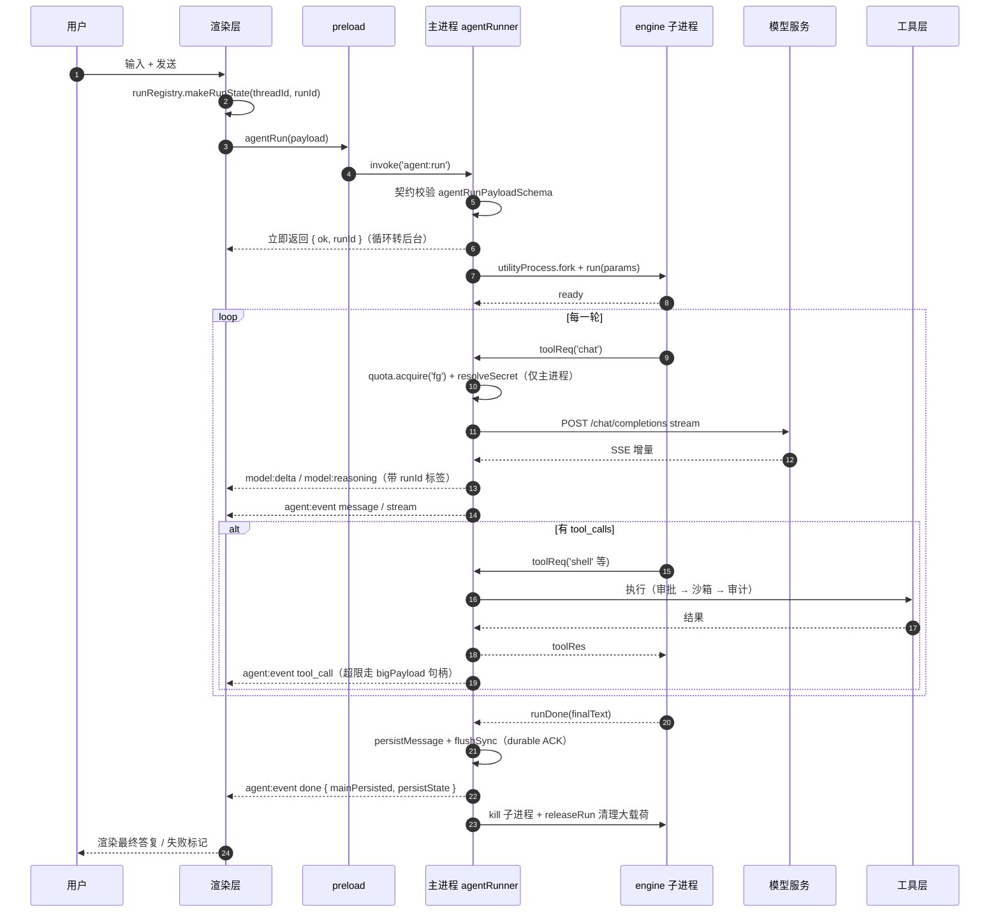

要点：`agent:run` **不等待结果**就返回（`main/agentRunner.js:98,321`），UI 完全由事件流驱动；
子进程退出若未收尾，会落 `kind: 'engine-exit'` 断点并提示"可继续"
（`main/agentRunner.js:296-311`）。

#### 6.2 工具调用触发审批

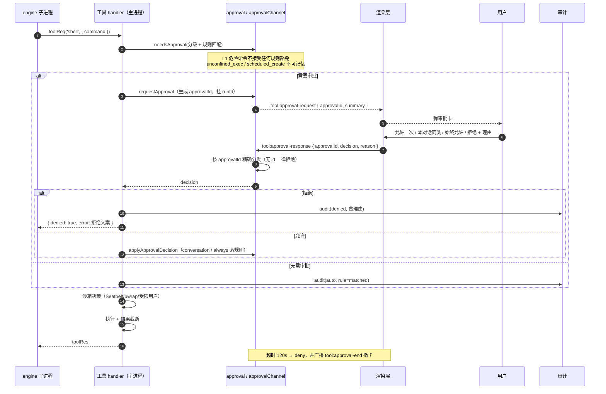

三条不可妥协的细节：

1. **按 id 分发**。曾经的实现是共享一条无 id 通道 + `ipcMain.once`，并发审批时"允许"会被
   发给另一个更危险的命令（`main/main.js:79-83` 记录的事故）。CUA 通道一度重演同一缺陷
   （`main/main.js:1259-1267`）。现在两个通道都是 `ApprovalChannel` + `approvalId`。
2. **无论怎么收尾都要撤卡**。用户决策 / 超时 / 运行取消，都回调 `onSettle` 广播
   `tool:approval-end`（`main/main.js:89-98`、`main/approvalChannel.js:56-83`）。
3. **无窗口时 fail-closed**。启动早期或窗口已销毁，按 `deny` 收尾而不是裸解引用
   `mainWindow.webContents`（`main/main.js:106-113`）。

---

### 7. 非功能性设计

| 维度 | 目标 | 实现手段 | 验证方式 |
|------|------|---------|---------|
| 性能·窗口首帧 | 不闪、不白屏；首帧可见有上界 | `show: false` + `ready-to-show` 才显示，1.5s 兜底强制显示（`main/lifecycle/window.js:44-64`）；`backgroundColor: '#0d0d0d'` 防白闪；`index.html` 内联脚本在 React 挂载前落 `data-theme`（`renderer/index.html:38-51`）；SplashScreen 接管视觉 | 冷启动计时【待确认：无实测基线】 |
| 性能·长会话渲染 | 消息条数增长不导致滚动卡顿 | 窗口切片 `MSG_WINDOW = 50`（`renderer/src/components/MessageStream.tsx:16`）；起点落在 `tool` 消息时向前回退，避免切断 `assistant(tool_calls)` 与结果的配对（`:56-58`）；顶部"加载更早"按钮（`renderer/src/components/ChatArea.jsx:207-209,454`） | 手工长会话（万条）滚动【待确认】 |
| 性能·大载荷 | IPC 不被超大工具结果拖死 | 超限 `tool_call` 字段落临时文件，事件只传句柄，渲染层按 offset/limit 分页取（`main/bigPayload.js`、`main/agentRunner.js:61`、`main/main.js:269-273`）；运行结束即清理（`main/agentRunner.js:317`）；`stdout` 50k / `stderr` 10k 截断（`main/tools/exec.js:169`） | 大文件读取回放 |
| 性能·主进程不被写盘阻塞 | 消息热路径不卡事件循环 | `LocalStore.scheduleFlush(150ms)` 合并刷盘，关键数据（凭证/偏好）仍同步 `flush`（`main/localStore.js:44-58`）；审批规则等改走 `writeFileDurable`（`main/main.js:69-76`） | 高峰期 IPC 响应延迟【待确认】 |
| 性能·并发上限 | 不把供应商打爆，也不让前台饿死 | `ResourceQuotaCenter(providerLimit: 8, fgReserve: 2)`，前台槽位预占、后台作业经 `bgGate` 让路（`main/main.js:246-282`、`:1030-1039`）；Worker 池 `maxConcurrent` 默认 4、钳制 1..8（`main/workerPool.js:18,38-43`） | `quota:snapshot` 轮询 / 压测【待确认】 |
| 可用性·引擎崩溃 | 单任务中断，应用与 UI 存活 | `utilityProcess` 独立进程 + 2GB 堆上限（`main/engineProcess/host.js:16,30-33`）；退出未收尾 → 落 `engine-exit` 断点 + 提示"继续"（`main/agentRunner.js:296-311`）；`utilityProcess` 不可用 → 回退 in-process（`host.js:25-27`） | `test/engine-*.test.mjs` 真子进程协议测试 |
| 可用性·主进程异常 | 不静默退出、不丢在跑任务 | `uncaughtException` + `unhandledRejection` 双兜底（后者是关键：Promise 拒绝不触发前者，Node 默认会终止进程，`main/main.js:379-392`）；结构化 JSONL 崩溃聚合 + trace 尾部（`main/diagnostics.js`） | 注入拒绝实验 |
| 可用性·退出落盘 | 强杀/关终端也尽量不丢 | `will-quit` 逐个 flush：localStore / taskStore / scheduler / intentLog / 审批通道 / MCP / browser / chromeRelay（`main/main.js:404-422`）；SIGTERM/SIGINT/SIGHUP 走 `app.quit()` 并有 2s 硬超时（`:424-430`）；单实例锁（`:345-352`） | `will-quit` 日志确认 `durable` |
| 可用性·数据损坏 | 不静默重置为空库 | 三级防线：flush 前后留 `.bak` → 按日副本保留 7 天 → 损坏先 `.bak` 恢复，失败才重置并 `console.error` 明示（`main/localStore.js:7-20`）；损坏且无备份时进入写入阻断态（`:41`） | `test` 中损坏注入用例 |
| 可用性·任务恢复 | 不自动重放副作用 | 中断任务 → `failed + needsReview`，运行中组 → `paused`，等人工核对（`main/main.js:1098-1113`）；重试前查 `listUncertainEffects`，需 `confirmReview=true`（`:1195-1212`） | `tasks:retryTask` 人工核对路径 |
| 可用性·外部依赖 | 服务端/网络不可达不影响本地能力 | `degrade.js` 区分"服务端不可达"与真错误；`api.js` 多处静默降级（`:140-149,183-192`）；定时任务优先本地调度器（`:194-215`）；`serverBase()` 三级解析（`main/main.js:41-45`） | 断网跑核心链路 |
| 安全·第 1 层：审批分级 | 危险动作必须有人确认 | 四档审批（on-request / auto-safe / always / never）+ 三级分类（L1 danger-command / L2 file-write / L3 mcp-tool）（`main/approval.js:6,16-60`）；**L1 不接受任何规则豁免**（`:111-113`）；`unconfined_exec` / `scheduled_create` 不可记忆（`:8-13`） | `approval.test.js` 分级矩阵 |
| 安全·第 2 层：OS 沙箱 | 把破坏面限制在项目目录内 | macOS Seatbelt profile 生成（`main/sandbox.js:83-130`，含 `.git` 等 carve-out）；Linux bubblewrap；Windows 受限用户 + ACL；`read-only` / `workspace-write` / `full-access` 三档 | `sandbox*.test.js` + 三平台真机 |
| 安全·第 3 层：写路径白名单 | 写不出项目/数据/临时目录 | `writeGuard.js`：`resolve` 快速判定 + `realpath` 精确判定，防软链穿越；白名单外写入不接受任何豁免（`main/writeGuard.js:1-45`） | `writeGuard.test.js` 软链用例 |
| 安全·第 4 层：命令黑名单兜底 | 无 OS 沙箱时仍拦住典型破坏 | `dangerousPatterns.js` 单一事实来源，审批层与沙箱层**同源引用**（`main/sandbox.js:33-39`、`main/approval.js:68-78`）；沙箱不可用时不是"裸跑"，而是 fail-closed 阻断或弹一次 `unconfined_exec`（`main/tools/exec.js:120-165`） | `dangerous-patterns.test.js` 同源断言 |
| 安全·不可信内容 | 第三方文本不能变成指令 | `shared/untrustedContent.mjs`：注入规则表 + `wrapUntrusted` 结构性隔离；覆盖技能内容、记忆沉淀、工具结果、AGENTS.md 四类入口；Worker prompt 的记忆块也走隔离（`main/main.js:1075-1077`） | `untrustedContent.test.mjs` |
| 安全·凭证 | Key 只存本机、只留主进程 | `safeStorage` 首选，不可用时降级文件密钥 AES-256-GCM 并留痕（`main/credentialCrypto.js`、`main/main.js:194-200`）；`secrets` / `localVault` 均为模块私有内存（`:46,180`） | `credential-crypto.test.js` |
| 安全·渲染层 | XSS 拿不到 Node，也关不掉安全校验 | `nodeIntegration: false` + `contextIsolation: true`（`main/lifecycle/window.js:52`）；CSP 无 `unsafe-inline`（script 用 sha256，`renderer/index.html:23-36`）；preload 字段白名单（`main/preload.js:88-97`）；`setWindowOpenHandler` 一律 `deny` 转外链（`window.js:73`） | 手工 XSS 演练【待确认】 |
| 可维护性·门禁 | 变更不能悄悄退化 | `npm test` 发现式全量跑完（`test/run-all.mjs`）；`eslint --max-warnings=0`（strict）+ `prettier --check` + `tsc --noEmit` + `eval:check`（`package.json:15-25`）；`max-lines` 门禁（`main/main.js:241`、`main/tools/exec.js:42` 均有被门禁推动的拆模块记录）；契约有 `.d.mts` 供 tsc | `npm test` / `npm run lint:strict` |
| 可维护性·单一事实源 | 同一规则不得有第二份手抄 | `modelShape.js`（模型形状转换）、`approvalPolicy.js`（审批/沙箱钳制）、`dangerousPatterns.js`（危险模式）、`shared/*.mjs`（跨宿主纯逻辑）、`dag.js` 常量同时供提示与校验（`main/orchestrator/index.js:6,13-16`） | 各模块头注释记录"漂移事故 → 收敛"历史 |

---

### 8. 数据流转与存储概要

只给分工与选型方向，详细建模交给数据建模工程师。

| 数据 | 载体 | 位置 | 写入路径 | 一致性策略 |
|------|------|------|---------|-----------|
| 会话 / 消息 / provider 元数据 / 偏好 / 项目 | JSON（`LocalStore`） | `userData/local-data.json`（+ `.bak` + 日副本） | 主进程 `local:threads/*`、`local:messages/*`；Agent 运行期由 `agentRunner.persistMessage` 直写 | 关键写同步 `flush`，消息热路径 150ms 合并；`done` 前强制 `flushSync` 才宣称 `durable` |
| 凭证（Key） | 加密字段 | 同上 `providers[].keyEncrypted` | `local:providers/*`；解密后只进 `localVault` 内存 | safeStorage / 文件密钥 AES-256-GCM；不落明文、不回传渲染层 |
| 任务组 / 子任务 / 记忆 | SQLite（打包态 sql.js WASM） | `userData/*.sqlite`（导出持久化） | `taskStore` / `memory` 由主进程写；`tasks:*` 写通道先过 zod | 迁移走 `PRAGMA user_version` 链（`main/db/index.js:12+`）；WAL 语义在 WASM 上退化为导出快照 |
| 断点 | JSON | `userData/checkpoints` | `onSuspend` / `engine-exit` 时保存（`main/agentRunner.js:212-231,296-309`） | 覆盖式；"继续"时取回并清除 |
| 运行 trace | JSONL | `userData/traces/<runId>.jsonl` | `runTrace.appendTraceEvent`（`main/agentRunner.js:238-241`） | 追加写 + `run_end` 后 LRU 淘汰；不上报 |
| 崩溃 / 异常 | JSONL | `userData/diagnostics/crash-YYYYMMDD.jsonl` | `reportError`（`main/main.js:379-392`） | 只落本机 |
| 大载荷临时文件 | 文件 + 句柄 | `userData` 下临时区 | `bigPayload.offloadToolCall` | run 结束即清 |
| 审计 | 上报服务端（可选）+ 本地日志 | — | `audit()` 33 处调用点（`main/audit/auditLog.js`） | 脱敏；`authToken` 仅在凭证拉取成功后开门（`main/main.js:324-326`） |
| 窗口状态 / 审批规则 / 定时任务 | JSON | `userData/window-state.json`、`approval-rules.json`、scheduled store | 各自模块 | 审批规则改用 `writeFileDurable`（`main/main.js:67-77`） |

**分工原则**：JSON 承载"用户资产"（可人工查看/救济、规模小、写频可控）；SQLite 承载
"系统运行数据"（任务、记忆、需要查询/迁移）；两者不重叠（`main/db/index.js:1-5` 明确裁定）。

---

### 9. 演进路径

| 触发条件 | 演进动作 | 成本估计 |
|---------|---------|---------|
| 单机会话/消息到万级，`local-data.json` 全量重写出现可感延迟 | 消息表迁 SQLite（`messages` 表 + 按 threadId 索引），JSON 只留偏好/凭证元数据；`LocalStore` 保留为 facade 不改调用方 | 中（3-5 人日 + 一次迁移脚本 + 回滚开关） |
| 并发运行数常态 > 8（多会话 + 编排 + 定时叠加） | `ResourceQuotaCenter` 从"全局 8 槽"改为"按 provider 分桶 + 公平排队"；Worker 池与前台共享同一配额账本 | 中（配额中心已抽象，主要是策略层） |
| 需要在团队内共享会话/任务 | 打开 `collab` 开关，主进程 Yjs 快照层（`main/collab.js`）接真实同步后端；CRDT 与本地 JSON 需要"双写 + 收敛"设计 | 高（需服务端 + 冲突策略 + 权限模型） |
| 服务端轨要真正启用 | 两条路选一：① 渲染层直连 → 必须放宽 CSP `connect-src`（削弱纵深防御）；② **经主进程代理**（推荐）：`fetch` 在主进程执行，CSP 不变、凭证同源、可统一限流 | 中（走主进程代理约 2-3 人日；直连方案的安全成本更高） |
| 主进程启动变慢（域模块继续增长） | `main.js` 收敛为"生命周期 + 声明式装配表"，各域导出 `{ channels, init }` 由 `registry.js` 统一注册 | 中（机械改造，但需逐域回归） |
| 需要真正的多窗口（如独立 Agent 面板） | 引入 per-window `runId → webContents` 路由表；当前 `mainWindow` 单例（`main/main.js:24`）与大量 `mainWindow.webContents.send` 需改为按订阅者广播 | 高（广播面 ~20 处，且要重做事件归属） |

---

### 10. 架构风险与已知债务

| # | 现象 | 影响 | 建议 | 证据 |
|---|------|------|------|------|
| D1 | `main.js` 仍是 God Object（装配、审批接线、模型代理、编排 IPC、CUA 全在一处）。**口径更正**：raw **1785** 行 / code **1212** 行，`max-lines:1500` 按 code 算，余 **288** 行——**不存在「行数快撞门禁」这个约束**（v1.0 的 1490 与 `:241` 注释均属已清理的错误前提） | 真实代价是**职责耦合**：装配与业务混杂使启动顺序成为隐式契约，拆分易漏跨模块调用点 | 把 `main.js` 收敛为"生命周期 + 声明式装配表"，各域模块自报 `{ init, channels }`，由 `registry.js` 统一注册；模型代理（`chatStreamOnce`）独立成 `modelProxy.js` | `main/main.js`（raw 1785 / code 1212，eslint `max-lines` 压到 1 实测，2026-10-20 复算）；同口径说明见 `main/main.js:1137-1139` |
| D2 | CJS 主进程 × ESM 共享模块 ⇒ 动态 import + ready 门。~~契约未就绪窗口内校验放行~~ | ~~启动早期 `agent:run` 可绕过 zod 校验~~ → **已修（2026-10-17，`4010a4d`）**：入口改 `startAgentRunWhenReady`，先 `await contractReady`；`if (!contract)` 由放行改为硬拒。残余风险只剩「打包漏 `shared-ipc` 白名单」一种，且表现为**全部对话启动失败**（显性故障，非静默放行） | ① ~~加载提前到 `whenReady` 前~~（已由入口 `await` 覆盖）；② ~~放行改排队~~（已落为硬 fail-closed）；③ 中期把主进程迁 ESM；④ 补一条构建期「产物必须含 `shared-ipc`」断言 | `main/agentRunner.js:25-31,74-96`；`main/main.js:931` |
| D3 | 两套持久化职责划界未完成：`localStore` 是单 JSON 全量重写，`db/` 只承载任务编排与记忆 | 消息量增长后每次 flush 是 O(全库) 写放大；主进程事件循环在高峰期被写盘占用（已用 150ms 合并缓解，未根治） | 按 `db/index.js:1-5` 的既定方向渐进迁移消息表；迁移前先给 `localStore` 加"按 threadId 分片文件"的过渡方案 | `main/localStore.js:1-20,44-58`；`main/db/index.js:1-5` |
| D4 | 打包态用 sql.js（全内存 WASM）：写入 **150ms 防抖 export** + `process.on('exit')` 兜底 + `will-quit` 第三道（**经第 5 章复核，初稿「仅 will-quit」表述已更正**）；`asarUnpack` 的 wasm 路径靠手写 | 强杀（SIGKILL/断电）最多丢 ~150ms 未落盘写；每次写是全量 export，有 O(库大小) 写放大；`asarUnpack` 配置漂移会让打包版启动即失能（包内找不到 wasm） | ① 关键事务后立即 `flush()` + 周期 checkpoint；② 启动时校验 wasm 可达，失败给可行动错误而非静默降级；③ 中期换增量驱动（见第 5 章 §6.6 的 B/C 选项） | `main/db/sqljsDb.js:14,37-62`；`main/db/index.js:172-183`；`desktop/package.json:55-57,84`；`main/main.js:437` |
| D5 | 通道面大而契约面窄：主进程 192 条通道（preload 202 个桥方法），契约只覆盖 `agent:*` 与 `tasks:*` | 其余通道靠实现约定，字段漂移仍只能运行时暴露；`local:*`（37 条，`main/ipc/localData.js` 内共 46 条）与 `market:*` 等写通道尤其关键；注册点分散（`ipc/` 十文件占 131 条 = 68%，`main.js` 22、`tools/exec.js` 19、`scheduler.js` 9，余 10 条散在 6 个模块），且有 1 条死通道 `diag:preview` 无人调用 | 按风险排序把写通道纳入 zod（`local:providers/*`、`local:messages/*`、`market:*`、`mcp:*`）；或在 `lib/ipc.js` 加 dev-only schema 断言（不增加生产开销）；顺手清理死通道；**通道总数不可硬断言**——`diff:comment` 条件自注册、3 条模板通道要跑到 `registerIpc()` 才存在，纯 Node 宿主会少 4 条（192→188），门禁须按"允许缺失清单"比对 | `main/preload.js:3-299`；`main/ipc/localData.js`（46 处）；`main/approvalChannel.js:286-288`（隐式注册，按字面量 grep 会漏）；`main/diagExport.js:187`；`shared-ipc/contract.mjs:1-13`；`shared-ipc/taskPayloads.mjs:1-14` |
| D6 | 渲染层状态分散：`App.jsx` 789 行 40+ `useState`，跨组件通信退化为 `window` CustomEvent 魔法字符串 | 新增交互容易漏事件名或重复定义；状态归属不清晰时会出现"两处都以为自己是权威" | 事件名收敛为常量模块并与 IPC 契约同处登记（便于 grep 与门禁）；把 `App.jsx` 的面板开关状态抽成 `useLayoutState` | `renderer/src/App.jsx:41-121`；`renderer/src/hooks/useAgentRun.ts:63-117` |
| D7 | "本地/服务端双轨"实际只有本地轨在跑：`App.jsx` 恒 `setLocalMode(true)`，CSP 又拦掉 `localhost:3001` | 双轨代码长期得不到验证 → 腐化；新人误以为服务端可用；`api.js` 里 **8 处 `localMode` 三元分叉 + 4 处提前返回**（共 12 个分叉点）是隐性技术债 | 二选一并显式化：① 删除服务端轨（收敛为纯本地客户端）；② 或改为主进程代理并加一条真实集成测试。不要保持"代码在、能力不可达"的中间态 | `renderer/src/App.jsx:34-36`；`renderer/index.html:31`；`renderer/src/lib/api.js:110-124,181-182` |
| D8 | 沙箱能力三平台不均：macOS 需 `sandbox-exec` 且**自身处于嵌套沙箱时必然不可用**；Linux 需装 bwrap；Windows 需一次性管理员设置 | 受限档位下命令被 fail-closed 阻断，用户感知为"明明给了权限却跑不了"；默认体验在三平台不一致 | 把 `describeCapability()`（后端/真实可用性/原因/嵌套标记）前置到 Onboarding 与状态栏；被阻断时直接给安装/授权指引（`sandboxNotice.mjs` 已有 errorCode→四要素文案） | `main/sandbox.js:142-176,232-246`；`main/tools/exec.js:120-165`；`shared/sandboxNotice.mjs:1-25` |
| D9 | `webPreferences.webviewTag: true` **且确在使用**：浏览器面板用命令式 `document.createElement('webview')` 承载内嵌页面（**初稿「零使用点、建议关闭」经主理人驳回，见第 10 章 J1**）。当前该元素**只设了 `src` 与尺寸样式，没有 `partition`、没有 `webpreferences`、没有 `allowpopups`**，与主渲染进程共享默认 session | webview 是弱隔离渲染面（Electron 历史漏洞高发区）：默认 session 共享意味着 guest 页面与主界面同源存储/同 cookie；渲染层设置的属性可被 XSS 绕过，而主进程**没有任何 `will-attach-webview` 兜底**（全仓无该事件） | ① 主进程加 `will-attach-webview` 强制：`partition=persist:mj-browser`、显式 `webpreferences`、剥 `preload`/`allowpopups`；② `new-window` 已收敛到同一 guest（`BrowserPanel.tsx:67-70`），保留；③ 中期评估换 `BrowserView`/独立子进程；④ 在威胁模型登记该渲染面 | `renderer/src/components/BrowserPanel.tsx:46-51,67-70`；`main/lifecycle/window.js:52`；grep `will-attach-webview` = 0 |

---

### 11. 待确认

1. **性能指标基线缺失**：本章所有性能项只给出"手段"，没有实测数字（冷启动时长、长会话滚动
   FPS、IPC 往返 P95、flush 抖动）。需要一轮可复现的度量（`mark`/`measure` + 打包版采样），
   在此之前任何"满足 SLA"的表述都不成立。
2. **macOS 公证与签名链路**：`electron-builder` 配置里只有 `verifyUpdateCodeSignature`（Windows），
   macOS 公证/entitlements 未在 `package.json` 体现，是否由 CI 外部处理需确认。
3. **服务端（`server/`）的产品定位**：本章按"非核心、可离线"处理。若未来恢复共享/团队能力，
   §9 的"主进程代理"方案需要服务端配合（CORS/令牌/审计口径）。
4. **多窗口需求**：当前单窗口假设贯穿 ~20 处广播（`BrowserWindow.getAllWindows()` 与
   `mainWindow.webContents.send`）。若产品要独立 Agent 面板，需在 §9 触发条件里正式立项。
5. **`agent-core` 的 ESM 边界是否长期保留**：它是"CJS 主进程 + ESM 引擎"这一整套动态 import
   模式存在的唯一原因（D2）。若引擎改为 CJS 或主进程改 ESM，D2 可整条消除。

### 12. 双入口与自动编排判定点（2026-10-24 落地）

> 本章前 11 节讲「能力怎么实现」。本节补的是新增的一层**决策壳**：能力不变，但「这次该不该动用这些能力」从入口分支里搬出来，交给一个可测的判定器。

#### 12.1 为什么要拆掉入口分支

旧实现是「在『新建会话』里选中军团 ⇒ 强制派活」：发送前直接 `return` 走派活分支，连「你好」这种普通问句都不放行。

这违反 §3 的分层职责表——**入口只负责选路，不该决定某个能力是否可用**。两个可观测后果：① 用户选过一次军团后，普通对话被永久剥夺，他要么清掉编制、要么换会话；② 「该不该并行」这个判断被固化在 UI 状态里，无法评测、无法调参、也无法向用户解释。

当前入口是**三个**：**新建任务** / **助理** / **定时任务**（生态中心仍是底部弹层）。

> 这里记录一次**用户实测后的回退**，因为它正好印证本节的论点：「入口数」不是审美问题，而是
> 「能力放在哪一维」的问题。第一版把定时任务并进助理的子 Tab（声称「2 个入口」更简洁），
> 用户当场反馈「一级菜单下面还是要有定时任务」——**「什么时候跑」是与「做什么」并列的运行
> 维度**，藏进助理后用户找不到。故第二版把定时任务升回一级入口，助理只保留「发布任务 /
> 军团 / AI 建团」三个子 Tab。教训：把并列维度折叠进另一个维度，省下的是侧栏一行，付出的是可发现性。

军团在新建任务里是**候选编制**（一个声明式偏好），不是模式开关。

#### 12.2 三个模块的边界

| 模块 | 职责 | 禁止事项 |
|---|---|---|
| `main/entryRouter.js` | **纯逻辑**：`ruleRoute` / `judgeRoute` / `buildConfirmPoint` / `decomposeOnly` / `noteUserChoice`。输入目标文本与策略，输出路由判定与确认点 | 不碰 electron、不写库、**不建组**——所以能被直接单测 |
| `main/entryRuntime.js` | **宿主接线**：把判定接到 `agent:run`，广播 `entry:route` / `entry:confirm`，注册 `entry:choice` / `entry:policy` | 不含判定规则；判定异常一律 fail-open（判不出来就不打扰用户，消息照常发出） |
| `main/entryPolicy.json` | **阈值与开关**：路由规则模式串、置信门槛、成本提示、三档判定条件 | 代码里不写死阈值——否则调参要改代码、还要重跑全部门禁 |

#### 12.3 判据是「任务结构」，不是「难度分」

输出是 5 个**离散类别**（不用 0–1 分数：分数无法解释、也无法写回归断言）：

| 路由 | 含义 | 确认点 |
|---|---|---|
| `simple_chat` | 单轮问答 | C0 |
| `multi_step_single` | 单 Agent 多步（有顺序依赖） | C0 |
| `parallel_team` | 可并行的多子任务 ⇒ 建议团队 | C1 |
| `manual_team` | 信号不足以下结论，但用户可能想用团队 | C2（引导） |
| `scheduled` | 意图是「定期做」⇒ 引导去定时任务，而不是当场派活 | C2（引导） |

四条结构信号（运行期启发式，不依赖训练）：

1. **子任务可真正并行** ⇒ 允许升级；
2. **强顺序依赖** ⇒ **禁止**升级（依据：顺序规划任务上多 agent 相对单 agent 显著退化，「并行」在那里只是上下文开销）；
3. 工具种类数 ≥ 阈值 ⇒ 提示降级（工具面碎片化时多 agent 收益低）；
4. 需**中心化验证** ⇒ 倾向 centralized 拓扑而非全并行。

两层判定：**L0 规则层**（零成本、命中即返回、**不调模型**）→ 只有 `unknown` 才走 **L1 模型层**（一次短调用，输出离散类别）。**L1 失败 / 超时 / 输出非法 ⇒ 一律降级 `simple_chat`**——误启多 agent（多花数倍 token、结论还可能更散）比漏启更伤。

#### 12.4 三档确认点：判定器只决定「要不要问」

这是本设计最容易做错的地方：**判定器不代替用户按执行**。

| 档 | 触发 | 行为 |
|---|---|---|
| **C0 静默** | 用户已选编制 / 规则层高置信 | 直接跑，事后给可点提示（可回看为什么这么判） |
| **C1 确认卡（默认）** | 结构信号达标但需要人确认 | **先出卡、不建组**。卡上三样：① 已拆好的子任务清单 ② 为什么建议用团队（人话 + 判据来源）③ 代价（N 人 / token 约 N 倍 / 预计墙钟） |
| **C2 阻断+引导** | 信号不足 / 意图其实是「定期做」 | 不执行，只给跳转引导（去助理对应 Tab） |

#### 12.5 三条纪律（每条都有门禁守）

1. **卡上的子任务必须是已经拆好的**（预拆 DAG 但不建组）。否则用户确认的是 A、执行的是 B——本设计最伤的失败形态。落地要点：`buildConfirmPoint` 必须把 `prompt` 一并下发，缺它会被派活层的归一函数整条过滤，表现为「看着能点、点了没用」。
2. **用户选「改成单 Agent」后，本轮不再追问**。实现为「会话 × 目标指纹」的已答复集合；指纹不一致就记不上、会重复弹卡，故渲染层回传的 `goal` 必须与卡片事件里的逐字一致。
3. **无人值守通道没有确认点**。定时任务必须在任务里预声明军团与预算，不允许运行期静默升级——失败要响，不能问。

#### 12.6 与「模型自决」的关系：不抢它的方向盘

判定器**不建组**。建组始终由模型调 `orchestrate_task`（交互）或宿主按预声明（定时）单点触发。原因：本项目里「子代理/团队」是昂贵且改变拓扑的动作，两个决策者各判一次必然重复建组、双倍烧 token。

判定器只做三件事：**给提示**、**给确认卡**、**给预拆清单**。用户点「按这个执行」后，渲染层调既有的 `teams:dispatch`，把卡上清单作为 `presetTasks` 回传——编排器**跳过 LLM 二次拆解**，按这份清单落库执行，于是卡上展示的就是实际执行的。

#### 12.7 渲染层的三个落点

| 位置 | 作用 |
|---|---|
| `renderer/src/lib/navState.ts` | 一级导航的单一判定点（`activeNavOf`）：互斥且穷尽；`scheduled` / `teams` 保留为**兼容输入**，不再作为返回值 |
| `renderer/src/lib/candidateRoster.ts` | 候选编制的进程内单一事实源（纯数据 + 纯函数，可被 Node 门禁直接 import） |
| `renderer/src/components/EntryRouteNotice.tsx` | `entry:route` / `entry:confirm` 的唯一消费者：升级/降级提示条、确认卡、回执 |
| `renderer/src/components/PublishTaskPage.tsx` | 助理里**唯一**的发起面：一句话 + 军团（不选=自动构建）+ 类型（复杂任务 / 定时任务）；复杂任务下方是看板（数据源 `teams:listThreadRuns`），定时任务就地展开重复/有效期/时间并给执行计划预览 |
| `renderer/src/lib/schedulePresets.ts` | 重复模板 → cron、cron → 下次运行、cron → 人话的**唯一实现**。定时任务页与发布页共用一份，避免「预览 09:00、实际 10:00」这类无门禁可查的漂移 |

#### 12.8 已知限制

- **临时编制（`kind='temp'`）不能直接派活**：`teams:dispatch` 需要 `teamId`，而临时编制不落 `teams` 表。UI 上禁用「按这个执行」并给解释文案；未伪造 `teamId`，也未静默降级。
- **工具面预热未实现**：设计意图是「判定命中时把编排工具提前放进工具面」。未做的原因是当前运行环境（1M 窗口）下工具表只占窗口约 1%、窗口裁剪根本不触发，预热是空操作；而为它要把判定从「不阻塞」改成「先判后跑」，风险与收益不成比例。小窗口模型下仍需先 `activate_tools`，此时靠确认卡这条更确定的路径兜底。
- **单 Agent 基线正确率无数据**：外部「多 agent 需要单 agent 正确率足够高才划算」这类阈值无法直接套用到本项目任务分布。L0 规则层不依赖该阈值，故不阻塞落地；但**升级收益至今没有本项目的实测数字**。


---

## 第 3 章　Agent 运行时与编排实现

# 第 3 章 Agent 运行时与编排实现

> 本章回答：**一次运行从哪来、每轮循环怎么转、token 花在哪、多 Agent 怎么不失控**。页面组件见第 4 章，
> 存储结构见第 5 章，部署见第 6 章——本章不重复。
>
> 已由前序阶段确认、直接采用（不再论证）：渲染层恒本地模式（服务端轨名存实亡）；工具集是 `BASE_TOOLS`
> 常量声明；技能（SKILL）是提示词注入而非新代码路径；审批有四层守卫。证据约定：路径相对 `desktop/`，
> 行号以当前工作树为准，推断标【推断】，需实测标【待确认】。

---

### 1. 一次运行的完整生命周期

#### 1.1 端到端时序（标注进程归属）

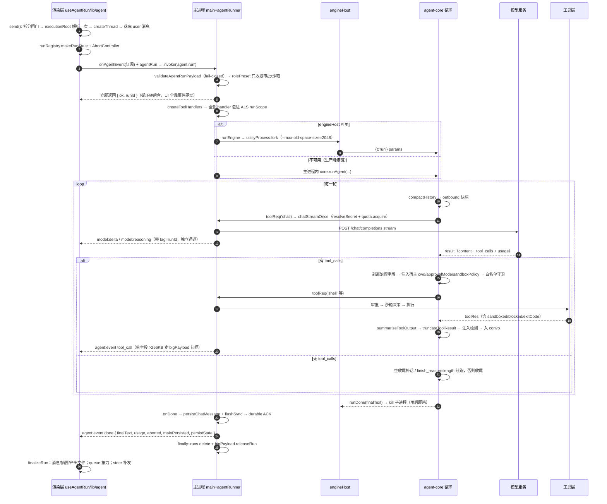

#### 1.2 阶段、失败点与处置

| 阶段 | 进程 | 关键实现 | 失败处置 |
|---|---|---|---|
| 输入→拆分闸门 / 解析执行根 | 渲染层 | `hooks/useAgentRun.ts:209-227,276-278` | 拆分异常按原样执行（fail-open）；建目录失败**阻断**运行并给可行动错误（`:262-268`） |
| 建会话 / 落库 user 消息 | 渲染层→主进程 | `useAgentRun.ts:279-327` | 复位 loading + 保留输入供「重试本轮」，不启动运行 |
| 订阅 + 发起 / 启动校验 | 渲染层→主进程 | `lib/agent.js:69-142`、`agentRunner.js:71-96` | 通道缺失 reject；契约模块缺失或载荷畸形**拒绝启动**（`:74-91`） |
| 引擎落地 | 主进程/子进程 | `agentRunner.js:260-281`、`engineProcess/host.js:41-113` | 子进程崩溃 → `engineExited` → 落 `engine-exit` 断点并提示「继续」（`:296-311`） |
| 逐轮循环 | agent-core | `agent-core/index.js:1492-1990` | 见 §2.5；模型失败分「可重试/需救援/须终止」 |
| 工具执行 | 主进程 handler | `main/tools/exec.js:65-282` 等 | 拒绝/沙箱不可用/守卫拦截均为结构化失败结果，不击穿循环 |
| 收尾落库 / 兜底收尾 | 主进程 | `agentRunner.js:242-256,283-291` | 落库失败 → `mainPersisted:false`，渲染层本地补显并明示未持久化（`useAgentRun.ts:403-411`）；引擎未触发 onDone 也必发 done |

#### 1.3 三个与直觉不同的事实

**① `agent:run` 不等待结果**：立刻返回 `{ok,runId}`（`agentRunner.js:98,321`），UI 由事件流驱动——这是
「刷新窗口不再杀死运行」的根因。**② 模型调用在主进程而非引擎**：引擎只发 `toolReq('chat')`，凭证解析/
限流/fetch 全在 `main.js:524+`，凭证与用户交互永不跨进程边界（`engineProcess/host.js:90-91`）。
**③ `done` 是唯一权威收尾，但仍留兜底分支**（`agentRunner.js:269,304`）——出现过「引擎未触发 onDone →
UI 永久转圈」。

---

### 2. 单轮循环内核

#### 2.1 循环体七步

```
while (true) {                                                        // agent-core:1492
  ① 闸前检查：budgetExhausted / aborted / rounds>=roundCap / budget<=0
     —— budget<=0 先自动续期 2 次（renewNotice 旁路），再耗尽才 break     :1493-1507
  ② compactHistory(convo,{knownTokens:lastPromptTokens})，结果必须回写并清空该值  :1509-1512
  ③ outbound = 当轮 system + renewNotice（不进 convo，不污染会话历史）      :1514-1517
  ④ withTimeout(chatWithRetry(chatFn,…), modelTimeoutMs)                  :1524-1532
  ⑤ usage 记账 → onBudget 上报 → budgetDecision 闸门                       :1576-1628
  ⑥ 无 tool_calls：length 续跑/空收尾补话/正常收尾；有则逐个执行            :1644-1989
  ⑦ 回到 ①
}
```

#### 2.2 消息组装：system 只有一条

`convo = [{role:'system',content:systemPrompt}, ...normalizeMessages(messages)]`（`:1379`），拼接链：

| 序 | 内容 | 处置 |
|---|---|---|
| 1 | `BASE_PROMPT`（角色/工具约定/10 条原则，`:448-486`） | 固定；可被 `customSystemPrompt` 整体替换（`:1302`） |
| 2 | `rolePreset.systemPrompt`（数字员工） | **追加**式，截断 12000（`:1305-1307`） |
| 3 | `enabledSkills`→`SKILL_PROMPTS`（内置 8 个，`:413-444`） | 直接拼接（`:1308-1310`） |
| 4 | `skills`（`~/.mjcode/skills/*/SKILL.md`） | 命中高危注入 → **整块不注入**并说明原因（`:1313-1328`） |
| 5 | `agentsMd` 项目规范 | 命中注入 → fail-closed 拒绝 + 可读原因（`:1341-1355`） |
| 6 | `memories` | 逐条检测，命中即丢该条；其余 `wrapUntrusted` 隔离后注入（`:1359-1372`） |
| 7 | `resumeContext` 断点摘要 | 只进 system，不进持久化历史（`:1375-1377`） |

**为什么必须单条 system**：DeepSeek 系兼容端点只认首部 system，中部出现 system 会被忽略甚至报错
（`:693-695`）——这直接决定压缩摘要与裁剪占位必须落在「前导 system 块内、首条 user 之前」
（`:695,806-807`）。`splitFixedHead`（`:659-667`）是压缩与裁剪共用的必留头：**全部连续前导 system +
首条 user**；历史上只留 `convo[0]` 会静默丢弃渲染层插入的专家 system，角色/技能约束全线失效。

#### 2.3 模型调用三重保护

| 层 | 参数 | 行为 | 证据 |
|---|---|---|---|
| 重试 | 3 次，指数退避+抖动，上限 8s | 仅 429/5xx/网络重试；Abort/KEY_MISSING/其他 4xx 直穿 | `:1015-1044` |
| 超时 | 120s（含整条重试链） | 半开连接不再挂死；超时先存断点（`kind:'timeout'`）再抛 | `:1055,1524-1568` |
| 中止 | `signal.aborted` | 每轮开头 + 每个工具执行前检查 | `:1494,1575,1682` |

上下文超限救援：错误消息命中 `API 400|context|length|too long|maximum|超出` → 强制压缩一次再 `continue`（`:1545-1550`）；只救一次，避免「压缩↔400」死循环。

#### 2.4 工具解析与执行

模型给的 `arguments` 只当业务意图，**治理字段一律剥离**（`GOVERNANCE_FIELDS`，`:576,1693-1698`：
`cwd/approvalMode/sandboxPolicy/conversationId/requireApproval/signal`），再由宿主注入：`cwd`（仅
`CWD_TOOLS` 内，`:491-498`）、`approvalMode+conversationId`（仅 `APPROVAL_TOOLS` 内，`:566-572`）、
`sandboxPolicy`（`shell` 缺省 `read-only`，fail-safe，`:1710-1712`）。

**白名单守卫（V02）**：`advertisedToolNames` 是本 run 实际通告的工具集（`:1418`）。绕过是真实存在
的——`switch` 按名字分发，plan 模式/角色裁剪只影响 `tools` 数组，谎报被过滤的写工具名就能直达
handler；守卫 fail-closed 拒绝（`:1718-1725`）。

结果三连（顺序不可换）：`summarizeToolOutput`（>8000 字符 → 折叠 PASS 行 → 头 2500+尾 3500 → **原文落盘**，需细节时 `read_file` 取回，`:1151-1195`）→ `truncateToolResult`（>15000 带标记截断，对象结果**逐字段**裁最长字符串以保 JSON 可解析，`:1088-1113`）→ 注入检测（命中才加告警+隔离，未命中原样透传，`:1975-1984`）。

#### 2.5 八条终止出口

| 出口 | 触发 | 行为 | 证据 |
|---|---|---|---|
| 正常收尾 | 无 tool_calls 且有文本 | `onDone` + return | `:1667-1670` |
| 长度续跑 | `finish_reason='length'`（≤3 次） | 旁路注入「从中断处继续」 | `:1647-1652` |
| 空收尾补话 | 空 content 且无 tool_calls（≤2 次） | 补总结指令；仍空则明示「任务未完全完成」 | `:1655-1664` |
| 轮次预算 | `budget<=0` 且续期用尽 2 次 | `budgetKind='rounds'` | `:1496-1505` |
| 硬轮次顶 | `roundsUsed >= 120` | 同上 | `:1200,1495` |
| token 预算 | `budgetDecision` 返回 suspend-* | 先 `onSuspend` 落断点再收尾 | `:1629-1642` |
| 重复失败熔断 | 同签名连续失败 4 次 | `budgetKind='repeat'`，点名工具 | `:1205-1206,1949-1953` |
| 用户中止 | `signal.aborted` | `aborted=true`，保留已有文本 | `:1494,1575` |

熔断只认**结构化失败**（`ok===false` 或显式 error），刻意不含 `exitCode!==0`（`:1233-1238`）——
`grep` 没命中、测试失败都是正常控制流，算进去会误伤「改代码→跑测试→再改」。

---

### 3. 上下文经济

核心认知：**长任务的成本不是「上下文太长」，而是「同一段上下文被每轮全价重发」**。

#### 3.1 token 估算

`estimateTokens`：CJK 1 字≈1 token，其余 4 字符≈1 token（`:623-628`）；`estimateMessagesTokens` 每条
+4 开销且**必须计入 `tool_calls` 的 name+arguments**（`:633-643`）。后者是事故修复：
`write_file/apply_patch` 正文全在 arguments，只算 content 实测 70,894 vs 真实 `prompt_tokens` 217,238，
**低估 3.06 倍**，压缩阈值永不触发（`:630-632`）。

#### 3.2 四道闸与 budgetDecision

| 闸 | 时机 | 判据 | 目的 | 证据 |
|---|---|---|---|---|
| 入口裁剪 | run 开始前一次 | 估算 > 窗口×0.45 | 压掉已完成工具轮的中段 | `:760-815` |
| 压缩 | 每轮模型调用前 | 估算 > 窗口×0.7 或 force | 早期对话摘要化 | `:673-749` |
| 预算决策 | 每轮 usage 记账后 | 上下文比例 + 累计花费 | compact/new-window/suspend | `:552-563` |
| 重复失败熔断 | 每个工具后 | 同签名连续 4 次 | 止血空转 | `:1943-1962` |

`budgetDecision`（纯函数，可单测）的语义修正是本项目最值得记的一笔：

| 情形 | 返回 | 说明 |
|---|---|---|
| `ctxEst > 窗口×0.7`，救援未用尽 | `compact` | 上下文真接近上限，压缩能解决 |
| `ctxEst > 窗口×0.7`，救援用尽 | `suspend-context` | 压了也放不下，continue 必被端点拒 |
| 花费 > 预算×0.7 且 `ctxEst ≥ 窗口×0.35` | `compact` | 上下文够大，压缩确能省重发成本 |
| 花费 > 预算×0.7 且 `ctxEst < 窗口×0.35` | `new-window` | **只换窗口不压缩**（小上下文压缩纯亏） |
| 花费 > 预算，救援用尽 | `suspend-tokens` | 暂停而非失败，走断点续跑 |
| 其余 | `ok` | — |

事故现场（`:541-549`）：「取 10 条最新新闻」5 轮累计 143k（每轮重发 ~27k），旧逻辑拿**累计花费**判「上下文过长」，把 27k 上下文 force 压成 376 tokens 摘要 → 原文被抹 → 重搜 → 再撞闸再压，用户看到「后台一直在压缩、没有任何输出」。修正后 `TOKEN_COMPACT_MIN_RATIO=0.35`（`:550`）成为「值不值得压」的门槛——花费闸管钱、上下文闸管装不装得下，两者判据不同。

#### 3.3 compactHistory 算法

```
① 触发 est > 窗口×0.7（force 跳过）；激进档 est > 窗口×0.85 → keepTail 6 或 3    :679-682
② splitFixedHead 拆出 systems / firstUser / body                               :684
③ 滚动摘要：旧摘要（前缀『[早期对话摘要』）并入本次输入，产出后只留一条
   —— 只丢旧摘要会丢历史；只加不并会让 head 无界增长                           :687-695
④ alignCutToRoundBoundary：切点落在 tool 消息上就后移至该轮工具结果之后         :649-653,696
⑤ 一次小模型调用产出四段式摘要（已完成/关键发现/待办/约束，300 字内），看门狗 30s   :712-728
⑥ 失败兜底：丢弃最早 1/2（激进 3/4），切点同样对齐轮边界                       :744-748
⑦ 无收益即放弃：压缩后 ≥ 压缩前 → 返回原 convo（收敛闸，防头部摘要发散）       :739,748
```

激进档额外注入「上下文压力告警」，要求「精确信息请重新 read_file/grep 核实，不要凭记忆假设」
（`:731-734`）；结果再过一遍 `normalizeMessages`，杜绝孤儿 tool 消息 400（`:736`）。

#### 3.4 trimHistoryForRun 与 30 轮演变

目标 `effectiveWindow × 0.45`，窗口下限 16000（刻意留低，免得入口裁剪抢跑压缩路径的单测，`:764`）；
按「轮」切组（一条非 tool + 其后 tool 结果），**组内绝不拆开**（`:776-785`）；至少保留 `keepRecent=8`
轮，之后按预算从尾向前收（`:796`）；被丢中段折成一条 system 占位「已省略 N 条（约 X tokens），需要
细节请重新读取」（`:755-758`）；裁了没收益 → unchanged（`:813`）。

一次 30 轮长任务的演变【推演，按算法口径计算，非实测】：

| 轮 | 动作 | 本轮 prompt | 窗口累计 | 触发的闸 |
|---|---|---|---|---|
| 1-6 | 下发 + todo_write + 读 8 文件 | 3k→34k | 60k | 文件读取缓存开始命中同文件重读（`:1883-1920`） |
| 7-8 | `write_file`（正文 12k 在 arguments）+ 跑测试原始输出 30k | 48k→62k | 190k | 折叠 PASS + 落盘，实际进上下文 ≈9k |
| 12 | 上下文 95k | 95k | 620k | 花费>420k 且 ctxEst>44.8k → `compact`（1/3），窗口清零 |
| 19 | 上下文 92k | 92k | 700k | 再次 `compact`（2/3） |
| 25-26 | 上下文 88k | 88k | 1.05M | 救援 3/3 用尽，两闸同时吃紧 → `suspend-context` + 落断点 |

第 26 轮不是失败而是**暂停**：`checkpointStore` 已保存摘要，下一轮从断点接续（§9.3）。

#### 3.5 其余省 token 手段（都在生产路径上）

| 手段 | 效果 | 证据 |
|---|---|---|
| run 内文件读取缓存 | 同文件 mtime/size 未变且 >4000 字符 → 只回「已在上文」 | `:1209,1883-1918` |
| 长输出落盘 | 原文进临时文件，上下文只留头尾 + 路径 | `:1172-1193` |
| PASS 行折叠 | `npm test` 类输出中段折成一行 | `:1126-1147` |
| 续期/截断/补话指令旁路 | 只拼进当轮 system，**不进 convo**，重进线程看不到系统话 | `:1463,1500,1514-1517` |
| 分层预算 | 前台常规 600k / 大任务 1M；Worker 200k；子代理 50k | `lib/agent.js:25-42`、`workerPool.js:215`、`agent-core:503` |

---

### 4. 大任务分解

#### 4.1 链路与状态机

```
用户文本 → looksLargeTask(text)      零成本本地启发式（agent-core:951-960）：多发词（多个/批量/重构/
  端到端…）或 分隔符≥2+目标词≥2 或 目标词≥3 且长度≥60
  → decomposeTask() → parsePlanResponse   一次纯文本规划调用（不传 tools），<2 条即放弃（:963-1010）
  → setPlan({tasks,reason})               渲染层弹卡片，**确认前不执行**（useAgentRun.ts:218-222）
  → Composer 发 send(task.prompt,…,{planStep}) → 单步运行 → setPlanReport
```

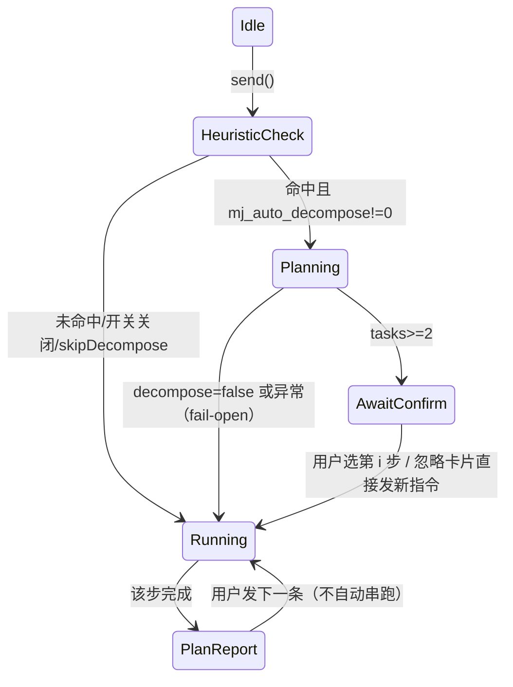

**拆分是「串行分步 + 每步人工确认」，不是并行**——与 `orchestrate_task`（§5）是两条不同产品路径：

| 维度 | 拆分分步 | 多 Agent 编排 |
|---|---|---|
| 触发者 / 执行位置 | 渲染层闸门；主会话一次一步 | 模型自主调工具；Worker 池 DAG 并行 |
| 人工介入 | 每步完成都要用户发下一条 | 只在审批卡与「停止」时介入 |
| 失败处理 / 入口 | 用户看报告自己决定；`Composer.tsx:304` | 重试/关键失败暂停/自动重规划；`main.js:799-847` |

#### 4.2 约束与风险

- **只在前台生效**：`decomposeTask` 由渲染层调 `window.mjcode.chat`（`agent-core:987-992` 回落），
  主进程定时任务与 Worker 路径**没有分解能力**——能力面不一致【已确认】；
- 开关藏在 `localStorage['mj_auto_decompose']`（`useAgentRun.ts:210`），不经设置页，用户不可发现；
- 规划调用只取 user 消息拼接、截断 4000 字符（`:993-997`），长上下文任务可能丢约束。

---

### 5. 多 Agent 编排

#### 5.1 端到端流程

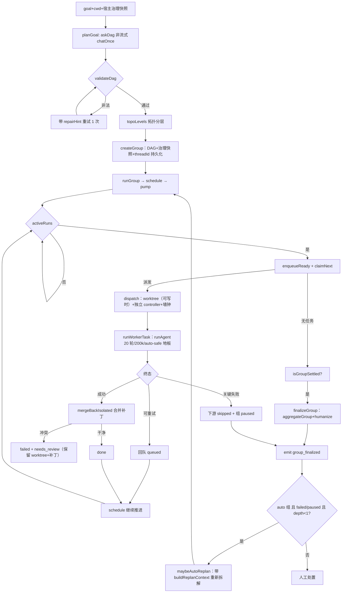

#### 5.2 DAG 校验约束（`orchestrator/dag.js`）

| 约束 | 值 | 位置 |
|---|---|---|
| 任务数 | 2~8（提示词与校验**同源引用** `MIN_TASKS/MAX_TASKS`） | `dag.js:8-9,30-32`、`index.js:6,17` |
| 单任务依赖数 | ≤ 4 | `dag.js:10,55` |
| 必填 / 唯一性 | `id/title/prompt` 齐全；id 唯一且 slug 化 | `:39-41` |
| prompt 长度 | ≤ 8000 字符 | `:42` |
| 自依赖 / 引用不存在 / 成环 | 各自独立报错（环用 Kahn 并列出节点） | `:56-59,62-81` |
| `maxRetry` / `timeoutMs` / `critical` | 0~3（缺省 0）/ 30s~30min（缺省 10min）/ 仅 `===true` 升级 | `:48-50` |

「提示词说 2~6、校验允许 8」的口径漂移已由同源常量消除（`index.js:13-16`），模型不会再被提示与校验
双重夹住。

#### 5.3 并发两个源与审批继承

① **层内并行**：`topoLevels` 每层内并行、层间串行（wait_all，`dag.js:86-105`）；② **全局信号量**：
`maxConcurrent` 默认 4（`workerPool.js:27,52`），`pump()` 从所有 running 组轮转领取（`:194-251`）——
多组并存共享同一并发池。`orchestrate_task` 的 `max_agents` **被有意忽略**（`main.js:804-816`）：原实现
让模型调 `setMaxConcurrent`，等于把并发闸交给被治理对象；现并发宽度只由用户设置决定。

```
approvalMode   = stricterApproval(group.approval_mode || getCurrentApprovalMode() || 'on-request',
                                  'auto-safe')                 // workerPool.js:405
sandboxPolicy  = runCwd ? groupSandboxPolicy : 'read-only'     // :406
conversationId = `agent:{memberId}`                            // :407（M5/T5-11：成员会话，
                                                               //  审批「本对话同类」按成员记忆；
                                                               //  无名册组回落 agent:anon:{groupId}:{taskId}）
```

`stricterApproval/stricterSandbox` 唯一事实源是 `main/approvalPolicy.js`。抽出的原因写在
`workerPool.js:405-406`：子任务原来硬编码 `'auto-safe'`，用户选「全部询问」时编排里每条命令仍自动
放行——**产品对用户的设置撒谎**。组级快照还有第二个作用：会话中途改审批档不会串到已排队的组。

M5/T5-11 另把成员断点（`agent-checkpoints.json` 的 `agent:{memberId}` 键）接入 Worker 通道：
运行前 `getCheckpoint` → `runOpts.resumeContext`，任务 done 后 `saveCheckpoint` 写回
「成员工作记录」（元数据含 `threadId/runId/taskId/ownerMemberId`，即 §13.2 四级 key 的可反查落点）。

#### 5.4 失败策略与重规划

| 情形 | 处置 | 证据 |
|---|---|---|
| 非关键失败且未超重试 | `handleFailure` → 回队 queued | `:242-247` |
| 关键失败且阻塞下游 | 下游 skipped（强制置 skipped 防组无法收尾）+ 组 paused | `:397-429` |
| 墙钟超时/外部中止 | 判 failed（不自动重试），`skipRetryCount` | `:248-257` |
| 引擎「未完成收尾」文案 | 判 failed，不伪装 done | `:261-267` |
| worktree 合并冲突 | failed + `needs_review` + 补丁与 worktree 路径上交 | `:276-291` |
| 组终态 failed/paused 且 auto | 最多 **1 次**自动重规划（depth≥1 不再重规划） | `orchestrator/index.js:119-156` |

重规划不是「同目标再跑一遍」：`buildReplanContext`（`:103-117`）把已完成结论/失败原因/跳过项压成
contextBlock，并明确「已完成结论可直接引用，不要重复执行」。聚合侧 `aggregateGroup` 产出
`summary/artifacts/warnings/failed`，`humanizeGroupResult`（`invoke.js:93-126`）转成人话并在失败时给
可行动建议（「把 `max_agents` 调小串行重试；已完成子任务结论可直接复用」）。

---

### 6. 子代理与隔离

#### 6.1 三层「子」结构，隔离强度完全不同

| 机制 | 实现 | 进程 | 工具集 | 预算 | 崩溃影响 |
|---|---|---|---|---|---|
| `spawn_subagent` | 引擎内**同步递归** `runAgent`（`agent-core:1739-1849`） | 与父**同进程同调用栈** | 只读 7 件（`:501-502`） | 8 轮 + 50k | 异常收成结构化结果，不炸父循环 |
| Worker | `workerPool.runWorkerTask`（`:164-311`） | 主进程内独立 `runAgent` | 全量工具 | 20 轮 + 200k + 墙钟 | 降级为任务 failed + 组 paused（`:138-161`） |
| 引擎子进程 | `engineProcess/host.js:41-113` | `utilityProcess` 独立 Node | 全部经 RPC 回主进程 | 2GB 堆硬顶 | 只影响单 run，UI 存活 + 落断点 |

**常见误解纠正**：`spawn_subagent` **不隔离**。它在同一个 `runAgent` 调用栈里递归 `await`，共享父的
`toolHandlers` 与 model，仅靠「只读子集 + 独立上下文 + 预算」约束；父 signal 中止会级联
`subCtl.abort()`（`:1746`），这是它主要的安全属性。

#### 6.2 workerPool 并发与 workerIsolation

`pump()` 在有槽位时对每个 running 组做 `enqueueReady → claimNext → dispatch`，收尾检查
`isGroupSettled → finalizeGroup` 与 `groupHasBlockingFailure → paused`；`schedule()` 用 `setImmediate`
合并同 tick 触发（防重入泵，`:62-103`）。Worker 的可爱命名（布丁/团子/芝麻…`：24-34`）不是装饰——
`activeRuns` 用它去重，Agent 胶囊靠它区分并发中的多个 Worker。

并发 4 个 Worker 同写一个目录会互相覆盖，因此**可写任务在独立 git worktree 里执行**：`createIsolated`
（非 git/开关关闭 → `null` 回落主目录；**「上限打满」故意抛错**，`:26-28`）→ Worker 在副本内干活 →
`mergeBackIsolated`（`add -A` → `diff --cached --binary` → 主目录 `apply --check` 预检 → `apply`；冲突则
补丁落 `~/.mjcode/worktree-conflicts/*.patch` 并**保留 worktree**）→ 失败路径 `archiveIsolated`（有改动
归档 + `needs_review`，无改动才清理）。V06 修的是「成果不可逆丢失」：此前 `finally` 无条件
`removeWorktree`，merge 抛错时改动随 worktree 销毁，调用方仍标 done（`workerIsolation.js:36-41`）。

| 边界 | 覆盖 | 不覆盖 |
|---|---|---|
| 崩溃半径 | 引擎子进程（每 run 一个，用后即杀）、CUA 下沉子进程、code 持久 vm | `spawn_subagent` 与 Worker 池都在主进程内 |
| 内存 | 引擎 2GB / code 1GB / CUA 512MB 堆上限 | 主进程自身无硬上限 |
| 文件系统 | OS 沙箱三平台 + worktree 副本 + 写白名单 + `.git` carve-out | `full-access` 档显式不隔离 |
| 审批 | 全部工具经 `ApprovalChannel` 按 id 分发、挂 runId、可统一撤下 | — |

---

### 7. 工具系统

#### 7.1 BASE_TOOLS 分类清单（共 41 个，`agent-core:30-411`）

| 组 | 工具名 | 审批档（`approval.js:16-66`） |
|---|---|---|
| 文件只读 | `read_file` `list_dir` `grep` `glob` | 不问（READONLY） |
| 文件写 | `write_file` `edit_file` `apply_patch` | L2 |
| 命令 | `shell`（`command` 或 `argv` 直调） | 命中危险模式 L1，否则不问 |
| Git | `git_status` `git_diff` `git_log` `git_branch`（只读）/ `git_commit` `git_add`（L2） | 见左 |
| 网络 | `web_search` `web_fetch` | 不问 |
| 受控浏览器 | `browser_navigate` `click` `fill` `select` `screenshot` `extract` | L3；click/fill/select 恒逐次 |
| Chrome 接管 | `chrome_status`（不问）/ `chrome_tabs` `navigate` `screenshot` `extract`（L3 可豁免）/ `chrome_click` `chrome_fill`（恒逐次） | 见左 |
| 代码执行 | `code_exec`（Code Mode，会话状态跨调用保留） | 普通 L3 可豁免；危险代码 L1 不可豁免 |
| 子代理/编排 | `spawn_subagent` `orchestrate_task` | 不经审批中心（受白名单+预算约束） |
| 插件 / 定时 / PR | `search_plugins`（只读）`install_plugin`（L3 不可记忆）`scheduled_create`（L3 不可记忆）`pr_list` `pr_view` `pr_diff`（只读）`pr_review` `pr_comment`（L3） | 见括号 |
| 引擎内置 | `todo_write`（引擎内直接处理，不出网不触盘，`:1850-1882`） | — |

#### 7.2 五个必须同步的集合（新增工具一个都不能漏）

| 集合 | 作用 | 漏了会怎样 | 位置 |
|---|---|---|---|
| `BASE_TOOLS` | 模型可见声明 | 模型永远不知道有此能力 | `:30-411` |
| `TOOL_HANDLER_NAMES` | 工具名→handler 映射 | 运行时报「未知工具」 | `:579-620` |
| `APPROVAL_TOOLS` | 透传审批档 | 审批中心按默认档处理，可能少问 | `:566-572` |
| `CWD_TOOLS` | 强制注入执行根 | 相对路径按主进程 CWD 解析 → ENOENT/写错位置 | `:491-498` |
| `PLAN_MODE_ALLOWED` | 规划模式白名单（fail-closed） | plan 模式出现写能力 | `:1385-1396` |

教训直接写在源码注释里：`git_add/git_branch` 曾有实现、handler、preload、审批分级，**唯独
BASE_TOOLS 没声明** →「有实现无入口」（`:139-144`）；`scheduled_create` 一度漏了
`TOOL_HANDLER_NAMES` 那一行（`:599` 点名）。

#### 7.3 超时与执行治理

超时：默认 120s（`:1056`）；`shell` 600s（构建/测试，`:1059`）；`web_fetch/web_search` 60s；
`spawn_subagent` 1200s（子代理 8 轮×模型超时，看门狗必须大于其自然上限，`:1062`）；
`orchestrate_task` 1800s（`:1063`）；`mcp__*` 统一默认档（动态名无法枚举，`:1730-1732`）。
`withTimeout` 是 Promise.race 语义：超时后**引擎不再等待**，底层 HTTP/子进程由各自 signal 回收（`:1046-1075` 明说「JS 无法真正杀死已挂起的 Promise」）。

治理两条腿各自 fail-closed：模型路径靠 `GOVERNANCE_FIELDS` 剥离 + 宿主覆盖（§2.4）；直连 IPC 路径靠 `ipcGovernance`（`tools/execGovernance.js:10-16`）强制 `requireApproval:true`、`sandboxPolicy` 钳到 `{read-only, workspace-write}`——`full-access` 只能经会话运行链路进入。`toolShell` 内部顺序（`exec.js:65-282`）：cwd 契约（不存在即拒绝，绝不静默换目录，`:83-88`）→ `needsApproval`（`:92-104`）→ 沙箱策略（缺省 workspace-write/无目录 read-only，`:110`）→ macOS seatbelt「先探测能否真 apply」（`:198-221`）→ Linux bwrap（ro-bind 全盘+unshare-all 断网+项目目录唯一可写，`:224-242`）→ Windows 受限用户（结果不可知时如实上报，绝不伪造 `exitCode=0`，`:245-279`）→ 统一兜底 `runFallback`：策略≠`full-access` 时**默认阻断**（`:127-165`），两条逃生口为 `MJCODE_ALLOW_UNCONFINED_FALLBACK=1`（留审计）与当场 `unconfined_exec` 审批（只取 once）。V03 修正值得单记：此前「沙箱不可用 → 黑名单守卫后裸跑」等于沙箱一失效就静默降级为宿主普通权限（权限提升且用户不可见）；现在受限策略下沙箱不可用 = 能力不可用。

#### 7.4 如何新增一个工具

1. `BASE_TOOLS` 加声明（name 小写下划线；description 写清何时用/不用、与近邻工具的取舍；parameters 给
   JSON Schema 与 required）；
2. `TOOL_HANDLER_NAMES` 加映射；引擎内可解的（如 `todo_write`）在工具循环 `switch` 加 `case`；
3. `main.js:876+` 的 `createToolHandlers` 注册实现（只读直连；写操作走 `runWriteTool`/审批中心）；
4. 需审批的补 `APPROVAL_TOOLS` + `TOOL_LEVEL` + `approvalSummary`（文案必须讲清后果，参考
   `git_checkout` 的「不可撤销」措辞）；依赖执行根的加 `CWD_TOOLS`、只读安全的加 `PLAN_MODE_ALLOWED`；
   慢工具补 `TOOL_TIMEOUT_OVERRIDES`；需进程内回退/直连 IPC 的补 `preload.js` 通道；
5. 补三处测试：声明与 handler 一一对应、审批分级、失败路径的结构化结果（前两项对不上分别意味着
   「看得到调不到」与「危险动作静默放行」）。

---

### 8. 审批闭环

#### 8.1 触发判定与载荷

`needsApproval`（`approval.js:105-126`）的判定链：`never` 不问 → 只读工具不问 → **L1 以外**命中
always/conversation 规则不问（matched 记审计）→ `always` 问 → `auto-safe` 且 L2 不问 → 其余问。
L1 判定：`shell` 命中 `DANGEROUS_PATTERNS`；`code_exec` 命中 `isDangerousCode`（内嵌 `child_process`/
危险命令）；`cua_action` 命中强确认类目（支付/删除/发送/验证码）。

请求链路（`main.js:100-130`）：`approvalSummary` 出 `{level,title,detail}`（含风险警示行）→ `nextId()` 得 `ap-<base36>-<seq>` → `wait(id, onSettle, runId)` → 无可用窗口则 `dispatch(deny)` 返回（fail-closed）→ 发 `tool:approval-request {approvalId, tool, rememberable, cwd?, ...summary}`。用户决策经全局唯一监听器按 id 精确分发，未知/已超时 id 一律忽略并告警。`reason`（P1-4）挂在返回 Promise 的只读属性上（`approvalChannel.js:66-90`）——**故意不改决议值形状**，因为约 15 处调用点都在比较 `decision === 'deny'`。

#### 8.2 决策回到执行 / rememberable / 超时

| decision | 效果 | 证据 |
|---|---|---|
| `once` | 只放行本次 | `exec.js:98-103` |
| `conversation` | `conversationRules.push({tool,pattern,conversationId})`（主进程内存） | `main.js:132-139` |
| `always` | 落 `userData/approval-rules.json`，可在设置里查看/删除 | `main.js:135-157` |
| `deny` | `{error:'Approval denied', stderr: denialText(reason)}`，**理由进工具结果**，模型下轮就知道「为什么被拒、该怎么做」 | `approvalChannel.js:26-28` |

`unconfined_exec` 额外硬约束：**只取 `once`**，其他决策按阻断处理（`exec.js:141-148`）。
`NON_REMEMBERABLE = {unconfined_exec, scheduled_create}`（`approval.js:12-13`）：前者是单次逃生口，后者
「一次点击 = 持久化 + 未来无人值守执行」；UI 拿到 `rememberable:false` 就不该显示「本会话/始终允许」
——**给了按钮但实现不生效，就是产品对用户撒谎**（`:8-11` 原话）。规则匹配是**前缀白名单**语义
（`matchPattern`，`:159-167`）：整串相等或后续为空白；历史缺陷是当正则做子串匹配（`pnpm test` 能命中
`pnpm test && rm -rf /`、`pattern='*'` 全放行），现在空/通配一律不匹配。

超时与收尾：120s 无响应 → `finish('deny','timeout')`（`approvalChannel.js:79`）；任一方式结束（决策/
超时/进程退出/运行取消）都回调 `onSettle` 广播 `tool:approval-end` 撤卡（`:56-83`、`main.js:89-98`）；
运行被中止 → `cancelByRun(runId)` 全按 deny（`:132-140`）；应用退出 → `disposeAll()`；非法 decision 归一
为 deny，无 `approvalId` 的响应拒绝且不猜（`:9-12,110-116`）。

---

### 9. 中断 / 引导 / 排队 / 恢复

#### 9.1 五个用户动作

| 动作 | 语义 | 实现 | 边界 |
|---|---|---|---|
| `stop()`（Esc） | 只中止**当前查看会话** | `useAgentRun.ts:48-53` | 后台会话不受影响；无注册表时回退 `abortRef` |
| `steer(text)`（Enter） | 立即中止当前轮并用新指令重开 | `:634-640` | 仅在用户仍停留本会话时补发（`:627`）；先清空排队 |
| `queueNext(text)`（Tab） | 排队到本轮结束后自动接力 | `:643-647` | 接力在 `finalizeRun` 内 `setTimeout(send,0)`（`:494-498`） |
| `/clear` | 中止 + 清空消息与窗口 | `:650-657` | 不删库，仅清当前视图 |
| 组强停 | 在役中止 + 排队置 skipped + 组 cancelled | `workerPool.js:358-386` | P1-8：只 abort 在役时队列仍被 pump 派发 →「点了停止还在烧 token」 |

`steer` 有个不显眼但必要的设计：**不能在 `steer()` 里直接 `send()`**——那时 `loading` 仍 true，请求会被
「运行中不发新请求」静默吞掉，用户看到的就是「点了没反应」；因此走 `steerPendingRef` 在 send 结束路径
重开（`:622-627`）。

#### 9.2 三层取消链

```
渲染层 signal.abort()
  ├ 本地立即 settle：finish(null)+onDone('',null,true) → UI 即时收敛（lib/agent.js:126-136）
  └ mj.agentAbort(runId) → ipcMain 'agent:abort'(main.js:930) → abortRun(runId)
       ├ controller.abort()            （in-process 路径）
       ├ engineHost.abortEngine(runId) （转发 {t:'abort'} 给引擎子进程）
       ├ cancelApprovalsForRun(runId)  （该 run 挂起审批按 deny 收尾）
       └ killChildrenForRun(runId)     （按 runId 终止 shell 子进程）
```

「本地立即 settle」修的是体验：此前点「停止」要等主进程跑完当前轮才收到真实 done，最长数十秒无反馈
（`lib/agent.js:122-125`）。

#### 9.3 断点恢复：状态驱动，不看关键词

| kind | 触发 | 恢复文案 |
|---|---|---|
| `tokens` | 预算闸 suspend-* | 预算触顶说明 + 断点摘要（`useAgentRun.ts:359-362`） |
| `timeout` | 单轮模型调用超时（先存断点再抛） | 「网络或供应商无响应」，**不拼摘要**（那不是结构化摘要，会误导） |
| `engine-exit` | 引擎子进程崩溃/被杀 | 「已完成消息与工具结果均已保留，从中断处继续」 |

`resumeDecision`（`shared/resumeIntent.mjs`）：**是否恢复只取决于「是否存在断点」**。断点只在中断时
写入、成功消费后清除，因此「有断点」≈「上一轮被中断」，与用户这轮说了什么无关；关键词（继续/接着…）
降级为辅助信号，只用于解释「用户以为该恢复却没恢复」。

---

### 10. 可观测与评测

#### 10.1 `agent:event` 事件类型（`shared-ipc/contract.mjs:98-107`）

| type | data | 用途 |
|---|---|---|
| `message` | `{role, content, tool_calls?, tool_call_id?, tokens_*}` | 中间轮消息（主进程已落库，渲染层不转发） |
| `stream` | `string` | 轮次边界信号（清空上一轮流式文本） |
| `tool_call` | `{name, args, result}` | 工具轨迹卡；单字段 >256KB 走 bigPayload 句柄 |
| `subagent` | `{tool, phase: spawn/progress/done/failed, …}` | 子代理/编排子任务树 |
| `todos` | `{todos[], doneCount, total}` | 任务清单实时进度 |
| `suspended` | `{saved, kind, summary, usage, roundsUsed, rescues, …}` | 预算/超时挂起 |
| `done` | `{finalText, usage, aborted, mainPersisted, persistState}` | 唯一权威收尾 |
| `error` | `string` | 运行失败/引擎退出 |

两道校验：主进程发送前（`agentRunner.js:56-68`，非法载荷降级为同 runId 的 error 事件，不静默丢弃）与
渲染层接收前（`lib/agent.js:73-78`，非法事件按 run 收尾，防「事件丢了导致运行永远挂起」）。新增类型
必须先在 `AGENT_EVENT_SCHEMAS` 登记，否则一律被拒——防字段漂移的强制门禁。流式 token 不走这条通道：
`model:delta`/`model:reasoning` 带 `tag=runId` 直达窗口（`main.js:596`），按活跃会话过滤。

#### 10.2 结构化 trace 与 eval 基线

`onTrace` 落 `userData/traces/<runId>.jsonl`（`agentRunner.js:236-241`）：

| 事件 | 字段 | 诊断价值 |
|---|---|---|
| `run_start` | model, cwd, tools, maxRounds, tokenBudget | 还原用哪个模型/几把工具 |
| `trim` | dropped, beforeTokens, afterTokens | 入口裁剪是否生效 |
| `model` / `model_error` | round, ms, promptTokens, completionTokens, toolCalls, finishReason / error | 逐轮耗时与用量曲线、供应商故障定位 |
| `tool` | round, name, ms, failed | 哪个工具慢/失败 |
| `run_end` | roundsUsed, aborted, budgetKind, usage, ms | 闭合时间线（正常与异常双出口都发） |

双出口是 2026-10-15 真机验证发现的缺陷修复：正常 return 与 break 路径都发，否则缺尾事件
（`agent-core:1424-1431`）。其它观测面：`agent:token/state` 轮询 `lastBudgetState` 供仪表盘
（`agentRunner.js:34,351-353`）；`audit()` 留 `cwd/exitCode/sandbox/rule/approved|auto|denied`
（`exec.js:177,214`）；`diagnostics` 崩溃聚合附活跃 runId 与 trace 尾部。

eval：`desktop/eval/` 有可复跑离线基线（10 条常规 / 5 条 hard / `run-eval.mjs` / `run-compare.mjs`）。
本机 Ollama `qwen3.8:27b-mlx` 实测常规档 **10/10**（643s、87,903 in / 13,657 out）、hard 档 **5/5**
（325s、62,491 in / 6,466 out）（`MJCode-Eval基线-本地离线模型-2026-10-17.md`）。局限必须讲清：
**通过率已饱和、不再有区分度**，当前有梯度的指标是轮次/耗时/tokens；且缺三类评测——① 幻觉与事实性
（无引用溯源检查）；② 工具选择正确率（只看终态）；③ 长任务稳定性（30 轮以上含压缩与断点续跑的回归集）。

---

### 11. 已知风险与改进点

| # | 现象 | 影响 | 建议 | 证据 |
|---|---|---|---|---|
| R1 | 编排组「工具看门狗」与「组级等待超时」都设 **30min**（`orchestrate_task: 1800000` 与 `DEFAULT_TIMEOUT_MS` 同值） | **已实测（2026-10-17，`scripts/probe-timeout-order.mjs`）**：① **看门狗必先到点** —— 同值 300/300 时看门狗在 300ms reject，组级等待 307ms 才收尾；原因是 `withTimeout` 的 timer 先注册（外层包内层），同 ms 下先注册者先触发；② **看门狗到点不 abort 组** —— 内层继续跑到自己的超时才收尾（结果 `{timedOut:true,aborted:false}`），挂机跑长任务时后台仍在派发与计费；③ 采用「组超时 = 看门狗 × 0.8」后组级先收尾（150/300 时 152ms 先 settle，看门狗从未触发），**但那只是父不再等，组仍在跑**。**推论**：`agent-core:1063` 的注释「组级超时先于看门狗生效」与实测不符（同值时看门狗必先），该注释需更正 | ① 组级超时设为看门狗 0.8 倍；② **超时路径必须显式 `abortGroup`**——0.8 倍只改变「谁先到点」，不解决「没人中止组」，这是本条的关键；③ 或编排改后台运行 + 查询 | `node desktop/scripts/probe-timeout-order.mjs`（A/B/C 三场景，ms 级可复跑）；`agent-core:1063,1728-1729`、`invoke.js:8`、`main.js:831-845` |
| R2 | provider 不返回 usage 时 `tokenWindowSpent` 只按 `content.length/4` 估算 | 预算闸系统性偏松（工具结果与 prompt 全不计），长任务远超预算才熔断 | 估算改为 `estimateMessagesTokens(outbound)+completion`，与压缩同源 | `agent-core:1576-1593` |
| R3 | `spawn_subagent` 与父同进程同步递归，父上下文只给「最近 6 条、每条 800 字符」 | 子代理信息不足 → 结论泛泛；父要等子跑完（最长 8 轮×120s） | 子代理改走 workerPool（真进程隔离+并发）；上下文改为目标自包含+按需读取 | `agent-core:1739-1849,1762-1766` |
| R4 | 并发宽度是模块级全局变量，`pump()` 每轮 `listGroups(50)` + 逐组 `enqueueReady/claimNext` | 多组并存时调度 O(组×任务)，一组关键失败拖慢其他组派发 | 持久化用户设置 + pump 内增量队列；组间按优先级而非简单轮转 | `workerPool.js:18,68-103` |
| R5 | 审批超时 120s 恒 deny，且 `unconfined_exec/scheduled_create` 不可记忆 | 无人值守场景（定时任务/Worker/用户在开会）把「没看到」统计成「拒绝」，失败率被低估 | 为无人值守路径设独立语义（`defer` + 集中确认），不复用交互式 120s | `approvalChannel.js:43,79`、`approval.js:12-13` |
| R6 | `code_exec` 规则粒度取「代码前 200 字符前缀」，前缀+空白即命中 | 批准短代码后，同前缀扩写被静默放行（危险代码除外，但「非危险」范围很宽） | 规则粒度改代码哈希+明细，或 `code_exec` 一律不落规则库 | `approval.js:143,159-167` |
| R7 | Worker 的「未完成」判定靠文案正则 `/已主动停止\|任务未完全完成/` | 改一个字或换语言就静默失效，未完成任务被判 done | 引擎返回结构化 `budgetKind/stopReason`，读字段不读文案 | `workerPool.js:259-267`、`agent-core:1994-2007` |
| R8 | 大任务分解只存在于渲染层 | 定时任务与编排 Worker 完全无分解能力，同一模型在不同入口能力不一致 | `looksLargeTask/decomposeTask` 下沉到 agent-core 作可选 hook | `useAgentRun.ts:209-227`、`agent-core:951-1010` |
| R9 | 入口裁剪只作用于本次 outbound，落库历史不裁 | 重进线程每轮重建 convo 就重裁；被丢中段靠占位提示让模型重读 → 额外工具轮 | 落库侧维护压缩后历史快照（`/compact` 已有 `replaceMessages` 可复用） | `agent-core:1434-1440`、`useAgentRun.ts:691-709` |
| R10 | CUA 是独立循环 + 独立审批通道，不在 `BASE_TOOLS` 内 | 出现「第二条执行面」：审计/预算/trace 三套并行，漏一处就是观测黑洞 | 把 CUA 收敛为工具集一员，或至少补同源 trace/审计 | `computerUse.js:1120-1129`、`main.js:1244-1275`、`approval.js:93-96` |

**需其他章节承接**：消息/任务/审批规则/断点的持久化表结构与迁移（第 5 章）；`quota.acquire` 限流算法
与凭证不落盘细节（第 5/6 章）；AgentDock/子任务树/审批卡组件边界（第 4 章）；打包白名单是否含
`shared-ipc`（直接决定 `contract` fail-closed 会不会挡住正常运行）——第 6 章【待确认】。

---

## 第 4 章　主进程服务层与 IPC 契约

# 第 4 章 主进程服务层与 IPC 契约

> 本章回答：**主进程这台"服务端"由谁组成、它们怎么被装配、渲染层通过什么边界调用它、边界上失守时会发生什么**。
> 不写 Agent 循环内部（第 3 章）、不写数据表结构（第 5 章）、不写页面与组件（第 6 章）。
>
> 证据约定：路径以 `desktop/` 为根（`server/` 单独标注），行号以当前工作树为准；凡推断标【推断】，
> 凡需实测/产品确认标【待确认】。与第 2 章重叠处以「见 §2-5」交叉引用，不重复论证。

---

### 1. 主进程职责地图

#### 1.0 装配事实

`main/` 下共 **177 个 `.js` 模块**（含 `tools/`、`ipc/`、`orchestrator/`、`memory/`、`engineProcess/`、
`browserProcess/`、`cuaProcess/`、`codeProcess/`、`chromeRelay/`、`lifecycle/`、`audit/`、`data/`、`db/`、
`updater/`、`aggregator/`、`cmd/` 共 17 个子目录；2026-10-20 起 `tools/` 新增 `execWrite.js`——写工具
实现本体自 `exec.js` 抽出，`exec.js` 799 → 622 raw），全部由 `main/main.js`（raw 2211 行 / code 1461 行）在**模块顶层按书写顺序
同步装配**。这意味着一个隐式契约：**`main.js` 的 require 顺序 = 模块初始化顺序**，任何一处把
`ipcMain.handle` 提到依赖注入之前都会在启动期直接抛错（例：`localDataIpc.initLocalDataIpc` 必须先注入
getter，再允许 `syncModelsFile` 被调用，`main/main.js:226-236`）。

装配分为四段：

| 阶段 | 时机 | 做什么 | 证据 |
|------|------|--------|------|
| 装配期 | 模块顶层（同步） | require 各域模块、注入 deps、注册 IPC、装配审批/工具/运行器 | `main/main.js:1-1238` |
| 就绪期 | `app.whenReady()` | 建窗、初始化 localStore/凭证、任务编排、MCP 重连、调度器 | `main/main.js:353-374` |
| 运行期 | 事件驱动 | IPC 调用、Agent 运行、定时触发、审批往返 | 各域 handler |
| 退出期 | `will-quit` / 信号 | 逐域 flush（localStore、taskStore、scheduler、intentLog）+ 清理子进程 | `main/main.js:404-430` |

> **风险提示（复述 §2 债务 D1）**：装配与业务混在同一文件，新增能力只剩「拆模块」或「往边缘塞」两条路。本章 §1.1–§1.8 的分组，本质上是**已经拆出来的模块**的地图；仍留在 `main.js` 的是：审批中心（`requestApproval`/`alwaysRules`）、模型代理（`chatStreamOnce`/`scheduledAgentChat`）、任务编排 IPC、Computer Use IPC。

#### 1.1 应用装配与生命周期

| 模块 | 职责 | 对外接口 | 依赖 |
|------|------|---------|------|
| `main/main.js` | 装配总入口、单实例锁、信号处理、审批中心、模型代理、编排/CUA IPC | 无导出（宿主） | 几乎所有模块 |
| `lifecycle/window.js` | 主窗口创建、窗口状态持久化、打包版 console tee | `init/getMainWindow`、`createWindow`、`setupFileLogging` | electron |
| `preload.js` | contextBridge 白名单（187 invoke / 3 send / 11 on = 201 个 `ipcRenderer` 调用点、202 个顶层键） | `window.mjcode` | electron |
| `featureFlags.js` | 五开关（collab/cloud/miniprogram/cua/ecosystem），默认冻结前三个 | `loadFeatureFlags(env)` | 无（纯函数） |
| `autoLaunch.js` | 开机自启 IPC（定时任务不错过的根因治理） | `initAutoLaunchIpc({getStore})` | electron |
| `updater/index.js` | electron-updater 三通道（check/download/install）+ 状态推送 | `init({getMainWindow})` | electron-updater |
| `ide.js` | IDE 候选与选择（打开文件到既有编辑器） | `IDE_CANDIDATES`、`pickIde` | 无 |

#### 1.2 数据与持久化

| 模块 | 职责 | 对外接口 | 依赖 |
|------|------|---------|------|
| `localStore.js` | 单文件 JSON 真值源（线程/消息/provider/项目/偏好/副作用注释） | `LocalStore` 类，40+ 方法 | `data/durableWrite` |
| `modelsFile.js` | `~/.mjcode/models.json` 解析→对账→写回（文件是一等事实来源） | `parseModelsFile`/`syncFileModels`/`writeModelsFile` | `data/durableWrite`、crypto |
| `credentialCrypto.js` | 凭证加密双轨（safeStorage / 文件密钥 AES-256-GCM） | `CredentialCrypto`、`scheme` | electron `safeStorage` |
| `data/durableWrite.js` | 原子写原语（tmp+fsync+rename，可选 mode），全项目唯一 | `writeFileDurable(WithMode)` | fs |
| `data/intentLog(.Registry).js` | sql.js 驱动期的追加式意图日志（真值源，C4 退役） | `flushAllIntentLogs` | fs |
| `db/index.js` | SQLite 底座（better-sqlite3 / sql.js WASM 双驱动）+ `PRAGMA user_version` 迁移链 | `openDbAsync` | 原生驱动/子进程 |
| `db/sqljsDb.js` | sql.js 驱动封装（内存库 + 快照导出） | `openSqliteJsDb` | sql.js |
| `taskStore.js` | 任务组/子任务仓储 + 崩溃恢复 + 副作用账本 | `TaskStore` | db |
| `checkpointStore.js` | 按会话保存熔断断点（LRU 50），原子写 + 损坏 fail-closed | `getCheckpoint`/`clearCheckpoint` | durableWrite |
| `zipStore.js` | 零依赖最小 ZIP（store 模式），仅用于诊断包 | `writeZip` | fs |
| `workspace.js` | 本地工作区 `~/Documents/.MJCoder`，项目目录名白名单 | 纯函数集 | fs |

#### 1.3 Agent 运行与工具执行

| 模块 | 职责 | 对外接口 | 依赖 |
|------|------|---------|------|
| `agentRunner.js` | 主进程运行编排：启动/中止/事件推送/落库承诺/契约校验 | `initAgentRunner`、`startAgentRun`、`abortRun` | `engineProcess/host`、`shared-ipc` |
| `engineProcess/host.js` | 引擎子进程宿主（utilityProcess，每 run 一个） | `initEngineHost`、`isAvailable` | electron utilityProcess |
| `tools/exec.js` | shell/读写/预览/list·grep·glob/git 工具实现与 IPC | `initToolExec` + 13 个具名工具 | sandbox、writeGuard、approval |
| `tools/execGovernance.js` | **直连 IPC 的治理参数强制覆写**（`requireApproval` 恒 true、沙箱钳到安全档） | `ipcGovernance` | 无 |
| `tools/execCwd.js` | cwd 信任契约（漏传回宿主默认根，绝不回主进程 cwd） | `resolveToolPath`、`shellErrorNote` | fs |
| `tools/execFileDetached.js` | spawn 复刻 execFile 契约并真正 detached（取消时整组杀灭） | `execFileDetached` | child_process |
| `tools/shellEnv.js` | 跨平台完整 PATH 构造（POSIX `/usr/bin` 泄漏到 Windows 曾致全工具 ENOENT） | `shellEnv` | fs |
| `tools/previewTool.js` | `file:preview` 类型白名单 / 大小分流 / `mjpreview://` 流式 | `handleFilePreview` | previewScheme |
| `tools/editMissDiagnostics.js` | 编辑未命中诊断（最近上下文） | 具名导出 | 无 |
| `writeGuard.js` | 写路径白名单（工作根约束） | `patchTargets` 等 | path |
| `sandbox(.Linux/.Windows).js` | OS 级隔离（seatbelt / bwrap / restricted user）与能力探测 | `describeCapability`、`wrap*` | 平台命令 |
| `dangerousPatterns.js` | 危险命令模式（单一事实来源，禁止手抄副本） | 规则表 | 无 |
| `browserTools.js` + `browserProcess/*` | Playwright 六工具，浏览器下沉子进程 | `initBrowserTools`、`disposeAll` | 子进程 |
| `chromeTools.js` + `chromeRelay/*` | Chrome 接管七工具（本地 WS 中继 + 扩展 CDP） | `initChromeTools`、`server.close` | ws |
| `codeTools.js` + `codeProcess/*` | Code Mode：持久 vm 子进程（每会话一个，30min 回收） | `initCodeTools`、`toolCodeExec` | 子进程 |
| `computerUse.js` + `cuaProcess/*` + `cuaRecorder.js` | macOS AX 界面自动化 / 录制回放 | `ComputerUseLoop`、`ReplayLoop` | osascript 子进程 |
| `webTools.js` + `webSearchProviders.js` | Web 检索/抓取（SSRF 防护、HTML 转文本、超时体积上限） | `webSearch`/`webFetch`/配置读写 | 网络 |
| `github.js` | `gh` CLI 封装（PR list/view/diff/review/comment） | `prList`…`prComment` | gh |
| `voice.js` | whisper.cpp 本地转写（音频不出本机） | `transcribeWav` | 本地二进制 |
| `skills.js` / `skillCompat.js` | SKILL.md 装载与兼容层 | `loadSkillContents`、`installCatalogSkill` | fs |

#### 1.4 编排与调度

| 模块 | 职责 | 对外接口 | 依赖 |
|------|------|---------|------|
| `orchestrator/index.js` | 目标→DAG 拆解、自动重规划、组终态订阅 | `planGoal`/`autoOrchestrate`/`onTaskEvent` | taskStore、chatOnce |
| `orchestrator/dag.js` | DAG 分层与依赖解析 | 纯函数 | 无 |
| `orchestrator/invoke.js` | 组等待/轮询 diff/人话聚合 | `waitGroupSettled`、`diffGroupEvents` | taskStore |
| `workerPool.js` | 并发执行子任务（信号量 1..8，默认 4）+ 组级失败策略 | `initWorkerPool`、`runGroup`、`abort*` | agent-core、workerIsolation |
| `workerIsolation.js` | 每任务独立 git worktree → 补丁合并回主目录（含 kill switch） | 具名导出 | worktree |
| `aggregator/merge.js` | 纯函数结果聚合 + patch 冲突检测 | `aggregateGroup` | writeGuard |
| `scheduler.js` | 本地定时任务：20s tick、cron 5 字段、补跑扫描、墙钟超时 | `startScheduler`/`registerIpc`/`runTask` | durableWrite、scheduledOutput |
| `scheduledOutput.js` | 运行记录按天归档到 `~/Documents/.MJCoder/tasks/<名>/<日期>.md` | `appendRunRecord` | fs |
| `scheduledTools.js` | 定时任务/Worker 共用工具集（含 `scheduled_create`） | `scheduledToolHandlers` | exec、mcp、web |
| `memory/index.js` | 记忆唯一写入入口（SQLite 五域四层） | `MemoryManager` | db |
| `memory/bgScheduler.js` | 后台记忆作业（bg 槽位、每日配额、前台过载让路） | `MemoryBgScheduler` | memory、quota |
| `memory/scorer.js` | 召回打分 | 纯函数 | 无 |

#### 1.5 生态与 MCP

| 模块 | 职责 | 对外接口 | 依赖 |
|------|------|---------|------|
| `mcpClient.js` | MCP 客户端：stdio + Streamable HTTP 双传输，JSON-RPC 分发 | `connectMcpServer`/`mcpRpc`/`killAllMcpServers` | child_process、fetch |
| `mcpAuth.js` | OAuth 引擎（发现→注册→授权→续期），令牌加密落 `mcp-oauth.json` | `McpAuthManager` | credentialCrypto |
| `ecosystem.js` | 生态目录加载 + **数字员工→运行时预设**映射（纯函数） | `loadEcosystem`/`buildEmployeeRuntimePreset` | fs |
| `pluginMarket.js` | 插件安装：签名校验 + 权限双闸 + 注入扫描（fail-closed） | `installFromGit`/`resolveSignaturePolicy` | registry、网络 |
| `pluginDiscovery.js` | 网络插件发现（对话内搜索/安装） | `search`/`install` | 网络 |
| `registry.js` | 静态 JSON 索引 + tarball/git 地址，缓存回落 | `search`/`list` | fs |

#### 1.6 IPC 域模块（`ipc/`，6 个）

| 模块 | 职责 | 通道数 | 依赖（注入） |
|------|------|--------|-------------|
| `ipc/localData.js` | models.json 同步/写回 + 线程/消息/provider/项目/偏好/记忆 | 40 | localStore、credentialCrypto、vault、memory |
| `ipc/mcp.js` | MCP 配置持久化/连接/授权/调用 + 沙箱状态 + GitHub + 语音 | 13 | mcp、mcpAuth、sandbox、github、voice |
| `ipc/plugins.js` | SKILL 体系 + 插件市场 + 网络发现与对话内安装 | 11 | pluginMarket、registry、approval、audit |
| `ipc/ecosystem.js` | flags/协同/skillCompat/IDE/生态目录/websearch | 20 | featureFlags、collab、ecosystem、webSearchProviders |
| `ipc/project.js` | 对话框/工作区/项目探测/worktree/磁盘快照/粘贴落盘 | 13 | workspace、worktree、git |
| `ipc/gitHunks.js` | hunk 级接受/拒绝 + 破坏性 git 操作（L3 审批） | 6 | approval、audit |

> 注：通道数按**注册所在文件**统计，与 §2.3 的**前缀**归属是两套口径，不可互相代入。`ipc/localData.js` 的 40 = 33 个 `local:*` + 5 个 `memory:*` + `server:health` + `model:testConnection`（故 §2.3 的 local 组记 33 而非 40）；`ipc/mcp.js` 的 13 含 `sandbox:status`/`github:*`(2)/`voice:transcribe`。全量分布：`ipc/*` 六文件共 **103**（61%），`main/main.js` 30、`tools/exec.js` 20、`scheduler.js` 6，其余 9 个散在 `autoLaunch`(2)/`updater`(3)/`diagExport`(2)/`bigPayload`(1)/`diagnostics`(1)。

#### 1.7 可观测与诊断

| 模块 | 职责 | 对外接口 | 依赖 |
|------|------|---------|------|
| `audit/auditLog.js` | 审计双轨（服务端上报 / 本地 JSONL），连续失败熔断 5 分钟，10MB 滚动 | `initAudit`/`audit` | degrade、fs |
| `degrade.js` | 降级日志原语：网络不可达（首条 warn 后续静默）vs 真错误（恒 error） | `report`/`markHealthy`/`shouldSkip` | 无 |
| `diagnostics.js` | 崩溃/异常聚合（结构化 JSONL + trace 尾部 + 渲染层转发） | `initDiagnostics`/`reportError` | runTrace |
| `runTrace.js` | 结构化运行 trace（`userData/traces/<runId>.jsonl`，不上报） | `initRunTrace`/`readTraceEvents` | fs |
| `diagExport.js` | 诊断包 zip（审计/崩溃/trace/日志/脱敏配置），**凭证纪律**双保险 | `registerDiagExportIpc` | zipStore |
| `resourceQuotaCenter.js` | 全局资源额度中心（fg/bg 槽位、错误连击熔断、本地后端探测） | `acquire`/`release`/`snapshot` | 无 |
| `bigPayload.js` | 大载荷外包（超限 `tool_call` 字段落临时文件，IPC 只传句柄） | `offloadToolCall`/`fetchChunk` | fs |
| `previewScheme.js` | `mjpreview://` 一次性 token 流式协议（不进 IPC 消息体） | `register/init/grant` | electron protocol |

#### 1.8 系统集成与安全原语

| 模块 | 职责 | 对外接口 |
|------|------|---------|
| `approval.js` | 分级裁决（L1/L2/L3）+ 规则记忆 + 摘要生成 | `needsApproval`/`approvalSummary`/`toolLevel` |
| `approvalChannel.js` | 按 `approvalId` 精确分发的审批通道（120s 超时）+ diff 评论通道 | `ApprovalChannel`、`initDiffCommentChannel` |
| `approvalPolicy.js` | 审批档比较的**唯一事实源**（更严者生效） | `stricterApproval`/`stricterSandbox` |
| `modelShape.js` | 模型形状转换（扁平⇄嵌套），全项目唯一 | `toAgentModel`/`toChatRequest` |
| `childRegistry.js` | 运行级子进程注册表（取消运行时整组杀灭） | `createChildRegistry` |
| `collab.js` | 本地 Y.Doc 快照持久化 + 与服务端交换增量 | `getLocalCollab` |
| `worktree.js` | git worktree 创建/promote/sync/remove（上限 8） | 具名导出 |
| `cmd/shellProfile.js` | 字符串命令的显式 shell 契约（`/bin/sh -c`、`cmd /d /s /c`） | `shellProfile` |

#### 1.9 依赖方向与禁止环

三条硬规则（违反即启动期或运行期崩）：

1. **领域模块不得 require `main.js`**。需要宿主能力（审批、审计、默认 cwd、子进程注册）一律经
   `initXxx(deps)` 注入 getter —— `ipc/*`、`agentRunner`、`tools/exec` 全部如此
   （`main/main.js:226-235`、`:439-453`、`:849-928`）。
2. **whenReady 之后才存在的对象必须用 getter**（`getLocalStore`、`getCredentialCrypto`、
   `getMemoryManager`），否则装配期读到 `null`（`ipc/localData.js:6-9` 明确记录了这条约束）。
3. **跨 ESM/CJS 边界一律动态 import + ready 门**（`main/agentRunner.js:23-31`、
   `main/main.js:13-22`、`:677-686`）——同步 require ESM 会让整个主进程在模块加载期抛
   `ERR_REQUIRE_ESM`，表现为"应用起来了但一片空白"（`main/main.js:671-676` 事故注释）。

---

### 2. IPC 契约体系

#### 2.1 `contract.mjs` 的组织方式

四段式，自上而下收敛（`shared-ipc/contract.mjs:1-13` 文件头已声明设计意图；分层语义见 §2-5.1，此处只补实现细节）：

1. **通道名常量** `AGENT_CHANNELS = { run, event, abort }`（`:17-21`）——主渲染同源引用，杜绝字符串手滑。
2. **data schema 分发表** `AGENT_EVENT_SCHEMAS`（`:25-104`）：8 种事件 → 各自 schema。**新增类型必须在此登记**，否则 union 不认、校验直接拒绝——这是防字段漂移的核心机制。
3. **信封 union** `z.discriminatedUnion('type', …)`（`:106-110`）：`{ runId, type, data }`，`data` 形状随 `type` 判别。
4. **入向载荷 + 工具函数**：`agentRunPayloadSchema`（`:115-150`，`passthrough` 允许新增可选字段，但 `messages`/`model` 缺失即拒，且**显式拒绝扁平 model 形**）、`validateAgentEvent`（`:164-167`）、`safeAgentEventEnvelope`（`:173-182`，非法降级为同 runId 的 `error`）、`validateAgentRunPayload`（`:185-188`）、`describeZodError`（`:155-161`，只出前 3 条带路径的可读信息）。

`tasks:*` 写通道另立 `shared-ipc/taskPayloads.mjs`：4 个 schema（`:17-38`）+ 统一入口 `parseIpcPayload`（`:46-55`，不回显整个载荷）。两文件关系被写死为"同属 IPC 边界契约，合并前**不得**各自漂移"（`taskPayloads.mjs:9-10`）。

#### 2.2 通道全景

脚本实测（扫 `main/**/*.js` 的 `ipcMain.handle|on` 首个字面量参数，2026-10-20 复核）得到 **233 个通道名**（去重口径，与 `desktop/scripts/doc-fact-check.mjs` 的现算算法一致）：

- **229** 个为直写字面量（其中 3 条是 `ipcMain.on`：`tool:approval-response` / `cua:approval-response` / `diag:report`）；
- **3** 个由 `WRITE_TOOLS` 模板生成（`tool:writeFile` / `tool:editFile` / `tool:applyPatch`）。注意其注册点是**反引号模板字面量** `ipcMain.handle(\`tool:${toolName}\`)`（`tools/exec.js:486`，遍历 `:310` 的 `WRITE_TOOLS`），只扫引号的正则抓不到它——必须按 `WRITE_TOOLS` 展开补计，这正是门禁口径的一部分（漏了这 3 条会少算）；
- **1** 个由变量注册（`diff:comment`，`approvalChannel.js:286-288`，在 `require('electron')` 成功后自注册，接收者是 `diffIpcMain` 而非 `ipcMain`）。

其中 `ipcMain.on`（单向、无返回值）3 条：`tool:approval-response`（`main/main.js:120`）、`cua:approval-response`（`:1269`）、`diag:report`（`diagnostics.js:144`）。其余 **230 条均为 invoke**（226 字面量 + 3 模板 + 1 `diff:comment`）。

**2026-10-24 双入口批新增 5 条**（`233 − 228`，与 `entryRuntime.js` / `teamsDraft.js` 同源）：

| 通道 | 形态 | 方向与语义 |
|---|---|---|
| `entry:choice` | invoke | 渲染层回传确认卡答复（`confirm` = 按团队执行 / `single` = 改成单 Agent），主进程按「会话 × 目标指纹」记「已答复」，从而本轮不再追问 |
| `entry:policy` | invoke | 只读：把 `entryPolicy.json` 全文给渲染层（阈值唯一事实来源在主进程，渲染层**不复制**一份） |
| `teams:draftTeam` | invoke | AI 建团草案：一句话需求 → N 个成员草案 + 覆盖度报告，**只出草稿不落库**（落库仍走既有写通道） |
| `entry:route` | 广播（`webContents.send`） | 判定结果事件：路由类别 + 是否规则层判定 + 理由 + 成本倍数 + 确认档 |
| `entry:confirm` | 广播（`webContents.send`） | C1 确认卡事件：**已拆好**的子任务清单 + 判据来源 + 代价 + 三个动作 |

> 后两条是 `send` 而非 `handle`，因此**不计入**上面「N 条主进程通道」的现算口径（该口径只扫 `ipcMain.handle|on`）；它们计入 preload 的 `on*` 桥。

> **门禁提示**：`diff:comment` 是**模块加载期条件自注册**（`if (diffIpcMain) diffIpcMain.handle(...)`，electron 不可用时静默跳过），且 3 条模板通道只有运行到 `registerIpc()` 才存在。因此"通道集合"依赖宿主能力与 import 顺序，静态扫描结果与运行时 `ipcMain._invokeHandlers` **可能不一致**；若日后用运行时清单做门禁断言，须允许这 1 条在纯 Node 测试宿主中缺失，否则假红。

#### 2.3 通道分组表

「校验强度」分级定义见 §2.4；「失败语义」指**边界失守时调用方看到什么**。

| 组 | 代表通道 | 数 | 入参形态 | 校验强度 | 失败语义 |
|----|---------|----|---------|---------|---------|
| **agent** | `agent:run` `agent:abort` `agent:token/state` | 3 | `{runId,messages,model,…}` | **强**：zod + fail-closed | 返回 `{ok:false,error:'Agent 启动被拒绝（IPC 契约）：…'}`，**不启动运行**（`agentRunner.js:85-91`） |
| **model** | `model:chat` `model:abort` `model:getSecrets` `model:testConnection` | 4 | `{providerId,messages,model,tools,…}` | **弱**：解构 + 前置断言 | 抛 `KEY_MISSING` / `BASE_URL_MISSING` / `NO_TOKEN`；`chat` 抛错→渲染层 catch（`main.js:524-530`、`:296-298`） |
| **tool**（fs/git/shell） | `tool:shell` `tool:readFile` `tool:writeFile` `tool:editFile` `tool:applyPatch` `tool:listDir` `tool:grep` `tool:glob` `tool:git*` `tool:probeProject` | 23 | 工具参数对象 | **弱字段+强治理**：字段不校验，但 `requireApproval` 恒 true、沙箱钳到 `read-only\|workspace-write`（`execGovernance.js:10-16`） | 审批 deny → `{error:'Approval denied',denied:true}`；路径越界 → `writeGuard` 拒绝；`listDir` 读失败**返回空数组而非 reject**（`exec.js:571-577`） |
| **tasks** | `tasks:autoRun` `tasks:plan` `tasks:execute` `tasks:cancel` `tasks:abortTask` `tasks:abortGroup` `tasks:retryTask` `tasks:deleteGroup` `tasks:config` `tasks:list` `tasks:get` | 11 | 见左 | **强（6 写通道）**：zod `parseIpcPayload`，业务逻辑前拒绝（`main.js:1153-1156` 等）；**无（5 查询通道）**：`tasks:list/get/execute/autoRun/plan` 直接解构 | `{ok:false,error:'IPC 载荷不合法：groupId: …'}`；契约模块不可用 → `'tasks 写通道载荷契约不可用（fail-closed）'`（`main.js:18-22`） |
| **local**（数据域） | `local:threads/*` `local:messages/*` `local:providers/*` `local:projects/*` `local:preferences/*` `local:models-file/*` `local:memories/*` `local:server/base` | 33 | 见 §4.2 | **弱**：直接解构 + `requireWritable`/getter 空态 | store 未就绪 → 返回 `[]` / `{ok:false}` / `null`（**静默空态**，见风险 R3）；corrupt-blocked → 抛错（`localStore.js:174-178`） |
| **生态**（mcp/market/skills/ecosystem/websearch） | `mcp:connect` `mcp:callTool` `mcp:setConfig` `mcp:authorize` `market:installGit` `market:search` `skills:*` `ecosystem:*` `websearch:*` | 30 | 见 §4.3/§4.5 | **中**：手写必填/枚举 + 字段白名单 + 安全参数剥离（`mcp.js:287-305`、`plugins.js:183-196`、`preload.js:88-97`） | 逐条 `{ok:false,error}`；`mcp:setConfig` 非法条目**静默丢弃并回报 `dropped` 计数**（`mcp.js:286,310`） |
| **scheduled** | `scheduled:list/save/delete/run/runs/setModel` | 6 | `{name,prompt,schedule,valid_until}` | **中**：必填 + `cronValid` 5 字段校验 | `{ok:false,error:'Cron 表达式无效（5 字段：分 时 日 月 周）'}`（`scheduler.js:411-412,433`） |
| **cua** | `cua:run` `cua:stop` `cua:status` `cua:replay` `cua:recordings:*` + `on: cua:approval-response` | 7 | `{objective,appName,approvalMode,…}` | **中**：逐字段解构 + 平台/权限/互斥前置 | `NEED_ACCESSIBILITY` / `已有进行中的界面自动化任务` / `界面自动化仅支持 macOS`（`main.js:1246-1248,1270,1371-1372,1386`） |
| **文件与工作区** | `dialog:*` `project:*` `worktree:*` `backup:*` `files:saveUpload` `file:preview` `shell:openPath/reveal/openExternal` `voice:transcribe` | 17 | 路径/文件名/URL | **中**：白名单 + 协议白名单 + 存在性检查 | `shell:openExternal` 仅 `http/https`，其余返回 `'出于安全考虑，只允许打开 http/https 链接'`（`exec.js:502-515`）；路径不存在 → `{ok:false,error:'路径不存在：…'}` |
| **系统与运维** | `app:*` `updater:*` `quota:snapshot` `sandbox:status` `server:health` `checkpoint:*` `bigPayload:fetch` `diag:*` `memory:*` `collab:*` `approval:*` `github:*` | 36 | 见 §4/§6 | **弱～中**：能力查询类基本无校验；写类（`approval:deleteRule`）做类型检查 | `server:health` 恒返回 `{online:false}` 不抛（`localData.js:145-151`）；`diag:export` 返回路径或 `{ok:false,error}` |

合计 3+4+23+11+33+30+6+7+17+36 = **170**（`on` 通道计入所属组，`diff:comment` 计入系统与运维）。

#### 2.4 校验强度分级与 fail-closed 策略

| 级 | 定义 | 覆盖面 | 失守时行为 |
|----|------|--------|-----------|
| **强** | zod schema，进业务逻辑前 `safeParse`，失败即返回结构化错误 | `agent:run`（1 通道入口）、`tasks:*` 6 写通道 | **拒绝执行**（fail-closed），不留副作用 |
| **中** | 手写必填/枚举/白名单 + 安全开关剥离 | `mcp:*` `market:installGit` `scheduled:save` `cua:run` `shell:openExternal` `websearch:setConfig` | 拒绝或丢弃非法项并回报计数 |
| **弱** | 解构默认值 + getter 空态回落 + 前置断言抛错 | `tool:*` `local:*` `model:*`（除强校验入口） | 抛错或返回空态（**可能被 UI 读成"没有数据"**） |
| **治理覆写**（替代校验的更强手段） | 不校验入参，而是**重写**治理字段 | `tool:shell` `tool:writeFile/editFile/applyPatch` `tool:gitCommit/gitAdd` | `requireApproval:true`、沙箱钳制（`execGovernance.js:10-16`） |

四条 fail-closed 纪律（都在源码注释里写明事故由来）：

1. **契约模块加载失败 = 拒绝运行**（`agentRunner.js:73-76`）：类型门禁通过 ≠ 运行时边界存在。
2. **审批无窗口 = 按 deny 收尾**（`main.js:106-113`）：不对 `mainWindow.webContents` 裸解引用。
3. **模型侧的治理参数一律不可信**（`main.js:876-887`、`:1125-1136`）：`max_agents` 被忽略并留痕，审批档取宿主值。
4. **渲染层的安全降级开关一律剥离**（`plugins.js:183-196`，双层：preload 白名单 + 主进程再剥离）。

#### 2.5 契约未就绪窗口（已于 2026-10-17 关闭）

`contract.mjs` 用动态 import 加载（`agentRunner.js:25-30`）。v1.0 在此记录过一个"未就绪窗口"（窗口内 `contract === null` → 跳过载荷校验）。**该窗口已于 2026-10-17（`4010a4d`）关闭**，当前实现：

- **入口先等就绪**：`agent:run` 不再直调 `startAgentRun`，而是走 `startAgentRunWhenReady`（`agentRunner.js:74-79`：`await contractReady` 后再进 `startAgentRun`；注册点 `main.js:931`）。
- **未就绪 = 拒绝**：`startAgentRun` 内 `if (!contract)` 已由「放行」改为硬拒（`agentRunner.js:94-96`）；即使绕过 IPC 入口直连调用，同样 fail-closed。
- **加载失败 = 拒绝**：`contractFailed = true` 后每次 `agent:run` 都被拒并给出可读原因（`agentRunner.js:83-85`）。
- 残余风险只剩一种：打包版若漏掉 `shared-ipc` 白名单，表现为**所有对话都启动失败**（显性故障，非静默放行）；打包输入已由 `test/untracked-deps.test.mjs` 全量枚举守护。

---

### 3. preload 暴露面设计

#### 3.1 分组与最小暴露原则

`contextBridge.exposeInMainWorld('mjcode', {...})` 单对象暴露（`preload.js:3`），按 24 个注释区块分组（App/Features、Model、Tools、Git、Worktree、Dialog/Project、Skills、市场、协同、生态、网络、Updater、Local-first、MCP、定时任务、Approval、Agent、任务编排、CUA 等）。实测：**246 个顶层键**（`invoke` 228 行 + `send` 3 行 + `on` 14 行，按行计）；其中 2026-10-24 双入口批新增 5 个（`onEntryRoute` / `onEntryConfirm` / `entryChoice` / `entryPolicy` / `teamsDraftTeam`），且 4 个入口桥已被渲染层真实调用——已从 `bridge-dead-allowlist.json` 移除登记。

五条最小暴露手法，值得后续通道照抄：

| 手法 | 做法 | 证据 |
|------|------|------|
| **字段白名单** | `marketInstallGit` 只放行 `{url, ref}`，其余字段丢弃（事故：曾可传 `allowUnsigned` 关掉签名校验） | `preload.js:88-97` |
| **返回取消函数** | 所有 `on*` 返回 `() => removeListener(...)`，避免 React StrictMode 重复注册 | `preload.js:13-17` |
| **只回状态不回凭据** | `mcp:authorize` / `mcp:authStatus` 只回 `level` / `authorized` 布尔 | `ipc/mcp.js:174-189` |
| **能力矩阵** | `app:flags` → 渲染层 `caps` 默认全 false（fail-closed，未探测即不可用） | `renderer/src/lib/ipc.js:13-34` |
| **不暴露文件系统路径 API** | 拖拽文件用 `webUtils.getPathForFile`（Electron ≥32 移除 `File.path`），失败返回 `''` | `preload.js:69-72` |

#### 3.2 为什么不用 `nodeIntegration`

`nodeIntegration: true` 会把 `require`、`process`、`fs` 直接交给页面上下文。本项目的威胁模型里有两个**现实**攻击面：模型输出会被渲染（Markdown/代码块），插件与 MCP 工具返回的是不可信内容。一旦渲染层拿到 Node 权限，一次 DOM XSS 就等价于本机 RCE——而主进程恰恰持有**模型 API Key 明文**（`main.js:180` 的 `localVault`）与**任意命令执行能力**（`toolShell`）。

当前选择是 `contextIsolation` + `sandbox`（授权窗口亦如此，`ipc/mcp.js:41-46`）+ preload 白名单，配合"凭证只在主进程内存"（`resolveSecret`，`main.js:184-189`）与"渲染层永远拿不到 env/headers"（`ipc/mcp.js:272-281`）两道隔离。**结论：不是"更安全的选项"，而是这套威胁模型下唯一可接受的选项。**

#### 3.3 暴露面与注册面的差集（实测）

| 差集 | 通道 | 说明 |
|------|------|------|
| 注册但未暴露 | `diag:preview`（`diagExport.js:187`） | 无对应桥方法，**当前不可达**（唯一一处死通道）【推断：为预留在 UI 中未接】 |
| 未在 preload 直写但可达 | `cua:approval-response` | 由 `resolveCuaApproval` 动态拼 payload（`preload.js:285-288`），扫字面量扫不到 |
| 由变量注册 | `diff:comment` | `approvalChannel.js:279-288` 在 electron 可用时自注册；单测环境跳过 |

> 这组差集说明：**"grep 不到"不等于"没有"**。新增通道时应同时更新 §2.3 的分组表，否则下游审查会漏。

#### 3.4 渲染层如何拿到能力

两层职责不可混（详见 §2-5.3）：`lib/ipc.js` 是**传输收口**（`call/on` + 30s 超时 + `{ok,data,error}`
归一 + `caps` fail-closed），`lib/api.js` 是**数据语义双轨**（`localMode` 分叉）。工程纪律写在
`renderer/src/lib/ipc.js:1-6`："组件层不再裸调 `window.mjcode`"。

---

### 4. 关键服务实现

#### 4.1 凭证与模型配置

**三个存储位、两条来源、一条解析链**：

| 位 | 内容 | 加密 | 证据 |
|----|------|------|------|
| `local-data.json` → `providers[]` | 本机 provider（`keyEncrypted`） | `CredentialCrypto` | `localStore.js:15-27` |
| `~/.mjcode/models.json` | 手工维护的模型清单（**明文 Key**，0600） | 文件权限 + 0600 校验 | `modelsFile.js:47-50,300-327` |
| 主进程内存 `localVault` / `secrets` | 解密后明文（唯一持有者） | — | `main.js:180,184-189` |

**加密双轨**（`credentialCrypto.js:1-9` 写明事故背景：打包版 macOS + 非 MAS 签名下
`safeStorage.isEncryptionAvailable()` 返回 false，凭证保存被硬拒）：

- 轨 1 `safeStorage`：密文 base64 无前缀（`:65-68`）；
- 轨 2 `file-key`：`userData/credential.key`（32B hex，0600）+ AES-256-GCM，密文带 `v2:` 前缀（`:69-73`）；
- **解密按前缀路由**（`:75-91`）：`v2:` → 轨 2，否则走 `safeStorage.decryptString`；轨 2 实例遇到轨 1 密文时
  抛可行动错误"请重新填写 API Key"，而不是静默失败。
- 权限收紧失败**必须留痕**（`:48-55`）：Windows 上 chmod 语义受限，密钥文件可能被同机其他账户读取。

**models.json 的读/写路径**：

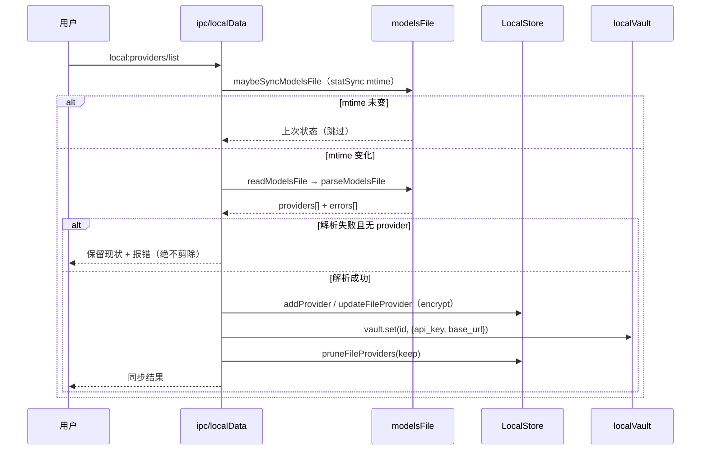

四条不可回退的纪律：

1. **解析失败绝不剪除**（`modelsFile.js:334-341`）：原实现 `keep=[]` → 一次写坏清空全部模型来源。
2. **写回是原子写 + 写前 `.bak`**（`:300-327`）：`writeFileDurableWithMode(…, 0o600)`，0600 未生效要报错。
3. **文件是一等事实来源**：UI 删/加模型会写回文件并热同步（`ipc/localData.js:96-132`）。
4. **迁移只在一处触发**（`ipc/localData.js:60-93`）：文件缺失 / 解析不出 provider / 全是 `example.com`
   占位时才把 UI 里手配的 provider 写进文件，避免覆盖用户手写内容。

#### 4.2 本地数据访问：`ipc/localData.js` 与 `localStore` 的分工

| 层 | 职责 | 不该做的事 |
|----|------|-----------|
| `ipc/localData.js` | **通道层**：入参解构、models.json 同步编排、空态回落、把异常转成 `{ok:false}` | 不直接读写 `local-data.json`、不做加密 |
| `localStore.js` | **仓储层**：内存真值 + 合并刷盘 + 三级恢复 + 写入阻断 | 不感知 IPC、不感知加密方案 |

`localStore` 的韧性设计（`localStore.js:7-11` 事故清单）：

- **合并刷盘**：`scheduleFlush(150ms)` 把消息热路径的多次写合并成一次，避免 Agent 高峰期同步写卡死事件循环；关键数据（凭证/供应商/偏好）仍走同步 `flush()`（`:44-63`）。
- **三级恢复**：`flush` 前留 `.bak` → 按日副本保留 7 天 → `load` 损坏先 `.bak` 恢复（`:76-123`）。
- **`corrupt-blocked`**：无备份可恢复时保留损坏原件（`local-data.corrupt-<ts>.json`）并**阻断一切写入**（`:101-115`、`:174-178`）。理由写在注释里：原实现"重置空库继续写"会让用户在新空状态上的所有输入覆盖损坏原件，原数据彻底不可恢复。
- **持久化 ACK**：`flush()` 返回 `{ok,error}`（`:149-170`），上层据此决定 `mainPersisted` / `persistState: durable|pending|failed`（`agentRunner.js:119-132`，契约在 `contract.mjs:89-91`）。

#### 4.3 MCP：连接 → 鉴权 → 发现 → 注入 → 调用

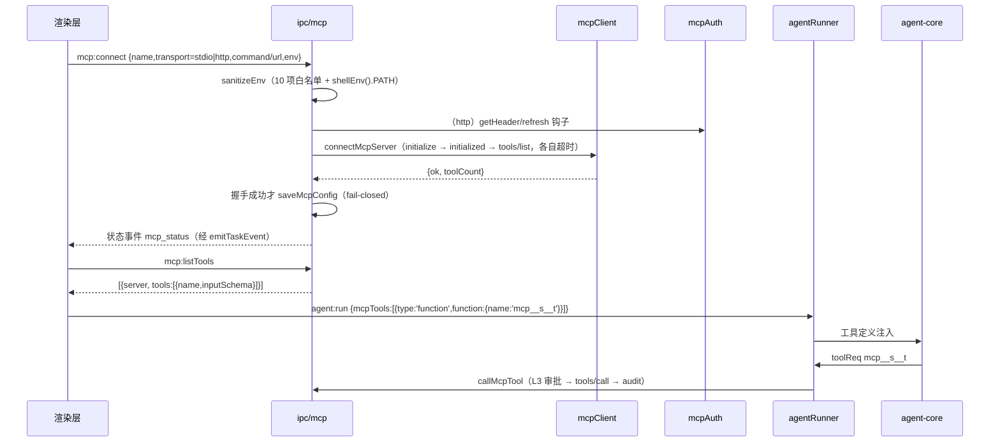

关键点：

- **双传输**：stdio 子进程按行 JSON-RPC；http 走 Streamable HTTP（POST JSON-RPC，响应可 JSON 或 SSE，`initialize` 捕获 `Mcp-Session-Id` 回带）（`mcpClient.js:1-17,77-104,110+`）。
- **不是 SSRF 防护对象**：MCP 地址来自用户显式配置而非模型可控参数，`localhost` 恰是自托管最常见形态，故**刻意不套** `webTools` 的私网拦截；模型只能调"已连接服务"的已注册工具（`mcpClient.js:10-14`）。这是"分发入口受控"替代"目标地址受控"的取舍，成立前提是 `callMcpTool` 按注册表查名。
- **env 白名单**：仅透传 `PATH/HOME/LANG/…/TMPDIR/NODE_ENV` 10 项 + 用户显式配置，`PATH` 特判用 `shellEnv().PATH`（打包版 GUI 继承的极简 PATH 曾让 npx/uvx 全部 `spawn ENOENT`）（`ipc/mcp.js:26,83-93`）。
- **OAuth 全程主进程闭环**：授权窗口是独立 `BrowserWindow`（无 preload、sandbox），令牌经 `CredentialCrypto` 加密落 `mcp-oauth.json`（0600，原子写），IPC 只回 `level` / `authorized`（`ipc/mcp.js:30-53`、`mcpAuth.js:29-35,50-67,119-128`）。
- **401 分流**：http 传输遇 401 先 `refresh()` 重试一次，仍 401 抛 `mcpAuthRequired`（穿透重包装保留标记，`mcpClient.js:130-141`；标记透传在 `:55-58`），上层据此提示"需要授权"而不是"网络故障"。
- **配置损坏不静默**：`loadMcpConfig` 解析失败时保留副本并 `console.error` 指路（`ipc/mcp.js:55-72`）。
- **注入侧的校验强度**：`mcpTools` 在 `agent:run` 里只被校验为 `z.array(z.any()).optional()`（`contract.mjs:134`）——**弱**；但落点强：`callMcpTool` 先 `mcpServers.get(server)`，未连接即抛 `MCP 服务 X 未连接`（`ipc/mcp.js:132-134`）。即"名字可信由注册表兜底，不由载荷兜底"。

#### 4.4 定时任务

| 面向 | 实现 | 证据 |
|------|------|------|
| 触发模型 | `setInterval` 20s tick → 5 字段 cron 匹配 → **分钟粒度幂等游标** `last_fired`（持久化字段，非内存 Map） | `scheduler.js:28,358-372` |
| 补跑扫描 | 启动时扫 `[last_fired, now]`：同日宽限窗口内补跑一次；超 7 天上限只标 `missed` 不回放 | `:30-32,195-235` |
| 执行通道 | 首选 Agent（工具循环 + 审批 + 沙箱 + 20 轮 + 200k token 预算），`chatOnce` 作为回落 | `main.js:935-968`、`scheduler.js:262-314` |
| 审批档 | 取"用户当前档 与 `auto-safe` 地板"中**更严者**（用户选"全部询问"必须生效） | `main.js:950-955`、`approvalPolicy.js` |
| 墙钟超时 | 单任务默认 10 分钟，到点 `ctl.abort()`；超时文案明确"墙钟上限 N 分钟" | `scheduler.js:29,292-320` |
| 假成功识别 | 全程零工具调用 + 自述做不到 → 判 `failed`（事故：UI 显示"成功"但内容是"我做不到"） | `:238-256` |
| 持久化 | `scheduled-tasks.json` 原子写 + `.bak`；损坏保留副本并明示；`MAX_RUNS=200` / 单任务 50 条 | `:26-27,49-82,347-352` |
| 输出归档 | `~/Documents/.MJCoder/tasks/<任务名>/<YYYY-MM-DD>.md` 按天追加；写失败只告警 | `scheduledOutput.js:1,14-15,41,72`；`scheduler.js:337-346` |
| 与 Agent 复用 | 复用 `loadAgentCore` + `scheduledToolHandlers()` + `scheduledAgentChat`（Worker 池同源） | `main.js:774-780,963,1050-1057` |

**注意**：定时任务**没有交互式审批通道语义**（无人值守），所以工具集是 `scheduledToolHandlers()` 的子集——浏览器/Chrome/Code Mode 七类高风险工具**只在主会话注入**（`main.js:907-926` 注释明确"Worker/定时任务无审批通道语义"）。

#### 4.5 生态资产：目录数据 → 运行时预设

链路（单一事实来源在 `main/ecosystem.js`，纯函数可单测）：

1. `loadDigitalEmployees(dir)`：读 `ecosystem/digital-employees.json`，**逐字段归一化**——非法 `approval_policy` / `sandbox_policy` 降级到最保守默认（`ecosystem.js:25-33,36-58`）。
2. `ecosystem:employeeRuntime`：按 `id` 找到员工 → `buildEmployeeRuntimePreset` → 审计留痕（`ipc/ecosystem.js:189-202`）。
3. 映射：抽象工具名 → 引擎具体工具名（`ROLE_TOOL_ALIASES`，未知名**直接丢弃**，"角色只裁剪工具、绝不发明工具"）；`browser` 只映射只读三件套（click/fill/select 有真实副作用，不默认授予）（`ecosystem.js:113-122`）。
4. 审批：`ROLE_APPROVAL_MAP` 归一后，与用户设置取**更严者**（`agentRunner.js:37-42`）——角色只能收紧。
5. 载荷：`sessionExtras.expert.runtime` → 每轮 `agent:run` 携带 `rolePreset` → 契约校验（`contract.mjs:139-148`）→ 引擎把 `systemPrompt` 拼在 `BASE_PROMPT` 之后（叠加身份而非替换）。
6. 技能：`starter_skills` 只传**名字**，内容由 `agentRunner` 按名从 `~/.mjcode/skills` 读（`main.js:853-854`），安全处置统一走不可信内容管道。

---

### 5. 云端 server（现状与边界）

#### 5.1 路由清单

`server/src/index.js:58-78` 把 10 个 router 全部挂在 `/api`（`auth` 挂 `/api/auth`）：

| 路由文件 | 主要端点 | 鉴权 | 备注 |
|---------|---------|------|------|
| `routes/auth.js`（125 行） | `POST /register` `POST /login`；`* /mp-bind`、`/mp-confirm`、`/mp-session` | 前者公开，后者 `requireMiniprogram` + `authMiddleware` | 小程序控制面默认 503（`auth.js:17-21`） |
| `routes/threads.js`（83） | `GET/POST /threads`、`GET/POST /threads/:id/messages`、`PUT /threads/:id/title`、`DELETE /threads/:id` | `router.use(authMiddleware)` | 服务端**无** `messages/replace`（压缩落库仅本地，`api.js:119-123`） |
| `routes/models.js`（137） | `GET /providers/secrets`（主进程专用）、`/providers` CRUD、`/providers/:id/models`、`/preferences` | 同上 | `secrets` 返回**解密后** api_key，注释"严禁暴露给渲染层"（`models.js:8`） |
| `routes/global-models.js`（72） | `GET /global/providers`（**公开**，不含 key）、`GET /global/providers/secrets`（auth）、`POST /admin/global/providers*`（auth+admin） | 逐路由显式挂载 | 注释说明禁用 `router.use` 兜底的原因（`global-models.js:45`） |
| `routes/scheduled-tasks.js`（73） | 5 个 CRUD + `POST /:id/run` + `GET /:id/runs` | `router.use` | 与桌面端本地调度器同构（list/runs 形状一致） |
| `routes/cloud.js`（115） | `POST /cloud/tasks`、`GET /cloud/tasks(/:runId)`、`POST /:runId/approve` | `router.use` + 特性开关 | **默认不挂载**（`index.js:64-70`） |
| `routes/chat.js`（63） | `POST /chat`（服务端代理模型调用） | `router.use` | 桌面端不走此路（本地直连） |
| `routes/audit.js`（28） | `POST /audit`、`GET /audit` | `router.use` | 桌面端审计上报目标 |
| `routes/dashboard.js`（65） | `GET /dashboard` | `router.use` | 离线时渲染层改用本地统计并标 `data_scope:'local'` |
| `routes/collab.js`（239） | 21 个端点：docs open/list/get/sync/pull/compact、messages、cards、approvals、presence、members | `router.use` | Yjs CRDT，见 §5.4 |

#### 5.2 鉴权中间件与一个挂载顺序陷阱

`middleware/auth.js:3-25`：`Bearer` 解析 → `jwt.verify(JWT_SECRET)` → 注入 `req.userId/userEmail/role`；`requireAdmin` 判 `role==='admin'`。全部是"共享密钥 HS"模式，无刷新令牌、无黑名单/吊销【待确认：是否需要】。

**陷阱**：`router.use(authMiddleware)` 对其所属 router 的**所有**请求生效（含未匹配路径）。因此 `index.js` 的挂载顺序本身构成鉴权语义：注释明确写"health 必须置于各 router 之前：`router.use(authMiddleware)` 会吞掉未匹配路径"（`index.js:21`）。这也是 `global-models.js:45` 拒绝用 `router.use` 兜底的原因。

#### 5.3 DB schema 与凭证加密

| 文件 | 表 | 说明 |
|------|----|------|
| `db/schema.sql`（92 行） | `users`、`model_providers`、`models`、`threads`、`messages`、`user_preferences` + 4 索引 | `model_providers.api_key` 注释仍写"simple XOR for now"，实际已是 AES-GCM（`schema.sql:22`） |
| `db/schema_extra.sql`（39） | `scheduled_tasks`、`subagents`、`plugins` | 子代理/插件表目前无路由使用【推断：预留】 |
| `db/schema_global.sql`（24） | `global_providers`、`global_models` | 管理员配置的共享模型 |
| `db/init.js` / `db/migrate.js` | 三条 schema 顺序执行 | 无版本表，靠 `CREATE TABLE IF NOT EXISTS` 幂等 |

`lib/crypto.js:17-44`：AES-256-GCM，密文格式 `v1:iv:tag:ct`，密钥取 `ENCRYPTION_KEY`（32B hex）；**无密钥时回落明文并 `console.warn`**（`:20-23`）——这是"可运行性优先"的显式取舍，须在部署清单里强制要求 `ENCRYPTION_KEY`（见风险 R6）。

#### 5.4 yjs 协同

`collab/crdt.js` + `docStore.js`（`PgStore`）+ `sync.js`，按业务实体分片：`thread:<id>` / `board:<id>` / `approval:<id>`（`routes/collab.js:3-4,25`）。进程内单例 `DocStore` 持有 `Y.Doc` 内存缓存（`:13-15`），增量走 `POST /collab/docs/:docId/sync|pull`，`seq` 单调递增用于乐观并发。桌面端对应 `main/collab.js`（本地快照持久化）+ 7 个 `collab:*` 通道，但**特性开关默认关闭**（`featureFlags.js:6-12` 的 `collab:false`）。

#### 5.5 为什么当前没接上，接回要改什么

**现状（两条独立证据，互为印证）**：

1. 渲染层 CSP `connect-src 'self' data: blob: ws://localhost:5173 ws://127.0.0.1:5173`（`renderer/index.html:31`）——**浏览器侧打不通 `http://localhost:3001`**。
2. `App.jsx` 在模块加载期 `setLocalMode(true)`（`renderer/src/App.jsx:36`），因此 `lib/api.js` 的双轨永远走 local 分支。

即：**当前发布形态只有本地轨在跑，服务端轨是代码遗留**（同 §2-5.3 与债务 D7）。这不是 bug，但必须显式化，否则会误判"服务端已可用"。

**接回所需改动（按依赖排序）**：

| # | 改动 | 位置 | 必要性 |
|---|------|------|--------|
| 1 | CSP 增加 `connect-src http://localhost:3001 https://<api-host>`（或改为主进程代理以彻底不开放） | `renderer/index.html:31` | 必须，否则一行都发不出 |
| 2 | 去掉 `setLocalMode(true)` 硬编码，改为由 `app:flags.cloud` / `server:health` 驱动 | `renderer/src/App.jsx:36`、`lib/ipc.js:13-34` | 必须 |
| 3 | 登录/令牌：目前无登录页路径与 `mj_token` 获取闭环 | `lib/api.js:24-43`（读到 401 即清 token） | 必须 |
| 4 | 审计开关：`authToken` 只在 `model:getSecrets` 成功后赋值（`main.js:339`），无令牌时审计只落本地 | `main.js:306-346`、`audit/auditLog.js:53-56` | 必须（否则云审计恒空） |
| 5 | 主进程代理方案（推荐）：渲染层不直连，改由主进程 `fetch` 转发，CSP 不必放宽、令牌不进渲染层 | 新增 `main/apiProxy.js` | 强烈建议【推断：与"凭证只在主进程"纪律一致】 |
| 6 | 双轨一致性：`messages/replace`、`threads/archived`、`threads/restore`、`threads/purge`、`providers/set-model` 等本地独有能力在服务端无对应路由 | `api.js:119-134` vs `routes/threads.js` | 需补齐或明确"仅本地" |
| 7 | 离线降级：`server:health` 已是探活入口（`ipc/localData.js:145-151`），需在 UI 明确"在线/离线"状态而非静默回落 | 渲染层 | 建议 |

---

### 6. 错误处理与可观测

#### 6.1 错误分类与可读化

四层分工，**每层只做一件事**：

| 层 | 机制 | 输出 | 证据 |
|----|------|------|------|
| 主进程边界 | 固定错误码前缀：`KEY_MISSING` / `BASE_URL_MISSING` / `NEED_ACCESSIBILITY` / `NO_TOKEN` / `DENIED` | 可 grep 的字符串 | `main.js:527,530,1340,1344`；`main.js:298-300`（`NO_TOKEN` 分支） |
| 主进程日志 | `degrade.report(scope,err)`：网络不可达→首条 warn 后续静默；真错误→恒 `console.error` | 分级日志 + `failureCount` | `degrade.js:34-55,58-74` |
| 渲染层 | `humanizeError(err)`：`Failed to fetch`→"本地服务未启动"；`Unauthorized`→登录失效；沙箱类→追加"安全下一步"（**不出现"改用 full-access"**） | 中文可读文案 | `renderer/src/lib/api.js:92-106` |
| 无人值守 | `detectUnfinished(output, toolCalls)`：零工具调用 + 自述做不到 → 判失败 | 明确的 failed + 原因 | `scheduler.js:246-256` |

`lib/ipc.js` 另有一层保护：所有调用 30s 超时后返回 `{ok:false,timeout:true}` 而非抛异常（`renderer/src/lib/ipc.js:37-45`），避免 UI 因未捕获 rejection 白屏。

#### 6.2 审计（`audit/auditLog.js`）

双轨，**可丢失遥测**定位（模块头注释即如此声明）：

- 无令牌 → 本地 `userData/audit-log.jsonl`（滚动上限 10MB，转 `.1` 只留一代）（`:19-51`）。**这是"本地优先"产品最基本的合规基线**：纯本地场景下的 shell/写文件/git/MCP/审批放行也必须留痕。
- 有令牌 → `POST {serverBase}/audit`，3s 超时；连续失败 3 次 → **熔断 5 分钟**，期间只计数不连接（`:53-80`）。
- 字段纪律：`target` 截 500、`detail` 截 2000；**绝不写 Key 明文**——凭证类审计只记服务名/模型数/结果（`modelsFile.js:31-36,361`、`credentialCrypto.js:28-33`）。
- 覆盖点：33 处调用（工具执行、审批结果、MCP 调用、插件安装、IDE 跳转、凭证读写、CUA 每步）。

#### 6.3 诊断导出（`diagExport.js`）

打包：`audit/` + `diagnostics/` + `traces/` + `logs/`（最近 3 个）+ `config/`（脱敏）+ `meta.json`（userData 路径以 `~` 相对表达）。三道脱敏：

1. **字段黑名单**：`api_key/apikey/keyEncrypted/…/env/headers/authorization`（`:18,29-40`）；
2. **内容正则扫描**：`sk-…` / `Bearer …` / `ghp_…` / `AKIA…` → `***REDACTED***`（`:25,43-45`），因为字段名脱敏对"命令原文/上游 401 响应体里嵌的 Key"完全无效（`:20-24` 事故说明）；
3. **models.json 白名单**（`MODELS_JSON_WHITELIST`，`:49-66`）：黑名单的变体键名永远漏，改白名单。

测试纪律：`test/diag-export.test.mjs` 用假密钥 grep 全包，命中即红（`:11`）。

#### 6.4 指标、探活与 trace

| 面向 | 实现 | 证据 |
|------|------|------|
| 资源快照 | `quota.snapshot()` 经 `quota:snapshot` 供 AgentDock 轮询；fg/bg 槽位 + 错误连击熔断 5 分钟 | `main.js:251-253`、`resourceQuotaCenter.js:1-14` |
| 本地后端探测 | 启动一次 + 每 5 分钟复探（Ollama），失败静默 | `main.js:280-282` |
| 服务端探活 | `/api/health` **探 DB**（`SELECT 1` + 2s 超时），DB 不可用 → **503 + `status:'degraded'`**（"说不了谎的 health 才有用"） | `server/src/index.js:24-56` |
| 桌面探活 | `server:health` 3s 超时，失败恒 `{online:false}` | `ipc/localData.js:145-151` |
| 运行 trace | `userData/traces/<runId>.jsonl` 逐轮事件，不上报，供排障与诊断包 | `runTrace.js`；`main.js:258-259` |
| 崩溃聚合 | `uncaughtException` + `unhandledRejection` → `diagnostics/crash-YYYYMMDD.jsonl`（含活跃 runId + trace 尾部） | `main.js:379-392`、`diagnostics.js` |
| 审批可观测 | 审批结束广播 `tool:approval-end` / `cua:approval-settled`，让 UI 撤卡（否则卡片常驻、用户"点了没反应"） | `main.js:92-98,1284-1288` |

> `unhandledRejection` 兜底那条注释值得单独抄进团队规范：Node/Electron 默认在 Promise 拒绝后终止进程，
> 一处漏接 `.catch()` 会让**正在跑的全部 Agent 任务与对话一起丢失且无提示**（`main.js:383-392`）。

---

### 7. 风险与改进

| # | 现象 | 影响 | 建议 | 证据 |
|---|------|------|------|------|
| **R1** | 170 个通道中只有 `agent:run` + `tasks:*` 6 个写通道有 zod 契约；~~其余写通道全靠实现约定~~ **✅ 部分已修（X14，2026-10-17）**：`payloadGuard` 已覆盖 **45 条写通道**的形状与上限（45 是通道数，实测 **71 个 `guard.assert*` 调用点**），但它是**形状/上限守卫**，不是 zod 契约——字段语义漂移仍只能运行时暴露 | 字段漂移只能运行时暴露；`local:providers/*`、`local:messages/*`、`mcp:setConfig` 这类**写通道**一旦漂移会静默写脏数据 | 按风险排序把 8 类写通道纳入 schema（`local:*` provider/message、`market:*`、`mcp:setConfig`、`scheduled:save`、`cua:run`）；或在 `lib/ipc.js` 加 dev-only 断言（生产零开销） | `shared-ipc/contract.mjs:1-13`；`main/main.js:13-22`；通道计数 §2.2 |
| **R2** | ~~契约未就绪窗口内 `agent:run` 跳过载荷校验~~ **✅ 已修（2026-10-17，`4010a4d`）**：`agent:run` 改走 `startAgentRunWhenReady`（先 `await contractReady`），`if (!contract)` 由放行改为硬拒 | 原风险（启动早期畸形载荷穿透）已消除；残余只有「打包版漏 `shared-ipc` 白名单」→ 表现为**全部对话启动失败**（显性） | ① ready 门 —— 已落地；② 打包白名单校验：`test/untracked-deps.test.mjs` 已覆盖打包输入枚举，建议再加一条「产物内必须存在 `shared-ipc/contract.mjs`」的断言 | `main/agentRunner.js:25-31,74-96`；`main/main.js:931` |
| **R3** | `local:*` 查询通道在 store 未就绪时返回 `[]` / `{ok:false}` / `null`，与"确实没有数据"不可区分 | UI 把"未初始化"读成"没有会话"，用户可能重复创建项目/会话；排障时无信号 | 引入统一错误码 `STORE_NOT_READY`（与 `KEY_MISSING` 同风格），渲染层对空态与错误态分别渲染 | `ipc/localData.js:154,183-187,252-255` |
| **R4** | `main.js` 是 God Object（raw **1785** / code **1212** 行）：装配 + 审批中心 + 模型代理 + 编排 IPC + CUA IPC 混在一起 | 新增能力只剩"拆模块/往边缘塞"；启动顺序成为隐式契约（本章 §1.0）；`chatStreamOnce` 与 `scheduledAgentChat` 两处模型代理逻辑已出现分叉【推断】 | 收敛为"生命周期 + 声明式装配表"：各域自报 `{init, channels}`，由统一注册器挂载；模型代理独立成 `modelProxy.js`（`chatStreamOnce`/`scheduledChatOnce`/`scheduledAgentChat`/`cuaChat` 四处合一） | `main/main.js:1-1432`、`:524-730`、`:1293-1306`；行数口径见 `:1137-1139`（**v1.0 引的 `:241`「逼近 max-lines 门禁」注释已被 `60d989e` 清理，该证据失效**） |
| **R5** | MCP 配置 `env` 全量存盘（明文），`mcp:getConfig` 靠 `.map(({env,...rest})=>rest)` 剥离 | 任何新增 MCP IPC 若忘记剥离即泄漏用户 Key；`mcp-servers.json` 本身是明文（无 0600 校验，对比 `models.json` 有） | `saveMcpConfig` 对 `env` 做敏感键加密（复用 `CredentialCrypto`）；写盘加 0600 + `modeApplied` 校验（照抄 `modelsFile.js:319-324`）；在 preload 侧对 `mcp:setConfig` 也做字段白名单 | `ipc/mcp.js:74-81,275-281,287-311`；`modelsFile.js:300-327` |
| **R6** | 服务端 `ENCRYPTION_KEY` 缺失时**回落明文**并只 warn | 生产环境配漏环境变量 = 全部用户 api_key 明文落库，且无任何启动失败提示 | 启动期强校验：`NODE_ENV=production` 且无 `ENCRYPTION_KEY` → 直接 `process.exit(1)`；部署清单与 CI 各加一道检查 | `server/src/lib/crypto.js:17-23`；`server/src/db/schema.sql:22` 注释仍写"simple XOR"（需更正） |
| **R7** | 服务端与桌面端的鉴权/数据模型存在结构性不一致：无刷新令牌、无吊销；`threads` 有 `archived` 字段但无 archived 路由；本地独有能力（消息替换/归档恢复/purge）服务端无对应 | 一旦按 §5.5 接回云端，"本地能用、云端不能用"的能力会变成隐性功能降级 | 以"云端能力矩阵"逐项标明仅本地能力，接回时要么补齐路由要么在 UI 上禁用而非报错 | `server/src/middleware/auth.js:3-25`；`routes/threads.js`；`renderer/src/lib/api.js:119-134`；§5.5 表 |
| **R8** | `diag:preview` 通道已注册但 preload 未暴露（不可达）；另有 3 条 `send` 单向通道无返回确认 | 死通道误导后续维护（以为有预览入口）；`send` 型通道（`tool:approval-response`、`diag:report`）失败无回执，审批丢失只能等 120s 超时 | 死通道删除或补齐桥方法；`send` 型改为 `invoke` 并由主进程 ack（审批响应已有 `approvalId` 分发 + 广播兜底，可保留现状但需在文档登记） | `main/diagExport.js:187`；§3.3 差集表；`preload.js:213,256,285-288` |

#### 待确认清单

- 【待确认】`mjcode` 是否计划把"渲染层直连服务端"改为"主进程代理"（§5.5 第 5 项）。这是接回云端的
  架构分岔：代理方案让 CSP 保持最严、令牌不进渲染层，代价是多一跳与主进程内存压力。
- 【待确认】`tasks:*` 5 个查询通道（`list/get/execute/autoRun/plan`）是否需纳入契约——`autoRun/plan`
  其实是**写通道**（建组 + 消耗 token），当前无校验。
- 【待确认】服务端 `schema_extra.sql` 的 `subagents` / `plugins` 两表无消费者，是否属废弃设计。

---

## 第 5 章　数据模型与持久化

# 第 5 章 数据模型与持久化

> 本章只回答三件事：**数据存在哪**、**表长什么样**、**崩了怎么恢复**。
> Agent 运行时状态机留第 3 章，进程与模块边界留第 2 章，IPC 通道清单留第 6 章。
>
> 证据约定：路径以 `desktop/` 为根，行号以当前工作树为准。凡属推断标【推断】，
> 凡需实测/产品确认才能定的标【待确认】。
>
> **与第 2 章的两处事实修正**（以源码为准）：
> ① 库文件名是 `userData/mjcode-tasks.db`（`main/db/index.js:226`），不是 `*.sqlite`；
> ② sql.js 不是"仅 `will-quit` 才 flush"——它有 150ms 防抖 export + `process.on('exit')` 兜底
> （`main/db/sqljsDb.js:14,55-62`），`will-quit` 是第三道。这个差别决定风险量级（见 §6.6）。

### 1. 存储选型

#### 1.1 现状：一个应用，三套持久化底座

不是"双活"，也不是"统一数据层"，而是按**数据形状**分工的三条独立轨道：

| 轨道 | 载体 | 承载 | 入口模块 |
|------|------|------|---------|
| 文档轨（JSON） | `userData/local-data.json` | 线程、消息、供应商凭证、项目、偏好 | `main/localStore.js` |
| 关系轨（SQLite） | `userData/mjcode-tasks.db` | 任务编排（组/子任务/副作用账本）、记忆（五域四层）、记忆后台队列 | `main/db/index.js` + `main/taskStore.js` + `main/memory/` |
| 旁路文件 | `agent-checkpoints.json`、`scheduled-tasks.json`、`audit-log.jsonl`、`traces/<runId>.jsonl`、`~/.mjcode/models.json` | 断点、定时任务、审计、运行 trace、供应商文件源 | `checkpointStore` / `scheduler` / `audit/auditLog` / `runTrace` / `modelsFile` |

分工理由（源码直证，非取舍偏好）：**消息/线程走 JSON** —— 访问模式是"按会话全量读出、按插入序渲染"，
无跨行聚合、无事务要求；且消息是**最高频写路径**，`localStore` 用 150ms 合并刷盘（`localStore.js:48-63`）
换掉"每条消息一次同步全库写"，避免卡死主进程事件循环（`localStore.js:38-41` 事故注释）。
**任务/记忆走 SQLite** —— 需要状态机迁移合法性校验（`taskStore.js:9-28`）、跨行聚合（`isGroupSettled` 的
`COUNT(*)`、`memory.stats()` 的 `GROUP BY domain, tier`）、幂等唯一约束（`UNIQUE(group_id, task_id)`，
`db/index.js:130-142`）、Top-K 排序（`ORDER BY tier DESC, updated_at DESC LIMIT ?`，`memory/index.js:209-211`）
—— 这些用 JSON 数组手写只会得到"半正确"的实现。

#### 1.2 候选方案对比

| 方案 | 事务/约束 | 查询能力 | 打包成本 | 崩溃安全 | 结论 |
|------|---------|---------|---------|---------|------|
| **sql.js（WASM）** | 完整 SQLite 语义（`BEGIN/COMMIT`、PK/UNIQUE/索引），但库在内存 | 完整 SQL | `sql.js ^1.13.0` 是普通依赖，仅需 asarUnpack 一个 `.wasm`（`package.json:55-57`） | **弱**：全量 export 落盘，窗口内变更丢失 | **打包态采用**（`db/index.js:238-244`） |
| **better-sqlite3** | 同上 + WAL 真事务 | 完整 SQL | 原生模块，需 electron-rebuild；仓库设 `npmRebuild: false`，无重编译兜底 | 强（WAL + fsync） | **仅 dev**（`optionalDependencies`，金丝雀探测通过后使用） |
| **LevelDB / RocksDB** | 仅 KV + 批写 | 无 SQL、无二级索引、无聚合 | 原生依赖，与 better-sqlite3 同风险 | 强（LSM + WAL） | **否决**：任务 DAG 查询、记忆 Top-K、`COUNT(*)` 全部要在 JS 层手写索引，复杂度反超收益 |
| **纯 JSON 文件（统一）** | 无 | 无 | 零 | 依赖 `writeFileDurable` | **否决**：任务状态机的唯一约束、并发领取、聚合统计都要在应用层重建，且单文件全量重写随数据量线性劣化 |
| **node:sqlite（未来）** | 完整（内建） | 完整 | 零原生依赖（Node 内建） | 强（真 WAL） | **规划中**：`intentLog.js:4-13` 明确 `RETIRES_AT: 'C4'`（node:sqlite 落地后退役意图日志） |

**被否决的关键理由（真机事故，非理论）**：打包版加载 better-sqlite3 后主进程启动 7s 即 SIGSEGV，栈在
`napi_register_module_v1`，且**子进程金丝雀探测环境干净、复现不了**（`db/index.js:176-182`）。因此
"打包版不加载任何原生模块"是硬约束，不是优化。

#### 1.3 驱动选择逻辑（`db/index.js:225-264`）

```
openDbAsync(dataDir, { isPackaged, driver })
  ├─ driver = driverOverride || MJ_DB_DRIVER || 'auto'        // 显式指定优先
  ├─ 'sqljs' ─────────────────────────────► sql.js（强制，测试用，零原生）
  ├─ 'auto' && isPackaged ────────────────► sql.js（不加载任何原生模块）
  └─ dev（auto）：probeBetterSqlite3() 子进程金丝雀，10s 超时（db/index.js:197-223）
        ├─ 通过 ──► better-sqlite3（WAL + foreign_keys=ON，migrate()）
        └─ 失败/超时 ──► sql.js（降级）
```

代价与不变量：dev 多一次 ~1s 子进程探测，换"永不因驱动崩溃而失能任务编排子系统"；两条路径 MUST 产出
同一 `db` API 面 `exec / prepare().run|get|all / pragma / transaction / flush / close`（`sqljsDb.js:68-142`
只实现了 `db/index.js` 与 `taskStore.js` 实际用到的子集）；`sqljsDb.__driver = 'sqljs'`（`sqljsDb.js:70`）
是主进程判断"是否需要显式 flush"的标识。

### 2. 表清单

#### 2.1 SQLite（`userData/mjcode-tasks.db`）—— 共 5 张表

| 表名 | 用途 | 关键列 | 主键与索引 | 写入方 |
|------|------|--------|-----------|--------|
| `task_groups` | 任务组（一次目标 → 一张 DAG） | `group_id` `goal` `cwd` `status` `dag_json` `result_json` `error` `auto` `replan_depth` `replan_of` `approval_mode` `sandbox_policy` `thread_id` `created_at` `updated_at` | PK `group_id`；`thread_id` 无索引 | `TaskStore.createGroup / setGroupStatus / recoverInterrupted / touchGroup`（`taskStore.js`） |
| `sub_tasks` | 子任务（DAG 节点） | `task_id` `group_id` `seq` `title` `prompt` `depends_on` `critical` `max_retry` `timeout_ms` `status` `retry_count` `result_json` `error` `worker_id` `started_at` `finished_at` | PK `(group_id, task_id)`；`idx_sub_tasks_status(status)`、`idx_sub_tasks_group(group_id)`；FK `group_id → task_groups` | `TaskStore.createGroup / setTaskStatus / enqueueReady / claimNext` |
| `memories` | 记忆条目（五域三层） | `id` `space_id` `domain` `tier` `content` `summary` `importance` `entity_tags` `embedding` `expire_at` `is_valid` `compressed` `re_hit_count` `usage_count` `source` `content_hash` `created_at` `updated_at` | PK `id`(TEXT)；`idx_memories_space(space_id, domain, tier)`、`idx_memories_valid(is_valid, expire_at)`、`idx_memories_hash(space_id, domain, content_hash)` | `MemoryManager.remember / recall / compress / decayJob / promoteToLongTerm / invalidate / _enforceSpaceCap`（`memory/index.js`） |
| `memory_bg_tasks` | 记忆后台作业队列（兼执行账本） | `id` `type` `payload` `priority` `status` `attempts` `error` `created_at` `updated_at` | PK `id`(TEXT)；`idx_bg_tasks_status(status, priority)` | `MemoryBgScheduler.enqueue / _claim / runOne / purgeHistory`（`memory/bgScheduler.js`） |
| `side_effects` | 副作用账本（V14"重启不自动重放"的地基） | `id`(AI) `group_id` `task_id` `state` `created_at` `resolved_at` | PK `id`；`UNIQUE(group_id, task_id)`；`idx_side_effects_state(state)` | `TaskStore.markEffectUncertain / resolveEffect`（`taskStore.js:233-247`） |

> 注意：`side_effects.group_id` **没有**声明 FK（`db/index.js:131-139`），删除靠 `deleteGroup` 在同一事务里
> 显式级联（`taskStore.js:80-85`）——"应用层外键"，schema 层面无保护。

#### 2.2 JSON 文档（`userData/local-data.json`）—— 5 个集合 + 1 个计数器

| 字段 | 形状 | 关键属性 | 写入方 |
|------|------|---------|--------|
| `threads[]` | 数组 | `id`(number, 自增) `title` `cwd` `projectPath` `providerId` `providerName` `modelName` `status`(idle/running/awaiting_approval/done) `archived` `createdAt` `updatedAt` | `createThread / setThreadStatus / renameThread / archiveThread / restoreThread / purgeThread / setThreadProject` |
| `messages[]` | 数组 | `id` `threadId` `role` `content` `toolCalls` `toolCallId` `tokensInput` `tokensOutput` `modelName` `createdAt` | `addMessage / replaceMessages`（`/compact` 落库）/ `purgeThread` |
| `providers[]` | 数组 | `id` `name` `base_url` `keyEncrypted`(safeStorage 密文) `models[]` `modelId` `source`(file) `fileKey` `createdAt` | `addProvider / updateProvider / setProviderModel / addProviderModel / removeProviderModel / pruneFileProviders` |
| `projects[]` | 数组 | `path`(业务主键) `name` `createdAt` `lastOpenedAt` | `addProject / renameProject / removeProject` |
| `preferences` | 对象 | `key → value` 自由 KV（如 `memory.bgDailyQuota`、`tasks.max_concurrent`） | `setPreference` |
| `seq` / `schemaVersion` | 标量 | `seq` 全局自增 id 源；`schemaVersion = 1` | `nextId()` / `migrate()` |

无数据库索引即"数组线性扫描"：`listMessages` 每次 `filter + sort`（`localStore.js:255-261`），`listThreads`
同理——**这是 §9 的第一个容量风险点**。

#### 2.3 旁路文件

| 文件 | 结构 | 容量控制 | 写入方 |
|------|------|---------|--------|
| `agent-checkpoints.json` | `{ [threadKey]: { kind: 'tokens'\|'engine-exit', summary, usage, rounds, rescues, budget, model, cwd, savedAt } }` | `MAX_ENTRIES = 50` LRU（`checkpointStore.js:21,86-89`） | `agentRunner.js:216,299` |
| `scheduled-tasks.json` | `{ tasks: [...], runs: [...] }` | `MAX_RUNS=200`、`MAX_RUNS_PER_TASK=50`（`scheduler.js:28-30`） | `scheduler.js`（全部写经 `persist()`） |
| `audit-log.jsonl` | 逐行 JSON（seq/prev/hash + action/target/detail/approval_result）——第八轮 L-3 起带哈希链，可校验「有没有被改过」 | 滚动上限 10MB（`audit/auditLog.js` 的 `AUDIT_LOG_MAX_BYTES`） | `auditLocal()` |
| `traces/<runId>.jsonl` | 逐行 trace 事件 | run_end 后文件级 LRU（`agentRunner.js:238-241`） | `runTrace.appendTraceEvent` |
| `~/.mjcode/models.json` | 供应商/模型清单（文件是事实来源） | 无 | `modelsFile.syncModelsFile` → 对账进 `providers[]` |

### 3. ER 图

只画有外键或强业务关联的边。属性清单见 §2，此处不重复；实线 = schema 有 FK，虚线 = 应用层约定。

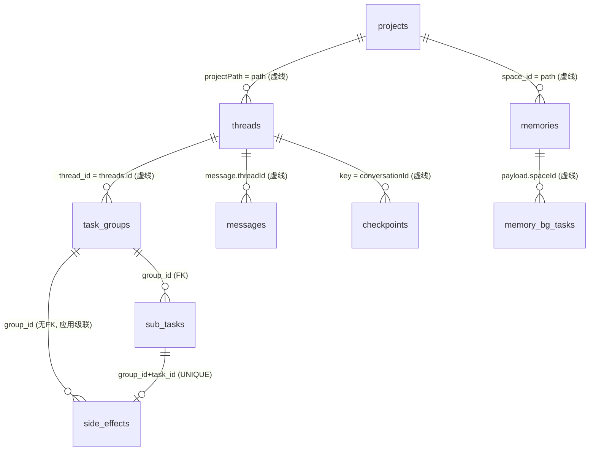

要点：
- `space_id` 存的是**项目绝对路径字符串**（`main.js:1070-1072` 传 `group.cwd`；`ipc/localData.js:303` 传
  `projectPath`）。路径改名 = 记忆归属断裂；但 `renameProject` 只改显示名不动目录（`localStore.js:490-501`），当前不会触发。
- `threads.id` 是 JSON 自增数字，却以 **TEXT** 存进 `task_groups.thread_id`（`db/index.js:151`）；类型宽松是
  有意为之（历史组无该列），代价是跨轨 JOIN 只能在应用层做。
- **不存在的实体**：没有独立的"用量/计费"表——用量只有 `messages.tokensInput / tokensOutput` 两列
  （`localStore.js:242-243`）与内存态 `lastBudgetState`（`agentRunner.js:233-235`），压缩配额靠
  `memory_bg_tasks` 当日 done 行计数（`bgScheduler.js:132-139`）。成本报表只能从消息行累加。【待确认】是否新增 usage 表。

### 4. 数据流向：一次对话从渲染层到落盘

#### 4.1 主链路

```
renderer useAgentRun → window.mjcode.agentRun(payload) → ipcMain 'agent:run'
  → agentRunner.run({ conversationId, messages, model, cwd, ... })
  → agent-core（in-process 或 engine 子进程）
  → cb.onMessage({ role, content, tool_calls, tool_call_id, tokens_input, tokens_output })
       │
       ▼ agentRunner.toStoreShape(m)                     // ★ snake_case → camelCase，唯一转换点
         { role, content, toolCalls: m.tool_calls, toolCallId: m.tool_call_id,
           tokensInput: m.tokens_input, tokensOutput: m.tokens_output }   (agentRunner.js:133-140)
       │
       ▼ deps.persistMessage({ conversationId, message })  // main.js:863-866
         localStore.addMessage({ threadId: conversationId, ...message })
       │
       ▼ 内存即时可见（UI 读路径）→ scheduleFlush(150ms)   // localStore.js:251
         flush() → writeFileDurable(local-data.json)       // tmp.<pid> + fsync + rename + fsync(dir)
```

终止路径的持久 ACK（V08 语义）：`onDone` → `persistChatMessage` → `confirmDurable()` → `deps.flushPersistence()`
→ `localStore.flushSync()`；只有 `{ok:true}` 才向渲染层回 `mainPersisted: true`，否则 `persistState: 'pending'`
（`agentRunner.js:119-128,252-255`）。**不允许"内存写了就说已保存"。**

#### 4.2 camelCase / snake_case 兼容层：三个转换点，一处不合就静默丢字段

| 边界 | 两侧命名 | 转换实现 | 风险 |
|------|---------|---------|------|
| agent-core ↔ 主进程 | `tool_calls` / `tool_call_id` / `tokens_input`（OpenAI 协议形状，snake）→ `toolCalls` / `toolCallId` / `tokensInput`（camel） | `toStoreShape`（`agentRunner.js:133-140`）**唯一转换点** | 新增字段必须在此登记，漏写 = 落库为空且无报错 |
| 主进程 ↔ JSON 库 | 全 camelCase（`threadId` `projectPath` `lastOpenedAt`） | `localStore` 直接读写对象，无映射层 | 命名即 schema；`EMPTY` 未声明的字段靠 `{...EMPTY, ...rawObj}` 原样保留（`localStore.js:128`） |
| SQLite 列 ↔ 业务对象 | `is_valid` / `usage_count` / `re_hit_count`（snake）→ `isValid` / `usageCount` / `reHitCount`（camel） | `_rowToMemory`（`memory/index.js:184-194`）、`rowToTask`（`taskStore.js:293-301`） | 打分函数显式双兼容：`memory.is_valid !== undefined ? !!memory.is_valid : memory.isValid !== false`（`scorer.js:71`） |

`scorer.scoreMemory` 的双键兼容是**必要的防御**而非冗余：`recall` 传进去的对象已过 `_rowToMemory`
转成 camel，但打分内部仍读 `memory.updated_at` / `memory.usage_count` 等 snake 键——**这意味着转换层的
输出对象是"混合命名"的**，新增字段时极易踩空，建议后续统一为单一命名后再移除兼容分支。

#### 4.3 记忆注入链路（写在主进程，读在 Worker/渲染层）

```
写：/mem 或自动捕获 → ipc 'local:memories/add' → MemoryManager.remember()   // 未就绪入 memoryWriteQueue
读：① Worker  buildTaskPrompt → recallContents(spaceId=group.cwd, query="goal+title", topK=3,
       domains=[global_knowledge, entity, reflection]) → wrapUntrusted() 隔离 → prompt (main.js:1066-1080)
    ② 会话    renderer → ipc 'local:memories/list' → recallContents → engineParams.memories
    ③ 设置页  ipc 'memory:list' / 'memory:invalidate' / 'memory:promote'（分页 50，上限 200）
```

`memoryWriteQueue` 只在进程内存（`ipc/localData.js:275-296`），**注释明确禁止回落 JSON**——因为那正是
"双轨分裂"的根：用户以为存了，实际召回与 UI 都只读 SQLite。

### 5. 迁移策略

#### 5.1 三套版本机制并存（真实状态）

| 域 | 版本载体 | 机制 | 幂等性 |
|----|---------|------|--------|
| SQLite（desktop） | `PRAGMA user_version` | `MIGRATIONS[1..6]`，每个迁移包在 `db.transaction()` 内执行 `up()` + `PRAGMA user_version = N`（`db/index.js:266-277`） | **部分**：`CREATE TABLE/INDEX IF NOT EXISTS` 幂等；`ALTER TABLE ADD COLUMN` **不幂等**（见 5.3） |
| JSON（desktop） | 文件内 `schemaVersion = 1` | `migrate(raw)`：`{...EMPTY, ...raw}` 容错合并 + 按版本号顺序补字段；v0→v1 只补 `providers[].models`（`localStore.js:126-141`） | 是（版本号单调推进，不会重放） |
| PostgreSQL（server） | `schema_migrations` 表 | `MIGRATIONS[001..005]` + `addColumnIfMissing()` 查 `information_schema.columns` 再 ALTER（`server/src/db/migrate.js:12-21,123-136`） | 是 |

#### 5.2 SQLite 迁移链（`db/index.js:12-154`）

| 版本 | 变更 | 兼容性 | 回滚方案 |
|------|------|--------|---------|
| v1 | 建 `task_groups` / `sub_tasks` + 2 索引 | 纯新增 | 删表（无数据依赖时） |
| v2 | `task_groups` 加 `auto` / `replan_depth` / `replan_of` | 纯加列，旧代码忽略新列 | 列不可删（SQLite 需重建表）→ **无回滚，只能向前** |
| v3 | 建 `memories` / `memory_bg_tasks` + 2 索引 | 纯新增 | 删表 |
| v4 | `task_groups` 加 `approval_mode` / `sandbox_policy`（建组时刻治理快照） | 纯加列 | 无 |
| v5 | 建 `side_effects` + 索引 | 纯新增 | 删表 |
| v6 | `task_groups` 加 `thread_id` | 纯加列；历史组为空 → 渲染层按 `cwd` 归属 | 无 |

**仓库无 down migration。** 回滚唯一手段是"退回旧版本二进制 + 保留旧库文件"；sql.js 单文件全量导出天然
适合整文件备份/还原——但**代码里没有任何备份动作**（见 §6.6 建议 A 的附带项）。

#### 5.3 已知迁移缺陷（源码可证，建议修）

1. **`ALTER TABLE ADD COLUMN` 不幂等**：v2/v4/v6 直接 ALTER。若 `user_version` 未成功推进（旧库文件被还原、
   事务中途崩溃、用户手工替换 db 文件），重跑抛 `duplicate column name` → `migrate()` 抛出 → `openDbAsync`
   reject → `initTaskOrchestration` 的 `.catch` 把 `taskStore = null`（`main.js:1008-1012`）→ **整个任务编排 +
   记忆子系统不可用，只留一条 console.error**。修法：迁移前 `PRAGMA table_info` 探测列存在性
   （`MemoryManager._ensureHashColumn` 已这么做，`memory/index.js:75-87`，只是没复用进迁移链）。
2. **`memories.content_hash` 不在版本链内**：由 `_ensureHashColumn()` 惰性补齐（`memory/index.js:71-87`）。
   注释理由是"迁移链不归本模块维护"，结果是 **schema 事实有两个来源**，任何"从 user_version 推导完整表
   结构"的工具都会漏列。修法：提升为 v7 迁移，模块内探测降为兜底。
3. **JSON 与 SQLite 版本号无关联**：JSON 停在 v1、SQLite 已到 v6；跨轨迁移（memories 从 JSON 导入 SQLite）
   靠**数据探测**而非版本号：`SELECT COUNT(*) ... WHERE source='legacy-import'`（`main.js:1035-1037`）。

### 6. 一致性、原子性与崩溃恢复

#### 6.1 原子写原语（`main/data/durableWrite.js`）

```
writeFileDurable(file, data):
  tmp = `${file}.${process.pid}.tmp`              // 带 pid，多实例不互踩
  openSync(tmp,'w') → writeSync → fsyncSync(fd)   // ① 数据落盘，不只进 page cache
  renameSync(tmp, file) → fsyncDir(dirname)       // ② 原子替换 + 目录项落盘（POSIX）
  → { ok, dirFsynced }
```

- **Windows 恒返回 `dirFsynced: false`**（`durableWrite.js:22-35`）：Node 无法对目录句柄 fsync，
  代码选择"如实上报没做到"，而不是伪装成功。
- `writeFileDurableWithMode(..., 0o600)` 在 rename 后补 `chmod`（`durableWrite.js:84-96`）——tmp 名带 pid
  会被复用，`open` 的 mode 只在创建时生效，会静默丢权限。使用者：`checkpointStore.saveAll`。
- `appendDurable`：`writeSync + fsyncSync`；`openAppend` 用 `'a+'` 而非 `'a'`——需同一 fd 读尾部窗口 + `ftruncate`
  截半行（macOS 上 write-only fd `readSync` 抛 EBADF，`durableWrite.js:115-127`）。其余写点：`localStore`/`sqljsDb`/
  `scheduler`/`checkpointStore` 均已走该原语；审计 JSONL 用普通 append（可丢失遥测，允许）。

#### 6.2 localStore 的四级韧性（`localStore.js:7-13,76-196`）

| 级别 | 机制 | 触发条件 |
|------|------|---------|
| 0 | `scheduleFlush(150ms)` 合并窗口 —— 崩溃丢失窗口 = 150ms，换主进程不被消息热路径阻塞 | 每次消息/状态变更 |
| 1 | `.bak`：flush 前 `copyFileSync(主文件 → .bak)` | 每次 flush（`corruptBlocked` 时拒绝写盘） |
| 2 | 按日副本：`local-data.YYYY-MM-DD.json`，保留 7 天 | 每天首次 flush |
| 3 | `corrupt-blocked` **fail-closed**：损坏且无备份 → 保留原件为 `local-data.corrupt-<ts>.json`，内存用空库撑 UI，**所有写方法经 `requireWritable()` 抛错** | `JSON.parse` 失败且 `.bak` 也失败 |

两处易漏但关键的细节：`pendingBakRepair`（主文件已知损坏时**跳过本次 `.bak` 覆盖**，防"好备份被坏文件
污染"，`localStore.js:36,154`）；V08 脏标记恢复（`flush()` 失败必须把 `_dirty` 置回 true，否则"用户看到
已保存、实际只在内存且无重试"，`localStore.js:55-59,70-73`）。

#### 6.3 意图日志（intentLog）—— 已建成，**尚未接入任何域**

设计目标（`intentLog.js:1-35`）：在 sql.js 驱动期充当**唯一真值源（durable truth）**，
内存库是派生索引；`compact()` 周期把内存态导出快照，崩溃恢复 = 快照 + replay 日志。

| 能力 | 实现 |
|------|------|
| T0 强持久追加 | `appendNow`：先 `flush()` 排空缓冲 → `writeSync + fsyncSync` → 成功才推进 seq；失败 `_truncateToWritten()` 回滚并抛错（fail-closed）。承载凭证密文/OAuth 令牌 |
| T1 组提交 | `groupCommitMs=20` / `groupCommitMax=10`，返回值恒 `durable:false`，调用方不得据此宣称已持久 |
| 崩溃恢复 | `_recoverTail()`：open 时截掉末尾半行 + 初始化字节账（唯一初始化点）；`_lastSeq()` 只读尾部 64KB 窗口（200k 条实测 4ms vs 全扫 51ms） |
| 折叠 | `compact(snapshotData, snapshotFile)`：**先原子落盘快照，成功后才清空日志**，顺序不可颠倒 |
| 字节账 | `syncedBytes ≤ writeBytes ≤ 文件实际大小`，只在 `writeSync` 完整成功后推进（防"过计 → 下次跳过写入 → 静默丢数据"） |

**事实校正（源码直证）**：`getIntentLog` 在 `main/` 与 `agent-core/` 中**零调用**（grep 排除模块自身后
无命中）。因此：注册表恒为空 → `main.js:409` 的 `flushAllIntentLogs()` 是**空操作**；当前没有任何数据域
的真值落在意图日志上，`local-data.json` 与 `mjcode-tasks.db` 仍是两份独立真值；该模块处于"已实现、
待接管"状态（`LIFECYCLE: 'sqljs-driver-period'`、`RETIRES_AT: 'C4'`）。结论：**不要把 intentLog 当成
当前的一致性保障**——设计上是对的，运行时是空的。

#### 6.4 checkpoint 的作用范围

- **触发点**：token 预算熔断（`onSuspend`，`agentRunner.js:212-231`）与引擎进程崩溃
  （`err.engineExited`，`agentRunner.js:296-310`）——只有这两处。
- **语义**："一次性恢复垫脚石"：渲染层发「继续」时取回注入，成功启动即 `clearCheckpoint`，不累积
  （`checkpointStore.js:1-7`）。
- **内容/范围**：`kind`（tokens / engine-exit，决定恢复文案分流）、`summary`（末 4000 字符）、`usage`、
  `rounds`、`rescues`、`budget`、`model`、`cwd`；按 `threadKey = conversationId` 覆盖写，全库上限 50 条。
- **损坏 fail-closed**：留 `.corrupt-<ts>` 副本 + `getLoadError()` 可查 + 不静默清空（`checkpointStore.js:39-65`）。

#### 6.5 崩溃恢复路径（按域）

| 域 | 恢复动作 | 安全性 |
|----|---------|--------|
| `local-data.json` | 主文件 → `.bak` → 日副本 → corrupt-blocked | fail-closed，原件永不被空库覆盖 |
| `mjcode-tasks.db`（sql.js） | 读文件 → `new SQL.Database(buffer)`；**解析失败仅 `console.error` 后 `new SQL.Database()` 重建空库**（`sqljsDb.js:23-32`） | **fail-open**：任务组/记忆全丢且用户无感。与 localStore 的 fail-closed 策略**不一致**，建议对齐 |
| 任务编排 | `recoverInterrupted()`：`running → failed`（写 `needsReview:true, interruptedByRestart:true`）、`running` 组 → `paused`；`queued` 保持（从未启动，无副作用） | fail-closed：V14 不自动重放，避免重复写文件/发请求 |
| 副作用账本 | 保留 `uncertain` 记录作为"副作用无法确认"清单；`handleFailure` 前查 `hasPriorUncertainEffects` 拦截自动重试（`taskStore.js:161-177,260-266`） | 防重复副作用 |
| 记忆 | 无恢复动作：写入幂等（`content_hash` 去重）、`memory_bg_tasks` 中 `queued` 续跑、`attempts>=3` 判死 | 可接受 |
| checkpoint | 读回注入「继续」；损坏留副本，`getLoadError()` 可查 | fail-closed |

#### 6.6 sql.js 全内存的真实风险与三个改进选项

**先纠正量级**：落盘不是只有 `will-quit`，实际有三道：① 每次写触发 `schedulePersist()` → 150ms 防抖 →
`sqldb.export()` 全量 Buffer → `writeFileDurable`（`sqljsDb.js:37-59`）；② `process.on('exit')` 兜底
（`sqljsDb.js:62`）；③ `will-quit` → `taskStore.db.flush()`（`main.js:437`）。

**但风险仍存在，有四个具体面**：

| # | 风险 | 机制 | 影响 |
|---|------|------|------|
| R1 | 强杀/断电丢窗口 | SIGKILL、断电、OS panic **不触发** `exit` 与 `will-quit`；丢失 ≤150ms 内的全部变更 | 极端场景下任务组刚建/刚终态即丢；记忆可重写，任务状态不可 |
| R2 | 写放大 O(库大小)/次 | 每次 `export()` 序列化**整个内存库**；而 `recall()` 每次命中都 `UPDATE re_hit_count`（`memory/index.js:223-226`），`setTaskStatus` 每任务至少 2 次写 → 高频小写入 × 全量导出 | 库到数十 MB 后，每 150ms 一次全量 fsync 会造成主进程卡顿（同步 IO）与 SSD 磨损 |
| R3 | export 期间阻塞事件循环 | `sqldb.export()` + `writeSync` + `fsyncSync` 全同步 | IPC 流式转发/审批响应在 flush 瞬间抖动 |
| R4 | ~~载入损坏即重建空库（fail-open）~~ **✅ 已修 2026-10-17（`34659a9`）**：`.corrupt-<ts>` 隔离 + `pre-v*.bak` 快照回试 + `PRAGMA schema_version` 探测，结果经 `dbStatus.warning` 上状态条 | `sqljsDb.js:21-55,73` | 剩余失守面：坏文件已保留但用户不会自行解读 `.corrupt-*` 文件名，排障仍需看状态条/日志 |

**三个改进选项**：

| 选项 | 做法 | 侵入性 | 收益 | 遗留问题 |
|------|------|--------|------|---------|
| **A. 定时 flush** | 双阈值：脏计数 ≥ N（如 100）或距上次 flush ≥ T（如 5s）才 export；读路径不触发 | 低（只改 `schedulePersist`） | R2 显著缓解（写放大降 1~2 个数量级） | R1 窗口扩大到 T（用"关键写立即 flush"补偿）、R3 单次抖动不变 |
| **B. 事务/关键写后立即 flush** | 在 `transaction()` 提交后、以及 `createGroup`/`setGroupStatus` 终态/`remember` 等关键路径显式 `flush()`；其余走 A | 中（需标注哪些写是关键的） | R1 对"不可重建的数据"归零 | 关键写频繁时 R2 回归 → 必须与 A 组合 |
| **C. 换增量驱动** | `node:sqlite`（Node 内建，零原生依赖）或恢复 better-sqlite3；真 WAL + 页级写 | 高（驱动适配层重写、打包验证） | R1/R2/R3 全部根治 | 需 Electron/Node 版本支持验证；`intentLog` 按设计在此步整体退役 |

**推荐路线**：近期 A+B 组合（低风险、可灰度、不动驱动），中期 C。另需同步修两处一致性缺口：
**R4 对齐 fail-closed**（载入失败先 `copyFileSync → mjcode-tasks.db.corrupt-<ts>` 再决定重建，状态暴露给
UI，复用 `checkpointStore.getLoadError()` 模式）；**迁移幂等**（见 §5.3 第 1 条——"加列失败 → 整个编排
子系统静默失能"比丢 150ms 更严重）。

### 7. 两阶段记忆

术语对齐：团队口径的 "stage1/stage2" 在源码里对应 **Tier1 原文写入 → Tier2 压缩摘要**，之后还有
**Tier3 固化晋升**；"两阶段"的另一种切法是 **前台召回** 与 **后台调度**。两条线都写清楚。

#### 7.1 写入阶段（Tier1）—— `MemoryManager.remember()`（`memory/index.js:97-154`）

1. **来源白名单**（唯一事实源 `SOURCE_TRUST`，`memory/index.js:27-33`）：`user_input 1.0 > model_conclusion 0.6
   = compressor 0.6 = legacy-import 0.6 > external_content 0.2`；未知来源**拒绝写入并返回 null**。
2. **域**：`private / session / global_knowledge / entity / reflection`；`external_content` 强制降级为 `session`，
   **禁止入 global_knowledge**（从入口切断污染正反馈）。
3. **去重**：`normalizeContent`（trim + 空白压缩 + 小写折叠）→ `sha1` 前 16 位 `content_hash` → 同
   `space+domain+hash` 存在则只刷新 `updated_at/usage_count/source/importance(MAX)`，**不重复 INSERT、不刷
   `re_hit_count`**（后者只由召回驱动，防"一次性重复"误触发高频晋升）。
4. **容量总闸**：单空间 500 条；超限先删"失效且过 7 天宽限"的行，仍超则物理删最旧 `session` 行；
   `global_knowledge/entity/reflection` **受保护不自动删**。

#### 7.2 压缩（Tier2）与晋升（Tier3）

- **压缩** `compress({batchSize=10, chatOnce, model})`（`memory/index.js:246-286`）：待压缩 Tier1 不足 3 条直接
  跳过 → LLM 摘要（失败退化为截断拼接）→ 写一条 Tier2 → 源 Tier1 置 `compressed=1`（**保留原文供审计，
  但召回不再返回**）。
- **自动晋升** `promoteByHits(3)`：Tier2 且 `re_hit_count >= 3` → Tier3，importance +0.2。
- **人工晋升** `promoteToLongTerm(id)`：`tier=3`、`expire_at=NULL`，**此后不受时间衰减、不被容量总闸优先淘汰**。
- **衰减/清理**：`decayJob()` 只作用于 `tier < 3`，`importance *= 0.5^(days/halfLife)`，低于 0.05 → `is_valid=0`；
  `cleanupJob()` 删"失效超 7 天"与"`expire_at` 已过"的行。

#### 7.4 scorer 如何打分（`memory/scorer.js`）

```
total = Σ(factor_i × w_i) / Σw_i     // 分母归一；query 为空时略过 relevance 并重新归一
w = { relevance: .40, recency: .20, importance: .20, frequency: .10, tierBoost: .10 }
```

| 因子 | 计算 | 关键参数 |
|------|------|---------|
| `relevance` | 查询与文本的 token 命中率（`hit / len(q)`）；tokenize = CJK 单字 + **CJK 二元组** + 拉丁/数字词（≥2 字符） | 对中文友好，无需分词器 |
| `recency` | `0.5 ^ (days / halfLife(domain))` | 半衰期：`session` 7 天 / `entity` `global_knowledge` `reflection` `private` 30 天 / 未知 **14**（`scorer.js:12-25`） |
| `importance` | 列值，钳制 [0,1] | 写入默认 0.5，压缩继承 max+0.1 |
| `frequency` | `min(1, log10(1+usage_count)/2)` | 100 次封顶（对数饱和） |
| `tierBoost` | `{1:0.3, 2:0.6, 3:1.0}` | Tier3 固化条目优先 |
| `validity` | **硬闸**：`is_valid=0` 直接 `total=0` 出局 | 不参与加权 |

召回后**再乘可信度乘子** `trust`（`memory/index.js:215-219`），并在 `recallContents` 层做注入过滤：
`trust < 0.6` 且 query 词法未命中的条目不进 system prompt（`memory/index.js:234-242`）。
性能约束（P3-3）：单次 recall 只扫 `LIMIT 200`（按 `tier DESC, updated_at DESC`），Top-K 硬上限 50
—— 打分成本与记忆总量解耦。

#### 7.5 bgScheduler 何时跑（`memory/bgScheduler.js`）

- **驱动**：`start({ intervalMs: 60_000 })`，`unref` 定时器；上一轮未完不叠加（`running` 闸）；每轮
  `autoEnqueue()` → `drain(5)`。
- **按需入队**（避免空转）：`compress`（优先级 **1**，某 `space+domain` 有 ≥3 条未压缩 Tier1 且无同 spaceId
  在途）；`decay`（**4**）、`cleanup`（**5**）无在途则各入一条；顺带 `purgeHistory()`（终态行超 7 天删除，
  总数超 500 时按 `updated_at` 只留最新 500）。
- **领取**：先把 `attempts>=3` 的 `queued` 判死，再 `ORDER BY priority ASC, created_at ASC LIMIT 10` 逐个尝试；
  `compress` 受**每日配额**约束（默认 20，可被 preference `memory.bgDailyQuota` 覆盖），用尽则**跳过不 claim、
  不消耗 attempts**。
- **让路/失败**：`bgGate()` 为 false（前台过载/熔断）整轮不 claim；`compress` 走 `bg` 槽位不吃前台预留；
  失败回 `queued` + 记 `error`，3 次判死（`bgScheduler.js:113-161`）。

#### 7.6 注入 Agent 的路径（三条）

| 消费方 | 入口 | 参数 | 隔离处理 |
|--------|------|------|---------|
| Worker 子任务 | `buildTaskPrompt`（`main.js:1060-1087`） | `spaceId = group.cwd`，`query = "goal + task.title"`，`topK=3`，`domains=[global_knowledge, entity, reflection]` | `wrapUntrusted()` 结构性隔离（历史沉淀可能已被污染，与 agent-core 注入口同处置） |
| 会话（前台） | `engineParams.memories`（`agentRunner.js:151`） | 渲染层经 `local:memories/list` 取 `recallContents` 结果 | 由 agent-core 侧注入策略决定【待确认：agent-core 是否再次隔离】 |
| 设置页 | `memory:list / memory:stats / memory:invalidate / memory:promote` | 分页 50（上限 200） | 只读展示 + 人工作废/晋升 |

### 8. 服务端 schema 概要

**17 张表，PostgreSQL**：`schema.sql`(6) + `schema_global.sql`(2) + `schema_extra.sql`(3) + `migrate.js`(6，
含 `schema_migrations`)。

| 表 | 用途 | 与本地关系 |
|----|------|-----------|
| `users` | 账号（email/username 唯一，role: user/admin） | 本地无对应用户概念（单机单用户） |
| `model_providers` | 用户级供应商（`api_key` 加密存储，`UNIQUE(user_id,name)`） | 对应本地 `providers[]`；**云端模式才用** |
| `models` | 供应商下模型（`UNIQUE(provider_id,model_id)`、context_window、max_output） | 对应本地 `providers[].models[]` |
| `threads` | 会话（含 `sandbox_policy`/`approval_mode`/`git_branch`/`git_sha`/`archived`） | 对应本地 `threads[]`；**异构但同构字段** |
| `messages` | 消息（`tool_calls JSONB`、tokens 两列、`ON DELETE CASCADE`） | 对应本地 `messages[]` |
| `user_preferences` | 主题/字号/默认模型（**强类型列**） | 本地 `preferences` 是**自由 KV** |
| `scheduled_tasks` | 定时任务（cron `schedule`、`last_run_at`、`execution_mode`、`container_image`） | 与本地 `scheduled-tasks.json` **同构**（`scheduler.js:14` 明示） |
| `scheduled_task_runs` | 每次运行记录（`state`/`sandbox_id`/`diff_url`/`report JSONB`） | 本地 `store.runs[]` |
| `subagents` | 子代理（`parent_thread_id`、`token_budget`/`tokens_used`） | 本地无表，运行态在内存 |
| `plugins` | 插件（`config JSONB`、`enabled`） | 本地无表，配置散在文件 |
| `global_providers` / `global_models` | 管理员配置的全局模型（`is_recommended`、`sort_order`） | 本地无；对应 `~/.mjcode/models.json` 的云端版本 |
| `audit_logs` | 审计（`action`/`target`/`detail`/`approval_result`） | 本地是 `audit-log.jsonl`（无结构、10MB 滚动） |
| `collab_docs` / `collab_doc_updates` | 协同 CRDT 文档快照 + 增量（`last_seq`、`snapshot BYTEA`、按 `(doc_id,seq)` 索引） | 本地 `yjs` 协同走 `main/collab.js`，无本地表【待确认落点】 |
| `collab_space_members` | 团队空间成员（`UNIQUE(space_id,user_id)`） | 本地无 |
| `schema_migrations` | 迁移应用记录（`id` PK + `applied_at`） | — |

#### 8.1 谁权威？——**不是同步，是二选一**

渲染层 `renderer/src/lib/api.js` 有 `localMode` 开关（`api.js:20-22`）：
`threads`/`messages`/`createThread`/`sendMessage` 全部是 `localMode ? 本地 IPC : request('/threads...')` 的三元式。

- `localMode = true`（离线/单机）→ 走 `window.mjcode.local*` → `localStore` JSON。
- `localMode = false`（云端）→ 走 REST → PostgreSQL。

因此现状是：**同一份业务有两条互斥的持久化实现，没有双向同步、没有冲突合并**——`desktop/main/` 中
没有任何 `/threads`、`/messages` 的上行同步代码（grep 零命中）。推论【推断】：会话相关数据在
本地模式下**本地是唯一权威**，云端模式下服务端是唯一权威，切模式不迁移历史。这是产品层面必须
显式告知用户的行为，否则"我在本地聊的会话登录后不见了"会成为必然投诉。
服务端独立权威的部分：账号体系、云端定时任务的委派执行（`execution_mode`/`container_image`）、
协同文档、团队空间、全局模型目录。

#### 8.2 双轨的字段错位（迁移时会咬人）

| 语义 | 本地 JSON | 服务端 PG |
|------|----------|----------|
| 工具调用 | `toolCalls`（对象） | `tool_calls JSONB` |
| token 用量 | `tokensInput` / `tokensOutput` | `tokens_input` / `tokens_output` |
| 偏好 | `preferences` 自由 KV | `user_preferences` 强类型列（theme/font_size/...） |
| 供应商 key | `keyEncrypted`（Electron safeStorage） | `api_key`（服务端加密，注释写 "simple XOR for now"） |
| 消息级模型 | `modelName`（字符串快照） | `model_name` + `model_id`（FK） |

**密钥密文不可跨端解密**：safeStorage 绑定 OS 钥匙串，服务端 XOR 密文与之无关——任何"上传本地供应商配置
到云端"的功能都必须**要求用户重新输入 key**，不能搬运密文。

### 9. 容量与性能

#### 9.1 规模上限（源码硬约束 vs 自然增长）

| 数据 | 硬上限 | 依据 |
|------|--------|------|
| 单空间记忆条数 | `500`（含失效行） | `memory/index.js:40,162-182` |
| 记忆单条 content | `8000` 字符（summary `2000`） | `memory/index.js:132-133` |
| 记忆后台队列终态行 | `500` 行 / 保留 `7` 天 | `bgScheduler.js:12-13,94-111` |
| 断点条目 | `50` 个会话（LRU） | `checkpointStore.js:21` |
| 定时任务运行史 | 全局 `200` / 单任务 `50` | `scheduler.js:28-29` |
| 审计日志 | `10MB` 滚动 | `audit/auditLog.js`（`AUDIT_LOG_MAX_BYTES`） |
| **消息 / 线程 / 项目 / 子任务组** | **全部无上限**（`listGroups` 只 `LIMIT 30`，不代表存储限制；`addMessage` 无裁剪） | `localStore.js` / `taskStore.js:68-71` |
| **sql.js 库体积** | **无任何守卫**（无 `VACUUM`、无体积阈值） | 全仓 grep `VACUUM` 零命中 |

容量估算（**假设前提，非实测**）：20 轮对话 ≈ 40 条消息 ≈ 40KB JSON；1000 个此类会话 ≈ **40MB** 的
`local-data.json`，而它**每次 flush 全量重写**（见 9.3 第 1 条）。单空间 500 条记忆 × 平均 2KB ≈ **1MB/项目**；
10 个项目 ≈ 10MB 内存库 → 每次 `export()` 就是一次 10MB 序列化 + fsync。【待确认】真实项目数与记忆量级。
建议诊断页暴露三个数字：`local-data.json` 字节数、`mjcode-tasks.db` 字节数、`memories` 行数——目前无任何
一处上报（`diagnostics.js` 未覆盖存储体积）。

#### 9.2 查询热点与索引建议

| 查询场景 | 现状 SQL 要点 | 使用的索引 | 优化建议 |
|---------|--------------|-----------|---------|
| 领取待执行子任务（高频，每 Worker 每轮） | `WHERE group_id=? AND status='queued' ORDER BY seq LIMIT 1`（`taskStore.js:150-152`） | 仅 `idx_sub_tasks_group(group_id)`，需回表过滤 + 排序 | 建 `(group_id, status, seq)` 联合索引，直接覆盖"取下一个" |
| 组收尾判定 | `COUNT(*) WHERE group_id=? AND status IN ('pending','queued','running')` | `group_id` 前缀 | 同上联合索引可做 index-only scan |
| 启动崩溃恢复 | `WHERE status='running'` 全表扫 | `idx_sub_tasks_status` | 保留（恢复是低频，且表通常小） |
| 记忆召回 | `WHERE space_id=? AND is_valid=1 AND compressed=0 ORDER BY tier DESC, updated_at DESC LIMIT 200`（`memory/index.js:209-211`） | `idx_memories_space(space_id,domain,tier)`：**`is_valid`/`compressed` 不在索引内，且 `domain` 缺省导致无法用满；排序仍需 filesort** | 建 `(space_id, compressed, is_valid, tier DESC, updated_at DESC)`；或 SQLite 3.8+ 的 partial index：`... WHERE is_valid=1 AND compressed=0` |
| 记忆衰减 | `WHERE is_valid=1 AND tier<3` 全表扫（`memory/index.js:314`） | `idx_memories_valid(is_valid,expire_at)` 帮助有限 | 建 `(is_valid, tier)`；行数受 500/空间约束，收益中等 |
| 去重查找 | `WHERE space_id=? AND domain=? AND content_hash=?` | `idx_memories_hash` 正确命中 | 无需改 |
| 后台队列领取 | `WHERE status='queued' ORDER BY priority ASC, created_at ASC LIMIT 10` | `idx_bg_tasks_status(status,priority)` 命中前缀，`created_at` 需排序 | 可扩为 `(status, priority, created_at)` |
| 副作用核对闸 | `WHERE group_id=? AND task_id=? AND state='uncertain' AND created_at < (SELECT MAX(created_at)...)` | `UNIQUE(group_id,task_id)` 前缀 | 建 `(group_id,task_id,state,created_at)`，避免子查询重复扫 |
| 消息/线程列表（JSON 轨） | `filter(threadId) + sort(id)`、`filter(!archived) + sort(updatedAt)` 全数组扫（`localStore.js:255-261`） | **无索引** | 短期：按 threadId 维护 `Map<threadId, messageId[]>` 内存索引；长期：消息迁 SQLite 并建 `(thread_id, id)` |

#### 9.3 压缩 / 归档策略

1. **`local-data.json` 无归档**：消息只增不减，`purgeThread` 是唯一删除入口。随文件增长，`JSON.stringify(this.data)`
   + 全量 fsync 耗时线性上升，而该路径在对话高峰期每 150ms 就可能触发一次——**这是本库最大的长期性能隐患**。
   建议：短期把合并窗口 150ms → 500ms，并加体积阈值触发"消息归档"（如 >20MB 时把 90 天前已归档会话的
   messages 迁到 `local-data.archive-<yyyy>.json`，主文件只留元数据）；中期消息迁 SQLite（`(thread_id, id)`
   索引 + 分页），与云端 schema 对齐。
2. **SQLite 无 `VACUUM`**：物理 DELETE 在 sql.js 下 vacuum 意义不大（导出的就是当前逻辑内容）；切到真 WAL
   驱动（C 方案）后**必须**补周期性 `VACUUM`/`incremental_vacuum`。
3. **冷热分离缺失**：`side_effects`/`memory_bg_tasks` 有保留期治理，`task_groups/sub_tasks` **没有**——终态组
   永久累积（仅 UI `LIMIT 30` 遮住了它）。建议加"终态且超 N 天"归档作业，与 `purgeHistory` 同款双阈值。

#### 9.4 数据安全与合规（要点）

供应商密钥由调用方 `safeStorage` 加密后落 JSON（`localStore.js:338`），`listProviders` 读取时**主动剥离**
`keyEncrypted`（`339-341`）——方向正确，但 `local-data.json` 本身未显式 0600。断点文件已用
`writeFileDurableWithMode(..., 0o600)` 收紧（`checkpointStore.js:67-79`）。记忆侧有可信度防线（禁入长期域 +
默认不注入 + 打分乘子）。三处缺口：① 线程 `purgeThread` **不清理** `agent-checkpoints.json` 里同 `threadKey`
的断点，残留任务摘要（含代码片段）；② 审计 JSONL 用普通 append，可编辑、无不可篡改设计，10MB 滚动是否
满足合规【待确认】；③ 意图日志 T0 设计用于承载凭证密文（`intentLog.js:145-146`）但当前无调用，凭证只
在 JSON 里。**建议**：两个主数据文件落盘时显式 `0o600`（原语已具备能力，只是 owner 模块没用）。

### 10. 待确认

1. **真实数据规模**：`local-data.json` / `mjcode-tasks.db` 典型与 P99 体积、单用户线程/消息/记忆条数——
   没有这组数字，§9.1 的容量判断只能停在【推断】。
2. **消息是否迁 SQLite**：取决于"历史会话分页 + 全文搜索"是否在近期路线图内。
3. **双轨产品语义**：切模式时历史会话如何处理（丢弃/只读/导入）？当前代码是"互不可见"。
4. **`intentLog` 落地计划**：等 C4 退役，还是先在某个域（如凭证）试点？两条都不做则应删除或标注"未启用"。
5. **驱动升级路径**：`node:sqlite` 在目标 Electron（33.x）上是否可用、WAL 是否可用——决定 C 方案时间窗。
6. **审计留存合规**：本地 10MB 滚动是否够（面向企业通常要求可导出 + 不可篡改）。
7. **`collab_docs` 本地落点**：协同文档在桌面端是否有本地副本/离线队列（当前未见本地表）。

---

## 第 6 章　渲染层架构与交互实现

# 第 6 章 渲染层架构与交互实现

> 本章只讲**渲染层怎么做出来的**：组件树怎么切、状态挂在哪、一次点击到流式回填之间发生了什么、
> 设计系统与 i18n 如何落地、性能与可访问性的现状与缺口。Agent 内部循环见第 3 章，数据表见第 5 章，部署见第 8 章。
>
> 证据约定：路径相对 `desktop/`（如 `renderer/src/App.jsx:36`），行号以当前工作树为准。
> 源码直证给 `文件:行`；推断标【推断】；需实测/产品确认标【待确认】。
>
> 实测技术栈（本章所有结论的前提，与 `renderer/package.json` 一致）：
> React **18.3.1** + ReactDOM 18.3.1 + Vite 5.4 + Tailwind 3.4 + react-markdown 9 + remark-gfm 4 +
> yjs 13（协同）+ zod 4；**无 zustand / redux / jotai / react-query**；TypeScript 5.9 仅部分落位
> （`.jsx` 35 个 + `.tsx` 20 个 = **55 个组件**，含 `components/icons/` 与 `components/tools/` 子目录、不含入口 `main.jsx`）；Electron 33 preload 桥 `window.mjcode`。

---

### 1. 渲染层总体结构

#### 1.1 组件树与信息架构

一个 `BrowserWindow`、一份 React 树、三个可折叠栏（`renderer/src/App.jsx:482-743`）：

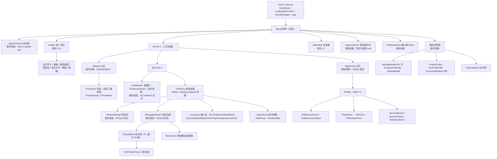

基础件（原子层）横切全树：`icons/index.jsx`（内联 SVG 图标集）、`PanelEmpty`、`InlineAlert`、
`feedback.jsx`（命令式 `confirm()` / `toast()`）、`VirtualText`、`ContextRing`、`ContextMenu`。

#### 1.2 常驻 / 条件渲染 / hidden 保活三档

| 档位 | 组件 | 证据 | 为什么 |
|------|------|------|--------|
| **永驻（无条件挂载）** | `header`、`StatusBar`、`FeedbackHost`、`ApprovalCard` | `App.jsx:499` / `744` / `779` / `773` | 顶栏与状态条是「回路」——左右栏收起后开关仍在顶栏；`FeedbackHost` 是模块级 listener 的宿主（`feedback.jsx:12-14,46-58`），卸载即 `confirm/toast` 静默丢；审批卡必须能接住任意时刻的挂起请求（FIFO 队列，`ApprovalCard.jsx:33-37`） |
| **hidden 保活** | `ChatArea`（数据/定时任务视图下） | `App.jsx:647` `className={... ? 'hidden' : 'contents'}` | 注释直陈三害：卸载会丢 `mjcode:enable-expert/skill` 事件（生态中心「在当前会话启用」静默失效）、重挂载重拉消息、重跑 AGENTS.md 5 级探测（`App.jsx:643-646`）。用 `contents` 而非 `block`，避免多包一层 flex 破坏原有布局 |
| **hidden 保活** | `RightPane`（收起时） | `RightPane.jsx:114-124` | 收起再展开不重拉 git diff、不重建文件树、不丢滚动位置（`RightPane.jsx:77-79`） |
| **条件渲染** | `Sidebar`、`Dashboard`、`ScheduledTasks`、各模态浮层、`Onboarding`、`SplashScreen` | `App.jsx:580` / `640` / `641` / `710-742` / `384-413` / `381,495` | 左栏与模态是「按需出现」，没有需要保活的会话内状态；向导走**早返回**（`App.jsx:384-413`）——未完成引导时主界面根本不挂载，天然避免「向导 + 主界面双份数据拉取」 |
| **条件渲染（右栏内 tab 层）** | `DiffReviewPanel` / `FilesPanel` / `TaskSummaryPanel` / `TerminalPanel` / `BrowserPanel` / `SideChatPanel` | `RightPane.jsx:210-217` | ⚠️ 与上一档**语义不一致**：面板整体收起用 hidden 保活，但 tab 之间切换是条件渲染 → 切走即卸载。见 §11 R2 |

#### 1.3 启动分层与时序（代码路径顺序）

`main.jsx:23-31` → `LanguageProvider` → `ErrorBoundary` → `App` 顶层**模块级** `setLocalMode(true)`（`App.jsx:36`，在任何 api 调用前生效）
→ `SplashScreen` 与主界面**同时挂载**，splash 用 `fixed z-splash(200)` 盖住（`App.jsx:379-381`）
→ `onboarded` 为假只渲染向导（`384-413`），为真进入三栏壳并触发 `loadData()`（`171`）；`splashDone` 只卸载自己，不让下方界面重挂载——「避免数据二次拉取」（`379-380`）。

---

### 2. 状态管理：没有全局 store 时状态如何归属

#### 2.1 为什么不引入外部 store（直证 + 推断）

1. **规模不构成理由**：真正的「全局」只有 6 类——会话列表、当前会话、项目、模型、审批档、布局开关。
   其余全是面板内状态。为 6 个字段引入 store + Provider + selector，代码量大于收益。
2. **已有的三个「事实源」已经够用**：`localStorage`（偏好/布局）、`window.mjcode`（主进程本机库）、
   `lib/runRegistry.ts`（运行快照）。引入 store 会变成**第四份真相**，与「主进程是权威」冲突【推断：这是最核心的取舍】。
3. **跨层通信已用 CustomEvent 总线替代**：`mjcode:open-settings`（`App.jsx:209-213`）、
   `mjcode:open-ecosystem`（`216-220`）、`mjcode:recruit-expert`（`227-241`）、
   `mjcode:enable-expert` / `enable-skill`（`ChatArea.jsx:281-295`）、`mjcode:insert-path`（`useAgentRun.ts:64-72`）、
   `mjcode:add-attachment`（`111-117`）、`mjcode:diff-comment`（`77-88`）、`mjcode:focus-file-search`
   （`FilesPanel.tsx:59-63`）、`mjcode:mcp-tools-dirty`（`App.jsx:86-90`）、`mjcode:focus-approval`
   （`ThreadList.jsx:196-205`）。事件总线是「避免层层传 prop」的既定方案（注释多处直陈）。
4. **局部已有一份自研 mini-store**：`AgentDock` 用模块级 `sharedState + listeners + version`
   做「外部可变源 + 订阅重渲染」（`AgentDock.jsx:15-17,197-206`），本质是手写 `useSyncExternalStore`。
   说明团队并不排斥单向数据流，只是不愿为它加依赖。

代价（要认）：
- **prop 钻透**：`ChatArea → Composer` 一个 `composerProps` 组装了 **37 个字段**（`ChatArea.jsx:399-421`）。
- **hook 依赖注入反模式**：`useAgentRun(d)` 从 `d` 解构 **43 项**（含 30 个 setter），`ChatArea.jsx:358-368` 一次性喂进去；函数体内「每次渲染重建」（`useAgentRun.ts:15-17` 注释自认）。
- **闭包陈旧**只能靠 `ref` 补丁：`messagesRef`（`ChatArea.jsx:95-96`）、`activeThreadIdRef`（`59`）、`paneStateRef`（`App.jsx:251-252`）、`onPromptConsumedRef`（`ChatArea.jsx:120-121`）、`onDoneRef`（`SplashScreen.tsx:28-29`）、`finishRef`（`feedback.jsx:70-71`）——**至少 6 处同型补丁**，是「无 store + 无 memo」架构的必然产物。

#### 2.2 状态归属表

| 状态 | 持有者 | 初始 / 来源 | 持久化 | 主要消费方 |
|------|--------|------------|--------|-----------|
| `threads` | App `useState` | `api.threads()`（`App.jsx:357`） | 无（主进程库为权威） | Sidebar→ThreadList、CommandPalette、StatusBar 计数 |
| `activeThread` | App | 用户点选 / 新建（`App.jsx:287-300`） | 无（会话自身带 projectPath） | ChatArea、RightPane 作用域、⌘⌥B 判定 |
| `projects` / `activeProject` | App | `loadJSON('mj_projects')` + `setActiveProject`（`57`、`76`） | **localStorage + 主进程 localStore 双写**（`303-311`、`314-328`） | Sidebar、ThreadList 分组、FilesPanel root、沙箱 cwd |
| `projectPicked` | App | `selectProject()` 置真（`424`） | 无（进程内） | WelcomePage 副标题与建议卡片（区分「本次主动选」vs「上次残留」） |
| `selectedModel` | App | `loadData` 回落首个 provider 首个模型（`364-366`） | **无**——重启即回落【待确认：是否有意不做选择记忆】 | Composer、SideChatPanel、StatusBar、scheduled 推送（`64-75`） |
| `theme` | App | `mj_theme`，缺省跟 `prefers-color-scheme`（`47-51`） | localStorage（`appState.ts:42-46`） | `applyThemeToDocument` → `data-theme` 属性（`144`） |
| 强调色 | **不落 React state** | `mj_accent` | localStorage（`SettingsModal.jsx:86-93`） | 直接写 CSS 变量（`lib/color.ts:30-40`），组件用 `setAccentVer` 强制重渲染（`73`） |
| `approvalSettings` | App | `mj_approval_settings`（`109`，缺省 workspace-write + on-request） | localStorage（`159`） | ComposerControls 展示、`runAgent` 入参（`useAgentRun.ts:526-527`） |
| `enabledSkills` | App | `mj_enabled_skills`（带数组守卫，`94-98`） | localStorage（`99`） | ChatArea 加载 SKILL.md、EcosystemModal、Onboarding 合并 |
| `mcpTools` | App | `restoreMcpTools()`（`84`）+ `mcp-tools-dirty` 事件（`86-90`） | 主进程配置 | `runAgent` 工具集、Composer「已连接」徽标（`ChatArea.jsx:420`） |
| `sidebarOpen` / `paneOpen` / `paneTab` | App | `mj_sidebar_open` / `mj_pane_open`（`120-122`） | 前两者 localStorage（`303-304`）；`paneTab` 不持久化 | 布局、快捷键、CommandPalette 命令 |
| `openedFiles` / `activeFilePath` | App | 打开文件 / 消息内文件 chip（`266-275`） | 无（切会话/切项目即清空，`253-260`、`428`） | FilesPanel / FileViewerPane |
| `agentFiles`（本轮改动） | App | `onAgentFilesChange`（`657`） | 无 | DiffReviewPanel |
| `subagentsByThread` | App（按 threadId 分桶） | `onSubagentEvent`（`658-661`） | 无 | TaskSummaryPanel |
| `messages` / `windowStart` | **ChatArea** | `api.messages()`（`ChatArea.jsx:205-215`） | 主进程（每条读写） | MessageStream |
| `input` / `attachments` | ChatArea | 用户输入 / 拖拽粘贴（`Composer.tsx:87-149`） | 无（切会话清空，`ChatArea.jsx:202`） | Composer |
| `loading` / `streamingText` / `reasoningText` / `toolCalls` | ChatArea | 事件回流（`316-355`）+ 注册表快照（`240-247`） | 无 | MessageStream、Composer 停止键 |
| `runSummary` / `runUsage` / `runFiles` | ChatArea | `finalizeRun`（`useAgentRun.ts:426-477`） | 无（切回靠 `rs` 快照） | RunFooter、RunOutputFiles |
| `queued` / `pendingRun` / `lastFailed` | ChatArea | 用户动作（`ChatArea.jsx:65-70`） | 无 | Composer 排队卡 / 重试条 |
| `plan` / `planReport` / `decomposing` | ChatArea | 拆分闸门（`useAgentRun.ts:209-227`） | 无 | Composer 拆分卡片 |
| `sessionExtras`（专家/技能/连接器） | ChatArea | 事件注入 + `localStorage['mj_extras_<threadId>']`（`261-278`） | **按线程 localStorage** | Composer 徽标、`runAgent.rolePreset` |
| `voice`（录音状态机） | `useVoice` hook | 组件级（`ChatArea.jsx:110`） | 无 | Composer 录音条 |
| 运行快照（streaming/toolCalls/finalMsg） | `runRegistry` **模块级 Map**（`lib/runRegistry.ts:6-21`） | `makeRunState`（`useAgentRun.ts:371-380`） | 无（进程内，切会话保活） | ChatArea 恢复、delta 分流（`ChatArea.jsx:321-333`） |
| 面板内状态（搜索词、折叠、宽度…） | 各面板自身 | 组件级 | 少量 localStorage（`mj_pane_width`，`RightPane.jsx:62-71`） | 自身 |
| 语言 `locale` | `LanguageProvider` | `mj.locale`（`i18n/index.ts:111-117`） | localStorage（`134`） | 全树 `t()` |
| 崩溃痕迹 | `ErrorBoundary` | `mj_crash_log`（`ErrorBoundary.jsx:22-28`） | localStorage（最多 20 条） | 排查 |

一句话总结归属原则：**「跨栏/跨页要看的」上提到 App，「只属于某次会话运行」留在 ChatArea，
「只属于某个面板」不出组件，「重启后还要在」的落 localStorage，「必须权威」的落主进程。**

#### 2.3 三级作用域与清理纪律

- **App 级**：跨页面存活；切换作用域时必须显式清理——`selectThread` 里清预览标签与 `agentFiles`（`App.jsx:287-300`、`253-260`）。
- **会话级**：ChatArea 在 `thread.id` 变化时清 `messages/windowStart/attachments/lastFailed`，并**先清空再异步拉取**（`ChatArea.jsx:203`），配合 `msgReqRef` 请求序号防「A→B→A 迟到覆盖」（`187-219`）；`prevThreadIdRef` 区分「新建会话（undefined→id）」与「真切换」，否则首条消息会把自己 abort 掉（`188-197`，注释直陈真机事故）。
- **组件级**：面板内状态，卸载即弃；正因如此，右栏 tab 切换会丢终端历史（见 R2）。

---

### 3. 一次交互的状态序列（点击发送 → 收尾条）

以「已有会话、已选模型、项目已选」为例，逐步列 `state` 变化与渲染影响。全部直证 `hooks/useAgentRun.ts`。

| # | 触发点 | 关键动作 | state 变化 | 渲染影响 |
|---|--------|---------|-----------|---------|
| 1 | `Composer` Enter（`Composer.tsx:414-419`）→ `send()`（`useAgentRun.ts:170-177`） | 附件 chips 拼成 `@路径` 上下文行；空输入 return | — | — |
| 2 | 斜杠分流 + 守卫（`178-204`） | `/mem` 直接写记忆库不触发模型；`loading` 直接吞；未选模型 → `setModelWarning(true)` | `input` 或 `modelWarning` | 输入框清空 / Composer 上方 `InlineAlert`（`ChatArea.jsx:469-475`） |
| 3 | 拆分闸门（`209-227`） | 本地启发式命中 → 一次小规划调用，出 `plan` 卡片，**不执行** | `decomposing:true→false`、`plan:{tasks,reason}` | Composer 出现「分析中」→ 拆分卡片（`Composer.tsx:275-316`） |
| 4 | 附件清空（`231`） | 位置在闸门之后（拆分卡片期间保留 chips） | `attachments:[]` | 附件条消失 |
| 5 | 自动建目录（`238-269`） | 未主动选项目（`projectPicked=false`）→ 主进程 `createProject` 建时间戳隔离目录；**失败则阻断本轮** | `lastFailed:{text}` | toast + 重试条（`Composer.tsx:357-365`） |
| 6 | 执行根解析（`276-278`） | `executionRoot = worktree ?? project ?? cwd`，一次解析、全程固定 | — | — |
| 7 | 建会话（`279-304`） | `api.createThread` → `onNewMessage()`（debounce 刷新列表）→ `onThreadCreated` 把新会话设为当前 | `App.threads`（稍后）、`App.activeThread` | ChatArea 从 WelcomePage 切到 MessageStream；**关键注释**：不切会把首条消息与流式输出藏起来（`300-303`） |
| 8 | 入列用户消息（`306-316`） | 本地先上屏 → 再 `api.sendMessage` 落库 | `messages:[...,userMsg]`、`input:''`、`loading:true`、`toolCalls:[]`、`runSummary:null`、`runFiles:[]`、`runUsage` 清零 | 消息流插入用户气泡；发送键变停止键（`Composer.tsx:511-521`）；RunFooter 切「运行中」（`MessageStream.tsx:171-191`） |
| 9 | 落库失败（`319-327`） | `setLoading(false)` + 线程 idle + `lastFailed` + toast，**不继续跑** | 回滚 | 停止键变回发送键 |
| 10 | 断点注入（`341-370`） | `checkpointGet` → `resumeDecision` → 拼 `resumeContext`；消费后 `checkpointClear` | — | 无（只进 prompt） |
| 11 | 运行登记（`371-380`） | `makeRunState(runId, threadId)` 写 `runRegistry`/`runIndex` | 模块级 Map | 后续事件可按 tag 分流 |
| 12 | `runAgent` 调用（`505-535`） | 注入 `sandboxPolicy`（planMode/无项目 → `read-only`）、`approvalMode`、`rolePreset`、`runId`、`conversationId` | — | — |
| 13 | `onStream`（`558-562`） | **轮次边界**：清空上一轮流式文本 | `rs.streaming=''`；`setStreamingText('')`、`setReasoningText('')` | 上一段流式块消失，准备新一轮 |
| 14 | delta 回流（`ChatArea.jsx:316-335`） | `runIndex.get(tag)` 归档；**仅当 `rs.threadId === 当前会话`** 才 `setStreamingText` | `rs.streaming += text` | 流式气泡按 token 重渲染 markdown（`MessageStream.tsx:101-106`）＋ 光标 `▋` |
| 15 | 推理流（`339-355`） | 同上，走 `onReasoning` | `reasoningText` | 折叠区「思考中」渐进渲染（`93-100`） |
| 16 | `onToolCall`（`563-567`） | 累积 `rs.toolCalls`；`agentFilesOf(tc)` 收本轮改动文件 | `toolCalls:[...,tc]`、`agentFilesRef` | 最后一轮块内 `ToolTraceGroup` 展开（`MessageStream.tsx:474-476`）；刷新时 `RunFooter` 显示实时 token |
| 17 | `onMessage`（`536-557`） | 中间轮 assistant/tool 消息**逐条落库**；usage 累加 | `runUsage{tokensIn,tokensOut}` | RunFooter 实时消耗跳动（1s tick，`MessageStream.tsx:159-163`） |
| 18 | `onDone` → `finalizeRun`（`387-503`） | 中止则拼「已停止」；非中止空文本给可行动提示；`mainPersisted/persistState` 未确证时追加「未持久化」；收敛 `rs`；`wasActive` 决定是否动可见 UI | `messages:[...,assistantMsg]`（仅 wasActive）、`rs.done/finalMsg/runSummary` | 结束消息上屏；`setRunSummary` 让 RunFooter 从 live 切结束态 |
| 19 | 产出文件与状态（`468-477`） | `rs.files` 快照；`onThreadStatus('done')` | `runFiles`、`App.threads[].status`（异步刷新） | 产出文件卡片（`MessageStream.tsx:305-335`）；侧栏状态点变「已完成」 |
| 20 | 排队接力（`493-498`） | `setQueued` 中取出队首，`setTimeout(0)` 重发 | `queued` 缩短 | 排队卡消失、下一轮开始 |
| 21 | 失败路径（`589-614`） | 错误消息仅打进「仍是本会话」的可见区；`runSummary.status='error'`；`lastFailed` 记原文 | 同上 | 红色收尾条 + 一键重试 |
| 22 | 收尾复位（`615-621`） | 仅 `stillActive` 时清 `streamingText/reasoningText`、`loading=false` | — | 停止键恢复、流式块被正式消息取代 |
| 23 | steer 补发（`622-627`） | 挂起的引导指令在此刻（已无并发 run）重开一轮 | — | 新用户气泡 |

要点：**渲染层从不「拼」最终答案**。它以 `runId/threadId` 为标签把主进程事件分流进注册表，
只对「当前正在看的会话」投射 UI；后台会话的事件照常入桶，切回时按快照恢复
（`ChatArea.jsx:220-247`）。这也是「切页回来会话被关掉」事故的修法所在（`useAgentRun.ts:45-53`）。

---

### 4. 组件体系

#### 4.1 分层表

| 层 | 数量/代表 | 职责 | 禁止事项 |
|----|----------|------|---------|
| **壳（1）** | `App.jsx`（798 行） | 全局状态、布局、快捷键、模态编排、主题落地 | 禁止写业务协议细节（Agent 循环/DB）；禁止直接 `window.mjcode.*` 以外的数据源分支膨胀——已抽 `lib/api.js`/`lib/ipc.js`；**行数已贴 800 行 God-File 门禁**（注释多次提到该门禁，如 `appState.ts:6`） |
| **页面（4）** | `WelcomePage.tsx`（空态）、`ChatArea`（会话态，740 行）、`AssistantPage.tsx`（助理工作台，3 个 Tab：发布任务 / 军团 / AI 建团）、`PublishTaskPage.tsx`（唯一的发布面：复杂任务 / 定时任务 + 看板）、`Dashboard`、`ScheduledTasks`（一级入口「定时任务」） | 组织页面级布局与数据装配 | 页面不放「第二次全局真理」；`ChatArea` 已被要求继续瘦身（`useAgentRun`/`MessageStream`/`Composer` 三次拆分痕迹 `ChatArea.jsx:7,13,21,31`） |
| **面板（8）** | `Sidebar`/`ThreadList`、`RightPane` + 6 个子面板、`SettingsModal`、`EcosystemModal`、`Onboarding`、`ArchiveModal`、`CommandPalette`、`ProjectPicker` | 一块自洽功能区，自带搜索/折叠/持久化 | 不跨面板直接改别人的 state（一律回调或事件总线）；不重复实现 `PanelEmpty`/`InlineAlert` |
| **业务件（20+）** | `MessageStream`/`RoundBlock`/`RunFooter`、`ToolTrace(+Group)`、`Composer`、`ComposerControls`、`PlusMenu`、`ApprovalCard`、`DiffReviewPanel`、`AgentDock`、`FileTree`/`FileViewerPane`、`ContextRing`、`WorktreeBar`、`TodoPanel`；2026-10-24 新增 `EntryRouteNotice`（判定提示条 + 确认卡，`entry:*` 的唯一消费者）、`AiTeamBuilder`（AI 建团草案逐条采纳/编辑/否决）、`ScheduledTeamPicker`（定时任务绑定军团）、`ui/TabBar`（Tab 条原语，替代各处裸按钮） | 承载 Agent 语义（轮次、工具、审批、改动、子代理） | 不写设计系统之外的色值（`theme.css:14` 明令组件内禁止十六进制）；不自建 z-index（必须用 `z-menu/z-approval/...`） |
| **基础件（7）** | `InlineAlert`、`PanelEmpty(+NoProjectEmpty/NoFileEmpty)`、`feedback(confirm/toast)`、`VirtualText`、`ContextMenu`、`icons/index.jsx`、`ErrorBoundary` | 视觉与行为的唯一实现点 | 禁止各面板自造空态/提示条/确认框——见 4.2 的实际缺口 |

#### 4.2 共享基础件现状与治理

**已收口（值得保持）**
- `InlineAlert`：三级 + `role="alert"` + 可选关闭（`InlineAlert.jsx:5-23`），被 Composer/models/Onboarding 等复用。
- `PanelEmpty`：从 `RightPane` 抽出以打断循环 import，并派生 `NoProjectEmpty` / `NoFileEmpty`（`PanelEmpty.tsx:4-36`）。
- `feedback.jsx`：模块级 listener + `<FeedbackHost/>`，`confirm()` 返回 Promise，`toast()` 支持动作按钮与 5s 超时（`feedback.jsx:16-37`）；危险操作 Esc 默认取消（`66-77`）；`countConfirm` 支持「输入数量确认」（`27-29`）；同屏最多 4 条（`52`）。
- `VirtualText`：零依赖固定行高虚拟滚动，`LINE_H=18` 与 `text-code` 强耦合（见 §5.2）。

**重复实现（治理点，按优先级）**

| 现象 | 证据 | 建议 |
|------|------|------|
| **弹层「点外部 + Esc 关闭」手写了 ≥6 遍** | `App.jsx:128-138`（筛选）、`RightPane.jsx:101-111`（+菜单）、`MessageStream.tsx:255-264`（文件菜单）、`ThreadList.jsx:281-291`（归组）、`feedback.jsx:72-77`（确认框 Esc）、`SettingsModal.jsx:96-100`（Esc 关闭） | 抽 `useDismissable(ref, onDismiss)`：统一 `mousedown capture` + `Escape` + 卸载清理；顺带统一「事件捕获阶段」这个易错细节（有的用 `true` 有的没用） |
| **Toggle / 开关三种写法** | `role="switch"` 共 7 处（grep 结果）、`SettingsModal` 内多为 `<button>`+ 条件 class、`Onboarding` 用卡片选中态 | 抽 `<Toggle checked onChange label/>` 与 `<SelectCard/>`，把 `aria-checked`、键盘空格/回车、禁用态一次做对 |
| **空态文案两套** | `PanelEmpty`（结构化）vs `ThreadList` 直接 `<p>{t('threadList.emptyThreads')}</p>`（`ThreadList.jsx:224`）、`FilesPanel` 搜索空态裸 `<div>`（`162-164`） | 全量改走 `PanelEmpty`（搜索空态用 `hint` 承载「换个关键词」） |
| **「行内可点元素」无统一件** | `ThreadRow` 是 `div + onClick`（`ThreadList.jsx:309-316`）、`ProjectGroup` 头部同型（`164-165`） | 抽 `<RowButton as="div" role="button" tabIndex={0} onKeyDown>` 或直接换 `<button>`（见 R7） |
| **按钮尺寸/圆角各写** | `h-7 w-7`（图标钮）、`h-7 px-3`（chip 钮）、`px-3 py-1.5 text-xs`（菜单项）、`px-5 py-2 rounded-lg`（主行动） | 定 4 档 `<Btn variant="icon" / "chip" / "menu" / "primary" / "danger">`；目前靠人工保持一致【推断：视觉回归风险随组件增长线性上升】 |

---

### 5. 设计系统

#### 5.1 token 三层（L1 基础面 → L2 语义 → L3 层级）

| 层 | 内容 | 位置 | 纪律 |
|----|------|------|------|
| **L1 基础面** | `--theme-bg/sidebar/surface/border/text/text2/text-disabled/accent/accent-solid/on-accent/accent-soft/hover/code-bg/select-bg/select-fg`，外加 `--surface-input`、`--surface-raise`、`--border-strong` | `theme.css:20-43`（dark 默认）、`45-67`（light）、`69-139`（midnight/forest/sunset） | 改色只改此文件 |
| **L2 语义层** | `--sem-success/danger/danger-solid/warn/info/overlay/accent/focus` + 淡底 `--sem-*-bg` | `theme.css:142-157` 及各主题覆盖（`159-221`） | 组件**只允许**用语义层与 L1 token；`*-bg` 只作背景、`*-soft` 只作前景（`theme.css:16`） |
| **L3 层级层** | `--z-drawer 40 < settings 50 < menu 60 < diff 90 < palette 110 < toast 120 < approval 130 < splash 200` | `theme.css:254-268` | 禁止裸 `z-index`；次序注释记录过一次返工（palette 曾压住审批卡） |

**双写机制（本项目最易踩的坑）**：每个色 token 提供两份——`--x`（hex，给 CSS/SVG/JS）与
`--x-rgb`（`r g b` 三元组，给 Tailwind 的 `/opacity`）。Tailwind v3 **无法**对 `var(--hex)` 应用 alpha，
`bg-accent/10`、`border-accent/40` 这类类会**整个不生成**，带 `border` 的元素回退到 preflight 的 `#e5e7eb`
——症状就是「暗色界面上莫名出现亮白细边」（`tailwind.config.js:3-7`、`theme.css:8-16`）。
因此 `tailwind.config.js` 统一用 `const v = (name) => \`rgb(var(--${name}) / <alpha-value>)\``（`7`），
浅底 token 则单独给 `var(--sem-*-bg)`（`tailwind.config.js:39-44`）。
**自定义强调色必须成对写入**，且只允许走 `lib/color.ts` 的 `applyAccent`（`color.ts:8,30-40`），
禁止各处 `setProperty`——否则换色后 `/opacity` 类再次失效。

#### 5.2 字阶、圆角、动效

- **字阶四档 + prose**：`caption 11/16`、`code 12/18`（等宽，**与 `VirtualText` 的 `LINE_H=18` 严格成对**）、`xs 13/20`（UI chrome）、`sm 14/21`（`tailwind.config.js:50-57`）；对话正文单列 `.msg-prose` = 15px/1.75，与 13px 的 UI 明确分层（`theme.css:306-311`）；中文在 12px 以下笔画粘连，故特意补了 13px 中间档（`tailwind.config.js:49`）。
- **圆角四档 + 两档扩展**：`sm 6`（小控件）、`md 8`（按钮/输入框）、`lg 10`（卡片）、`xl 14`（模态），另有 `2xl 16` / `3xl 20`（`theme.css:223-231`）；Tailwind `borderRadius` 直接引用这些变量（`tailwind.config.js:59-67`）——改一处全局生效。
- **阴影三档**：`--shadow-menu/pop/modal`，light 主题另乘约 0.6（`theme.css:233-235,248-252`）。
- **动效三档时长 + 两条曲线**，硬约束「禁弹跳曲线」（`theme.css:236-241`）；并尊重 `prefers-reduced-motion`
  ——把循环动画压到 0.01ms（`371-377`），启动页在 reduced-motion 下时长 2400→600ms（`SplashScreen.tsx:41-42`）。
- **滚动条恒留沟槽**：`scrollbar-gutter: stable`，内容变长时不再横向抖动（`theme.css:290`）。

#### 5.3 主题切换与强调色

- 5 套主题：`dark / light / midnight / forest / sunset`（`lib/themes.json:1-7`），只存 `id + nameKey + swatch`；
  **显示名不冻结**，渲染期经 `tr(th.nameKey)` 解析，切语言即时生效（`App.jsx:152-156`）。
- 落地入口 `applyThemeToDocument`：写 `data-theme` + `data-platform`，再 `applyAccent(localStorage.mj_accent)`
  （`lib/appState.ts:29-47`）。`data-platform` 驱动 `--titlebar-inset`（darwin 80px / 其他 12px，
  `theme.css:244-246`），顶栏用它给 macOS 交通灯留位（`App.jsx:499`）。
- 顶栏换肤是**循环点击**而非下拉（`App.jsx:147-150`），完整主题列表在设置→外观（`SettingsModal.jsx:275-294`）。
- 冷启动防闪变：`index.html` 里 React 挂载前先落 `data-theme` 与强调色（`index.html:39-52`）——
  这里有个已知缺口：**只写了 hex、没写 `-rgb`**（见 R3）。

---

### 6. i18n 机制

- **零依赖自研**：`React Context` + `useState`，切语言 `setLocale` → 全树重渲染，**免重启**
  （`i18n/index.ts:127-142`）；同时同步命令式通道 `activeLocale`（`93-96`）与 `<html lang>`（`135`）。
- **模块化语言包**：`locales/<locale>/<module>.json`，模块名即 key 第一段（如 `composer.send`）；
  用 `import.meta.glob(..., { eager: true })` 全量收集，**新增模块文件无需改代码**（`i18n/index.ts:23,49-72`）。
  实测 41 个模块，zh-CN 各模块顶层键合计约 **1.44k**（`settings.json` 247 条为最大，其次 `diff.json` 92、`agentDock.json` 64）。
- **宿主兼容的 glob 兜底**：绝不用 `typeof import.meta.glob === 'function'` 探测（Vite 只在**调用点**替换，
  `typeof` 表达式会留在产物里恒 undefined → 真机全界面显示原始 key，`i18n/index.ts:39-47` 记录了这次事故），
  改为直接调用 + `try/catch`，失败回落 `globalThis.__MJ_I18N_PACKS__`（测试注入）。
- **回退链**：`当前 locale → zh-CN → 返回 key 本身 + console.warn`（`102-109`），可见可查，不静默空白。
- **插值**：`{name}` 占位，`t('x.y', { name })` 替换；缺参保留原占位符（`85-89`）。
- **纯 JS 消费方通道**：`lib/api.js`、`lib/agent.js` 被 Node 测试静态导入，不能 `import` TS+React 模块，
  故经 `globalThis.__MJ_T__` 取翻译（`i18n/index.ts:97-99`，`lib/api.js:88-90`）。
- **门禁（防止裸中文回潮）**——`test/i18n.test.mjs` 四项断言：
  1. `renderer/src` **全量**（不只 components）注释剥离后零裸中文（`scripts/i18n-scan.mjs`，状态机剥注释而非正则近似，`23-72`）；
     不可翻译字面量按行标 `// i18n-literal` 豁免（`i18n-scan.mjs:90`）。
  2. zh-CN 与 en-US 深度 key 集**双向一致**，叶子必须是字符串。
  3. 组件里出现的 `t('x.y')` / `tGlobal('x.y')` 必须真实存在于 zh-CN 包（防漏登记）。
  4. 切换免重启接线存在（`main.jsx` 挂 Provider、`SettingsModal` 有 `setLocale` 入口），且 zh/en 同 key 的
     `{var}` 参数集一致（防翻译丢参数）。
  另加一条棘轮：主进程事件载荷零裸中文（先覆盖 `main/workerPool.js`，其余 272 行为已知债务、只报告不失败）。
- **现状缺口**：`MessageStream` 里消息时间用 `toLocaleTimeString('zh-CN', ...)` 硬编码
  （`MessageStream.tsx:214,491`）——切到 en-US 后时间仍是中文区域格式【推断：属门禁不覆盖的「区域参数」盲区】。

---

### 7. 性能策略

#### 7.1 已落地的手段

| 手段 | 实现 | 证据 |
|------|------|------|
| **消息窗口化（按条）** | 历史全量在 `state`，只渲染最近 `MSG_WINDOW=50` 条；顶部「加载更早 n 条」按窗口步长回退；切片起点落在 `tool` 消息上时继续前移，避免切断 `assistant(tool_calls)` 与结果的配对 | `MessageStream.tsx:16,56-58,65-72`；初始化在 `ChatArea.jsx:207-209` |
| **大文本虚拟滚动（按行）** | 固定行高窗口化：`LINE_H=18`、`OVERSCAN=20`、低于 500 行不虚拟化（避免无收益复杂度）；滚动用 `requestAnimationFrame` 节流；单行不换行（换行会破坏固定行高假设） | `VirtualText.tsx:8-10,30-59`；唯一使用点 `tools/ToolTrace.tsx:93` |
| **大载荷「先看元信息再拉全文」** | 主进程把超大输出卸载为 `bigRef`，折叠态只显示体量；点「加载完整输出」才回取，再交 `VirtualText` | `ToolTrace.tsx:66-97,102-104` |
| **事件节流 / 防抖** | `scheduleLoadData` 600ms 合并「每条消息一次全量刷新」（`App.jsx:372-377`）；文件面板搜索 250ms + 结果上限 100（`FilesPanel.tsx:18-19,88-93`）；命令面板文件检索 200ms + 限额 30（`CommandPalette.jsx:26-42`）；`RunFooter` 实时计时 1s tick，仅运行时挂 `setInterval`（`MessageStream.tsx:159-163`）；资源额度轮询 3s 且**仅面板展开时**（`AgentDock.jsx:222-234`）；语音电平 250ms（`useVoice.js:46-50`） | `App.jsx:372-377`、`FilesPanel.tsx:18-19`、`CommandPalette.jsx:26-42`、`MessageStream.tsx:159-163`、`AgentDock.jsx:222-234`、`useVoice.js:46-50` |
| **长列表分页** | 会话按项目分组，组内默认 20 条 + 「加载更多」（`GROUP_PAGE_SIZE=20`，`ThreadList.jsx:15,229-253`）；孤儿组同样分页（`41,97-102`）；再叠加时间分段（今天/昨天/本周/更早，`389-406`）减少视觉噪音 | — |
| **图表轻量化** | 仪表盘**不引图表库**：模型分布与 7 日活跃用 div 高度/宽度按比例铺，7 天固定补零对齐 | `Dashboard.jsx:47-60` |
| **隐藏而非卸载** | `ChatArea` / `RightPane` 保活，避免重挂载重拉 | `App.jsx:647`、`RightPane.jsx:114-124` |

#### 7.2 已知瓶颈（含测量建议）

| # | 瓶颈 | 机理 | 如何测 |
|---|------|------|--------|
| B1 | **流式 delta 触发全仓重算** | 每个 delta `setStreamingText`（`ChatArea.jsx:258`（修复前为 `:329`；流式入口另见 `:121` 的 coalescer））→ `ChatArea` 重渲染 → `MessageStream` 重新执行 `renderMessages(visibleMessages, ...)`（`MessageStream.tsx:77`）→ 50 条内所有 `RoundBlock` 与其中 `ReactMarkdown` 全部重新解析，**全仓 0 处 `React.memo`**（grep 直证） | React DevTools Profiler 录一次 800 token 回复；看 `MessageStream` commit 次数 ≈ delta 数、单次 commit > 16ms 的占比 |
| B2 | **滚底 effect 每次 delta 都 `scrollTo`** | `useEffect` 依赖 `[messages, streamingText, toolCallsCount]`，未做 rAF 合并（`MessageStream.tsx:37-39`） | Performance 面板看 Layout/Recalculate Style 频率；长回复下掉帧 |
| B3 | **全量 `loadData` 无缓存** | `api.threads()` + `api.providers()` 全量，`onThreadStatus(...).then(loadData)` 与 `onPendingChange` 都直连（`App.jsx:616-618,728-730`），不走 600ms 防抖；`loadData` 每次重设 `threads` → 整条左栏重渲染 | 会话 200+ 时点审批/发送，测 `loadData` 耗时与 React commit |
| B4 | **仪表盘 N+1 串行** | 本地模式 `for (const t of threads) messages.concat(await localMessages(...))`（`lib/api.js:218-235`），会话越多越慢，且会把全部消息读进内存 | 造 100 会话 × 50 消息，测首屏到图表出现的时间 |
| B5 | **右栏 tab 切换即重建** | 条件渲染（`RightPane.jsx:210-217`）→ `DiffReviewPanel` 每次进入重拉 git diff、`TerminalPanel` 历史清空（`TerminalPanel.tsx:47-50`） | 切 tab 计时 + 观察终端历史是否消失 |

目标（建议值，需产品确认）：冷启动可交互 < 1.5s（splash 可跳过，见 §10）；流式期间单次 commit p95 < 16ms；切会话首屏消息 < 150ms；切 tab < 80ms【待确认：无既有基线，属新建预算】。

#### 7.3 埋点建议

仓库内**没有前端埋点/性能上报**，只有崩溃留痕：`onerror`/`unhandledrejection` 转发主进程 `diagReport`（`main.jsx:8-21`）、`ErrorBoundary` 写 `mj_crash_log`（`ErrorBoundary.jsx:22-28`）、主进程侧另有 `runTrace`/`diagnostics`（第 2 章）。建议补：

| 事件 | 触发 | 字段 |
|------|------|------|
| `ui.stream.commit` | 每 N 次 delta 采样 | threadId、delta 数、commit ms、消息条数 |
| `ui.thread.open` | 会话切换 | 距点击 ms、消息条数、是否命中注册表快照 |
| `ui.action.error` | toast(error)/InlineAlert 出现 | 来源组件、`humanizeError` 前后指纹 |
| `ui.first_paint` | `useEffect` on mount | splash 跳过与否、`mj_onboarded` |

---

### 8. 可访问性

#### 8.1 已有基线

- **全局焦点可见**：`:focus-visible { outline: 2px solid var(--sem-focus); outline-offset: 1px }`（`theme.css:270-274`）。
- **aria 使用**：`aria-*` 共 **78 处 / 21 个文件**；`role` 23 处（`switch` 7、`menuitem` 7、`menu` 5、
  `status`/`dialog`/`alertdialog`/`alert` 各 1）。
- **键盘可达的功能路径**：
  - 全局快捷键 ⌘K / ⌘N / ⌘O / ⌘, / ⌘B / ⌘⌥B / ⌘P（`App.jsx:179-206`）；
  - Esc 停止生成（`useAgentRun.ts:56-61`）、Esc 关设置/确认框/筛选弹层；
  - 输入区：Enter 发送、Shift+Enter 换行、运行中 Enter=引导 / Tab=排队（`Composer.tsx:414-425`）；
  - 斜杠菜单 ↑↓ + Enter/Tab/Esc（`Composer.tsx:408-413`）；命令面板 ↑↓ 导航；
  - 审批卡 **1/2/3/4** 快捷决策，且**带输入焦点守卫**（在输入框打字时不触发，防止「方案 1 不错」误批）（`ApprovalCard.jsx:110-135`）；
  - Cmd/Ctrl+M 按住说话（刻意避让 macOS 的 ⌘M 最小化，`useAgentRun.ts:136-159`）。
- **语义正确的小处**：`InlineAlert` `role="alert"`（`InlineAlert.jsx:14`）、`feedback` 确认框 `role="alertdialog" aria-modal`（`feedback.jsx:90-92`）、
  启动页状态 `role="status"`（`SplashScreen.tsx:79`）、右栏 `aria-hidden={!open}`（`RightPane.jsx:123`）、
  菜单按钮带 `aria-expanded`（`App.jsx:523`、`Composer.tsx:482`、`RightPane.jsx:155`）。

#### 8.2 缺口（按影响排序）

| 缺口 | 证据 | 后果 |
|------|------|------|
| **列表行/项目行是 `div + onClick`** | `ThreadList.jsx:309-316`（`ThreadRow`）、`164-165`（`ProjectGroup` 头） | 键盘 Tab 无法聚焦、无法回车选中/删除会话——桌面端核心导航不可键盘操作 |
| **全仓 `tabIndex` = 0 处** | grep 直证 | 自定义弹层没有 roving tabindex，`role="menu"` 只是标签，↑↓ 在菜单里不生效（命令面板/斜杠菜单是特例，各自手写了键盘） |
| **审批卡无 role / 无 aria-live** | `ApprovalCard.jsx:141-157`（普通 div） | 读屏用户不会被告知「有高危操作待批」，而这是 z-index 最高的交互（130） |
| **模态无焦点陷阱与 `aria-hidden` 背景** | `SettingsModal.jsx:151-152`、`EcosystemModal`、`ProjectPicker` 均为普通 `fixed` 容器 | 焦点可跑到背后页面，Tab 顺序穿越遮罩 |
| **图片/图标缺文本替代** | `icons/index.jsx` 多数内联 `<svg>` 无 `aria-hidden`/`role="img"`；但按钮普遍带 `aria-label` 兜住 | 读屏会读空 svg 节点噪音 |
| **对比度未验证** | `--theme-text-disabled #6a6a6a` on `#0d0d0d`≈3.0:1（`theme.css:21,31`） | 禁用态文字低于 WCAG AA 4.5:1；属可接受豁免但需明示【待确认】 |

#### 8.3 收口建议

1. 抽 `RowButton`（`role="button" tabIndex={0} onKeyDown Enter/Space`）替换 3 处列表行；
2. 抽 `useDismissable` 时顺带补 `Escape` 焦点回还（打开菜单前的元素）；抽 `<Modal>` 骨架：`role="dialog" aria-modal` + 首焦点 + 焦点陷阱 + 关闭后回还 + 背景 `inert`；
3. 审批卡加 `role="alertdialog" aria-live="assertive"` 并把 1-4 键写进可读提示（已有键盘逻辑，只差语义）。

---

### 9. 与主进程的边界

#### 9.1 唯一通道

渲染层**只经 preload 桥** `window.mjcode` 访问能力：`contextIsolation` 开、`nodeIntegration` 关（第 2 章）。
仓库里同时存在两条访问路径：

- `lib/ipc.js`：**统一出口**——`call(method, payload, {timeout})` 归一为 `{ok, data, error}`、默认 30s 超时、
  `on(eventMethod, cb)` 统一返回取消函数（StrictMode 下不重复注册）、能力矩阵 `loadCaps/getCaps/hasCap`
  **fail-closed**（`lib/ipc.js:9-34,37-82`）。
- `lib/api.js`：**数据访问层双轨**——`localMode ? 本地 store : HTTP`（`api.js:108-236`）。
  实测：`App.jsx:36` 模块级 `setLocalMode(true)`，**服务端分支当前不生效**；且 `index.html` 的 CSP
  `connect-src` 不含 `http://localhost:3001`（`index.html:31`），即便去掉 `setLocalMode(true)`，
  浏览器侧也会拦截——**双保险，说明「恒本地」是结构性决策而非临时开关**。
  本地模式下 `globalProviders()` 直接 `return []`，避免「启动即打 3001 被 CSP 拦截」的无意义报错（`api.js:180-192`）。
- 已知不一致：大量组件仍**裸调** `window.mjcode.*`（`ChatArea.jsx:137`、`FilesPanel.tsx:75`、`Composer.tsx:565`、`AgentDock.jsx:36-60`），`ipc.js` 的「组件层不再裸调」目标只完成了一部分【推断：迁移成本 vs 收益，短期不会全量收口】；且桥面**无类型**，见 R10。

#### 9.2 错误呈现链

```
主进程 throw / {ok:false,error}
  → lib/api.js humanizeError()          // Failed to fetch → 「本地服务不可用」；Unauthorized → 「认证失败」
  → 沙箱类失败追加「安全下一步」指引      // 且明确不给「改用 full-access」这种建议
  → 组件三档呈现：InlineAlert / toast / 消息流内错误气泡
```

- `humanizeError` 的判定串**只用 ASCII 标识**（`sandbox-unavailable`、`operation not permitted` 等），
  裸中文会被 i18n 门禁拒绝（`api.js:92-106`，注释直陈）。
- 失败必须**可挽回**：运行失败会 `setLastFailed({text})` 并存原文（`useAgentRun.ts:610-611`），
  Composer 出「重试本轮」按钮（`Composer.tsx:357-365`）。
- 落库失败与「假装成功」的分界：`finalizeRun` 用 `meta.mainPersisted` / `persistState`
  判断是否已在主进程落库，未确证时**追加「未持久化」内联提示**且**不重复写库**（`useAgentRun.ts:398-411`）。
- 「能力边界诚实呈现」的例证：拖入文件全部解析失败时不静默吞，而是把提示写进输入框
  （`Composer.tsx:91-94,120-124`）；`ipc.call` 遇到未暴露的方法返回
  `runtime.capabilityUnavailable`（`ipc.js:61-63`）。

---

### 10. 启动页与首启引导

#### 10.1 SplashScreen 时序

`splashDone=false` 时以 `fixed z-splash(200)` 覆盖一切（含审批卡 130），**与主界面同时挂载**，
结束时只卸载自己（`App.jsx:379-381,495`）。内部时序（`SplashScreen.tsx:40-59`）：

| 时刻 | 动作 |
|------|------|
| t=0 | `getAppVersion()` 异步取版本号（`31-38`） |
| t=total−500（≥200） | `ready=true` → 文案切「就绪」 |
| t=total（默认 2400ms） | `leaving=true` → 200ms 淡出 |
| t=total+220 | `finish()` → 父层 `splashDone=true` |
| 任意时刻 | `pointerdown` / `keydown` 一次性跳过（160ms 后 finish） |

防御细节：`prefers-reduced-motion` 把 total 压到 600ms（`41-42`）；`doneRef` 保证点击与定时器同时到达时
`onDone` 只调一次（`24-25,44-47`）；`onDoneRef` 走 latest-ref，避免父组件内联箭头导致计时器被重置
——「否则启动页永不消失」（`26-29`）；进度线用 `scaleX` 而非宽度，不触发布局（`theme.css:363-364`）。

#### 10.2 9 步向导

`STEPS` 九步（`Onboarding.jsx:15`）：欢迎 → 模型 → **安全默认档** → 数字员工 → 技能 → 连接器 → 项目 → 首任务 → 完成。
进度用「当前步骤名 + i/N + 细进度线」而非九段步骤条——否则 `max-w-xl` 内必然溢出（`228-239` 注释）。

**目录加载**：`ecosystemEmployees / ecosystemSkills / ecosystemConnectors` 三路 `Promise.allSettled` 并发拉取，任一失败不阻塞（各步骤退化为「稍后配置」/`InlineAlert`），`cancelled` 守卫防卸载后 setState（`Onboarding.jsx:66-85`）。

**落盘策略（不写假开关）**：

| 选择 | 真正落地方式 | 证据 |
|------|-------------|------|
| 模型 | `localAddProvider`（主进程 localStore + safeStorage 加密）→ **立刻测试连接**，失败提示「已保存但测试未通过」 | `138-154` |
| 安全档 | 进入该步骤即写 `approvalSettings`（`onApprovalSettingsChange({...preset.patch})`），**跳过选择也带安全默认离开** | `102-110` |
| 技能 | 逐个 `installEcosystemSkill` 物化 SKILL.md，**未安装成功的 id 不进 `enabledSkills`** | `196-205` |
| 连接器 | 只写「启用态」（决定「+」菜单可见性），密钥仍需在生态中心配——**启用 ≠ 连接** | `206-214` |
| 数字员工 | 回传 `{id,name,title_cn,mission}` → App 落 `mj_pending_expert` → 主界面挂载后 `usePendingExpert` 派发 `enable-expert`（一次性消费，读到即删） | `onFinish` 见 `App.jsx:396-409`；`hooks/usePendingExpert.ts:12-36` |
| 完成 | `localStorage.mj_onboarded='1'` → `setOnboarded(true)` 切主界面；首任务提示词经 `initialPrompt` 传给 ChatArea，用 latest-ref 消费一次 | `App.jsx:396-409`；`ChatArea.jsx:114-127` |

**跳过策略**：每一步都有出口——模型步「稍后配置」、员工/技能/连接器步「跳过本步」、项目步「跳过项目」（本地优先：问答/纯对话不需要目录）、首任务步「直接进入」（`Onboarding.jsx:301,323,390,432,472,489,511`）。硬性约束：**不允许被卡死**（注释直陈「无 Key 的用户不允许被卡死在模型步骤」，`321`）。

**离线降级**：`globalProviders` 本地模式恒为空 → 「共享模型」选项**直接不渲染**（不做装饰性入口）并明示需联网获取；`mode` 兜底复位防卡在 `global` 态（`94-97,262-281`）。

**时序坑（已规避）**：`ChatArea` 的 effect 先于父组件执行，`enable-expert` 监听此时已就绪，`setTimeout(0)` 再兜一层（`usePendingExpert.ts:6-9`）；生态中心「招募」**必须先切会话、等 `thread=null` 清空 extras 落定后再派发**，否则 expert 被覆盖（`App.jsx:222-241` 注释详述顺序不可颠倒）。

---

### 11. 风险与改进（按影响排序）

#### R1 流式 delta 引发全量 markdown 重算（性能，高）　✅ 已修 2026-10-17（`9433085`）

- **现象**：长会话（≥30 轮）里流式输出期间页面明显发涩，滚动/输入有延迟。
- **影响**：回复越长越卡，用户感知为「越用越慢」；直接打击「持续盯着它跑」的核心体验。
- **建议**：① 把「已定稿历史轮」与「本轮流式块」拆成两棵子树，历史轮 `React.memo` 包一层
  （其 props 在流式期间不变）；② 流式文本 30–60ms 批量合并（`requestAnimationFrame` 或时间片），不要每个 delta 都 setState；
  ③ 滚底改为 `useLayoutEffect` + 仅当 `stickToBottom` 且消息数变化时滚，`streamingText` 变化不滚。
- **证据**：`renderer/src/components/ChatArea.jsx:258`（修复前为 `:329`；流式入口另见 `:121` 的 coalescer）（每 delta setState）、
  `renderer/src/components/MessageStream.tsx:77`（全量 `renderMessages`）、
  `MessageStream.tsx:37-39`（每次 delta scrollTo）；全仓 `React.memo` **0 处**（grep 直证）。
- **✅ 修复状态（2026-10-17，`9433085`）**：新增 `renderer/src/lib/streamCoalescer.ts`（同帧合并 + `shouldCommit` 防幽灵文本）；`MessageStream` 的 `renderMessages` 结果按依赖 `useMemo` 化，流式期间历史轮次不再重解析；6 条门禁测试（`stream-coalesce.test.mjs`）。
  **未采用** `React.memo`——因此「全仓 `React.memo` 0 处」至今仍成立，这句不能当作"未修"的反证。

#### R2 右栏 tab 用条件渲染，面板状态切走即丢（一致性，高）

- **现象**：切到「变更」再切回「终端」，之前执行的命令与输出全部消失；`DiffReviewPanel` 每次重新拉 diff。
- **影响**：与右栏「常驻、保持上下文」的产品语义直接矛盾（同一文件里同时存在两种策略，属实现疏漏）。
- **建议**：tab 容器改为「全部挂载 + 非活动 `hidden`」（与 `ChatArea` 同一档），并在面板内加
  `useEffect` 的 `active` 感知以延迟首次加载（避免 6 个面板同时打 IPC）。
- **证据**：`renderer/src/components/RightPane.jsx:210-217`（条件渲染）vs `77-79`（注释声称 hidden 保活）；
  `TerminalPanel.tsx:47-50`（历史在组件 state）；`App.jsx:686-707`（面板 props 每次渲染重建）。

#### R3 冷启动首帧强调色只写 hex，`/opacity` 类落回主题色（视觉，中）

- **现象**：设过自定义强调色的用户，冷启动第一帧里淡底/描边（`bg-accent/10`、`border-accent/40`）用的是主题自带强调色，
  随后（React effect 跑完）才跳变成自定义色。
- **影响**：一闪而过的错色；若 `applyAccent` 因异常未执行，会**持续错色**。
- **建议**：`index.html` 前置脚本内做三元组换算后同时写 `--theme-accent-rgb` / `--sem-accent-rgb`（逻辑已在 `lib/color.ts:hexToRgbTriplet`，需内联一份或抽成 UMD 小模块）。
- **证据**：`renderer/index.html:45-49`（只 set hex）vs `renderer/src/lib/color.ts:36-39`（双写才是正确姿势）；
  `theme.css:8-16`（为什么必须双写）。

#### R4 仪表盘本地统计 N+1 串行拉全量消息（性能，中）

- **现象**：会话数上百后，「数据」页要等很久才出图，期间只有骨架屏。
- **影响**：一个只读页面把渲染进程和主进程都拖住；且把全部消息读进内存。
- **建议**：主进程提供聚合接口（`SUM(tokens)` + `COUNT(*)` 一条 SQL），或分页 + 缓存（`data_scope:'local'` 已有口径字段）；
  不得在渲染层做全量聚合。
- **证据**：`renderer/src/lib/api.js:218-235`（`for...await` 串行 + `concat` 全量）；
  `Dashboard.jsx:11-19`（一次 `api.dashboard()` 决定全部视图，无增量）。

#### R5 状态变更后全量 `loadData`（性能，中）

- **现象**：点一次审批、跑完一轮、重命名会话，都会触发 `threads + providers` 全量拉取并整条左栏重渲染。
- **影响**：会话多时操作有可感知延迟；与 600ms 防抖并存的 `onThreadStatus` 路径绕过了防抖，等于白做。
- **建议**：`setThreadStatus` 走**乐观本地更新**（只 patch 该条 `threads[i].status`），失败再回滚；
  `providers` 与 `threads` 拆成两个独立刷新源（现在被绑在一个 `loadData` 里）。
- **证据**：`renderer/src/App.jsx:616-618`、`728-730`（`.then(loadData)`）；`356-368`（两请求合一）；
  `372-377`（防抖只覆盖 `onNewMessage`）。

#### R6 `useAgentRun` 的 43 项依赖注入 + 30 个 setter（可维护性，中）

- **现象**：任何一次会话域重构都要同时改 `ChatArea`（声明 state）与 `useAgentRun`（解构 + 使用），
  类型上 `@ts-nocheck` 关闭了检查（`useAgentRun.ts:1`）。
- **影响**：白屏事故的温床——`Composer.tsx:12-13,32-34` 记录了「直接引用父作用域变量导致白屏」的真实事故。
- **建议**：把会话域收敛为一个 `useChatSession(thread)` 内部 `useReducer`，对外只暴露
  `{state, actions}`；`useAgentRun` 只依赖 `actions` 与少量只读选择器。分三步：先抽出 reducer，再迁 setter，最后删 `@ts-nocheck`。
- **证据**：`renderer/src/hooks/useAgentRun.ts:32-43`（解构 43 项）、`renderer/src/components/ChatArea.jsx:358-368`（喂 43 项）；
  `ChatArea.jsx:48-108`（30+ 个 `useState`）。

#### R7 核心导航列表不可键盘操作（可访问性，中）

- **现象**：Tab 键到不了会话行，无法用键盘切换/重命名/删除会话；`role="menu"` 的弹层内没有 ↑↓。
- **影响**：桌面工具的基本门槛（键盘可达）在最重要的列表上失守；与「键盘可达性是桌面端留存硬指标」的自述相违
  （`CommandPalette.jsx:6`）。
- **建议**：见 §8.3 —— `RowButton` + `useDismissable` + `<Modal>` 三件套。
- **证据**：`ThreadList.jsx:309-316,164-165`（div+onClick）；全仓 `tabIndex` 0 处；
  `App.jsx:528-531`（`role="menu"` 但无键盘导航，与 `Composer.tsx:408-413` 的斜杠菜单不一致）。

#### R8 首包无代码分割（性能，中低）

- **现象**：所有模态静态 import，`SettingsModal`(997) / `DiffReviewPanel`(644) / `EcosystemModal`(570) /
  `MarketModal`(312) 等体积较大的组件都进首屏 chunk，而首启用户根本用不到。
- **影响**：冷启动 JS 解析时间上升；与 splash 2.4s 叠加后「首屏可用」被进一步推后。
- **建议**：`React.lazy` + `Suspense` 包 6 个低频模态（设置/生态/市场/归档/项目选择/命令面板）；
  注意 `SettingsModal` 被 `EcosystemModal` 等处内联引用时需先拆依赖。
- **证据**：`renderer/src/App.jsx:2-22`（全部静态 import）；`package.json` 无 bundle 分析脚本，构建侧同样无分割配置（`vite.config.js`）。

#### R9 两处渲染细节：拖拽宽度未节流 + 时间格式化硬编码 `zh-CN`（低）

- **现象**：① 拖右栏宽度时每次 `mousemove` 都 `setWidth`，整个右栏（文件树/diff）跟着重渲染；
  ② 切到 English 后消息底部时间仍是中文区域格式。
- **影响**：宽面板 + 大文件树时拖拽掉帧；后者属 i18n 可见残留（门禁只扫裸中文，不覆盖 BCP-47 参数）。
- **建议**：拖拽用 `requestAnimationFrame` 合并或仅改 CSS 变量、`mouseup` 才落 state；
  时间格式化改传 `useI18n().locale`。
- **证据**：`renderer/src/components/RightPane.jsx:80-98`；`MessageStream.tsx:214,491`；`test/i18n.test.mjs`（门禁口径）。

#### R10 桥面类型是 `Record<string, fn>`：方法名拼错编译期不可见（类型债，中）

- **现象**：`env.d.ts:5` 一句 `mjcode: Record<string, (...args: unknown[]) => unknown>` 放行**任意方法名**。把 `localThreads` 写成 `localThread`，`tsc --noEmit`（`renderer/package.json:10`）照样通过；运行时降级为 `lib/ipc.js:61-63` 的 `capabilityUnavailable` **结构化错误**（不抛异常——当初为「消灭静默失败」而设计，副作用是把**代码缺陷**与**能力缺失**压成同一表现，用户只看到「功能不可用」）。
- **影响**：桥面 **181 个方法**（`main/preload.js` 顶层键实测），而调用形态有三种——`lib/agent.js:53` 直取、`148` getter、`149-153` `requireChannel(name)` 的**字符串键动态解析**（整条进程内工具通道走这里）。因此「靠扫描 / 靠人眼」都不成立：朴素扫 `window.mjcode.<name>` 会把 `agentRun`/`onAgentEvent` 这类主链路方法误判为未使用。这也与第 2 章 §5.2 的「单一事实源」纪律不一致——`shared-ipc/contract.mjs` 只覆盖 `agent:*` 载荷，**桥面签名是它没盖到的另一半**。
- **建议（处理顺序）**：① 把 preload 方法表抽成单一事实源（名字 + 参数/返回形状），由它生成 `env.d.ts` 的精确接口，替代 `Record`；② 只对**组件层直调**加强类型，保留 `ipc.call()` 的动态签名（它是刻意的收口层）；③ ~~清 `@ts-nocheck` 存量——现值 6 个~~ **✅ 已完成 2026-10-17**：6 处全部剥离，`tsc --noEmit` 在 `strict: true` 下 **0 error**（说明它们是历史遗留，当时阻塞的类型问题已被后续重构消除）；④ 最后一次性收敛 `lib/api.js` 的 **39 处**直调。
- **证据**：`renderer/src/env.d.ts:5`、`lib/ipc.js:61-63`、`lib/agent.js:53,148-153`、`main/preload.js`、`grep -rln '@ts-nocheck' renderer/src`（**0 文件**，2026-10-17 剥离后）、`grep -c window.mjcode renderer/src/lib/api.js`（39）。

---

### 附：本章结论速查

- 壳（App）持 6 类真全局状态，其余下沉；**无外部 store 是有意取舍**，代价是 prop 钻透（37 项）、6 处 ref 补丁与「桥面靠约定而非类型」（R10）。
- 「一次发送」途中有 **25 个可观测状态节点**，其中 4 处会写线程状态、3 处会落库、2 处会清空上轮 UI。
- 性能靠**窗口化 + 行级虚拟滚动 + 大载荷按需加载 + 6 处节流**兜住，缺口集中在「流式期间的重复渲染」与「全量刷新」。
- 视觉纪律是**双写 token + 语义层 + 层级层**三件套，浅底与 `-rgb` 是最容易踩的两处。
- i18n 有 4 条门禁盯着裸中文，但**区域参数、时间格式**仍是盲区。
- 可访问性「有基础（focus-visible/aria/快捷键）但缺结构（列表行、模态焦点、菜单键盘）」。

---

## 第 7 章　构建、部署与运维

# 第 7 章 构建、部署与运维

> 本章只回答一个问题：**这份代码怎么变成用户机器上能跑、能修、能退回去的安装包**。
> 逐平台操作步骤见 `docs/打包与安装指南.md`（下称《打包指南》）、`docs/发布回滚Runbook.md`（下称《回滚 Runbook》）、
> `docs/签名公证更新演练Runbook.md`（下称《签名 Runbook》）——**本章不复述操作步骤**，只补"工程侧"的约束、耦合与缺口。
>
> 证据约定：路径相对仓库根，行号以当前工作树为准；实测数字标采集时间与方式，推断标【推断】，需真机验证标【待确认】。
> 实测基线（2026-10-17）：Electron **33.4.11**、electron-builder **25.1.8**、Node **22**、桌面端测试 **142 套件**
> （`ls desktop/test/*.test.{js,mjs}` = **140** + 2 smoke = 142 套件）、三处 `package.json` 均为 **0.5.0-beta**（2026-10-18 起）、仓库已有 **`v0.5.0-beta`** tag（2026-10-18 首次发版；此前无任何 `v*` tag）。

---

### 1. 环境分层

#### 1.1 四层环境与一个"缺位层"

| 环境 | 用途 | 数据来源 | 配置来源 | 访问权限 |
|------|------|---------|---------|---------|
| **① 本地开发**（`npm run dev`） | 写码、热更新、调试 | `userData` 本机库；DB 走 **better-sqlite3** 原生驱动 | `desktop/.env`（gitignore 排除）、`renderer` 的 vite dev server | 开发者本机，无签名/无公证 |
| **② 本地打包**（`npm run dist:*`） | 自测、内测分发、问题复现 | 同上，但 DB 强制 **sql.js(WASM)** | 代码内常量 + `build` 段；无 CI 变量 | 维护者本机，产物在 `desktop/release/` |
| **③ CI**（`verify` + `release`） | 唯一合规制品来源 | 每次全新 `npm ci`；`verify` 起一个临时 **postgres:16** service | 仓库 Secrets（签名）/ Variables（`PUBLISH_RELEASE`）+ 步骤内临时 `.env`（`ci.yml:52-58`） | GitHub Actions runner；制品公开下载 |
| **④ 用户安装态** | 真实运行 | `userData`（`local-data.json` + `mjcode.db` + 日志/审计/trace） | 用户设置 + 首次引导；`Resources/ecosystem` 只读资产 | 终端用户；签名状态决定 Gatekeeper/SmartScreen 表现 |
| **⑤ 服务端生产**（**缺位**） | 账号/同步/审计上报/云端委派 | PostgreSQL | `.env`（`ENCRYPTION_KEY` / `JWT_SECRET`） | —— **无 Dockerfile、无 compose、无 K8s manifest、无部署文档**（`ls server/` 仅 `src test package.json`） |

#### 1.2 四层不可混淆的七个分叉

这七处行为在 ①/②/④ 之间**代码级不同**，任何"我本地是好的"结论都不自动适用于用户态：

1. **启动加载路径**：打包态 `loadFile(renderer/dist/index.html)`，开发态 `loadURL(localhost:5173)`（`window.js:67-72`），后者依赖 vite 就绪（`dev` 脚本用 `wait-on` 串起，`package.json:7`）。
2. **数据库驱动**：打包态一律 sql.js，dev/测试走 better-sqlite3（`main/db/index.js:225-263`；原生模块在主进程 NAPI 注册时 SIGSEGV 的真机事故见 `test/build-config.test.js:5-16`）→ **dev 永远复现不了"打包版数据库坏了"**。
3. **控制台日志**：dev 只在终端；打包态 tee 到 `userData/logs/main-YYYYMMDD.log`（`window.js:80-96`），dev 里看不到这条链路。
4. **自动更新**：所有入口都有 `if (!app.isPackaged) return`（`updater/index.js:36,53,66,95,122`）→ 只能在 ②/④ 验证。
5. **生态资产目录**：优先 `userData/ecosystem`，回落 `app.getAppPath()/../ecosystem`（`ipc/ecosystem.js:20,31,40`）→ dev 命中仓库根，打包态命中 `Resources/ecosystem`。
6. **凭证加密轨**：`safeStorage` 可用走轨 1，否则降级 `userData/credential.key`（0600）AES-GCM（`credentialCrypto.js:24-57`）；真机触发条件是 **macOS 27 非 MAS 下 `isEncryptionAvailable()` 为 false**（`:2-3`）→ 同一份包在不同系统版本上密钥保护级别不同。
7. **原生模块**：`npmRebuild:false`（`package.json:84`）安全的前提是"运行时依赖全为纯 JS/WASM"，由 `build-config.test.js` 守住。

#### 1.3 "生产包只从 CI 出"的纪律从哪来

纪律出处是两条白纸黑字：`ci.yml:110-119`（"制品纪律：生产包只从 CI 产出，禁止本地 build 直发"）与《回滚 Runbook》第 5 节场景 B（本地应急出包"仅限维护者本机 + 留痕 + 24h 内用 CI 制品替换"）。

**但现实有一条明确裂缝**：`desktop/release/` 里躺着 2026-10-17 17:58 本地打出来的 `MJCode-0.1.0-mac-arm64.dmg` 与 `latest-mac.yml`，而仓库长期**没有任何 `v*` tag**（`git tag` 只有 `archive/pre-republish-mjcoder`）→ 迄今没有一次 CI release 成功跑过，所有"发版"都是本地产物；纪律靠人自觉，无技术强制（第 7 章 §11 R1）。**2026-10-18 补记**：已打 `v0.5.0-beta` 并手动发版（dmg 由本机 electron-builder 产出、`gh release` 上传），仍未走 CI release——这条缝隙只是被手动绕过一次，没有关闭。

---

### 2. 构建流水线

#### 2.1 全景

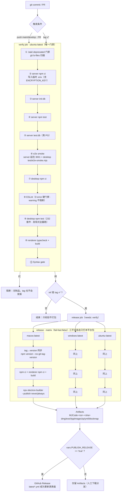

#### 2.2 verify 的门禁强度（逐项）

| # | 步骤 | 门禁性质 | 强度评价 |
|---|------|---------|---------|
| ① | `.bak/.deprecated` 入库检查（`ci.yml:34-41`） | 硬阻断 | 强；用 `git ls-files` 而非 `find`，绕过 `.gitignore` 也会红 |
| ②-③ | server 依赖 + `init-db` | 硬阻断 | 强；`ENCRYPTION_KEY` 在 CI 是 64 位 hex（`ci.yml:57`），与生产同形态 |
| ④-⑤ | server 单测 + 真 PG 测试 | 硬阻断 | 强；`test:db` 覆盖了"必须有真库"的路径 |
| ⑥ | e2e smoke | 硬阻断 | 中；`sleep 3` 等 server 起来（`ci.yml:76-78`），runner 慢时可能假红【推断】 |
| ⑧ | ESLint | **0 error / 不限 warning**（`package.json:21` `--max-warnings=9999`） | 弱；`lint:strict`（0 warning）存在但**未进 CI** |
| ⑨ | desktop 测试 | 硬阻断 | 强；`test/run-all.mjs:14-34` 改为**发现式 + 全量跑完 + 末尾汇总**，专治"某套件崩溃后其后 41 个套件静默不跑"的假绿 |
| ⑩ | renderer typecheck + build | 硬阻断 | 强；`tsc` 门禁 + 产物生成 |
| ⑪ | Syntax gate | 硬阻断，**全量扫描**（2026-10-17 第六轮 N3 已修）：`node --check` 覆盖 `server/src` + desktop 的 `main`/`agent-core`/`eval`/`scripts`/`shared`/`shared-ipc`/`chrome-extension` 全部 `.js/.mjs`（`ci.yml:110-113`），`main/` 下实有 **138 个 .js** 无一漏网；renderer 的 ts/tsx 由 ⑩ 的 tsc 覆盖（`node --check` 无法解析 TS） | 强；原实现只 `--check` 8 个写死文件，**新增文件永不被检查**（假绿），现任一语法错误即红；与 ESLint 分工明确（Syntax gate 管可解析性，ESLint 管规则） |

**缺的门禁**（第 7 章 §11 R4）：无依赖漏洞扫描（`npm audit`/Dependabot）、无密钥泄漏扫描（gitleaks）、无"打包后自检"、无 `lint:strict` 增量收紧。

#### 2.3 release 阶段的三个真问题

1. **`--publish always` 缺令牌**：`ci.yml:155` 在 `always` 时需要 `GH_TOKEN`/`GITHUB_TOKEN`，而 release job 的 `env:` 只注入 5 个签名 secrets（`ci.yml:128-133`），也无 `permissions: contents: write` → 一旦置 `PUBLISH_RELEASE=true`，Package 步骤会因"GitHub Personal Access Token is not set"失败（【推断】基于 electron-builder 发布器行为，首次发包必验）。
2. **架构由 runner 决定**：Package 未指定 `--x64/--arm64/--universal`，`macos-latest` 为 Apple Silicon 故只出 arm64（本地产物名 `MJCode-0.1.0-mac-arm64.dmg` 与 `latest-mac.yml` 印证）→ **Intel Mac 装不了**（《打包指南》第 9 节已提示）。
3. **三 runner 并发发布同一 Release**：各自 `--publish always` 同时向同一 tag 上传，electron-builder "查不到就建"，偶发 `409 Release already exists` 竞态【推断】→ 更稳的做法是三平台只传 Artifacts，单 job 汇总后 `gh release upload`。

#### 2.4 为什么 renderer 必须先构建

`build.files` 是白名单，只收 `renderer/dist/**`（`package.json:47-54`），而它是被 gitignore 的产物：

- **不会报错，只会白屏**：`dist` 缺失/过期时 electron-builder 照常出包，`loadFile` 打开空白页。`dist:*` 脚本因此都先 `npm run build --prefix renderer`（`package.json:9-13`）——纪律写在脚本里而非文档里，是对的。
- **`base: './'` 是能启动的硬前提**：`renderer/vite.config.js:6` 设 `base:'./'`，产物引用 `./assets/index-*.js`；若改成 `'/'`，`file://` 下会解析到 `file:///assets/...` 直接白屏。属"删了没人知道为什么坏"的部署级约束，建议加注释。
- 同理 `extraResources` 的 `../ecosystem`（`package.json:78-83`）是**相对 `desktop/`** 的路径，把 `desktop/` 单拷出去打包会静默缺资源（《打包指南》第 6 节）。

---

### 3. 产物与分发矩阵

#### 3.1 平台 × target × 架构

| 平台 | target | 架构覆盖（现状） | 产物名（实测） | 自动更新元数据 |
|------|--------|-----------------|---------------|---------------|
| macOS | `dmg` + `zip`（`package.json:60`） | 仅 **arm64**（runner 决定；`--universal` 未启用） | `MJCode-0.1.0-mac-arm64.dmg` / `.zip` | `latest-mac.yml` |
| Windows | `nsis`（`:65`） | x64（runner 决定） | `MJCode-<v>-win-x64.exe` | `latest.yml` |
| Linux | `AppImage`（`:71`） | x64（runner 决定） | `MJCode-<v>-linux-x64.AppImage` | `latest-linux.yml` |

`artifactId` 模板统一为 `MJCode-${version}-${os}-${arch}.${ext}`（`:62,67,73`），版本-平台-架构三元组可追溯，
与《回滚 Runbook》第 1 节一致。

#### 3.2 体积实测（采集方式：`ls -la desktop/release/`，2026-10-17 17:58 本地产物）

| 文件 | 字节 | 折算 | 用途 |
|------|------|------|------|
| `MJCode-0.1.0-mac-arm64.dmg` | 120,417,964 | **114.8 MiB ≈ 115 MiB** | 人工下载安装 |
| `MJCode-0.1.0-mac-arm64.zip` | 114,853,454 | 109.5 MiB | **自动更新下载的就是它**（不要删） |
| `...dmg.blockmap` | 124,803 | 122 KiB | 增量更新差分 |
| `...zip.blockmap` | 120,246 | 117 KiB | 增量更新差分 |
| `latest-mac.yml` | 506 | 0.5 KiB | 更新源真值（含 sha512） |

对照参考：2026-10-14 的《上线发布方案》记录 dmg 为 113,413,320 B（108 MiB），两版相差约 7 MiB，
来自前端资源增长（`renderer/dist` 现 4.0 MB）与 Electron 版本差异【推断】。

#### 3.3 自动更新必需的四个文件（少一个就断链）

| 文件 | 缺失/不一致的后果 |
|------|-----------------|
| 安装包（`.zip` / `.exe` / `.AppImage`） | 客户端拿到 yml 却无处下载 |
| `latest*.yml` | 完全不提示更新（客户端靠它判断版本） |
| `*.blockmap` | 退化为全量下载（能更新，但流量翻倍） |
| 包内 `package.json.version` | 与 yml 不一致 → 更新后版本号不前进，反复提示更新 |

`latest-mac.yml` 实测内含 `version: 0.1.0` + 两个文件的 `sha512` 与 `size`，与磁盘文件字节数逐一对上
（`size: 120417964` / `114853454`）→ **yml 与制品必须同批产出，禁止单独补传**。

#### 3.4 体积构成与可优化项（未压缩口径，`du -sh`）

| 组成 | 大小 | 备注 |
|------|------|------|
| Electron 33.4.11 运行时 | 体积主体【推断】 | `builder-effective-config.yaml: electronVersion: 33.4.11` |
| `renderer/dist` | 4.0 MB | 白名单唯一前端来源 |
| 运行时依赖 | sql.js 21 MB、playwright-core 13 MB、zod 8.1 MB、yjs 2.5 MB、electron-updater 1.5 MB、ws 196 KB | 实际进包的是压缩后的 asar |
| `main/` + `agent-core/` + `shared*` | 1.1 MB + 148 KB + 52 KB | 纯源码 |
| `ecosystem` | 本地 1.1 MB（3 JSON 610 KB + `skills/` 400 KB） | **CI 检出后只剩 610 KB**，见第 7 章 §11 R2 |
| 图标源 `logo.png` | 2.9 MB | 2048×2048 PNG，可压到 <300 KB |
| `sql-wasm.wasm` | 659,806 B | `asarUnpack` 必须解包，否则打包版唯一 DB 引擎加载失败 |

可省的大头是 `sql.js` 里除 `sql-wasm.wasm` 外的 Emscripten 变体与 `playwright-core` 的无用 driver 包——但**动依赖前必须先跑 `build-config.test.js` 与打包后自检**，否则省下 20 MB 换来一个白屏包不划算。

---

### 4. 签名与公证

#### 4.1 现状：默认关闭，CI 仍绿

macOS 签名/公证、Windows 签名**全部未启用**（secrets 未配置，按团队确认口径）。electron-builder 的行为是：没证书就跳过签名并继续，所以 `release` job 会产出一个"未签名但完整"的包（`ci.yml:113-116` 注释写明了这个设计）。
《签名 Runbook》第 1 节把这条固化成表：**默认关闭 / secrets 就位即自动启用 / 无需改工作流**。

#### 4.2 启用条件（一次性清单）

| 平台 | Secrets | 额外工程动作 |
|------|---------|-------------|
| macOS 签名 | `CSC_LINK`（Developer ID Application p12 的 base64）+ `CSC_KEY_PASSWORD` | 无 |
| macOS 公证 | `APPLE_ID` + `APPLE_APP_SPECIFIC_PASSWORD` + `APPLE_TEAM_ID` | **必须新增 `build/entitlements.mac.plist`** 并在 `build.mac` 加 `hardenedRuntime/gatekeeperAssess/entitlements/notarize`（片段见《签名 Runbook》第二节） |
| Windows 签名 | `CSC_LINK`（pfx base64）+ `CSC_KEY_PASSWORD` | 建议起步用 Azure Trusted Signing（《签名 Runbook》第三节） |

✅ **缺件提醒（已解除）**：v1.0 记录过「`desktop/build/` 目录不存在」——该目录与 `build/entitlements.mac.plist`（1,302 B）已于 2026-10-17 18:35 建立（`5325188` 接线 `hardenedRuntime/gatekeeperAssess/entitlements`）。
保留纪律：**顺序必须是「先建 plist，再开 secrets」**，否则 electron-builder 在签名阶段直接失败 → 三平台 release 全红。

#### 4.3 未签名的用户侧代价

| 平台 | 表现 | 绕过方式（写进 Release notes） |
|------|------|------------------------------|
| macOS | Gatekeeper「无法验证开发者」，双击被拦；公证缺失时更常见「已损坏」 | 右键 → 打开；或 `xattr -cr "/Applications/MJ Coder.app"` |
| Windows | SmartScreen「未知发布者」+ 信誉积累为 0 | 「更多信息」→「仍要运行」 |
| Linux | 无强制签名 | —— |

#### 4.4 与自动更新的强耦合（最容易被忽略的一条）

`build.win.verifyUpdateCodeSignature: true`（`package.json:68`）会让 Windows 客户端**校验更新包发布者**。
推论链条：未签名 → 自更新包被拒 → 用户只能手动下载覆盖安装 → 更新链路在 Windows 上实际不可用。
**这不是"体验差一点"，是功能缺失**。内测期若必须自更新，只能临时关该字段并在 Release notes 明示（《打包指南》第 7 节）。

> 历史坑已修：该字段原先误放在 `build.mac` 下。`verifyUpdateCodeSignature` 是 Windows 专有属性，
> 放错层级会让 electron-builder 的 schema 校验直接失败（`configuration.mac has an unknown property`），
> **整个打包命令跑不起来**——`test/build-config.test.js` 现在守着这条。这是"配置错位比配置缺失更致命"的典型样本。

macOS 侧同理：未签名/未公证的 zip 更新后，新包仍会被 Gatekeeper 拦（用户看到"更新完了打不开"），
故 mac 的签名是更新的前置条件，而不是锦上添花。真机升级演练步骤见《签名 Runbook》第四节（0.x → 0.x+1 五步），此处不重复。

---

### 5. 版本与发布策略

#### 5.1 三处 version 必须一致（现状：一致）

`desktop/package.json:3` / `server/package.json` / `desktop/renderer/package.json` 当前均为 `0.1.0`。
一致性由《回滚 Runbook》第 1 节要求，但**没有自动化校验**（`build-config.test.js` 只验 build 段，
不比对三处 version）→ 建议加一条断言（第 7 章 §11 R5）。

CI 会**用 tag 覆盖** desktop 的 version（`ci.yml:141-145` `npm version "$VERSION" --no-git-tag-version --allow-same-version`），
所以本地改了也会被盖掉；但 server / renderer 的 version **不会被覆盖** → tag 为 `v0.2.0` 时会出现
"安装包 0.2.0 / server 0.1.0"的静默漂移。发布前必须手工对齐。

#### 5.2 tag 即发布触发器

```
git tag v0.2.0 && git push origin v0.2.0   →   release job 唯一入口
```

tag 是唯一触发器（`ci.yml:121` `if: startsWith(github.ref, 'refs/tags/v')`），分支 push 只跑 verify。
**当前仓库零个 `v*` tag**，因此 release job 的**全部代码路径从未在真实 GitHub 环境执行过**——
这是首次发版最大的不确定性（第 7 章 §11 R1）。发版前建议先在私有 fork 或 `v0.0.1-rc.1` 上完整演练一遍。

#### 5.3 CHANGELOG

根目录 `CHANGELOG.md`（39 KB，Keep a Changelog 风格）。流程要求："未发布"段落改版本号 + 日期，
摘要面向用户价值（《回滚 Runbook》第 1、2 节）。CI 不校验 CHANGELOG 是否更新 → 靠人。

#### 5.4 灰度：设计存在，链路未通

设计意图：`MJ_UPDATE_CHANNEL=beta` 走预发布通道，读取 `latest-beta.yml`（`updater/index.js:7,16,101-103`）。
**但代码里只设了 `channel`，没有任何 `allowPrerelease` / `allowDowngrade` 设置**（全仓 grep 零命中）：

- 无 `allowPrerelease=true` → electron-updater 默认过滤预发布版本，`latest-beta.yml` 里的 `0.2.0-beta.1`
  **不会被判定为可更新**（【待实测】，但这是 electron-updater 的既有行为）；
- 无 `allowDowngrade` → 回滚只能"不升级"，已经升上去的用户**无法被自动降级**。

且 CI 的 `publish.channel` 固定为 `latest`（`package.json:45`），beta 包连产出通道都没有。
→ 结论：**当前只有一条 `latest` 通道，灰度能力是文档级的**（第 7 章 §11 R6）。

#### 5.5 回滚路径（工程视角，不重复操作步骤）

| 场景 | 有效范围 | 工程前提 |
|------|---------|---------|
| A 撤回发布 + 重指向旧 yml | **只对"尚未升级"的客户端有效** | 旧版 zip + 旧版 `latest*.yml` 必须留档；yml 的 sha512 必须与重新上传的文件一致 |
| A' 已升级用户回退 | 只能**手动卸载 + 装旧版**（无 `allowDowngrade`） | Release notes 必须写明操作步骤 |
| B CI 制品损坏 → 删 tag 重打同号 tag | 全矩阵重跑 | 禁止手工补传单平台制品（矩阵不全比没有更糟） |
| C server 回归 | 回退到上一 tag 进程 | 次版本内可混跑，主版本不混跑（《回滚 Runbook》第 5 节 C） |

回滚演练：场景 A 需"上一稳定版存在"才能演练 → **首个 tag 发布后 72 小时内必须补一次 A 的实测**，并记录在《回滚 Runbook》第 6 节（该表当前两行仍是 ⏳）。

---

### 6. 运行时稳定性

#### 6.1 首帧显示策略（白屏/闪黑的第一道防线）

```js
show: false, backgroundColor: '#0d0d0d',
mainWindow.once('ready-to-show', reveal);
setTimeout(reveal, 1500);           // 兜底：渲染进程异常时不至于"窗口不出现"
```

（`desktop/main/lifecycle/window.js:48-65`）

- **解决的不是白屏，是"闪色"**：原 `show:true` 时窗口先以纯色底出现，浅色主题用户先看到一帧深色再跳白底，比黑屏更刺眼（`:48-50` 注释即真实反馈）。
- **1.5s 兜底是权衡**：渲染进程崩了 `ready-to-show` 永不触发，宁可闪一下也不能不显示窗口；剩余风险是"有窗口无内容"——**可观测**，比"没窗口"好排查。
- 首帧之后还有约 2.4s 启动页（《打包指南》第 10 节），两者是独立的观感优化，不要混谈。

#### 6.2 崩溃与降级：三级分流

| 级别 | 判定 | 处置 | 证据 |
|------|------|------|------|
| 可降级（环境不可达） | `ECONNREFUSED/ENOTFOUND/ETIMEDOUT/EPIPE` 等 | 首条 `warn` + 同签名后续静默，计数留档 | `main/degrade.js:8,34-55` |
| 真错误（4xx/5xx/解析失败） | 非网络类 | **始终 `error`，绝不静默** | 同上 `:36-40` |
| 进程级崩溃 | `uncaughtException` / `unhandledRejection` / 渲染层 error | 结构化 JSONL + 原生 dump（不上传） | `main/main.js:379-392`、`main/diagnostics.js` |

三条关键加固：① **`unhandledRejection` 必须兜底**——Node 15+ 默认在未处理拒绝后终止进程，原先只挂 `uncaughtException`，任何漏 `.catch()` 的异步 IIFE 都会让整个应用退出（`main.js:383-392` 记录了该事故）；
② **崩溃半径收缩**——引擎跑在 `utilityProcess` 子进程（`main/engineProcess/host.js`），一个 run 崩了不拖垮 UI，`utilityProcess` 缺失时回退主进程直调；
③ **审计熔断**——连续 3 次上报失败熔断 5 分钟，只计数不发请求（`audit/auditLog.js:15,75-78`），审计失败绝不阻塞业务（`:49`）。

#### 6.3 诊断包：四道脱敏（不是三道）

用户"设置 → 问题诊断 → 导出诊断包"产出 zip，内含 audit / diagnostics / traces / logs / 脱敏配置 / meta.json
（`main/diagExport.js:1-11`）。四道防线：

| 道 | 手段 | 代码位置 | 防的是什么 |
|----|------|---------|-----------|
| 1 | 敏感**字段名**黑名单递归剔除（`api_key/token/env/headers/authorization`…） | `:18,29-40` | 结构化配置里的键值对 |
| 2 | 非结构化文本**正则扫描**（`sk-…` / `Bearer …` / `ghp_…` / `AKIA…`） | `:25,43-45` | 命令原文、上游 401 响应体回显的 Key |
| 3 | `models.json` 走**白名单**（只放行 name/url/models 等） | `:49-66` | 黑名单漏键（`accessKeyId` / `secretKey` / `api_key_encrypted` 等变体） |
| 4 | `userData` 绝对路径 → `~/…` 相对表达 | `:70-78` | 泄漏系统用户名 |

另有**导出前清单**（`:158-170`）+ 导出回带 contents（`:194-203`），让用户打包前就知道"里面有什么"；`test/diag-export.test.mjs` 用假密钥值 grep 全包，命中即红——这是唯一防回归手段，不要删。

**边界**：诊断包不含会话正文与消息体（`:129-131` 只取 providers/preferences/projects 三域），排障"某轮对话错了"只能拿到 trace 事件——隐私与可诊断性的既有取舍，需写进支持话术。

#### 6.4 数据安全：sql.js 的落盘窗口

| 机制 | 参数 | 证据 |
|------|------|------|
| 写操作后**防抖导出** | 150ms | `main/db/sqljsDb.js:14,55-59` |
| 落盘**真 fsync** | fsync 文件 + fsync 目录 | `:41-43`（`writeFileDurable`），失败保持 `dirty=true` 下次重试（`:44-49`） |
| 进程退出兜底 | `process.on('exit')` 一次 flush | `:62` |
| 正常退出第三道 | `will-quit` 里 `taskStore.db.flush()` + localStore + intentLog + 8 项子进程清理 | `main/main.js:404-422` |
| 信号退出 | SIGTERM/SIGINT/SIGHUP → `app.quit()`，2s 后强退 | `main.js:424-430` |

**强杀（SIGKILL / 断电）最多丢约 150ms 的写入**——可接受，但有两个必须知道的副作用：

1. **每次 flush 都是全库导出**：`sqldb.export()` 返回整个 DB 字节数组，内存瞬时翻倍；DB 长到 35–40 MB（约 2 万条消息）时每次导出的峰值与 CPU 都不可忽略，流式消息更会持续触发【推断】→ 建议 `messages` 走独立追加日志。`【待确认：当前最大库体积与 flush 耗时】`
2. **没有自动备份**：`userData/mjcode.db` 是唯一副本，损坏时 `openSqliteJsDb` 直接"重建空库"（`sqljsDb.js:26-29`）→ **静默丢失全部任务编排数据**（第 7 章 §11 R3）。

#### 6.5 升级时的 schema 迁移

- 桌面侧：`PRAGMA user_version` 版本链，每个迁移包在事务里（`main/db/index.js:266-277`）；
- 服务端：`schema_migrations` 表 + 幂等 `addColumnIfMissing`（`server/src/db/migrate.js:12-24`），
  修过"PG 不支持 `ADD COLUMN IF NOT EXISTS` 导致重复启动即崩溃"的假幂等事故（同文件 `:3-11`）。

⚠️ **迁移前无快照**：桌面侧迁移失败没有"回滚到旧 schema"的路径，且**旧版本应用遇到新 schema 的行为未验证**
（`user_version` 更大时旧版直接跳过全部迁移，若旧版 SQL 依赖列顺序/数量就会出错）→【待确认】。
建议迁移前 `copyFile(mjcode.db → mjcode.db.bak-<version>)`，成本几毫秒，收益是"降级可救"。

---

### 7. 可观测性

#### 7.1 日志分层

| 层 | 落点 | 能力 | 缺口 |
|----|------|------|------|
| dev | 终端 stdout | 实时、可 `openDevTools` | 无留存 |
| 打包主进程 | `userData/logs/main-YYYYMMDD.log`（`window.js:80-96`） | console 全量 tee，单条截断 4000 字符 | **无轮转、无保留上限、无体积上限** → 长期使用会无限增长（每天一个新文件） |
| 崩溃/异常 | `userData/diagnostics/crash-YYYYMMDD.jsonl` | 5 MB/日上限 + 3 代轮转 + 溢出文件 + 1 分钟同签名聚合 + 附活跃 run 的 trace 尾部（`diagnostics.js:17-21,73-116`） | 高频异常达上限后**静默丢弃新记录**（"真实崩溃被挤掉"的事故链见 `orchestrator/invoke.js:20-23`） |
| 原生崩溃 | `userData/Crashpad`（`crashReporter.start({uploadToServer:false})`，`diagnostics.js:122-139`） | 本地 dump | 不上传，用户不导出就等于没发生 |
| 运行 trace | `userData/traces/`，最多 **50** 个文件（`main/runTrace.js:9,39`） | 逐轮引擎事件，可回放"崩之前最后在干什么" | 无跨会话聚合 |

#### 7.2 审计日志

`userData/audit-log.jsonl`，**本地优先**：无服务端令牌时直接落盘，10 MB 单代轮转（`audit/auditLog.js` 的 `auditLocal` / `AUDIT_LOG_MAX_BYTES`）。
第八轮 L-3 起每行额外带 `seq` / `prev` / `hash`（`sha256(prev + 行体)`）构成哈希链，
`verifyAuditChain()` 可事后判定「文件有没有被改过一行、删过一行、插过一行」——
改前只保证「API 层不可改写」（只有 append，不导出 update/delete），防不住有人直接编辑文件。
覆盖 shell / 写文件 / git / MCP / 审批放行。审计是"可丢失遥测"，写失败只 `warn`（`:49`）——
这条纪律要保留：审计把业务带走是最糟的权衡。

#### 7.3 health 探针

服务端 `/api/health` 会真的探 DB（`SELECT 1`，2s 超时），DB 挂则 **503 + `status:'degraded'` + `dbError`**（`server/src/index.js:24-50`）。
设计意图写在注释里且很正确：「说不了谎的 health 才有用」——此前 health 只回进程状态，DB 挂了仍 200，
客户端表现为"应用显示在线但所有功能报错"。

桌面侧**没有对应探针**：没有 IPC 暴露"本地引擎/DB/子进程是否健康"的聚合状态，
`app:flags`（`main/ipc/ecosystem.js`）只回功能开关。→ 用户报"卡住"时，第一线只能靠诊断包。

#### 7.4 缺失的指标（要补的四件事）

| 缺什么 | 影响 | 补法（成本递增） |
|--------|------|----------------|
| 崩溃/错误上报（遥测） | 只能等用户主动导出诊断包 | ① 导出包时生成短 ID + 让用户报 ID；② opt-in 上报（首次启动明确询问，默认关）；③ Sentry 自建（与"本地优先"主张冲突，需产品拍板） |
| 更新成功率 | 不知道 `--publish always` 后多少人更新失败 | 把 `updater:status` 的 error/kind 计数落 `userData/updater-stats.json`，随诊断包导出 |
| 版本分布 | 不知道旧版用户占比，无法判断能否下线兼容层 | GitHub Release 资产下载数 + opt-in 上报 |
| 关键路径耗时 | 首帧、DB flush、run 时长无量化 | 已有 `runTrace` 事件流，补 `run_end` 的 duration/token 汇总即可（`agent-core/index.js:1428` 已有 `run_start`） |

告警与值班：**当前无任何服务端告警通道**（无 Prometheus/Grafana/Sentry，`server` 只有日志）。最小可用方案：`/api/health` 挂外部探活 + GitHub Issues 模板分类 + 发布后 72 小时观察窗（《回滚 Runbook》第 7 节已有约定，但全靠人工）。

---

### 8. 密钥与配置管理

#### 8.1 客户端密钥（模型 API Key）

| 轨 | 触发条件 | 存储 | 保护级别 |
|----|---------|------|---------|
| 轨 1 `safeStorage` | `isEncryptionAvailable()` 为真 | OS 钥匙串托管密钥，密文存 `local-data.json` | 高 |
| 轨 2 file-key | safeStorage 不可用（**macOS 27 非 MAS 真机实测为 false**） | `userData/credential.key`（0600）+ AES-256-GCM，密文带 `v2:` 前缀 | 降级为"文件权限"，与 `local-data.json` 同级 |

解密按前缀自动路由，兼容旧密文（`credentialCrypto.js:9,60-91`）；`chmod` 失败会显式 `console.error` + 审计留痕（`:48-55`）——"权限收紧失败"绝不能静默。

**运维含义**：换机/重装时若原先走轨 1，`credential.key` 不存在但密文存在 → 解密抛「该凭证由系统钥匙串加密，当前环境 safeStorage 不可用，请重新填写 API Key」（`:88-90`）。这是**预期的 fail-closed**，支持话术要背下来：不是 bug，是让用户重填。

#### 8.2 MCP 的 `env` / `headers` 是明文（已知债）

`userData/mcp-servers.json` 原样保存 `env` 与 `headers`（`main/ipc/mcp.js:24-25,284`），渲染层又把含密钥的值另存一份到 `localStorage`（`renderer/src/lib/ecosystemEnabled.ts:97` 注释自陈）→ 同机任意进程可读，扩散备份即泄密；这也是诊断包必须整块剔除 `env/headers`（`diagExport.js:145`）的原因。
**修法**：MCP 密钥迁入 `CredentialCrypto`（复用轨 1/轨 2），JSON 只存 `envRef: "mcp:<id>:<KEY>"`，一次性迁移脚本搬运后清理旧文件。安全债里优先级最高的一条（第 7 章 §11 R7）。

#### 8.3 服务端 `ENCRYPTION_KEY`

未设置时 `api_key` **明文入库**，只在启动时 `warn` 一次（`server/src/lib/crypto.js:21`）；已加密凭证在缺 key 时解密直接抛错（`:36`）。仓库根 `.env.example` 里 `ENCRYPTION_KEY=` 是**空值** → 默认配置就是明文存储。生产必须 `openssl rand -hex 32` 生成、只进密钥管理；**轮换需重加密**（无密钥版本号，换 key 等于旧数据全废）→ 先导一次明文再写回是新 key 下唯一可行路径【待确认：是否保留旧 key 双读】。

#### 8.4 CI secrets 与发布令牌

| 名称 | 类型 | 现状 | 备注 |
|------|------|------|------|
| `CSC_LINK` / `CSC_KEY_PASSWORD` | Secret | 未配置 | mac p12 与 win pfx **共用同名变量**，无法同时启用两平台签名（矩阵并行时会串味）→ 需拆成 `CSC_LINK_MAC` / `CSC_LINK_WIN` 并在 job 里映射【待确认：electron-builder 是否支持按平台变量】 |
| `APPLE_ID` / `APPLE_APP_SPECIFIC_PASSWORD` / `APPLE_TEAM_ID` | Secret | 未配置 | 公证用 |
| `PUBLISH_RELEASE` | Variable | 未配置（默认走 `never`） | 置 true 前先补 `GH_TOKEN`（见 2.3） |

**未做的两件事**：`permissions: contents: write`（release job 无此声明，默认 token 在新仓库为只读）；
发布令牌无有效期/最小权限约束（PAT 若用 classic token 会带全仓权限 → 应用 fine-grained token 仅 contents:write）。

#### 8.5 泄露应急（一页纸）

1. 立即在 GitHub 撤销/轮换 secret → 重打 tag 重发（旧包自动更新会被新 yml 覆盖）；
2. 客户端模型 Key 泄露 → 用户在设置页重填即覆盖密文，无吊销能力（Key 属于用户自己的 provider）；
3. 服务端 `ENCRYPTION_KEY` 泄露 → 按 8.3 重加密 + 强制所有用户重登（`JWT_SECRET` 同步轮换，`JWT_EXPIRES` 现为 `7d`，轮换后最长 7 天残留）。

---

### 9. 容量与成本

#### 9.1 安装包与分发流量

- 单平台包 ~115 MB（dmg）；三平台全量对外 = 约 345 MB/版本。
- 自动更新走 zip + blockmap，**差量更新**是省流量的关键：删掉 blockmap 会让每次更新退化为全量 110 MB。
- GitHub Release 无带宽成本，但**单文件 2 GB / 单 Release 资产数**限制不影响本项目。

#### 9.2 运行内存（子进程堆上限，实测量级）

| 进程 | `--max-old-space-size` | 证据 |
|------|----------------------|------|
| 引擎（每 run 一个 utilityProcess） | **2048 MB** | `main/engineProcess/host.js:16,31` |
| Code Mode | 1024 MB | `main/codeProcess/host.js:19` |
| Browser Use（Playwright 驱动） | 512 MB | `main/browserProcess/host.js:20` |
| Computer Use | 512 MB | `main/cuaProcess/host.js:17` |

上限之和 ≈ **4 GB heap**（不含 Chromium 渲染进程与浏览器实例）。并发编排（`workerPool`）同时起多个引擎进程时内存是**乘性**的 → 需明确"最大并发 worker 数"并在池上设上限【待确认：`workerPool` 当前并发上限】；8 GB 机器同时跑 3 个 run + Browser Use 即有 OOM 风险，但 OOM 表现为子进程被杀（run 失败），不是应用崩溃。

#### 9.3 token 成本：两个真实敞口

1. **交互 run 没有 token 预算**：`tokenBudget` 默认 **0 = 不启用**（`agent-core/index.js:1274`），只有无人值守路径强制注入 200000（`workerPool.js:215`、`main.js:958-959` 定时执行）→ 用户开着对话跑，轮次硬顶 120（`:1200`）是唯一闸门；叠加 `TOKEN_RESCUE_MAX=3`（`:533`）的压缩救援（口径 ≈ 4 × budget），单 run 成本上界不可预估。
2. **"30 分钟"被三处共用，是定时炸弹**：

| 位置 | 值 | 含义 |
|------|-----|------|
| `main/orchestrator/invoke.js:8` | 30 × 60 × 1000 | `orchestrate_task` 等待组终态的墙钟上限 |
| `agent-core/index.js:1118` | 1800000 | `orchestrate_task` 工具级看门狗 |
| `main/orchestrator/dag.js:50` | 30 × 60 × 1000 | 子任务 `timeoutMs` 钳制上限 |

三者**同值** ⇒ "组超时"与"看门狗超时"几乎同时到期，谁先触发不确定（注释写"组级超时先于看门狗生效"，那是**依赖时序的假设**，不是保证）。后果：用户看到的可能是「编排超时」也可能是「工具看门狗终止」，归因困难；且两条路径都在 30 分钟才收尾，**这 30 分钟 token 照烧**。修法：看门狗设 32–35 分钟（明确晚于组超时），并给交互 run 注入预算（如 300k），让"超预算"先于"超时间"发生。

#### 9.4 磁盘占用（长期使用）

| 目录 | 上限 | 说明 |
|------|------|------|
| `logs/main-*.log` | **无上限**（每天一文件） | 最大的隐性增长源，建议 7 天/50 MB 轮转 |
| `diagnostics/crash-*.jsonl` | 5 MB × (1 + 3 代) + overflow | 有界 |
| `traces/` | 50 文件 | 有界 |
| `audit-log.jsonl` | 10 MB × 2 代 | 有界 |
| `mjcode.db` | 随消息量线性增长（2 万条约 35–40 MB） | 每次 flush 全量导出，见 6.4 |

---

### 10. 上线检查单

**发版前（T-1 天）**
- [ ] 三处 `package.json` version 已对齐，且**不同于**任何已发布版本号（同号重发会让自动更新失效）
- [ ] `CHANGELOG.md` 的"未发布"已改为 `vX.Y.Z + 日期`，摘要面向用户价值
- [ ] `desktop/release/` 已清空（防旧产物混入 `--publish always`）
- [ ] `renderer/dist` 可重建：`cd desktop/renderer && npm run build` 成功且 `dist/index.html` 存在
- [ ] `desktop/build/entitlements.mac.plist` 存在（若本期启用 mac 公证）
- [ ] release job 已注入 `GH_TOKEN`（或 `GITHUB_TOKEN`）与 `permissions: contents: write`（若本期启用 `PUBLISH_RELEASE`）
- [ ] 本地 `cd desktop && npm test` 全绿（232 套件），`npm run typecheck --prefix renderer` 通过

**发版中（tag 之后）**
- [ ] `verify` job 全绿（任一红 → 不打 tag、不发版）
- [ ] `release` matrix 三个 runner 均 Success（`fail-fast:false`，单平台失败要单独看）
- [ ] Artifacts 里三平台齐全，且每个平台都有：安装包 + `latest*.yml` + `*.blockmap`
- [ ] 若发 GitHub Release：三平台资产 + 三份 yml 都在，且 `latest*.yml` 的 `sha512/size` 与资产一致
- [ ] Release notes 标注签名状态（未签名则写明 Gatekeeper / SmartScreen 绕过方式）

**发版后（T+2h / T+72h）**
- [ ] 干净机器装**新包**：首帧不白屏、启动页出现、引导可走完
- [ ] 干净机器装**上一版**：10s 后自动检查 → available → 下载 → 重启安装 → 版本号前进、数据完好
- [ ] 断网后点"检查更新"：error 态出现且"手动下载最新版本"链接可点开（不静默）
- [ ] 打包版 `userData/logs/main-*.log` 有内容（证明 tee 生效），诊断包可导出且不含密钥（抽查 `sk-`/`Bearer`）
- [ ] 生态中心三类资产非空（数字员工 / 连接器 / 技能），首条消息能正常返回
- [ ] T+72h：无 P0/P1 Issue 累积；有则按第 5.5 节进入回滚判定
- [ ] 在《回滚 Runbook》第 6 节追加一行演练记录（日期 / 版本 / 操作人 / 结果）

---

### 11. 风险与改进

| # | 现象 | 影响 | 建议 | 证据 |
|---|------|------|------|------|
| **R1** | 仓库**零个 `v*` tag**，release job 从未真实执行；`desktop/release/` 里已有本地打的 dmg 与 `latest-mac.yml` | 首次发版即"在生产上调试流水线"；且"生产包只从 CI 出"的纪律实为人工约定 | 先用 `v0.0.1-rc.1` 在仓库完整跑一遍三平台矩阵（含 `PUBLISH_RELEASE` 两种取值），记录耗时与失败点；把"产物来源"写进 Release notes | `git tag` 仅 `archive/pre-republish-mjcoder`；`ci.yml:110-119`；`ls desktop/release` |
| **R2** | ~~`.gitignore` 排除 `*.md`，`ecosystem/skills/` 下 103 个 `SKILL.md` 全部未被 git 跟踪~~ **✅ 已修 2026-10-17（`7b63c9f`）**：`.gitignore:52` 增 `!/ecosystem/skills/**/*.md`；实测 **100 个 SKILL.md 全部入库**（`git ls-files ecosystem` = 104） | 原风险「CI 检出后 `extraResources` 只剩 3 个 JSON、610 KB vs 本地 1.1 MB → 同一版本号两个产品」**已消除** | 保留反向门禁：`test/untracked-deps.test.mjs` 全量枚举打包输入，缺文件即红 | `git ls-files 'ecosystem/skills/*/SKILL.md'` = 100；`.gitignore:46-52`；`package.json:78-83`。**口径更正**：v1.0 的「103 个 SKILL.md」实为 `find ecosystem -name '*.md'` = 103（= 100 个 SKILL.md + 3 个顶层 .md），标签与数字都错 |
| **R3** | ~~sql.js 库文件是唯一副本，损坏即 `new SQL.Database()` 重建空库~~ **✅ 已修 2026-10-17（`34659a9`）**：坏文件隔离为 `.corrupt-<ts>`（不删）→ 按 mtime 回试 `pre-v*.bak` 快照 → 都失败才建空库，且结果经 `dbStatus.warning` 在状态条显性提示 | 原风险「静默清零、无恢复路径」已解除，现为「有隔离 + 有快照 + 有提示」 | 残余：快照只在**迁移前**生成，运行期写入仍依赖 150ms 合并刷盘（第 5 章 R2），断电丢 ≤150ms | `main/db/sqljsDb.js:21-55,73`（corrupt/快照/`PRAGMA schema_version` 探测）；`main/db/index.js`（迁移前 `pre-v{N}.bak`） |
| **R4** | verify job 现 **11 步**（`No .bak` / server install·init-db·unit·db·e2e / desktop install·lint·test / renderer typecheck+build / syntax），仍缺依赖漏洞扫描、密钥扫描、产物自检；`lint` 用 `--max-warnings=9999`，`lint:strict` 未进 CI | 供应链风险与"能打包但打不开"的 bug 只能靠人工发现；warning 永久不清零 | 加 `npm audit --audit-level=high`、gitleaks、以及 release job 后的"启动自检"（`--dir` 产物跑 `--version` 退出）；`lint:strict` 按目录分批纳入 | `ci.yml` verify 段（`- name:` 计 11 条）；`package.json:21-22`；`main/` **102** 个 js vs 语法门禁 8 个 |
| **R5** | 三处 version 一致性、CHANGELOG 更新、`v*` tag 与 version 相等，**全靠人** | `v0.2.0` 时 server/renderer 仍 0.1.0（CI 只覆盖 desktop） | 在 `build-config.test.js` 里加断言：三处 version 相等 + tag 名解析后与 desktop version 相等（CI 传 `GITHUB_REF_NAME`） | `ci.yml:141-145`；`desktop/package.json:3`；`server/package.json` / `renderer/package.json` 均 0.1.0 |
| **R6** | ~~灰度通道只设 `channel`，全仓无 `allowPrerelease`/`allowDowngrade`；CI 的 `publish.channel` 固定 `latest`~~ **✅ 已修 2026-10-17（`5325188`）**：非 `latest` 通道自动 `allowPrerelease=true`（`main/updater/index.js:104-105`）；`MJ_ALLOW_DOWNGRADE=1` 提供回退路径（`:108-110`）；CI 由 tag 形态显式解析 `channel`/`releaseType`（`scripts/resolve-update-channel.mjs`，非法规 tag **fail-closed 抛错**） | 原风险「灰度不可用、只能卸载重装」已解除。**仍属「未验证」而非「未修」**：`beta.yml` 是否真落地、GitHub Release 是否真标 prerelease、beta 客户端能否取到 —— 需真跑一次 `v0.1.0-rc.1` | 保留真实 tag 演练；建议把「通道→制品文件名」写进 Release notes 便于核对 | `main/updater/index.js:100-112`；`scripts/resolve-update-channel.mjs`；`ci.yml:153-185` |
| **R7** | MCP 的 `env`/`headers` 明文存 `userData/mcp-servers.json`，且渲染层另存一份到 `localStorage` | 同机任意进程可读；用户分享配置/备份即泄密 | 迁入 `CredentialCrypto`（轨 1/轨 2），JSON 只留引用；渲染层删除 localStorage 副本 | `main/ipc/mcp.js:24-25,284`；`renderer/src/lib/ecosystemEnabled.ts:97`；`diagExport.js:145`（诊断包已不得不整块剔除） |
| **R8** | ~~release job 缺 `GH_TOKEN` 与 `permissions: contents: write`~~ **✅ 已修（`7b63c9f`）**：`ci.yml:126-127` 加 `permissions: contents: write`、`:134` 注入 `GH_TOKEN`。**残留**：三 runner 并发 publish 同一 Release 的竞态未处理 | 首次自动发布的"必失败"已解除；并发竞态仍在（三平台同 tag 同时建 Release） | 改为"三平台只传 Artifacts + 单 job 汇总发布"，或给 Release 创建加重试/幂等 | `ci.yml:126-134` |
| **R9** | 交互 run `tokenBudget=0`（无预算）；30min 组超时与 30min 看门狗同值 | 用户挂机跑长任务时成本无上界；超时归因混淆 | 交互 run 注入 300k 预算；**超时顺序按第 3 章 R1 统一为「组级超时 = 看门狗 × 0.8 并在超时路径 abortGroup」**（v1.0 此处写「看门狗抬到组超时 + 2 分钟」，与第 3 章 R1 的方向相反，已废弃）；DAG 子任务上限降到 25 分钟 | `agent-core/index.js:1274,1063`；`orchestrator/invoke.js:8`；`orchestrator/dag.js:50` |
| **R10** | `logs/main-*.log` 无轮转/无上限；诊断包只能靠用户主动导出 | 长期用户日志目录无限增长；崩溃现场默认拿不到 | 日志按 7 天/50 MB 轮转；诊断包导出后给一个 8 位 ID 便于用户报障；`updater:status` 计数落盘随包导出 | `window.js:80-96`；`diagnostics.js:17-25` |

---

### 附：待确认清单

1. **`workerPool` 的并发上限**与"同时 N 个 run"时的实测内存峰值（关系到 9.2 的 OOM 结论）。
2. **electron-updater 在 `channel=beta` 且 `allowPrerelease` 未设时是否真的拿不到预发布版**（R6 需真机实测一次）。
3. **`ENCRYPTION_KEY` 轮换是否需要双 key 双读**（当前实现换 key 即旧密文不可解，`server/src/lib/crypto.js:36`）。
4. **macOS 公证后的 `spctl` 结果**（`hardenedRuntime` + entitlements 组合在本地优先 Agent 场景是否影响子进程沙箱）。
5. **旧版本应用读新 schema 的兼容性**（降级安装后 `sub_tasks` 新增列是否导致旧 SQL 报错）。

---

## 第 8 章　测试体系与验收标准

# 第 8 章 测试体系与验收标准

> **口径声明**：本章所有套件数与结论均以 `desktop/test/run-all.mjs` 的汇总输出为准。
> `142 = 140 个 *.test.{js,mjs} + 2 个 smoke 套件（smoke-load.mjs / render-smoke.mjs）`。
> 基线复跑（2026-10-17 21:25，`cd desktop && npm test`）：`总计 142 · 通过 142 · 失败 0`，
> 另有 2 条「未执行/跳过」显式记账（sandbox 真机探测），整轮墙钟 **约 55s**。
> eval 复跑（`node eval/run-eval.mjs --check` 与 `--tasks eval/tasks-hard.json --check`）：
> 10 条 + 5 条 schema 与 fail-to-pass 基线全部成立。

---

### 1. 测试策略总览

#### 1.1 现实约束（决定了策略形状）

| 约束 | 事实 | 对测试策略的影响 |
|------|------|-----------------|
| 无浏览器 E2E 基建 | `desktop/package.json` 无 vitest/playwright-test/spectron；`playwright-core` 只作为 Browser Use 的子进程内核被调用，不是测试框架 | 渲染层交互无法自动化，只能"静态断言 + 首帧渲染冒烟 + 手工验收"三段拼 |
| CI 无显示器 | `.github/workflows/ci.yml` 的 verify job 跑 `ubuntu-latest`，无 X | Electron 真窗口行为（交通灯、快捷键、拖拽、视觉）在 CI 结构性不可验 |
| 平台能力不均 | macOS 需 `sandbox-exec`（且嵌套沙箱时必然不可用）、Linux 需 bwrap、Windows 需管理员一次性设置 | 平台相关断言只能"本平台可测则测、不可测则显式记账"，绝不允许静默绿 |
| 主进程耦合 Electron | `app/BrowserWindow/safeStorage/ipcMain` 在主进程被直接使用 | 单测必须 stub 宿主或走真实子进程协议，不能靠"整体启动 Electron" |
| 引擎是流式 + 有模型 | `agent-core` 的每一轮都要一次 chat 调用 | 行为测试全部用**脚本化 chat 函数**注入，零网络、零 token 成本 |

#### 1.2 金字塔的实际落地形态（六层）

| 层 | 手段 | 覆盖对象 | 套件量 | 单轮成本 | 失败定位成本 |
|----|------|---------|--------|---------|------------|
| **L0 加载/首帧冒烟** | esbuild 打包成 CJS → `require` 每个组件；再 `react-dom/server.renderToStaticMarkup(<App/>)` | 模块顶层求值、组件函数体执行、TDZ、循环依赖、首帧崩溃 | 2 | < 3s | 极低（点名文件） |
| **L1 纯逻辑单测** | 手写 runner（`check(name, ok)`），零框架、零依赖 | 审批分级、DAG 拓扑、cron 匹配、writeGuard、payload 校验、i18n key、connector 纯函数 | ~45 | 毫秒级 | 低 |
| **L2 宿主集成（stub）** | `Module._load` 拦截 Electron、`ipcMain.handle` 捕获表、真实 sql.js、tmpdir | store 与迁移、任务状态机、MCP 握手、大载荷卸载、诊断导出 | ~30 | 百毫秒~3s | 中 |
| **L3 真子进程/真协议** | `fork` RPC（engine/browser/cua/code）、真实 WS/HTTP MCP、真实 git 仓库、真实 shell | 进程隔离、崩溃重建策略、取消回路、Worktree 合并 | 19（含 `child_process`）+ 若干真 git | 0.3~2s | 中高 |
| **L4 源码级门禁** | 正则 / TS AST / 文本断言 + ratchet 基线 | UI 约定、未定义标识符、props 契约、依赖入库、lint 全量、i18n 完整性、体积、打包配置 | 17 | 0.2~1.1s | 低（有行号） |
| **L5 手工验收** | M1–M4 清单（共 53 项，三段式：操作/期望/代码依据） | 真实 Electron 时序、视觉手感、系统权限、kill 子进程 | — | 30~60 min/批次 | 高（需人复现） |
| **L6 模型能力评测** | eval（15 个 fail-to-pass 任务） | 引擎端到端"能不能把缺陷改对" | 2 档任务集 | 325~643s/档 | 高（看报告） |

#### 1.3 为什么形状是"倒金字塔 + 双底座"

标准金字塔假设"UI 交互可用 E2E 覆盖、底层用大量单测"。本项目两个月内的高频缺陷形态是两类：

1. **静态正确、运行时崩**（连续四次启动白屏：`onModeChange is not defined`、`planMode is not defined`、`decomposing is not defined`、`Cannot access 'activeProject' before initialization`）。当时的 22 套件 / 606 断言全绿——因为门禁只查"约定"（裸色/z-index/emoji），从不查"名字是否存在"。
2. **测试绿、真机红**（`build.mac.verifyUpdateCodeSignature` 让 electron-builder schema 校验失败，测试全绿但 `npm run build` 直接红）。

这两类都不是"多写点单测"能治的，必须在**源码/AST 层**和**外部工具语义层**各加一层断言。所以 L4 门禁套件（14 个）与 L3 真子进程套件（19 个）的数量刻意压过了传统单测的比例。

#### 1.4 回归策略与冒烟集

- **全量即冒烟**：232 套件约 90s 全跑，不设"快速子集"。理由写在 `run-all.mjs` 头部：原实现是 83 个套件用 `&&` 串联，`orchestrator.test.js` 因 `better-sqlite3` 与 Node ABI 不匹配崩溃（`ERR_DLOPEN_FAILED`），**其后 41 个套件从未执行**，而 CI 照样亮绿——门禁假绿。修法：发现式发现、全量跑完、末尾汇总、崩溃与断言失败分开记账。
- **顺序执行不并发**：多套件共用 tmpdir 与全局 stub，并发会互相污染（源码注释明确）。
- **单套件 180s 超时 + SIGKILL**：卡死套件记失败并继续，不拖死整条基线。
- **跳过必须显式记账**：`run-all` 单独列出 `⚠ 跳过/未执行` 行，避免"全绿"被误读为"该平台已验证"（当前 3 条：`sandbox-crossplatform` 的 bwrap 探测、`sandbox-linux-status` 的 Linux 真机探测、"sandbox" 的 sandbox-exec 探测）。
- **成本分布**：单套件最慢 `mcp-multi-transport.test.js` **30.1s**（占整轮 38%，含真实 HTTP/WS 握手等待），其余 Top：`diagnostics` 3.0s、`orchestrator` 2.1s、`resourceQuota` 1.6s、`tools-cwd` 1.6s、`checkpointStore` 1.6s、`tool-loop-guard` 1.6s。其余 100+ 套件多在 1s 以内。

#### 1.5 测试数据与环境策略（摘要，详见 §6）

夹具以**内联字面量**为主（纯函数测试零外部依赖），进程级故障注入只有 2 个 fixture，隔离以 `mkdtempSync(os.tmpdir())` 为主（**43 / 124** 套件），eval 任务自带 `files[]` 快照并在临时目录物化后销毁。

---

### 2. 套件的域分组（快照口径，勿用于核对当前总数）

> **快照声明（2026-10-20 补）**：本表为 2026-10-17 撰写时实测（14 域 / 136 用例 + 2 smoke；原标题写「130」与实际枚举数即不符，属历史账本误差）。此后套件持续新增，下表数字**只对撰写时刻成立**；核对当前总数请现算：`ls desktop/test/*.test.* | wc -l`（用例数，+2 smoke = 套件总数），权威口径见速查表与第 8 章 §1。

按"改动会打到哪一块"聚类（而不是按测试形态聚类）——回归定位时人是按改动面找套件的。

| # | 域 | 套件数 | 代表套件 | 守护的具体风险 |
|---|----|-------|---------|--------------|
| 1 | **Agent 内核与单轮循环** | 11 | `agent-core`、`agent-watchdog`、`context-econ`、`tool-loop-guard`、`message-schema`、`model-shape` | 中间消息持久化顺序、逐轮 usage 归属、abort 收敛、压缩后仍能完成、重复失败熔断、`model` 两套形状漂移（`Cannot read properties of undefined (reading 'id')`）、snake/camel 命名导致模型接口 400 |
| 2 | **编排、多 Agent 与任务队列** | 11 | `orchestrator`、`orchestrator-invoke`、`dag`、`workerPool`、`workerIsolation`、`taskStore`、`r4-side-effects`、`r5-cancel-run`、`r6-group-binding` | 拆解失败重试/重规划防失控、`waitGroupSettled` 悬挂导致对话卡死与 interval 泄漏、并发上限与关键失败暂停、Worktree 冲突不丢产物、副作用账本「重放」风险、运行取消时挂起审批全部按 deny 撤下 |
| 3 | **调度与无人值守** | 3 | `scheduler`、`scheduled-tools`、`scheduled-output` | cron 语法与分钟匹配、无人值守路径的工具注入清单漏配（曾出现「web_search 工具不存在」）、归档目录名消毒（路径穿越）与按天追加 |
| 4 | **工具执行与沙箱治理** | 15 | `tools-cwd`、`exec-governance`、`cancel-realproc`、`sandbox`、`sandbox-crossplatform`、`protected-paths`、`writeGuard`、`r2-*` | cwd 贯通与命令注入、渲染层能否绕过审批/沙箱、真实子进程取消回路（mock 版曾让回路「测试绿、生产断」）、`.git` 只读 carve-out、env 泄漏进模型上下文、argv 绕开 shell 的语义漂移 |
| 5 | **单工具实现与集成** | 8 | `apply-patch-hardening`、`web-search-config`、`github`、`github-pr-review`、`hunk-stage`、`ide` | patch 重复应用挂死与 `.rej/.orig` 污染工作区、SSRF 防护、gh CLI argv 传参无注入面、**逐 hunk 暂存**（错一下就等于整文件 `git add`） |
| 6 | **高风险执行面（CUA/浏览器/Chrome/Code Mode）** | 7 | `browser-process`、`chrome-relay`、`code-mode`、`cua-process`、`cua-recorder`、`computerUse`、`cuaVision` | 有副作用通道（click）崩溃后**绝不自动重试**（防重复提交）、未授权连接 fail-closed、状态丢失必须如实透出、敏感步骤逐次确认、录制路径穿越 |
| 7 | **审批与不可信内容** | 7 | `approval`、`approvalChannel`、`approval-queue`、`r0-trust-boundaries`、`prompt-injection-parity`、`untrusted-content-wiring` | 审批按 id 精确分发（防「允许」发给另一条更危险的命令）、并发申请不覆盖卡片、超时 deny 与 `onSettle` 撤卡、未知决策档位收敛为 deny、四类不可信入口是否真的被扫描（不是"源码里有同样字符串"） |
| 8 | **数据与持久化** | 13 | `localStore`、`sqljsDb`、`durable-write`、`crash-durability`、`intent-log`、`memory`、`credentialCrypto`、`providerStorage` | 原子写/fsync、SIGKILL 后恢复、`ftruncate` 忘初始化字节账导致全库归零、凭证加密双轨（file-key / safeStorage）与篡改拒绝、JSON 全量重写的写放大、worktree/workspace 目录约定 |
| 9 | **IPC 契约与大载荷** | 10 | `ipc-contract`、`ipc-payloads`、`agentRunner`、`big-payload` | 8 类 `agent:event` 形状、非法事件降级为 error 而非静默丢弃、`agent:run` 载荷扁平形被拒、`tasks:*` 写通道 fail-closed、10MB 消息体瘦身与句柄分页/过期 |
| 10 | **进程隔离与可观测/运维** | 8 | `engine-process`、`resourceQuota`、`diagnostics`、`diag-export`、`runTrace`、`featureFlags`、`updater-errors` | 引擎子进程 kill 后 `engineExited` 拒绝而非崩主会话、fg/bg 配额与熔断、诊断包**绝不出现密钥**（假密钥全包 grep）、trace 落盘、feature flag fail-closed、更新失败五类各有可行动 hint |
| 11 | **生态与扩展（MCP/插件/技能/连接器）** | 19 | `ecosystem`、`pluginMarket`、`pluginDiscovery`、`plugin-bypass-hardening`、`skills`、`skillCompat`、`mcp-auth`、`mcp-multi-transport` | 权限声明 fail-closed、签名校验不可由渲染层关闭、提示注入扫描、OAuth 2.1 PKCE 全真 http mock、生态目录 `auth_mode` 与注入通道匹配（曾出现「点配置什么都输不了」） |
| 12 | **渲染层源码断言与冒烟** | 19 + 2 smoke | `ui-conventions`、`undef-ident`、`props-contract`、`layout-pane`、`layout-resilience`、`settings-coverage`、`max-lines`、`no-new-jsx`、`render-smoke` | 白屏三类（未定义标识符 / 依赖数组 TDZ / 跨作用域引用）、props 契约漂移、布局塌陷（`min-height:auto` 把输入框顶出屏幕）、假可用（空设置页/假开关/空态伪装已选） |
| 13 | **i18n** | 1 | `i18n` | 零裸中文（含 `main/` 事件载荷棘轮）、zh/en key 双向一致、引用 key 存在性、`{var}` 插值参数一致、`typeof import.meta.glob` 宿主判定反模式（Vite 产物中恒 false → 全界面显示原始 key） |
| 14 | **构建与发布** | 4 | `build-config`、`release-update` | 打包期不重编原生模块、packaged 必走 sql.js、publish owner/repo（曾写错导致更新 404）、mac 必须同时产 dmg+zip、**平台字段必须被 electron-builder schema 接受**、CI 制品纪律与回滚 Runbook |

**分组口径说明**：`r0–r6` 前缀套件是 2026-10 信任阻断波的验收件，按"它守哪个失守点"拆到 4/2/7 三个域，不单列成一组——否则会形成"按波次而非按代码"的分组，回归时找不到。

---

### 3. 门禁体系

#### 3.1 两类门禁必须分开讲

**① 只减不增基线（ratchet）** —— 守的是"存量债务不许扩大"，不表达任何行为正确性。

| 门禁 | 机制 | 当前基线 |
|------|------|---------|
| `max-lines` | 源码目录（main / renderer/src / agent-core）内 >800 行文件必须在清单内；清单条目消失也要同步移出 | 4 个文件：`main/computerUse.js`、`main/main.js`、`renderer/src/components/SettingsModal.jsx`、`agent-core/index.js` |
| `max-lines`（eslint 侧） | `eslint.config.mjs` 的 `max-lines` 豁免清单必须与实测 >1500 集合**完全一致** | 仅 `agent-core/index.js` |
| `no-new-jsx` | `renderer/src` 新增 `.js/.jsx` 一律拒绝；存量冻结 | 48 项（36 `.jsx` + 12 `.js`） |
| `ui-conventions` | 6 项计数基线，全部为 0 | emoji / 裸 z-index / 调色板色 / 组件内 hex / 死按钮 / 裸 `ipcRenderer` |
| i18n A1b 棘轮 | `workerPool.js` 活动流裸中文已清零 ⇒ 有残留即失败；`main/` 其余约 272 行为已知债务，**仅报告不失败** | 已清零 1 处，剩余按文件计数打印在测试输出 |

**② 行为断言** —— 守的是"某条不变量在实现变化后仍然成立"。

`layout-pane`（12 项：三栏常驻、Diff/审批不得回退为全屏模态、快捷键与布局持久化）、`layout-resilience`（flex `min-height` 陷阱）、`settings-coverage`（12 项：导航项与正文一一对应、无孤儿分支、"写入的设置键必须有人读取"、空态不得伪装成已选）、`ipc-contract`（29 项：合法形状放行 / 非法形状逐类拒收 / 降级信封保留 runId / 扁平形 model 被拒）、`exec-governance`（`requireApproval` 恒置 true、沙箱策略钳到安全档）、`r1-plan-allowlist`（plan 模式白名单 + 运行时谎报工具名也拒绝）、`r0-trust-boundaries`（未知档位收敛默认、`unconfined_exec` 不可豁免、损坏无备份阻断写入）、`i18n`（6 项：含 `main/` 事件载荷棘轮与 `typeof import.meta.glob` 反模式）、`build-config`（19 项）。

**③ 元测试（门禁自检）** —— 守的是"门禁本身还活着"。

`undef-ident.test.js` 共 13 项，其中 **9 项是自检**，按三组门禁各配一对「干净代码零误报 + 复现真实事故」：扁平绑定集（干净代码零误报 / 复现 `onModeChange`、`worktreeInfo` 传旧名 / 复现 `planMode` 解构漏参数 / class 组件不误报 / 语法错误识别）、依赖数组 TDZ（零误报 / 复现 `activeProject before initialization`）、作用域链（零误报 / 复现 `decomposing is not defined`）。**没有元测试的门禁，"零违规"可能只是"没在查"**——这正是四次白屏期间 606 条断言全绿的根因。

#### 3.2 门禁表

| 门禁 | 守护目标 | 触发时机 | 违规后果 | 误伤范围 |
|------|---------|---------|---------|---------|
| `ui-conventions` | 设计 token 纪律（禁裸色/裸 z-index/emoji/裸 ipc） | 每次 `npm test` | 红，指出文件:行 | 中：新组件用 `bg-[#...]` 也会红（须走 token） |
| `layout-pane` / `layout-resilience` | 布局不变量（同屏常驻、内容不得顶变形） | 每次 `npm test` | 红 | 高：实现文件搬迁即需同步改断言 |
| `settings-coverage` | 无假可用 / 无假开关 / 空态不伪装 | 每次 `npm test` | 红 | 中：设置键改名需同步 |
| `undef-ident` / `props-contract` | 白屏三类 + props 契约 | 每次 `npm test` | 红 | 低（有自证零误报） |
| `max-lines` / `no-new-jsx` | 债务不扩大、渐进 TS 化 | 每次 `npm test` | 红 | 中：拆薄后**忘记**下调基线也会红（这是设计意图） |
| `i18n` | 零裸中文、key 双向一致、插值一致 | 每次 `npm test` | 红 | 中：新增文案必须同时补两语 |
| `ipc-contract` / `ipc-payloads` | 边界契约单一事实来源 | 每次 `npm test` | 红 | 低（passthrough 允许未知可选字段） |
| **IPC 通道数 / 桥面一致性**（建议形态，**不得写等号**） | 主进程注册面 ↔ preload 暴露面 ↔ 渲染层实际调用面，三者不脱节 | 每次 `npm test`（新增通道时） | 红 | **高：写成等号必然假红**——纯 Node 宿主 168→164；3 条模板通道要 `registerIpc()` 才注册；`diff:comment` 是模块加载期条件自注册；静态 grep 还因别名 receiver（`diffIpcMain.handle`）与注释偏移 ±1~2 |
| `exec-governance` / `r1-plan-allowlist` | 渲染层不得绕过审批与沙箱 | 每次 `npm test` | 红 | 低 |
| `build-config` | 打包配置合法、schema 可接受 | 每次 `npm test`（CI 亦跑） | 红 | 低：但**只覆盖本仓配置**，不覆盖 CI secrets 与签名 |
| `release-update` | 更新链路默认值、版本规范、制品纪律 | 每次 `npm test` | 红 | 低（静态断言） |
| CI `Syntax gate` | 关键主进程文件语法 | push/PR | 红 | 低（白名单式，覆盖不全） |
| CI `lint` / `typecheck` | 0 error；渲染层 tsc | push/PR | 红 | 中：`lint` 用 `--max-warnings=9999`，warning 不阻断 |

#### 3.3 维护成本与更新纪律

门禁本质是**对实现的断言**，实现一迁移，门禁必迁移。`layout-pane.test.js` 的注释就是证据链：文件树断言从 `App.jsx` 下移到 `FilesPanel.tsx`（2026-10-17 组合面板改造）、`ChatArea` 的 `workspaceBound` 门控随 `Composer.tsx` 拆出、窗口断言从 `main.js` 迁到 `main/lifecycle/window.js`——同一个"守护目标"换了三次断言位置。

**四条纪律**（建议写进 CONTRIBUTING）：

1. **锚不变量，不锚位置**：断言"右栏必须有文件树入口且预览容器可达"，而不是"App.jsx 里必须出现 `FileTree`"。
2. **迁移实现必须同 PR 更新门禁**，并在注释里写明"守护目标不变，锚点随实现走"（现有多处已是这个写法）。
3. **基线只许下调**；上调必须在 PR 里说明原因，且不得以"先绿再说"为由批量放宽。
4. **门禁新增必须有反证**：新增断言时同时加一条"能复现该事故"的自检用例（`undef-ident` 是范式）。

**维护成本的真实反例**：`no-new-jsx.test.js` 注释写"存量 37 个 `.jsx` + 13 个 `.js`"，实测基线已是 **36 + 12 = 48**（两个文件已迁移为 TS）——基线在正确收缩，但**注释漂移了**。这类漂移不影响正确性，却会让后来者怀疑门禁权威性。建议把注释里的数字改为从集合长度派生。

**门禁失效的真实事故**（本章最重要的教训）：`build-config.test.js` 曾断言 `build.mac.verifyUpdateCodeSignature === true`。该字段是 **Windows 专有**（schema: `WindowsConfiguration.properties`），写在 `mac` 下会让 electron-builder 25 的 schema 校验以 `unknown property` 拒绝整个构建——**测试绿、`npm run build` 红**。
修法不是改断言，而是新增元校验：读 `node_modules/app-builder-lib/scheme.json`，把 `build.mac/win/linux` 的每个字段逐个核对是否在对应 `*Configuration.properties` 里（`build-config.test.js:89-110`）。**"外部工具能不能接受我的配置"必须成为门禁的一部分**，否则源码断言永远追不上外部语义。

#### 3.4 数字型门禁的写法纪律（以 IPC 通道数为例）

"把某个计数写成硬常量"是门禁设计里最容易埋雷的一类。IPC 通道数是最典型的案例，三方（架构 / 后端 / 测试）已对齐口径：

| 数字 | 真实构成 | 为什么它不能当常量 |
|------|---------|------------------|
| 主进程通道 **192** | 185 条单条字面量 `ipcMain.handle` + 3 条 `ipcMain.on` + 1 条模板行展开成 3 条（`main/tools/exec.js:486` 遍历 `WRITE_TOOLS = ['writeFile','editFile','applyPatch']`，`:310` 定义）+ 1 条模块加载期条件自注册（`main/approvalChannel.js:286-288` 的 `diffIpcMain.handle('diff:comment', …)`） | **纯 Node 宿主恒为 188**：3 条模板通道未 `initToolExec()→registerIpc()` 就不存在，`diff:comment` 无 electron 就跳过 → 等号断言必然假红 |
| preload 桥 **181** | 168 个 invoke + 3 个 send + 11 个 on（= 182 个调用点）+ 1 个不走 IPC 的方法（`getPathForFile` 用 `webUtils`） | **桥方法数 ≠ 通道数**：11 个 `on` 监听的是主进程 `webContents.send` 出去的通道，压根不在 170 里 |
| 同口径差集 **1** | 167 条 invoke 通道 ↔ 168 个 invoke 桥方法，差集 = `{diag:preview}` | 这是唯一真正的"死通道"（`main/diagExport.js:187` 已注册，preload 未暴露 ⇒ 渲染层不可达），比总数有意义得多 |

**允许的四类写法**（按成本递增，任选其一，都不要等号）：

1. **关键通道包含断言**：`expectedChannels ⊆ actualChannels`，只对审批、写文件、`agent:*`、`tasks:*` 这些"漏一条就是安全事故"的清单断言。最抗重构。
2. **区间 + 差集**：`实际通道数 >= 167` 且 `差集 ⊆ {diff:comment}`；或等价地用"允许缺失清单"——按宿主能力动态算 `allowedMissing`（无 electron ⇒ 含 `diff:comment`；未 init ⇒ 含 3 条模板通道）。
3. **桥面覆盖断言**（最贴近真实风险）：`preload 桥方法集合 ⊇ 渲染层实际调用的通道集合`。**桥缺失 = 功能静默不可达**，这比"总数对不对"重要一个量级（`diag:preview` 就是活证据：注册了但永远点不到）。
4. **静态扫描只做结构性断言**：扫 `\.handle\(|\.on\(`（**不是** `ipcMain.`，否则漏掉 `diffIpcMain` 这类别名 receiver），用于"注册点分布""哪些模块贡献了多少通道"。不做数量断言——静态口径本身有 ±1~2 的不确定性（别名、注释、字符串）。

> **本次核对的实测证据**（说明"±1 就能让门禁翻转"不是危言耸听）：
> - `grep -ro 'ipcMain\.handle(' main/` 得 **186**，其中 `main/tools/exec.js:486` 是**一行模板注册**（反引号字面量，只扫引号的正则抓不到它，须按 `WRITE_TOOLS` 展开补计 3 条），运行时展开成 3 条通道 ⇒ 单条注册是 **185**；再加 `ipcMain.on(` 的 3 条与 `diff:comment` 1 条，合计 **192**。
> - `grep -c 'invoke(' main/preload.js` 得 **167**（含注释行），而 `grep -o '\.invoke('` 得 **166** ⇒ 真实 invoke 桥方法是 **166**。
> 两次偏差各 1、方向相反（一处少算、一处多算）。用这种数字当等号断言，红绿全凭运气。
>
> **本节自身就是漂移的活证据**：v1.0 写的 168 / 178 / 161 / 164 / 165，到 v1.1（同日几小时后）实测已全部偏移 2。这不是笔误，而是"手写快照 + 无门禁"的必然结果——**所以只允许区间与差集断言，不允许等号**。

**更稳的替代品**：`shared-ipc/contract.mjs` 的 `AGENT_EVENT_SCHEMAS` 是一张"新增事件类型必须登记否则被拒"的权威清单。校验"契约与实现一致"靠这张表，比数通道稳得多——因为它是**枚举 + fail-closed**，而不是**计数**。同理 `shared-ipc/taskPayloads.mjs` 覆盖 `tasks:*` 写通道。**能枚举就不要计数**：计数随重构漂移，枚举随需求增长。

---

### 4. Agent 行为的评测（eval）

#### 4.1 任务集构成

| 文件 | 规模 | 难度定位 | 分类分布 | 用途 |
|------|------|---------|---------|------|
| `eval/tasks.json`（v1） | 10 | easy / medium：单文件、局部缺陷或新增小函数 | bugfix 4 / feature 3 / refactor 3 | 引擎链路健康检查（应接近满通过率） |
| `eval/tasks-hard.json`（v2） | 5 | hard：多文件跨模块、需跑通既有测试、长上下文定位 | bugfix 3 / feature 1 / refactor 1 | 区分度（设计目标 40%–80%） |

每个任务 = 初始代码快照（`files[]`）+ 中文问题陈述（`prompt`）+ `verify.js` fail-to-pass 脚本。引擎复用 `agent-core.runAgent`，只暴露核心编码工具子集（shell/read/write/edit/patch/list/grep/glob），在隔离临时目录执行。

#### 4.2 评分口径

- **PASS 判定**：`verify.command` 退出码 0。**没有"看起来改了"的中间态**。
- **可判定性前置**：`baseline_should_fail: true` 强制要求"修复前 verify 必须失败"。`--check` 模式会对每条任务物化 fixture 并实跑一次 verify，确认它以非 0 退出（当前 15/15 成立）。
- **通过率分母**：`resolved = passed + failed`，`status=error`（端点/引擎不可用）**不计入**。避免"模型服务挂了 → 通过率 0% → 误判为质量崩塌"。
- **次级指标**：分类成功率、轮次、耗时、prompt/completion tokens。报告落 `eval/results/eval-report-<ts>.{json,md}`。

#### 4.3 当前基线（本地离线，可复跑）

| 档位 | 通过率 | 总耗时 | tokens | 最难一条 |
|------|-------|-------|--------|---------|
| v1（10 条） | **10/10（100%）** | 643s | 87,903 in / 13,657 out | `refactor-extract-discount`（7 轮 / 247s） |
| v2 hard（5 条） | **5/5（100%）** | 325s | 62,491 in / 6,466 out | `hard-router-multifile`（7 轮 / 104s） |

模型 `qwen3.8:27b-mlx`（本地 Ollama，`127.0.0.1:11434/v1`，不发任何云端请求）。

#### 4.4 与单测的分工

| 问题类型 | 由谁发现 | 例子 |
|---------|---------|------|
| 某条不变量被破坏 | 单测 / 门禁 | 事件形状漂移、props 契约断裂、布局回退 |
| 能力整体退化 | eval | 改 system prompt 后模型不再会用 `apply_patch` |
| 真实时序/权限 | 手工验收 | kill 子进程后会话是否可恢复 |
| 效率退化（同样任务更贵/更慢） | eval 次级指标 | tokens 增幅、轮次增幅 |

**eval 不在 CI 门禁内**：它需要模型端点、非确定性、单轮 5–11 分钟。这是刻意的取舍，但也是缺口（见 §8）。

#### 4.5 缺口（现状与后果）

1. **通过率饱和，失去判别力**：双档 100%，任何改动前后都还是 100%。原因不是"测试假"，而是题库难度不足（15 条都是单文件/小范围注入缺陷，27B 本地模型 4–7 轮即收敛）。当前只能当**效率与稳定性基线**，不能当质量门禁。
2. **不覆盖工具调用正确性**：只判最终 verify。模型选错工具但"碰巧把 bug 改对"无法区分；"该调用 `apply_patch` 却用了三次 `write_file`"这类劣化完全看不见。
3. **不覆盖上下文压缩后的能力保持**：`agent-core` 与 `context-econ` 只断言"压缩发生了、消息数缩减了、压缩后能完成"，不测"压缩后长任务还能不能做完"。而第 3 章 R9 已指出：被丢弃的中段只留占位提示，模型需重新读文件。
4. **无 Prompt 回归集**：system prompt 每次改动都没有独立回归集，唯一信号是饱和的通过率 → 等于没有信号。
5. **无"必失败任务"**：缺少一条"故意不可完成的需求"，用来断言 agent **如实报告做不到**而不是伪造通过——这是抓"假完成"最有效的一条。
6. **无合规/敏感内容评测**：审批与拦截的正确性靠 `approval*` 单测（行为确定），但"模型试图绕过审批"的语义层评测为零。

---

### 5. 手工验收体系

#### 5.1 组织方式

| 批次 | 主题 | 项数 | 适用阶段 | 与自动化的边界 |
|------|------|------|---------|--------------|
| M0（`test/e2e-checklist.md`） | 端到端主链路 / 数据库安全 / MCP / 打包 / 生成控制 / UI 治理 / 工具执行（A–G 七组） | **25** 勾选项 | 立项与集成期 | 服务端 API 部分已由 `e2e-smoke.mjs` 覆盖 |
| M1 | 过程可信度（工具轨迹语义化、轮次分组、子代理事件、编排 DAG、运行概览、停止与恢复） | **15** | 每次改动工具渲染/事件流后 | 事件形状已由 `ipc-contract` 覆盖；"看起来对不对"只能手工 |
| M2 | 工程可维护性 + 发布信任（主进程拆分回归、流式运行态、超限拦截、CI、诊断链路、导出脱敏、断网、升级演练） | **14** | 重构类改动后 | 诊断聚合、导出脱敏已自动化；真机升级演练必须手工 |
| M3 | 体验打磨 + 引擎驻留隔离（大消息 IPC、kill 引擎不崩、配额降级、i18n 免重启切换） | **11** | 性能/隔离类改动后 | i18n 静态面已自动化；"切语言后界面全变英文"只能走查 |
| M4 | 通用桌面 Agent 能力（Browser Use、Chrome 接管、数字员工、Deep Research、LaTeX、录制回放、Code Mode） | **13** | 能力扩展后 | 子进程协议与审批闸已自动化；真机浏览器/系统权限必须手工 |

每项三段式：**操作 / 期望 / 代码依据（文件:行）**。第三段是这套清单最有价值的设计——它让验收人能在"怀疑是 bug"和"我理解错了"之间立刻判定，而不是回头翻代码。核心项额外标注「核心验收项」或「准出核心项」，这些是发布准入的硬条件。

#### 5.2 什么必须留在手工（判据三条）

1. **需要真实 Electron 窗口**：交通灯安全区、⌘B/⌘⌥B/⌘P、拖拽入参、滚动 FPS。
2. **需要真实系统权限/环境**：辅助功能、屏幕录制、bwrap 安装、`sandbox-exec` 可用性、Tectonic/MacTeX、Playwright 内核。
3. **需要真实时序与不可预设状态**：120s 审批超时后的卡片状态、`kill -9` 子进程后的恢复、长会话滚动保活、断网。

**反向纪律**：只要能在纯 Node 里用 stub 复现，就必须下沉为自动化。`settings-coverage` 与 `i18n` 就是这条纪律的产物——原本都是"M3-4 手工走查"项，被固化成静态断言后覆盖更密、成本更低。

#### 5.3 边界与失效模式

- **不做交叉矩阵**：M1–M4 是"增量批次的验收单"，不是"全量回归矩阵"。跨批次回归靠 `npm test` 全量 + §9 的最小回归集，不靠重跑 M1–M4。
- **不替代自动化**：清单里出现过"手工验了就算过"的项（例如 i18n 走查），后来都补了自动化。清单只应包含"自动化结构上做不到"的项。
- **失效模式**：清单项依赖"代码依据"的行号，重构后行号会漂。建议引用**符号名**（`ToolTrace.tsx 的 DetailBody`）而非行号。

---

### 6. 测试数据与夹具

#### 6.1 夹具形态

| 形态 | 用途 | 实例 | 数量 |
|------|------|------|------|
| 内联字面量 | 纯函数/纯逻辑 | 审批分级矩阵、DAG 用例、cron 表达式 | 绝大多数 |
| 进程级故障注入 | "子进程启动即死" | `test/fixtures/browser-no-ready.js`、`cua-no-ready.js` | **2** |
| 宿主 stub | 无 Electron 时加载真实模块 | `mcp-handshake` 用 `Module._load` 拦截 + `ipcMain.handle` 捕获表 | 数个 |
| 脚本化 chat 函数 | 驱动引擎循环，零网络零 token | `agent-core`、`subagent-events`、`role-preset` | 数个 |
| 真实外部资源 | 真协议/真文件系统 | 真实 git 仓库（`worktree`/`workerIsolation`/`hunk-stage`）、真实 WS/HTTP（`chrome-relay`/`mcp-*`）、真实 shell（`tools-cwd`） | 19 套件含 `child_process` |
| eval fixture | 任务快照物化 | `tasks*.json` 的 `files[]` | 15 个任务 |

#### 6.2 隔离策略

- **临时目录**：**43 / 124** 套件用 `fs.mkdtempSync(path.join(os.tmpdir(), ...))`（其余为纯函数/内联字面量，不需要临时目录）。
- **不碰真实家目录**：`workspace.test.js` 不直接用 `~/Documents`，而是造 `tmp/Documents` + `tmp/home` 再断言根目录解析——这一点很关键，因为工作区默认根是 `~/Documents/.MJCoder`。
- **eval 沙箱**：`materialize()` 到 `mj-eval-<taskId>-*`，schema 层禁止 `..` 与绝对路径（`path.isAbsolute`），结束 `rmSync`。
- **顺序执行**：run-all 明确不并发，因为多套件共用 tmpdir 与全局 stub。

#### 6.3 污染防护的缺口

| 风险 | 现状 | 建议 |
|------|------|------|
| 测试写脏仓库 | 无"跑完 `git status` 必须干净"的断言；`apply-patch-hardening` 的历史事故正是 patch 失败在用户项目里落 `.rej/.orig` | run-all 前后各做一次仓库指纹（`git status --porcelain` 快照）比对，不一致即失败 |
| 写到真实 userData | 无统一的 env 隔离器；只有部分套件自己覆盖 `userData` | 新增 `test/helpers/env.mjs`，在 run-all 里预置 `MJ_USER_DATA`/`HOME` 指向 tmpdir 并被所有套件继承 |
| 真实子进程依赖宿主环境 | 19 套件跑真实 `ls`/`git`/shell profile；断言若只看 stdout 片段，跨机器可能假绿 | 断言改为结构化字段（exitCode/signal/cwd），并对环境差异给出明确 skip 而非 PASS |
| 平台能力"未验证但绿" | 已有机制：`⚠ 跳过/未执行` 单列 | 补一条规则：任何 `skipped` 必须在发布准入里逐条说明"在哪个平台复跑了"（见 §7.2） |

---

### 7. 缺陷分级与发布准入

#### 7.1 分级（绑定 `fail-closed / 不可静默降级` 原则）

| 级别 | 定义 | 本项目典型形态 | 修复时限 | 放行影响 |
|------|------|--------------|---------|---------|
| **P0** | 数据丢失、安全边界失守、启动即不可用、打包不可用、**测试绿真机红** | 凭证/消息落盘丢失（`intent-log` 字节账类）；渲染层可经 IPC 关掉签名校验/审批/沙箱（`plugin-bypass-hardening`/`exec-governance` 守的点）；启动白屏；`electron-builder` schema 拒绝配置；`publish.repo` 写错导致更新恒 404 | **24h**（含当日回滚或撤回 tag） | 阻断，禁止灰度 |
| **P1** | 核心链路不可用，或**静默降级**：错误被吞、结果显示"成功"但实际未完成、降级不告知、i18n key 原样显示 | 审批超时被统计成"用户拒绝"（R5）；Worker 未完成被判 done（靠文案正则，R7）；沙箱被阻断却只抛 `operation not permitted`（D8）；更新失败不分类只显示原始错误（`updater-errors` 的存在理由） | **3 天** | 阻断发布 |
| **P2** | 单点功能异常但有明确提示与绕行路径 | 某个生态连接器缺注入通道；某主题下强调色 `/opacity` 类不生成；预览某类型回退为纯文本 | **2 周** | 可带病发布，须在 CHANGELOG 披露 |
| **P3** | 体验/文案/视觉/性能体感 | 动效时长、文案措辞、图标对齐 | 排期 | 不阻断 |

**分级的关键约束**：
- **P0/P1 的区别不是"严重程度"而是"是否可控"**。一个会崩的功能（崩溃 → 用户立刻知道）可以是 P1；一个**不崩但骗人**的功能（结果说成功、实际没写盘）必须是 P0——因为它在破坏信任的同时不产生任何信号。
- **"测试绿真机红"一律 P0**：它意味着门禁体系本身失效，比单个 bug 更危险。
- 每个 P0/P1 修复必须附带**一条新门禁或新用例**（`undef-ident`、`build-config` 的 schema 元校验、`apply-patch-hardening` 都是这么来的）。不带反证的修复不予验收。

#### 7.2 发布准入（Go / No-Go）

全部满足才可 Go；任一条 No-Go 且无书面例外，发布顺延。

1. `cd desktop && npm test` → `总计 142 · 通过 142 · 失败 0`；**skipped 2 项必须在对应平台复跑并留证**（Linux bwrap 要在装了 bubblewrap 的环境跑，CI ubuntu runner 需先 `apt install bubblewrap`；Seatbelt 要在真实 macOS 桌面环境跑——嵌套沙箱里的探测必然失败，那不是缺陷）。
2. `npm run lint`（0 error）、`npm run lint:strict` 无新增 error、`npm run typecheck`、`renderer npm run build` 全通过。
3. `npm run eval:check` 15/15 可判定；若跑真实评测：通过率不低于基线，且**次级指标不劣化**（总 tokens 增幅 ≤20%、总轮次增幅 ≤15%）——在通过率饱和期，这是唯一灵敏的 eval 门禁。
4. `build-config` / `release-update` 通过；三平台产物齐全（`dmg` + `zip` + `exe` + `AppImage` + 对应 `.blockmap` + `latest*.yml`）。
5. M1–M4 的**准出核心项**全过，且本次改动对应的最小回归集（§9）全过。
6. 无未关闭的 P0/P1；每个已修 P0/P1 都有配套门禁或用例。
7. `diag-export` 通过（诊断包内绝无密钥/密文/Authorization）；发布包与 `package.json` 的 `publish.owner/repo` 指向真实仓库。
8. 回滚路径可用：上一版安装包可下载、`docs/发布回滚Runbook.md` 与实际流程一致、更新演练表已逐项打勾。

#### 7.3 必须人工确认（不可自动化）的清单

- [ ] 打包版（非 dev）双击启动不白屏，且卸载/重装后会话历史仍在
- [ ] 三平台各自的沙箱实际可用性（macOS Seatbelt 真机、Linux bwrap、Windows 受限用户）
- [ ] 审批卡在 120s 超时后**自动撤下**且事后点击不出现"无法匹配的审批响应"
- [ ] `kill -9` 引擎/浏览器/CUA 子进程后，主会话不崩且能断点恢复（或如实提示状态丢失）
- [ ] 5 套主题 × 2 语言下无裸色/亮白细边/错位（token 双写失效是最隐蔽的形态）
- [ ] 更新闭环实测（旧版本 → 新版本），包括 `codesign`/`spctl` 校验
- [ ] 应用内无"假可用"入口（点进去有真实内容，或明确标注不可用）

---

### 8. 覆盖缺口与风险

| # | 缺口 | 后果 | 补法 | 优先级 |
|---|------|------|------|--------|
| 1 | **7 个套件未入库**（`cancel-realproc`、`context-econ`、`exec-governance`、`hunk-stage`、`queue-tasks`、`scheduled-output`、`scheduled-tools`） | CI checkout 出来的树只有 **107 个 `.test` + 2 smoke = 109 套件**，本地 116 的"全绿"在 CI 结构上不可能复现；`git ls-files desktop/test \| grep -c '\.test\.'` 实测 107 | 立即 `git add`；并在 `run-all` 里断言"发现套件数 == `git ls-files` 计数的 `.test` 文件数 + 2"，把"漏入库"变红 | **P0** |
| 2 | **渲染层无组件级测试** | 交互状态机（排队卡片三动作、审批卡 FIFO、工具卡展开分页、上下文环）零断言；这些恰好是"点了没反应/被顶掉/原文丢了"类缺陷高发区 | 引入 vitest + RTL（不引入 E2E 也能覆盖 80%），先做 5 个关键组件的行为快照 | P1 |
| 3 | **无端到端"发消息→流式→工具→收尾"自动化** | 引擎链路（`agent-core`）与主进程链路（`agentRunner`）之间的接缝只由 M1/M2 手工覆盖；`RunFooter` 消失这类"结果对但信息全缺"的缺陷只能靠人发现 | 假模型端点 + headless Electron（xvfb / offscreen）跑一条固定脚本，断言事件序列与收尾条存在 | P1 |
| 4 | **门禁与实现的错位会再次发生** | `build-config` 事故是范式：源码断言无法覆盖外部工具的语义（schema/entitlements/fuses/CSP） | 把"外部工具校验自身输入"变成门禁范式：已对 electron-builder schema 落地，扩展到 electron fuses、`entitlements`、`CSP`、`asarUnpack` 可达性 | P1 |
| 5 | **eval 饱和且不进 CI** | 通过率无判别力；能力退化只能靠用户体感 | 扩题到 20–30（多文件 + 需读 3 个以上文件）、加隐藏断言、加 1 条"必失败任务"、门禁改用 tokens/轮次阈值 | P1 |
| 6 | **无性能与资源基线** | 第 2 章 §11 已指出：性能项只有"手段"没有实测数字；IPC P95、冷启动、长会话滚动、flush 抖动全无基线，任何"SLA 满足"的表述都不成立 | `performance.mark/measure` + 打包版采样，先建"冷启动 / 首屏可交互 / 长会话 200 条滚动 / flush 抖动"四条基线 | P1 |
| 7 | **上下文压缩后的能力保持无评测** | 第 3 章 R9：入口裁剪只作用于 outbound，落库历史不裁 → 重进线程每轮重裁，模型靠占位提示重读，行为退化无信号 | eval 增"长上下文 + 触发压缩 + 完成同一任务"专项；对照组（不压缩）与实验组比轮次/tokens | P1 |
| 8 | **工具调用正确性无独立断言** | 选错工具但最终 verify 通过 = 假绿；工具参数约束（cwd、argv vs shell、路径越界）只在个别套件覆盖 | 建"工具策略矩阵"：mock 工具 + 断言调用序列（该调谁、不该调谁、参数形状） | P2 |
| 9 | **Windows/Linux 真机自动化缺失** | 跳过项只有 2 条，但 Windows 受限用户沙箱、Linux bwrap 全链路在本地永远未验证；CI 的 ubuntu runner 未显式安装 `bubblewrap`，`sandbox-crossplatform` 在 CI 上大概率同样跳过 → 等于"两个平台都只有配置断言，没有真实生效证据" | CI verify job 增加 `apt install bubblewrap` 并把探测结果写进构建日志；补一个 Windows job 跑 `r2-*` 与 `sandbox-crossplatform` | P2 |
| 10 | **无障碍与视觉回归无基线** | 第 6 章 §8 的可访问性只能靠人工；主题/字号改动无视觉对比 | 引入 `jest-axe`（组件级可行）+ 关键页面截图基线（按主题 × 语言 10 张） | P3 |
| 11 | **preload 桥面与渲染层调用面之间无门禁** | 桥方法缺失时功能静默不可达，且不报错（`diag:preview` 已注册但 preload 未暴露，至今无人调用即活证据）；新增通道时"注册了但忘了暴露"只能靠人工点页面发现 | 加一条"渲染层实际调用的通道集合 ⊆ preload 桥方法集合"的断言（枚举而非计数，见 §3.4 写法 3） | P1 |

---

### 9. 回归风险热点与最小回归集

结合前几章结论（第 2 章 D1–D9、第 3 章 R1–R10、第 5 章迁移链、第 6 章 token 双写），改动最容易引发回归的五个区域：

| # | 区域 | 为什么危险 | 最小回归集（自动化） | 手工必查 |
|---|------|-----------|--------------------|---------|
| 1 | **Agent 循环与上下文**（`agent-core/index.js` >1500 行，唯一 eslint 豁免文件） | 单文件承载循环/压缩/预算/子代理/工具分发；R1（看门狗与组超时同设 30min）、R2（usage 缺失时预算偏松）、R9（压缩不落库）都在这一个文件里 | `agent-core`、`agent-watchdog`、`context-econ`、`tool-loop-guard`、`message-schema`、`spawn-subagent-budget`、`subagent-events`、`resume-intent`、`role-preset` + eval v1 10 条 | M1-2.x（轮次分组、切片不切断配对）、M1-6.1（停止与恢复） |
| 2 | **IPC 契约与 preload 桥面**（`shared-ipc/contract.mjs` + `main/preload.js` 是两个高危单点：改一处影响全量通道） | D5：192 条通道里契约只覆盖 `agent:*` 与 `tasks:*`，其余靠实现约定，字段漂移只能运行时暴露；preload 是唯一暴露面（`ui-conventions` 已禁渲染层裸 `ipcRenderer`），**桥漏一条 = 功能静默不可达**（`diag:preview` 已注册但未暴露，是活证据）；主进程 CJS × 契约 ESM 的 `ready` 窗口内校验会放行（D2）；桥面 178 与通道 168 口径不同，对比前必须先对齐（§3.4） | `ipc-contract`、`ipc-payloads`、`agentRunner`、`big-payload`、`mcp-handshake`、`no-new-jsx`（契约双文件齐备）+ 建议补"桥面 ⊇ 渲染层调用集合"断言 | 大输出不卡 UI（M3-1.1）、句柄过期提示（M3-1.2）、设置页逐页可达（M2-1.1） |
| 3 | **数据库迁移链**（`PRAGMA user_version` v1–v6，无 down migration） | `ALTER TABLE ADD COLUMN` 不幂等；`user_version` 未推进时重跑抛 `duplicate column` → `taskStore = null` → **任务编排与记忆子系统整体不可用，只留一条 console.error**；`memories.content_hash` 在版本链之外 | `taskStore`、`sqljsDb`、`memory`、`crash-durability`、`intent-log`、`intent-log-registry`、`r4-side-effects`、`r6-group-binding` | 用**旧版库文件**启动新版应用（升级路径）、SIGKILL 后重启（恢复路径） |
| 4 | **设计 token 与渲染层样式**（`--x` 与 `--x-rgb` 双写） | Tailwind v3 无法对 `var(--hex)` 应用 alpha → `bg-accent/10` 整个类不生成，带 `border` 的元素回退到 `#e5e7eb`（暗色界面亮白细边）；`index.html` 冷启动只写 hex 不写 `-rgb`（**已于 2026-10-17 修复并重算 CSP sha256，此处留作回归检查点**） | `ui-conventions`、`layout-pane`、`layout-resilience`、`settings-coverage`、`undef-ident`、`props-contract`、`smoke-load`、`render-smoke` | 5 主题 × 2 语言目视（重点看带 `/opacity` 的边框与强调色） |
| 5 | **打包与发布配置**（`package.json` 的 `build` 块 + `publish` + `asarUnpack`） | 唯一"测试绿但产物不可用"的入口：schema 非法、`files` 白名单漏 `shared/` 或 `shared-ipc/`（打包版静默失去安全能力）、wasm 未解包（打包版启动即失能）、`publish.repo` 写错（更新恒 404） | `build-config`、`release-update`、`updater-errors`、`diag-export` | `npm run dist:dir` 后启动产物（非 dev）、更新闭环实测 |

**附加热点（值得单列但按"5 个"要求未列入主表）**：审批链路（`approval` / `approvalChannel` / `approval-queue` / `exec-governance` / `r1-plan-allowlist` / `r0-trust-boundaries`）。它跨"安全"与"交互"两面，任何触碰工具分级或超时语义的改动都必须整组跑。

---

### 第 8 章附录 A：套件全量清单（按域；2026-10-17 快照，**不是当前全集**）

> **快照声明（2026-10-20 补）**：本清单枚举 **133** 个套件（2026-10-17 实测存在）。此后新增套件未回填此处——**不要据本清单推断"全套件仅这些"**。当前全集现算：`ls desktop/test/*.test.* | wc -l`。

- **1. Agent 内核与单轮循环（11）**：`agent-core.test.mjs`、`agent-engine.test.mjs`、`agent-watchdog.test.mjs`、`tool-loop-guard.test.js`、`context-econ.test.mjs`、`message-schema.test.js`、`model-shape.test.js`、`role-preset.test.mjs`、`resume-intent.test.mjs`、`spawn-subagent-budget.test.mjs`、`subagent-events.test.mjs`
- **2. 编排、多 Agent 与任务队列（11）**：`orchestrator.test.js`、`orchestrator-invoke.test.js`、`dag.test.js`、`aggregator.test.js`、`workerPool.test.js`、`workerIsolation.test.js`、`taskStore.test.js`、`r4-side-effects.test.js`、`r5-cancel-run.test.js`、`r6-group-binding.test.js`、`subtask-tree.test.mjs`
- **3. 调度与无人值守（3）**：`scheduler.test.js`、`scheduled-tools.test.mjs`、`scheduled-output.test.mjs`
- **4. 工具执行与沙箱治理（15）**：`tools-cwd.test.js`、`exec-governance.test.mjs`、`cancel-realproc.test.mjs`、`r2-env-allowlist.test.js`、`r2-exec-cwd-contract.test.js`、`r2-shell-profile-argv.test.js`、`r3-seatbelt-probe.test.js`、`sandbox.test.js`、`sandbox-crossplatform.test.js`、`sandbox-linux.test.mjs`、`sandbox-notice.test.mjs`、`protected-paths.test.js`、`writeGuard.test.js`、`degrade.test.js`、`r1-plan-allowlist.test.mjs`
- **5. 单工具实现与集成（8）**：`apply-patch-hardening.test.js`、`coverage-gaps.test.mjs`、`web-todo-tools.test.js`、`web-search-config.test.js`、`github.test.js`、`github-pr-review.test.js`、`ide.test.js`、`hunk-stage.test.mjs`
- **6. 高风险执行面（7）**：`computerUse.test.js`、`cuaVision.test.js`、`cua-process.test.mjs`、`cua-recorder.test.mjs`、`browser-process.test.mjs`、`chrome-relay.test.mjs`、`code-mode.test.mjs`
- **7. 审批与不可信内容（7）**：`approval.test.js`、`approvalChannel.test.js`、`approval-queue.test.js`、`approval-mode-source.test.mjs`、`r0-trust-boundaries.test.js`、`prompt-injection-parity.test.js`、`untrusted-content-wiring.test.mjs`
- **8. 数据与持久化（13）**：`localStore.test.js`、`sqljsDb.test.js`、`durable-write.test.js`、`crash-durability.test.mjs`、`intent-log.test.js`、`intent-log-registry.test.js`、`checkpointStore.test.js`、`memory.test.js`、`models-file.test.js`、`providerStorage.test.mjs`、`credentialCrypto.test.js`、`workspace.test.js`、`worktree.test.js`
- **9. IPC 契约与大载荷（10）**：`ipc-contract.test.mjs`、`ipc-payloads.test.mjs`、`localdata-id-guard.test.mjs`、`ipc-payload-guard.test.mjs`、`ipc-write-guard-coverage.test.mjs`、`bridge-parity.test.mjs`、`tasks-ipc-wiring.test.mjs`、`host-policy-snapshot.test.mjs`、`agentRunner.test.js`、`big-payload.test.mjs`
- **10. 进程隔离与可观测/运维（8）**：`engine-process.test.mjs`、`process-host-policy.test.mjs`、`resourceQuota.test.js`、`diagnostics.test.mjs`、`diag-export.test.mjs`、`runTrace.test.js`、`featureFlags.test.js`、`updater-errors.test.mjs`
- **11. 生态与扩展（19）**：`ecosystem.test.js`、`ecosystem-enabled.test.mjs`、`ecosystem-search.test.mjs`、`connector-catalog.test.mjs`、`connector-launch.test.mjs`、`custom-connector.test.mjs`、`pluginMarket.test.js`、`pluginDiscovery.test.js`、`plugin-bypass-hardening.test.js`、`skillCompat.test.js`、`skills.test.js`、`mcp-auth.test.mjs`、`mcp-handshake.test.js`、`mcp-multi-transport.test.js`、`mcp-connect-failfast.test.mjs`、`mcp-remote-transport.test.mjs`、`mcp-sse-transport.test.mjs`、`workbuddy-catalog.test.mjs`、`connector-form-fields.test.mjs`
- **12. 渲染层源码断言与冒烟（21，含 2 个 smoke）**：`ui-conventions.test.js`、`navigation-guard.test.mjs`、`queued-message.test.mjs`、`injection-precision.test.mjs`、`lint-gate.test.mjs`、`stream-coalesce.test.mjs`、`layout-pane.test.js`、`layout-resilience.test.js`、`settings-coverage.test.js`、`undef-ident.test.js`、`props-contract.test.js`、`no-new-jsx.test.js`、`max-lines.test.js`、`project-switch.test.js`、`thread-composer.test.js`、`plan-worktree-context.test.js`、`run-footer-restore.test.js`、`message-meta.test.mjs`、`queue-tasks.test.mjs`、`smoke-load.mjs`、`render-smoke.mjs`
- **13. i18n（1）**：`i18n.test.mjs`
- **14. 构建与发布（4）**：`build-config.test.js`、`release-update.test.js`、`update-channel.test.mjs`、`untracked-deps.test.mjs`

> 合计 11+11+3+15+8+7+7+13+10+8+19+21+1+4 = 138（2026-10-17 口径）
> **+ 4**（2026-10-18 新增：`stream-guard` / `compact-tail-budget` / `crash-guard` / `stream-settings`）= **142**，与 `run-all.mjs` 实测一致（`发现 142 个测试套件`）。
> v1.0 的 116 清单漏列 10 个（均为 2026-10-17 新增的门禁与回归件）：`bridge-parity`、`host-policy-snapshot`、`ipc-payload-guard`、`ipc-write-guard-coverage`、`lint-gate`、`mcp-connect-failfast`、`stream-coalesce`、`tasks-ipc-wiring`、`untracked-deps`、`update-channel`。
> 未纳入 `npm test` 基线的辅助脚本（不参与汇总计数）：`e2e-smoke.mjs`（需启动服务端）、`mcp-real-verify.mjs`（需真实 MCP 服务）、`mock-mcp-server.js`（夹具）、`sqljs-electron-probe.js`（探针）、`run-all.mjs`（入口）。

### 第 8 章附录 B：本章数字口径与复跑命令

```bash
cd desktop

# 1) 基线（243 套件）
npm test                                  # 期望：总计 246 · 通过 246 · 失败 0（246 = 243 套件 + 3 个前置门禁：eval:check / doc-fact-check / harness-r7:check），另有 3 条跳过记账

# 2) eval 可判定性（零成本，需 ~15s）
node eval/run-eval.mjs --check                      # 10 条
node eval/run-eval.mjs --check --tasks eval/tasks-hard.json   # 5 条

# 3) 真实评测（需端点；本地 Ollama 可离线）
npm run eval        -- --base-url http://127.0.0.1:11434/v1 --model qwen3.8:27b-mlx
npm run eval:hard   -- --base-url http://127.0.0.1:11434/v1 --model qwen3.8:27b-mlx

# 4) 门禁单跑（改渲染层/打包配置时）
node test/ui-conventions.test.js && node test/undef-ident.test.js \
  && node test/layout-pane.test.js && node test/settings-coverage.test.js \
  && node test/render-smoke.mjs && node test/build-config.test.js
```

**已知的口径陷阱**（写给后来者）：
1. `run-all` 的"通过 116"包含 2 条内部跳过的套件——**PASS ≠ 该平台已验证**，汇总里的 `⚠ 未执行/跳过` 段必须一起读。
2. 若先跑 `npm run build`/`dist:*` 再跑 `npm test`，`@electron/rebuild` 会把 `better-sqlite3` 编成 Electron ABI，随后 `taskStore`/`workerPool`/`sqljsDb` 等套件 `ERR_DLOPEN_FAILED`。这不是代码问题，`npm rebuild better-sqlite3` 即可恢复；`build-config` 已用 `npmRebuild: false` 结构性消除这个坑。
3. `git ls-files desktop/test | grep -c '\.test\.'` = **124**，与本机磁盘 **124** 一致（差额 0）——X7 的 7 个未入库套件已于 `7b63c9f` 补齐，本条不再是缺口证据。

---

## 第 9 章 风险总表（跨章汇总）

> 本章把 8 位成员各自列的 50+ 条风险去重合并为 **29 条**（X1–X29 连续编号，无缺号；X26–X29 为 2026-10-24 双入口批新增），按「会不会让用户丢数据 / 发不出包 / 花冤枉钱 / 只是技术债」排序。
> 等级定义：**P0** 阻断发布或造成数据/安全问题；**P1** 影响成本、可靠性或核心体验；**P2** 可维护性债务。

### 1. 总表

| # | 等级 | 风险 | 后果 | 出处 |
|---|---|---|---|---|
| **X1** | **P0** | **`ecosystem/skills/` 下 100 个 `SKILL.md` 未被 git 跟踪**（`.gitignore:46` 的 `*.md` 规则命中，仅 3 个目录白名单） | CI 检出后 `extraResources` 只剩 3 个 JSON（610 KB vs 本地 1.1 MB）→ **CI 产出的安装包里技能是空的**，而本地包正常。同一个版本号，两个不同产品 | 第 7 章 R2；主理人实测 `git ls-files ecosystem` = 3；**✅ 已修 2026-10-17（7b63c9f）：100 个 SKILL.md 已入库** |
| **X2** | **P0** | **首次发版即会在生产上调试**：仓库零个 `v*` tag，release job 从未真实执行 | 三平台矩阵的耗时、失败点、制品组成全部未知；「生产包只从 CI 出」目前只是人工约定 | 第 7 章 R1；`git tag` 仅 1 个 `archive/*` |
| **X3** | **P0** | **`PUBLISH_RELEASE=true` 必然失败**：job 未注入 `GH_TOKEN`、无 `permissions: contents: write` | 开启自动发布的第一步就红；三 runner 并发 publish 还有 Release 创建竞态 | 第 7 章 R8；`ci.yml:128-155`；**✅ 已修 2026-10-17（7b63c9f）：补 GH_TOKEN + permissions: contents: write** |
| **X4** | **P1** | **版本链迁移缺幂等护栏 + 失败静默降级**：`db/index.js` 的 `up()` 里直接 `ALTER TABLE ADD COLUMN`。**更正**：迁移体本身在 `db.transaction()` 里（`sqljsDb.js:121` BEGIN/COMMIT/ROLLBACK），DDL 与 `user_version` 原子提交，所以「迁移中断电」不会留下半迁移——初稿把这条列为 P0 属高估。残留风险是两类：① **历史遗留库**（列已存在但 `user_version` 未推进，早期无事务包装的版本或手工还原/拷库所致）→ 重跑抛 `duplicate column`；② **持续性失败**（磁盘满/库损坏）每次启动都失败，而 `main.js:1008` 只 `console.error` 一行就把 `taskStore = null`，同一 `db` 上建出来的 `MemoryManager` 一并没建 | 失败后应用照常启动，但**任务编排与记忆整块消失**：`orchestrate_task` 只回 `{ok:false,error:"任务编排子系统不可用"}`，记忆召回静默为空。用户侧没有任何「为什么没了」的提示，排障只能翻主进程日志——这是「功能静默消失」，比崩溃更难发现 |① 迁移前 `PRAGMA table_info` 探测 + `IF NOT EXISTS` 语义（幂等）；② 迁移前自动快照 `.bak`；③ 失败不静默：把 DB 状态暴露到 UI（入口置灰 + 原因 + 重建/恢复操作），并阻止在不可用库上继续写入；`main/db/index.js:57-61,117-118`（ALTER）、`:158-170`（migrate 事务体）、`main/db/sqljsDb.js:121-133`（BEGIN/COMMIT/ROLLBACK）、`main/main.js:1004-1011,1018-1021`（同一 db 建 TaskStore + MemoryManager）、`main/memory/index.js:77-88`（**已有** table_info 护栏，可照抄）；**✅ 已修 2026-10-17（302ba07）：addColumn 幂等 + migrate 精确容错 duplicate column + 迁移前快照（含 -wal/-shm） + dbStatus 模块 / db:status 通道 / 状态条徽标 / 工具错误带原因**|
| **X5** | **P0** | **本地库是唯一副本**：sql.js 文件损坏即 `new SQL.Database()` 重建空库，无快照、无备份、无提示 | 升级/断电后任务数据静默清零，且与 `localStore` 的 fail-closed 姿态不一致（一个静默重建、一个拒绝启动） | 第 5 章 R4；第 7 章 R3；`main/db/sqljsDb.js:26-29`；**✅ 已修 2026-10-17（34659a9）：坏文件隔离为 .corrupt-<ts>（不删）→ 按 mtime 试 pre-v*.bak 快照 → 都失败才建空库；打开后加 PRAGMA schema_version 探测（sql.js 构造不解析，坏文件原本连错误都接不住）；结果经 dbStatus.warning 在状态条显示「本地库已重建」** |
| **X6** | **P0** | **MCP 凭证明文落盘两处**：`userData/mcp-servers.json` 的 `env`/`headers` 明文，且渲染层另存一份到 `localStorage` | 同机任意进程可读；用户备份/分享配置即泄密。诊断包已不得不整块剔除 env/headers 来兜底 | 第 4 章 R5 + 第 7 章 R7；`main/ipc/mcp.js:24-25,284` |
| **X7** | **P0** | **7 个测试文件从未入库**（`cancel-realproc` / `context-econ` / `exec-governance` / `hunk-stage` / `queue-tasks` / `scheduled-output` / `scheduled-tools`），且未被 `.gitignore` 忽略，纯属漏 `git add` | 磁盘 114 个用例文件、仓库只跟踪 107 个 → **别人 clone 或 CI 检出后这 7 个用例直接消失**，「套件全绿」只是本机结论；其中 `context-econ`、`exec-governance` 正是第 3/9 章多条风险的证据来源 | 第 8 章；主理人实测 `ls` = 114 / `git ls-files` = 107；**✅ 已修 2026-10-17（7b63c9f）：7 个用例已入库，仓库用例数 107→114** |
| **X8** | **P1** | **成本无上界**：交互 run `tokenBudget=0`（不设预算）；`orchestrate_task` 的 30min 工具看门狗与 30min 组级等待**同值**，**已实测**：看门狗先到点（同值下必先，timer 先注册），且到点后编排组仍在后台派发（见第 3 章 R1） | 用户挂机跑长任务 = 持续计费却无人接收结果；超时归因也混乱（模型以为「工具超时」，实际组还活着） | 第 3 章 R1 + 第 7 章 R9；`agent-core:1063,1274`；`invoke.js:8`；`agent-core:1728-1729`（超时后引擎不再等待、不 abort 组）；**❌ 未修** —— 2026-10-17 复核仍成立。注：v1.0 此行误挂了 X9 的修复说明，已移回 X9 |
| **X9** | **P1** | **契约未就绪窗口内 `agent:run` 跳过载荷校验**（`if (contract)` 分支；CJS 主进程 × ESM 契约靠动态 import） | 冷启动极快时畸形载荷可穿透到引擎；打包版若漏 `shared-ipc` 白名单则表现为「全部对话启动失败」 | 第 2 章 D2 + 第 4 章 R2；`main/agentRunner.js:25-31,74-96`；**✅ 已修 2026-10-17（4010a4d）**：新增 `startAgentRunWhenReady` 先 `await contractReady` 再进 `startAgentRun`，`agent:run` 已切到该入口（`main.js:931`）；`if (!contract)` 由「放行」改为硬拒（`agentRunner.js:94-96`）；新增 3 条源码级反回归断言 |
| **X10** | **P1** | **本地/服务端双轨名存实亡**：恒 `setLocalMode(true)` + CSP 不让连 `:3001` | `api.js` 12 个 `localMode` 分叉点长期无人验证必然腐化；README 仍把 `server/` 列为能力；接回云端时「本地能用、云端没有」的能力会变成隐性降级 | 第 2 章 D7 + 第 4 章 R7；`App.jsx:34-36`；`index.html:31` |
| **X11** | **P1** | **渲染层无 memo，流式每个 delta 触发全量 markdown 重算**（全仓 0 处 `React.memo`） | 长会话越用越涩，与「长时间工作站」的定位冲突 | 第 6 章 R1；`ChatArea.jsx:258`（修复前为 `:329`；流式入口另见 `:121` 的 coalescer） → `MessageStream.tsx:77`；**✅ 已修 2026-10-17（9433085）：新增 lib/streamCoalescer.ts（同帧合并 + shouldCommit 防幽灵文本）；MessageStream 的 renderMessages 结果按依赖 memo 化，流式期间历史轮次不再重解析；新增 6 条门禁测试** |
| **X12** | **P1** | **右栏 tab 用条件渲染**（与同文件自述的「hidden 保活」矛盾） | 切 tab 丢终端历史与侧聊上下文，Diff 每次重拉 | 第 6 章 R2；`RightPane.jsx:210-217` |
| **X13** | **P1** | **核心导航不可键盘操作**：会话行/项目行是 `div + onClick`，全仓 `tabIndex` 0 处 | 键盘用户无法用 Tab 到达主列表；与「桌面端键盘可达是硬指标」的产品自述冲突 | 第 6 章 R7；`ThreadList.jsx:164-165,309-316` |
| **X14** | **P1** | **IPC 写通道既无契约也无审批**：192 条通道里只有 `agent:run` + `tasks:*` 有 zod；`main/ipc/*` 内无任何 approval/guard 引用（`writeGuard` 只服务 `tools/exec.js`） | 字段漂移只能运行时暴露；且「渲染层直调写通道」这条路径**绕过了审批**——威胁模型里必须承认 | 第 2 章 D5 + 第 4 章 R1 + 第 10 章 J6；**✅ 已修 2026-10-17（`d3065bf`→`8b82941`）**：`payloadGuard` 覆盖 45 条写通道（44 条 `assert*` + `tasks:execute` 并入既有 zod），逐条注明字段与上限；剔除 16 条并给出理由（纯读 6 / 无入参 4 / 已有 zod 6 / 已有等价类型检查 1）。**边界层只判形状与上限，不做 IO**（路径是否存在、仓库是否合法交下游）。逐条踩坑：`cua:run` 的 `providerId` 本机是数字 id、服务端是 `s…` 串，写死字符串断言会打死录制面板——**接线前必须读被调方解构**；`autoLaunchSet` 的 `!!p.enabled` 会把 `'false'` 判真（用户点「关闭」反而开启）。**加 guard 后暴露 3 类真实功能损坏并已修**：`shell:openPath` 2 处传裸字符串 → `resolveToolPath('')` 回落 `process.cwd()`，打开的是应用工作目录；`shell:openExternal` 4 处 → `new URL('')` 抛，文档链接点了没反应；`lib/market.js` 三个方法少传第三参 → 插件启停/卸载静默无效。门禁：`ipc-write-guard-coverage`（清单腐化 + 共用出口恒真 + 剔除名单回流，三重反向断言） |
| **X15** | **P1** | **子代理不是隔离进程**：`spawn_subagent` 与父同 `runAgent` 调用栈同步递归，只靠「只读 7 工具 + 8 轮 + 50k」约束；父上下文只传最近 6 条×800 字符 | 子代理结论泛泛（信息不足）；父要等子跑完；容易被误当成「沙箱隔离」 | 第 3 章 R3；`agent-core:1739-1849` |
| **X16** | **P1** | **无人值守场景复用交互式 120s 审批超时**（超时恒 deny）；`code_exec` 的审批规则粒度只取代码前 200 字符前缀 | 定时任务/Worker 把「没人看到」统计成「拒绝」，失败率被低估；批准短代码后同前缀扩写被静默放行 | 第 3 章 R5/R6；`approvalChannel.js:43,79`；`approval.js:143,159-167` |
| **X17** | **P1** | **Agent 评测饱和，失去判别力**：常规档 10/10、hard 档 5/5，改动前后都是满分 | 模型能力退化只能靠用户体感；题库也不覆盖「工具选错但结果碰巧对」「压缩后长任务还能不能做完」「该失败时是否如实说做不到」 | 第 8 章 §4.5；`eval/` |
| **X18** | **P1** | **无性能与资源基线**：冷启动、首屏可交互、长会话滚动 FPS、IPC 往返 P95、flush 抖动全无实测 | 任何「满足 SLA」的表述都不成立；X11（无 memo）这类问题也无客观验收标准 | 第 2 章 §11 + 第 8 章 §8 |
| **X19** | **P1** | **双平台签名无法并存**：`CSC_LINK`/`CSC_KEY_PASSWORD` 被 mac p12 与 win pfx 共用同名变量 | 三平台矩阵并行时只能启用其一，另一平台必产未签名包；要同时签名必须拆变量 | 第 7 章；`ci.yml:133-139`；**✅ 已修 2026-10-17（5325188）：按 matrix.os 分流 CSC_LINK/CSC_KEY_PASSWORD，保留单变量回落** |
| **X20** | **P2** | **`main.js` 是 God Object**（装配 + 审批 + 模型代理 + 编排 IPC + CUA）。**注意口径**：`max-lines: 1500` 按**去空行去注释的 code 行数**算，（该轮实测 raw 1432 / code 1023，余 477 行）——「已逼近 1500」是长期传错的错误前提（9 处注释已于 `60d989e`/`97ca61e`/`1d54721` 清理）。真正的问题不是行数，是**职责耦合**：一个文件的改动会牵动启动顺序 | 新增能力只能「拆模块 / 往边缘塞」，而拆分本身会制造跨模块调用点遗漏（`hostPolicySnapshot` 事故即此类）；启动顺序是隐式契约，没有测试守 | 第 2 章 D1 + 第 4 章 R4；`main.js` raw **1785** / code **1212**（eslint `max-lines` 压到 1 实测）；**收敛应按「内聚性/风险隔离」立项，不要按「行数快爆了」立项** |
| **X21** | **P2** | **两套持久化职责未划清**：`localStore` 单 JSON 全量重写，SQLite 只承载任务与记忆 | 消息量大后每次 flush 是 O(全库) 写放大，高峰期占住主进程事件循环 | 第 2 章 D3；`localStore.js:1-20,44-58` |
| **X22** | **P2** | **灰度与回滚链路断**：只设 `channel`，无 `allowPrerelease`/`allowDowngrade`；`desktop/build/`（entitlements）不存在；CI 从不产出 beta 通道更新描述 | beta 通道不可用；已升级用户无法自动降级，只能卸载重装；照 Runbook 加公证配置会因缺 entitlements 打包失败；`latest.yml` 之外没有任何通道文件，**「发 beta 给部分用户先升」物理上无法执行** | 第 7 章 R6；**✅ 已修 2026-10-17**：`5325188` 非 latest 通道自动 `allowPrerelease`、`MJ_ALLOW_DOWNGRADE` 开关、`build/entitlements.mac.plist` 接线；本轮补完通道元数据——新增 `scripts/resolve-update-channel.mjs`（tag→channel 纯函数，非法规 tag **fail-closed 抛错**，绝不把预发布当稳定版推全量）、CI 先捕获后判退出码再 `eval`（`eval "$(cmd)"` 会在 cmd 失败时 eval 空串**并返回 0**，等于静默放行）、`electron-builder -c.publish.channel/releaseType`、`build.generateUpdatesFilesForAllChannels`（**build 顶级字段**，放 publish 会被 `GithubOptions.additionalProperties=false` 拒绝）。**仍待真跑一次 tag 验证**：`beta.yml` 真实落地、GitHub Release 是否真标 prerelease、beta 客户端能否取到、Windows runner 的点路径覆盖 |
| **X23** | **P1** | **IPC 桥面签名零类型保护**：`renderer/src/env.d.ts:5` 把 `window.mjcode` 声明为 `Record<string, (...args: unknown[]) => unknown>`，任意方法名都放行；`lib/ipc.js:60-63` 对不存在的方法返回 `capabilityUnavailable` | 方法名拼错（`localThread` vs `localThreads`）能通过 `tsc --noEmit`，运行时被降级成「功能不可用」——**代码缺陷与平台能力缺失在运行时无法区分**；202 个顶层键（preload 实测）的名字与签名至今没有机器可校验的权威声明（契约只管 `agent:*` 载荷） |把 preload 方法表抽成单一事实源并生成精确的 `Window.mjcode` 接口；两个前置成本：**全仓 6 个 `@ts-nocheck` 文件**里 3 个正是核心对话链路（`MessageStream.tsx`/`Composer.tsx`/`WelcomePage.tsx`，另 `useAgentRun.ts`/`runRegistry.ts`/`chatHelpers.ts`），不先清这 6 个则类型形同虚设；且 `lib/api.js` 有 34 行直接调用需一次性收敛；第 2 章 D5 的另一半；`env.d.ts:5`；`lib/ipc.js:60-63`；实测朴素静态扫描会把 41/201 误判为未使用|
| **X24** | **P0** | **19 个运行时依赖文件未入库**（`main/{autoLaunch,childRegistry,scheduledTools}.js`、`main/ipc/gitHunks.js`、`main/tools/{execGovernance,execFileDetached}.js`、`renderer/src/components/{SplashScreen,FilesPanel,TerminalPanel,BrowserPanel,SideChatPanel,TaskSummaryPanel,MemorySection,PanelEmpty}.tsx`、`renderer/src/lib/{appState,color}.ts`、`renderer/src/hooks/usePendingExpert.ts`、`i18n/locales/{zh-CN,en-US}/splash.json`）；另有 125 个已修改文件长期只在工作树 | 本地门禁（130 套用例 / `tsc` / `vite build`）**全部只读磁盘**，没有任何一条能回答「这个文件在版本库里吗」。失败形态分三档：`main.js` 缺 3 个 `require` → **主进程启动即 MODULE_NOT_FOUND**；`App.jsx` 缺 8 个 import → **`vite build` 直接失败**；`splash.json` 缺失 → **静默降级**（i18n 走 `import.meta.glob` 编译期收集，源码里没有 import 语句，缺文件只让文案回落成裸 key） |① 19 个文件全部 `git add`；② 新增 `test/untracked-deps.test.mjs` 四条断言把根因变成机器校验——其中「三个源码根下**全量枚举**源文件必须被跟踪」这一条覆盖静态分析看不见的 glob / `extraResources` / 动态拼路径，实测正是它抓出了静态分析漏掉的 2 个 `splash.json`；③ 非 git 环境（源码 tarball）自动跳过而非误报；**✅ 已修 2026-10-17（`b813f58`）**；同根因第三次发作（X1 技能空包 / X7 用例缺失 / X24 运行时文件）|
| **X25** | **P0** | **「本地绿」与「CI 绿」不等价**：`npm test` 全绿且退出码 0 的同时，`npm run lint` 可以是红的——`test/undef-ident.test.js` 这个专抓「引用不存在的变量」的 AST 门禁**只扫 `renderer/src`**，主进程侧没有等价覆盖；而 CI 的 `Syntax gate` 用 `node --check`，对跨作用域引用完全免疫 | 后果被放大两级：① 缺陷形态极隐蔽——`hostPolicySnapshot` 随 X14 搬迁换了作用域未导出，应用正常启动、冒烟测试抓不到，只有 `no-undef` 能拦；② **整条发布链路被挡死**——`verify` 的 lint step 无 `continue-on-error`，`release` 又 `needs: verify`，于是**打任何 tag 都不产出安装包**，X22 刚做的 beta 元数据在物理上跑不到 |**✅ 已修 2026-10-17（`8b82941`）**：`test/lint-gate.test.mjs` 把 `eslint main/ agent-core/ renderer/src/ chrome-extension/ --quiet` 纳入 `npm test`（spawn 本地 `node_modules/.bin/eslint` 而非 npx，避免缺依赖时联网）；无 eslint 环境打印 ⚠ 跳过，**不把 127 当失败**；不加 `--max-warnings=0`（存量 145 个 warning 会常年判红）。**已反向验证**：故意插一行未定义标识符 → 门禁 0/1 并打印出该 error。**同类第二层已补**：`tasks-ipc-wiring.test.mjs`（stub electron + 假 deps 真调 handler）拦「符号存在但没注入进 deps 契约」——拆模块不只搬代码，还改了模块间调用契约，而契约漏字段既不 `no-undef` 也不 lint；实测 eslint 全范围 3.2–5.8s，对单套件 180s 超时余量充足；`test/undef-ident.test.js:SRC=renderer/src`；`ci.yml` verify.lint / release.needs|
| **X26** | **P1** | **浏览器通道的 SSRF 防护对「30x 跳转到私网域名」仍有缺口**：Chromium 自动跟随重定向，跳转目标由浏览器内部解析与建连，宿主的 URL 守卫在请求发出前拦不住 | 已覆盖三层：字面量闸（协议 + 私网字面量）、解析后复检（堵 DNS rebinding）、**落地后 `page.url()` 复检并先 `about:blank` 清空页面**（堵「302 → IP 字面量」主路，正文不会被 `browser_extract` 读走）。**未覆盖**：302 → 某域名，而该域名 A 记录指向内网。触发需「攻击者可控公网域名 + 302 + 该域名解析到内网」三件同时成立，门槛远高于直接 navigate——但**不得据此宣称 SSRF 已闭环** | 彻底修法需改用 Playwright `context.route('**/*')` 逐请求判定并 `route.abort()`，属独立议题；`main/browserProcess/urlGuard.js`、`main/browserProcess/childEntry.js`、`test/browser-ssrf-guard.test.mjs`（13 项，含 fork 真子进程验接线）；**⚠️ 部分修（主路已堵，残留已登记）** |
| **X27** | **P1** | **临时编制（`kind='temp'`）无法直接派活**：`teams:dispatch` 的成员子集只与团队名册取交集，而临时编制不落 `teams` 表、没有 `teamId` | 用户花时间组了临时编队，点「按这个执行」却被拒。当前处置是**禁用按钮 + 解释文案**（「临时编制需先保存为军团才能按团队执行」），拒绝原因分档（无编制 / 临时编制 / 缺 teamId / 缺会话 / 缺目标 / 子任务未就绪），不合并成一句「无法执行」，也不静默降级成单 Agent | 需 `teams:dispatch` 接受 `rosterSnapshot`（或新增 `teams:dispatchAdhoc`）；`renderer/src/lib/entryRouteView.ts` 的 `dispatchPlanOf`（纯函数，拒绝时返回对象里不含 `teamId`）、`test/entry-route-ui.test.mjs`；**❌ 未修（已按「不伪造、不静默」处置）** |
| **X28** | **P2** | **「工具面预热」未实现**：设计意图是判定命中时把编排工具（`orchestrate_task`）提前放进工具面，让模型不必先 `activate_tools` 就能自主启 DAG | 小窗口模型下仍有物理断裂：模型看不到编排工具 ⇒ 只能串行。缓解是确认卡这条更确定的路径（用户点确认 ⇒ 渲染层直接派活，不依赖模型自己想到）。当前运行环境（1M 窗口）工具表仅占窗口约 1%、窗口裁剪不触发，预热是空操作 ⇒ 本轮有意不做 | 需要给引擎侧 `runAgent` 增加「预载分组」参数；难点不在参数而在**时机**：判定是异步 fire-and-forget，而 run 已同步启动，预热要把判定改成「先判后跑」，与「不阻塞主链路」冲突；`main/entryRouter.js`、`desktop/agent-core/toolTiers.js`；**❌ 未实现（有意）** |
| **X29** | **P2** | **「升级为团队」的收益没有本项目数据**：L0 规则层依据的是「任务结构」（可并行 / 顺序依赖），不依赖「单 Agent 正确率低于某阈值才值得多 agent」这类外部经验值 | 路由判定能给解释、能回归，但**无法回答「这次升级到底值不值」**；成本侧只能给「N 人 / token 约 N 倍」的静态估算，没有与实测收益对照。风险是阈值长期停在点估计上，无人校准 | 需要一轮离线评测：同一批任务分别跑「单 Agent」与「团队」，比较正确率与 token；`main/entryPolicy.json`（阈值已全部配置化，调参不需改代码）、`test/entry-router.test.mjs`；**【待确认】** |

> **X1、X7、X24 是同一个根因的三次发作**：仓库里存在「只在本机成立」的构建输入（100 个技能 SKILL.md、7 个用例、19 个运行时文件 + 125 个未提交改动）。
> 任何「在我机器上没问题」的判断都可能是假的——**验收标准应当是「干净 clone 后能复现」，而不是「我这台能跑」**。
> 前两次靠人工排查发现，第三次（X24）起由 `test/untracked-deps.test.mjs` 守：它把「磁盘上有 ≠ 库里有」变成可执行断言，
> 且用**全量枚举**兜住静态分析看不见的 glob 加载（`import.meta.glob`）与 `extraResources` 打包输入。

### 2. 风险热图（按「修它的收益 / 成本」排序）

| 象限 | 条目 | 说明 |
|---|---|---|
| 立刻修（低成本高收益） | ~~X1、X3、X7、X19、X22、X24、X25~~ 已修 | `.gitignore` 白名单 + `git add ecosystem/skills`；补 `GH_TOKEN`/`permissions`；`git add` 7 个用例；拆签名变量；`git add` 19 个运行时文件 + 未跟踪依赖门禁；lint 纳入 `npm test`；tag→通道 fail-closed + build 顶级 schema 断言 |
| 排期修（中等成本） | ~~X4~~、~~X5~~、~~X8~~、~~X11~~、~~X14~~（已修）、X23 | 迁移加 `PRAGMA table_info` 探测与快照；预算与看门狗错开；热点组件 memo 化；45 条写通道纳入边界校验 |
| 立项改（架构级） | X10、X15、X20、X21 | 双轨去留、子代理真隔离、`main.js` 收敛、消息迁 SQLite（第 10 章三个岔路口） |
| 承认并写进威胁模型 | X14 的「IPC 直调免审批」、X15 的「子代理非隔离」 | 短期不改，但不能再对外表述成「所有写操作都过审批 / 子代理隔离」 |

### 3. 建议处理顺序（三批）

1. **第一批（发版阻断）**：~~X1、X3、X7~~ 已于 2026-10-17 修复并提交（`7b63c9f`）；~~X8、X14（前两批）、X24~~ 已修（`4010a4d`/`76f2c6e`/`f699da0`/`b813f58`）；剩 X2（跑一次 `v0.0.1-rc.1` 全矩阵）待做；X19 已修，X22 仅差「CI 产出 latest-beta.yml」。
2. **第二批（可靠性，1 个迭代）**：~~X4~~、~~X5~~、~~X8~~ 已修；剩 X9 ready 门、X11 热点 memo 化已修待验收、X23 桥面类型化（当前只有双向静态比对门禁，精确接口未生成）、X14 余 22 个写通道。
3. **第三批（结构，1–2 个季度）**：X10 双轨二选一、X15 子代理隔离、X20 `main.js` 收敛、X21 消息迁库。

---

## 第 10 章 决策、裁决与权衡

> 本章由主理人（高屋建）撰写。团队 8 位成员的分工产出分散在第 1–8 章，本章只做三件事：
> ① 对成员之间**相互矛盾的事实**给出裁决与证据；② 记录**被否决的方案**及理由；③ 列出需要产品/架构**显式拍板**的岔路口。

---

### 1. 主理人裁决（针对成员结论冲突）

团队协作中出现了 5 处事实冲突。裁决原则：**以源码为准，谁的证据更接近运行时谁赢**，不按资历。

| # | 冲突 | 甲方案 | 乙方案 | 裁决 | 证据 |
|---|---|---|---|---|---|
| J1 | `webviewTag` 能否关闭 | 架构师 D9：全仓无 `<webview>` 使用点，建议关闭（成本近 0） | 前端：`BrowserPanel` 用命令式创建 webview | **驳回 D9。webviewTag 不可关闭** | `renderer/src/components/BrowserPanel.tsx:46` `document.createElement('webview')`；`:8,10,13` 注释明确此实现取舍。关闭即废掉「浏览器」面板 |
| J2 | sql.js 何时落盘 | 架构师 D4：「仅 `will-quit` 时 flush」 | 数据工程师：150ms 防抖 + `process.on('exit')` + will-quit 三道 | **采信乙。D4 表述已更正**（风险仍在，但量级是「最多丢 ~150ms」而非「丢整个会话」） | `main/db/sqljsDb.js:14` `PERSIST_DEBOUNCE_MS = 150`；`:37-59` 防抖 export；`:62` exit 兜底；`main/main.js:437` will-quit |
| J3 | 数字员工是否接入运行时 | README：「当前未接入 Agent 运行时，仅作角色提示词模板库」 | 产品：已接入并钳制权限 | **采信乙。README 过期，需修** | `main/agentRunner.js:163-170` 对 `rolePreset` 执行 `stricterApproval` / `stricterSandbox` 并把 `starter_skills` 装载进引擎 |
| J4 | 前端框架版本 | 任务书背景写 React 19 | `renderer/package.json` 写 `^18.3.1` | **采信乙：React 18.3.1**。全文技术栈一律按 18 表述 | `desktop/renderer/package.json` dependencies |
| J5 | IPC 通道数量 | 架构师初稿：168 通道 / 178 桥方法，校验分四级含「治理覆写」 | 后端：168 = 161 字面量 + 3 模板 + 1 隐式 + 3 个 `on`；178 = 164 invoke + 3 send + 11 on；**「治理覆写」层并不存在** | **v1.1 重新实测、单一口径**：注册 **170** 条 = 166 字面量 `ipcMain.handle` / `ipcMain.on`（含 3 条 `on`）+ 3 模板展开 + 1 条件自注册；preload **181** 顶层键 / 180 调用点。**v1.0 双方数字均偏低，且「161+3+1+3」与第 4 章「164+3+1」自相矛盾**（前者把 `on` 计了两次），已全文统一 | `main/preload.js`；`main/tools/exec.js:310,486`（WRITE_TOOLS 定义与模板注册行；2026-10-20 抽 execWrite.js 后行号变更，v1.1 数字为当时口径未回填）；`main/approvalChannel.js:286-288`；复跑脚本见文首修订记录 R1 |
| J6 | IPC 写通道是否经审批 | 架构师初稿：写通道有「治理覆写」这一层 | 后端：`main/ipc/*` 内无任何 approval/guard 引用，`writeGuard` 只被 `tools/exec.js` 使用 | **采信后端：不存在 IPC 级治理层**。审批只包住 Agent 工具链，渲染层直调 `local:*` 写通道不经审批 | `grep approval\|guard main/ipc/*.js` 无命中；`main/tools/exec.js:17` 是 `writeGuard` 唯一消费者 |

> **方法论：否定式结论的证据标准。** J1 的误导来自两件事叠加——`grep --include="*.jsx"` 未加引号被 zsh 当作 glob 展开、命令整体没执行，而**空输出被读成了「零使用」**；且 `.jsx` 过滤本身就排除了 `.tsx`（该组件正是 `.tsx`）。因此凡「全仓没有 X」这类**破坏性建议的前提**，必须同时交出：可复现的检索命令、覆盖的扩展名清单、以及一处正样本证明检索有效。这条纪律对人是如此，对 Agent 更是如此——本次团队 8 个角色里有 1 个犯了、被我按源码驳回。

> 裁决 J1 的意义：这不是"谁对谁错"的面子问题——若按 D9 执行，浏览器面板会直接失效，而门禁（130 项测试）**不会红**。这类"测试覆盖不到的破坏性建议"必须在文档层拦下。

---

### 2. 必须显式拍板的三个岔路口

以下三项不是技术细节，而是**产品定位问题**，需要产品与架构共同决策，团队不代拍。

#### 岔路口 A：本地轨与服务端轨，二选一

- **现状**：`App.jsx` 恒 `setLocalMode(true)`；CSP `connect-src` 只放行 `self` 与 vite ws，**渲染层物理上打不通 `:3001`**。服务端轨是"代码在、能力不可达"。
- **代价**：`lib/api.js` 里 **8 个三元分叉 + 4 处提前返回**（12 个分叉点）长期得不到验证，必然腐化；新人会误判服务端可用（README 也把 `server/` 列为能力之一）。
- **三个选项**：

| 选项 | 做法 | 成本 | 后果 |
|---|---|---|---|
| A1 收敛为纯本地 | 删除服务端轨与 `server/` 依赖，README 同步 | 中（删代码 + 改文档） | 定位最清晰，符合"本地优先"叙事；放弃账号/协同 |
| A2 主进程代理接回 | 渲染层不直连，改由主进程转发（令牌不进渲染层，CSP 保持最严） | 高（新模块 + 鉴权 + 审计 + 集成测试） | 能力最全，但要把 server 的 7 项缺口补齐 |
| A3 明确标注实验性 | 保留代码，UI 与 README 标「实验性/未启用」 | 低 | 止血但不治本，后续仍会腐化 |

**建议**：短期选 A3 止血（本季度），下个版本按产品方向在 A1/A2 中二选一，**不要维持中间态**。

#### 岔路口 B：主进程 ESM 化

- **现状**：主进程是 CJS，`agent-core` 是 ESM，靠动态 `import()` + ready 门缝合。**v1.0 记的缝隙（窗口内跳过校验）已于 2026-10-17（`4010a4d`）关闭**：`agent:run` 入口改为 `startAgentRunWhenReady`（`agentRunner.js:74-79`），`if (!contract)` 由放行改为硬拒（`:94-96`）。
- **选项**：~~B1 把"放行"改为"排队等 ready"~~（已落地，且形态更强：等就绪 + 未就绪硬拒）；B2 主进程整体 ESM（消除 CJS×ESM 双模，但要动 100+ 文件与打包配置）。
- **建议**：B2 作为长期方向；短期只需补「打包产物必须含 `shared-ipc`」的构建期断言（`test/untracked-deps.test.mjs` 已覆盖打包输入枚举，扩展即可）。

#### 岔路口 C：消息表是否迁入 SQLite

- **现状**：`localStore` 是单 JSON 全量重写（threads/messages），`db/`（SQLite）只承载任务编排与记忆。消息量增长后每次 flush 是 O(全库) 写放大。
- **选项**：C1 保持 JSON + 按 threadId 分片文件（过渡，成本低）；C2 迁入 SQLite（正确方向，但要处理与 `db/` 的职责边界和迁移脚本幂等性——见第 5 章结论）。
- **建议**：先 C1 止血；C2 与"迁移脚本加 `PRAGMA table_info` 探测"一起做。

---

### 3. 被否决的技术方案（选型留痕）

| 决策点 | 采用 | 否决的方案 | 否决理由（一句话） |
|---|---|---|---|
| 桌面壳 | Electron 33 | Tauri 2（Rust） | 本项目 60% 的能力在"进程编排 + 命令执行 + 浏览器/CDP + 子进程隔离"，Tauri 需在 Rust 侧重写这一整套（含 Windows/Linux 沙箱后端），而收益（包体积/内存）对"本地 Agent 工作站"不是首要矛盾 |
| 打包态数据库 | sql.js（WASM） | better-sqlite3（原生） | 原生模块曾在主进程 NAPI 注册时 SIGSEGV 且无法用子进程金丝雀兜底；WASM 换来确定性，代价是写放大（第 5 章 R2） |
| 渲染层状态 | React 分层状态 + localStorage | zustand / redux | 状态本质是"会话作用域"的树形归属，95% 的 state 只被一层消费；引入中心 store 会增加同步点与"两处都以为自己是权威"的风险（代价见 D6，已用纪律约束） |
| 消息列表 | 窗口化 50 条 + 虚拟滚动 | 全量渲染 + 虚拟列表库 | 长会话 DOM 爆炸是首要矛盾；自研固定行高虚拟滚动零依赖，且与等宽字阶强耦合可控（`LINE_H=18`） |
| 样式体系 | Tailwind + 三层 token（基础面/语义层/层级层） | CSS-in-JS / 组件库（Ant Design 等） | 桌面端要"极窄的视觉控制 + 零运行时开销"；组件库的默认审美与密度不可控，且 i18n/主题切换要穿透两层 |
| 测试体系 | 自研 runner + 静态门禁（232 套件） | Jest/Vitest + Playwright E2E | 现有 232 套件里一半是"源码形态断言"（零 hex、i18n 对齐、God File、IPC 契约），这是本项目最有效的防线；E2E 在 Electron + 本地模型下成本高、稳定性差（缺口见第 8 章） |
| 云端鉴权 | JWT（access only） | 刷新令牌 + 吊销列表 | 当前云端未启用的前提下不引入复杂度；但接回云端前必须补（第 4 章 R7） |

---

### 4. 主理人对"待确认"的处理原则

全文 **32 处**【待确认】标记（第 1 章 7、第 2 章 7、第 3 章 2、第 4 章 4、第 5 章 4、第 6 章 2、第 7 章 2、第 10 章 2；`grep -c` 实测）。本章不逐条回答，已归并为附录 D 的 **20 项**（8 产品决策 + 4 工程度量 + 5 技术方向 + 3 证据欠账）：

| 类别 | 数量 | 处理 |
|---|---|---|
| 已在源码中有确定答案（团队标错） | 4（J1–J4） | 已裁决，全文统一口径 |
| 需要产品决策（指标口径、非目标边界、数量口径） | 8（P1–P8） | 汇总在附录 D，建议一次评审会拍板 |
| 需要技术方向决策（双轨/ESM/消息迁库/凭证/灰度） | 5（T1–T5） | 随第 10 章三个岔路口一起定 |
| 需要工程度量（性能基线、容量、埋点） | 4（E1–E4） | 建议排一轮「度量周」，先有数字再谈 SLA |
| 证据欠账（不是决策，是必须补的实测） | 3（V1–V3） | 排期补测，不得用推断替代 |

> 纪律：**没有度量就不写 SLA，没有决策就不写承诺**。本文所有性能与容量陈述均已标注来源或【待确认】，不做乐观推断。

---

## 附录 A 文档与实现的偏差校正

> 目的：本仓库存在大量历史文档（根目录 60+ 份 `MJCode-*.md` 与 `README`）。撰写过程中发现**文档描述与源码实现不一致**共 6 处，均以源码为准（A6 是「本文自身未入库」，属同一根因的第 4 次发作）。读者若只看 README 会得到错误结论，故单列。

| # | 文档位置 | 文档说法 | 源码事实 | 证据 | 建议动作 |
|---|---|---|---|---|---|
| A1 | `README.zh-CN.md:103` | 数字员工「当前未接入 Agent 运行时，仅作为角色提示词与工具权限模板库」 | **已接入**：运行时会用角色的 `approvalMode`/`sandboxPolicy` 收紧本次运行（只可收紧不可放宽），并装载 `starter_skills` 的 SKILL.md | `main/agentRunner.js:163-170`、`main/ecosystem.js:132` `buildEmployeeRuntimePreset` | 改 README。当前表述**低估了已有能力** |
| A2 | `README.zh-CN.md:16,158`；任务书 | 「100 个技能」 | `ecosystem/skills.json` 有 **219** 条目录记录；`ecosystem/skills/` 有 **100** 个 SKILL.md 实体 | 目录计数实测（219 / 100） | 明确两个口径：目录条目 vs 可安装实体，避免"技能数"歧义 |
| A3 | 任务书 | React 19 | `renderer/package.json` = `^18.3.1` | `desktop/renderer/package.json` | 以 18 为准 |
| A4 | `README.zh-CN.md:103` | 「50 个数字员工」 | `ecosystem/digital-employees.json` = **51** 条 | 文件计数 | 改为 51 或注明"约 50" |
| A5 | `server/src/db/schema.sql:22` 注释 | 「simple XOR」加密 | 实际为 **AES-256-GCM**（`server/src/lib/crypto.js`），但缺 `ENCRYPTION_KEY` 时**回落明文** | `server/src/lib/crypto.js:17-23` | 更正注释，并把"回落明文"改为启动期强校验（第 4 章 R6） |
| A6 | **本文件自身** | 假定 `docs/` 下文档已入库 | ~~全部未入库~~ → **✅ 已修 2026-10-17**：`.gitignore` 增 `!/docs/**/*.md`，`git ls-files docs` = **8**（含本文与核验报告） | `git ls-files docs \| wc -l` → 8；`.gitignore:52-55` | 已完成。后续新增文档无需 `-f` 强加 |
| A7 | **仓库根 `.gitignore`** | 假定忽略规则已入库 | **`HEAD` 中不存在 `.gitignore`**（`git cat-file -e HEAD:.gitignore` → fatal）：clone/CI 检出后**没有任何忽略规则**，任何一次 `git add .` 都可能把 `node_modules/`、`dist/`、`.env`、凭证文件提交进库 | `git cat-file -e HEAD:.gitignore`；`git ls-tree HEAD --name-only` 无该文件 | **✅ 已修 2026-10-17**：`git add .gitignore`（已暂存待提交）。此条与 X1/X7/X24/A6 同根因——**「只在本机成立的输入」第 5 次发作**，且是其中影响面最大的一次 |

> 附加提醒：根目录 60+ 份审查报告是**过程产物**（不同时点的快照），相互之间存在结论冲突（例如对数字员工、双轨、通道数的描述不一致）。技术决策请以 `docs/` 下两份 Runbook + 本文为准。

---

## 附录 B 关键文件索引（按主题）

> 便于评审与新人定位。路径相对 `/Users/jianma/Desktop/MJCode`。

| 主题 | 入口文件 | 关键实现 |
|---|---|---|
| 应用装配与生命周期 | `desktop/main/main.js`（raw 2211 行 / code 1461 行） | `desktop/main/lifecycle/window.js`（首帧显示策略）、`main/main.js` 内的 IPC 注册段 |
| 渲染层桥 | `desktop/main/preload.js`（240 个桥方法） | `desktop/shared-ipc/contract.mjs`（契约）、`renderer/src/lib/ipc.js`、`lib/api.js` |
| Agent 循环内核 | `desktop/agent-core/index.js`（2022 行） | `BASE_TOOLS`、`budgetDecision`、`compactHistory`、`trimHistoryForRun`、`decomposeTask`、`withTimeout` |
| Agent 运行体 | `desktop/main/agentRunner.js` | `startAgentRun`、`rolePreset` 钳制、事件发射 |
| 多 Agent 编排 | `desktop/main/orchestrator/index.js` | `planGoal` / `autoOrchestrate` / `maybeAutoReplan`；`dag.js`（`validateDag`/`topoLevels`）、`invoke.js`（`waitGroupSettled`） |
| 工具执行与治理 | `desktop/main/tools/exec.js` | `execGovernance.js`、`execCwd.js`、`shellEnv.js` |
| 审批 | `desktop/main/approval.js` | `approvalChannel.js`（含 CUA 专用通道） |
| 沙箱 | `desktop/main/sandbox.js` | `sandboxLinux.js` / `sandboxWindows.js`、`shared/sandboxNotice.mjs` |
| 本地数据 | `desktop/main/localStore.js`（JSON 全量） | `main/db/index.js`（SQLite 迁移 v1–v6）、`main/db/sqljsDb.js`（WASM + 150ms 落盘） |
| 记忆 | `desktop/main/memory/index.js` | `scorer.js`、`bgScheduler.js` |
| 定时任务 | `desktop/main/scheduler.js` | `taskStore.js`、`scheduledOutput.js`（按天归档） |
| 生态资产 | `desktop/main/ecosystem.js` | `ecosystem/digital-employees.json`（51）、`skills.json`（219）、`mcp-connectors.json` |
| MCP | `desktop/main/mcpClient.js` | `mcpAuth.js`、`main/ipc/mcp.js` |
| 模型与凭证 | `desktop/main/modelsFile.js` | `credentialCrypto.js`、`modelShape.js` |
| 可观测 | `desktop/main/diagExport.js` | `audit/auditLog.js`、`degrade.js`、`runTrace.js` |
| 渲染层壳 | `desktop/renderer/src/App.jsx`（789 行） | `main.jsx`、`components/SplashScreen.tsx`、`Onboarding.jsx` |
| 对话主链路（前端） | `desktop/renderer/src/hooks/useAgentRun.ts` | `components/ChatArea.jsx`、`MessageStream.tsx`、`Composer.tsx` |
| 设计系统 | `desktop/renderer/src/styles/theme.css` | `desktop/renderer/tailwind.config.js`、`lib/color.ts` |
| i18n | `desktop/renderer/src/i18n/index.ts` | `i18n/locales/{zh-CN,en-US}/*.json`（41 模块） |
| 构建与发布 | `desktop/package.json`（build 段） | `.github/workflows/ci.yml`、`docs/打包与安装指南.md`、`docs/发布回滚Runbook.md` |
| 测试与门禁 | `desktop/test/run-all.mjs`（232 套件） | `test/build-config.test.js`、`ui-conventions.test.js`、`i18n.test.mjs`、`eval/run-eval.mjs` |
| 云端（未接入） | `server/src/index.js` | `server/src/routes/*`（10 个 router）、`server/src/db/schema*.sql`（17 表） |

---

## 附录 C 术语表

| 术语 | 含义（本项目的具体所指） |
|---|---|
| **运行（run）** | 一次「用户发一条消息 → Agent 循环到收尾」的完整过程，有 `runId`，可中断、可保活 |
| **一轮（round）** | 循环内的一次模型调用 + 其后续工具执行；一条 run 可含几十轮 |
| **编排组（group）** | `orchestrate_task` 生成的 DAG 执行单元，含多个子任务，有组级超时与策略快照 |
| **子代理（subagent）** | `spawn_subagent` 派生的受限执行体；**同进程递归**（非独立进程），只读工具子集 + 8 轮上限 |
| **Worker** | `workerPool` 管理的隔离执行单元（`utilityProcess`），用于编排子任务；与「子代理」不是一回事 |
| **数字员工** | `ecosystem/digital-employees.json` 中的角色模板；运行时会收紧审批/沙箱并注入 starter skills |
| **技能（skill）** | 打包好的工作方法（`SKILL.md`），以提示词注入方式生效，不新增代码路径 |
| **连接器（MCP）** | 外部服务接入；「启用」只控制可见性，「连接」需另填凭证与授权 |
| **审批档 / 沙箱档** | 两组正交设置：审批档决定"要不要问"，沙箱档决定"能碰什么"；角色只能收紧 |
| **contract / ready 门** | `shared-ipc/contract.mjs` 的载荷校验；因 CJS×ESM 需异步加载，存在未就绪窗口 |
| **门禁** | `desktop/test/` 里的静态断言套件（零 hex、i18n 对齐、God File、schema 合法性等），违规即 CI 红 |
| **token 双闸** | 花费闸（按累计花费）+ 上下文闸（按窗口占用），两者判据不同，混淆会导致"一直压缩无输出" |

---

## 附录 D 待确认事项汇总（需拍板）

> 全文 **32 处**【待确认】标记。本章按"谁该拍板"归并为 **20 项**（P1–P8 / E1–E4 / T1–T5 / V1–V3），避免评审会上逐条散问。
> 已能由源码判定的 4 项（webviewTag 在用、sql.js 落盘机制、数字员工已接入、React 版本）已在第 10 章裁决，不在此列。

### D1 产品决策（建议一次评审会拍板）

| # | 事项 | 现状与影响 | 建议默认值 | 出处 |
|---|---|---|---|---|
| P1 | **技能/员工/连接器的对外数量口径** | 技能目录 219 条 vs 实体 100 个；员工 51；连接器目录若干。三个数字口径不同，宣传与验收会打架 | 对外只讲"实体可安装数"，目录条目数仅在生态中心内部展示 | 第 1 章 Q2/Q3、附录 A2/A4 |
| P2 | **`never` 审批档是否在引导中暴露** | 该档位存在且可选，UI 已标风险态；引导阶段暴露会提高误选率 | 引导阶段不暴露，仅设置页可选，且保留二次确认 | 第 1 章 Q7 |
| P3 | **定时任务是否承诺"开机常驻"** | 应用关闭则不跑；补跑仅一次、回放窗口 7 天；已有 `autoLaunch.js` | 不承诺常驻；文案写清"应用需保持运行" | 第 1 章 Q8 |
| P4 | **`server/` 与小程序的产品定位** | 当前不可达（CSP + 恒本地），但 README 列为能力 | 本期标「实验性/未启用」，下版二选一（见第 10 章岔路口 A） | 第 1 章 Q9、第 2 章 D7 |
| P5 | **包体积 115 MiB 与便携版** | Electron 运行时占大头；未启用 `portable` target | 面向开发者可接受；若要分发 B 端，增设便携版 | 第 1 章 Q11、第 7 章 |
| P6 | **Windows OS 级隔离是否"永不落地"** | 后端代码在但未接线；影响对外安全承诺措辞 | 明示"Windows 仅有写白名单 + 审批，无 OS 级沙箱" | 第 1 章 Q10、第 2 章 D8 |
| P7 | **无遥测前提下的成功指标如何度量** | 产品刻意不上报；引导完成率/首任务成功率无数据 | 定义"本地统计 + 用户主动导出"，不破坏"不上传"承诺 | 第 1 章 Q6 |
| P8 | **模型选择是否跨重启记忆** | 当前重启回落首个 provider 首个模型 | 记入 `localStorage`（一次小改动） | 第 6 章 |

### D2 工程度量（建议先排一轮"度量周"）

| # | 事项 | 为什么必须先测 | 建议基线项 | 出处 |
|---|---|---|---|---|
| E1 | **性能基线** | 全文所有性能陈述都只有手段没有数字 | 冷启动可交互、首屏消息、长会话 200 条滚动 FPS、切 tab、IPC 往返 P95、flush 抖动 | 第 2 章 §11、第 6 章 §7、第 8 章 §8 |
| E2 | **容量与写放大** | `sqldb.export()` 全库导出，DB 达 35–40 MB 时峰值不可忽略 | 1k/1w/2w 条消息下的 flush 耗时与内存峰值 | 第 5 章、第 7 章 |
| E3 | **并发 worker 上限** | 每引擎进程 2 GB heap 硬顶，并发是乘性的；池上无明确上限 | 明确"最大并发 worker 数"并落到配置 | 第 7 章 |
| E4 | **事件通道数是否入契约门禁** | `diff:comment` 条件自注册、模板通道需运行到 `registerIpc()`，硬断言必假红 | 用「≥165 且差集 ⊆ {diff:comment}」或「桥集合 ⊇ 实际调用通道」 | 第 2 章 D5、第 4 章 §2.2 |

### D3 技术方向（建议随第 10 章三个岔路口一起定）

| # | 事项 | 选项 | 推荐 | 出处 |
|---|---|---|---|---|
| T1 | 本地/服务端双轨去留 | 删除 / 主进程代理接回 / 标实验性 | 先标实验性止血，下版二选一 | 第 2 章 D7、第 4 章 R7 |
| T2 | 主进程是否迁 ESM | 保持 + ready 门 fail-closed / 整体迁 ESM | 先做 ready 门（一次改动），ESM 作长期 | 第 2 章 D2、第 10 章岔路口 B |
| T3 | 消息是否迁 SQLite | 分片 JSON 过渡 / 迁库 | 先分片止血，迁库与迁移幂等一起做 | 第 2 章 D3、第 10 章岔路口 C |
| T4 | MCP 凭证是否加密 | 明文（现状）/ `CredentialCrypto` | 迁加密，JSON 只留引用，渲染层删 localStorage 副本 | 第 4 章 R5、第 7 章 R7 |
| T5 | 灰度与降级策略 | 真做 beta 通道 / 删掉宣称 | 若不做灰度就删掉 `channel` 宣称，回滚话术统一为"手动重装" | 第 7 章 R6 |

### D4 需要补的一类"证据"（不是决策，是欠账）

| # | 事项 | 说明 |
|---|---|---|
| V1 | 三平台真机验证 | macOS 有实测；Windows 受限用户沙箱、Linux bwrap 全链路从未真机验证（本地永久 skipped，CI 也只跑 `npm test`） |
| V2 | 升级路径实测 | 用**旧版库文件**启动新版应用、用旧版安装包验证更新闭环，均无自动化 |
| V3 | 签名双平台并存 | `CSC_LINK`/`CSC_KEY_PASSWORD` 被 mac p12 与 win pfx 共用同名变量，矩阵并行时只能启用其一，需拆 `CSC_LINK_MAC` / `CSC_LINK_WIN`（第 7 章实测结论） |

### D5 双入口与判定点决策（2026-10-24）

> 本节记录「入口数 / 命名 / 编制语义」这组决策。原则与 §1 一致：以源码与可复现实验为准；**没做过的就不写「已实现」**。

| # | 事项 | 选择 | 理由 | 状态 |
|---|---|---|---|---|
| D5-1 | 一级入口数量 | **4 → 3**（新建任务 / 助理 / 定时任务），生态中心降级为弹层 | 第一版做到 4 → 2（定时任务并入助理子 Tab），**用户实测当场要求恢复**（「一级菜单下面还是要有定时任务」）——「什么时候跑」是与「做什么」并列的运行维度，折叠进助理会牺牲可发现性。第二版升回 3 项；团队编制仍留在助理（它是编制管理，不是并列运行维度） | ✅ 已落地（两版记录见 §12.1） |
| D5-1b | 助理内部的子页 | **发布任务（默认）/ 军团 / AI 建团**，去掉「定时任务」与「复杂问题」两个 Tab | 「复杂问题」本就是发布任务的一种类型，独立成 Tab 会与发布页抢同一职责；且用户在两个地方都能派活时「默认走哪条」不可解释 | ✅ 已落地 |
| D5-2 | 军团在「新建任务」里的语义 | **候选编制**（声明式偏好），不再是「强制派活」的模式开关 | 旧实现属「入口分支 gate 能力」，普通对话被永久剥夺；改为编制后，普通对话照常发起，只有判定器命中才注入为 roster | ✅ 已落地 |
| D5-3 | 谁决定「要不要组队」 | 判定器判**结构**、确认点问**用户**、模型调 `orchestrate_task` 单点建组 | 三个决策者各判一次会重复建组、双倍烧 token；判定器只做提示 / 确认卡 / 预拆清单，**不建组** | ✅ 已落地 |
| D5-4 | 临时编制的执行能力 | **不支持直接派活**，UI 禁用并解释 | `teams:dispatch` 需要 `teamId`，临时编制不落表。宁可明说不可用，也不伪造 `teamId` 或静默降级（见 X27） | ⚠️ 限制保留 |
| D5-5 | 「助理」这个命名 | **正文沿用「助理」**，未擅自改名 | 与外部产品（WorkBuddy 的「助理」= IM 远程控制）语义冲突，改名会牵动 `NavKey` / i18n 模块 / 侧栏文案三处；备选顺序 **团队 > 编制 > 数字团队 > 工作室** | **【待拍板】** |
